# CmpGenerateFlushControlData

- RVA: `0x009B4BCC`–`0x009B4ED9` (길이 `781` bytes)
- VA: `0x00000001409B4BCC`
- 실행 섹션: `PAGE`
- PDB 이름 있음: `예`; PDB Function 태그: `예`
- unwind 정보 RVA: `0x0009E560`
- 디코드: `201`개 명령, `781/781` bytes 표시
- 미해석 바이트: `0` (있으면 어셈블리에 `.byte`로 보존)

> 이 문서는 커널 이미지의 기계어와 PDB 기호를 분석해 생성했습니다. 4번과 5번은 함수 원형과 자료형을 바이너리 사용 방식에서 추정한 C 해석이며 원본 소스 복구 결과는 아닙니다.

## 1. Dependencies

- 직접 호출 지점: **6**; 고유 호출 대상: **4**
- 직접 호출자로 확인된 함수: **1**
- RIP 상대 이미지 참조: **1**

### Outgoing calls
- `0x009B4C9A` → [HvGetHiveLogFileStatus](HvGetHiveLogFileStatus_function_009B67B8.md) (function, `0x009B67B8`)
- `0x009B4D6F` → [HvGetEffectiveLogSizeCapForHive](HvGetEffectiveLogSizeCapForHive_function_009B6408.md) (function, `0x009B6408`)
- `0x009B4DF1` → [CmpIsWriteQueueActive](../../text/48/CmpIsWriteQueueActive_function_0048C7D8.md) (function, `0x0048C7D8`)
- `0x009B4E15` → [HvIsCurrentLogSwappable](../A8/HvIsCurrentLogSwappable_function_00A875D8.md) (function, `0x00A875D8`)
- `0x009B4E55` → [HvGetHiveLogFileStatus](HvGetHiveLogFileStatus_function_009B67B8.md) (function, `0x009B67B8`)
- `0x009B4E91` → [HvIsCurrentLogSwappable](../A8/HvIsCurrentLogSwappable_function_00A875D8.md) (function, `0x00A875D8`)

### Direct callers
- [CmpFlushHive](CmpFlushHive_function_009B3DC0.md) at `0x009B40F1`

### Static image references
- `0x009B4C6A` → RVA `0x00EF7230` (`.data`; read)

## 2. Other-region calls and transfers

- 다른 실행 섹션으로 향하는 call: **1**
  - `0x009B4DF1` → [CmpIsWriteQueueActive](../../text/48/CmpIsWriteQueueActive_function_0048C7D8.md) (`PAGE` → `.text`)
- call이 아닌 외부 분기/꼬리 이동: **2**
  - `0x009B4E98` → [sub_00B2DCEA](../B2/Unknown_function_00B2DCEA.md) (`tail-transfer`)
  - `0x009B4EA1` → [sub_00B2DCEA + 0x3](../B2/Unknown_function_00B2DCEA.md) (`tail-transfer`)

## 3. Assembly (complete function range)

```asm
009B4BCC  48 89 5C 24 10                  mov qword ptr [rsp + 0x10], rbx
009B4BD1  48 89 6C 24 18                  mov qword ptr [rsp + 0x18], rbp
009B4BD6  48 89 74 24 20                  mov qword ptr [rsp + 0x20], rsi
009B4BDB  57                              push rdi
009B4BDC  41 56                           push r14
009B4BDE  41 57                           push r15
009B4BE0  48 83 EC 20                     sub rsp, 0x20
009B4BE4  45 33 FF                        xor r15d, r15d
009B4BE7  49 8B D8                        mov rbx, r8
009B4BEA  4D 89 38                        mov qword ptr [r8], r15
009B4BED  8B EA                           mov ebp, edx
009B4BEF  4D 89 78 08                     mov qword ptr [r8 + 8], r15
009B4BF3  48 8B F9                        mov rdi, rcx
009B4BF6  45 89 78 14                     mov dword ptr [r8 + 0x14], r15d
009B4BFA  8A 81 C3 00 00 00               mov al, byte ptr [rcx + 0xc3]
009B4C00  84 C0                           test al, al
009B4C02  75 17                           jne 0x1409b4c1b
009B4C04  44 39 79 68                     cmp dword ptr [rcx + 0x68], r15d
009B4C08  75 11                           jne 0x1409b4c1b
009B4C0A  44 39 B9 80 00 00 00            cmp dword ptr [rcx + 0x80], r15d
009B4C11  75 08                           jne 0x1409b4c1b
009B4C13  41 8A F7                        mov sil, r15b
009B4C16  45 8B D7                        mov r10d, r15d
009B4C19  EB 18                           jmp 0x1409b4c33
009B4C1B  40 B6 01                        mov sil, 1
009B4C1E  44 39 79 68                     cmp dword ptr [rcx + 0x68], r15d
009B4C22  0F 85 1C 01 00 00               jne 0x1409b4d44
009B4C28  45 8B D7                        mov r10d, r15d
009B4C2B  84 C0                           test al, al
009B4C2D  0F 85 11 01 00 00               jne 0x1409b4d44
009B4C33  4C 8D 99 C2 00 00 00            lea r11, [rcx + 0xc2]
009B4C3A  41 8B D2                        mov edx, r10d
009B4C3D  49 8B CB                        mov rcx, r11
009B4C40  40 84 F6                        test sil, sil
009B4C43  0F 85 B1 00 00 00               jne 0x1409b4cfa
009B4C49  8B 87 A0 00 00 00               mov eax, dword ptr [rdi + 0xa0]
009B4C4F  4D 8B C3                        mov r8, r11
009B4C52  A8 02                           test al, 2
009B4C54  0F 85 BB 00 00 00               jne 0x1409b4d15
009B4C5A  F7 87 10 10 00 00 00 08 00 00   test dword ptr [rdi + 0x1010], 0x800
009B4C64  4C 8B C1                        mov r8, rcx
009B4C67  0F 94 C1                        sete cl
009B4C6A  F6 05 BF 25 54 00 01            test byte ptr [rip + 0x5425bf], 1
009B4C71  0F 94 C0                        sete al
009B4C74  84 C8                           test al, cl
009B4C76  0F 84 99 00 00 00               je 0x1409b4d15
009B4C7C  40 B6 08                        mov sil, 8
009B4C7F  40 84 EE                        test sil, bpl
009B4C82  0F 85 A4 01 00 00               jne 0x1409b4e2c
009B4C88  80 E2 48                        and dl, 0x48
009B4C8B  40 3A D6                        cmp dl, sil
009B4C8E  75 2A                           jne 0x1409b4cba
009B4C90  8B 53 18                        mov edx, dword ptr [rbx + 0x18]
009B4C93  4C 8D 43 08                     lea r8, [rbx + 8]
009B4C97  48 8B CF                        mov rcx, rdi
009B4C9A  E8 19 1B 00 00                  call 0x1409b67b8
009B4C9F  8B 43 08                        mov eax, dword ptr [rbx + 8]
009B4CA2  A8 01                           test al, 1
009B4CA4  0F 85 C4 01 00 00               jne 0x1409b4e6e
009B4CAA  A8 0A                           test al, 0xa
009B4CAC  0F 85 F4 01 00 00               jne 0x1409b4ea6
009B4CB2  A8 04                           test al, 4
009B4CB4  0F 85 CB 01 00 00               jne 0x1409b4e85
009B4CBA  8B 13                           mov edx, dword ptr [rbx]
009B4CBC  F6 C2 40                        test dl, 0x40
009B4CBF  0F 85 25 01 00 00               jne 0x1409b4dea
009B4CC5  8B C2                           mov eax, edx
009B4CC7  24 48                           and al, 0x48
009B4CC9  40 3A C6                        cmp al, sil
009B4CCC  0F 84 AA 00 00 00               je 0x1409b4d7c
009B4CD2  8B 87 80 10 00 00               mov eax, dword ptr [rdi + 0x1080]
009B4CD8  A8 01                           test al, 1
009B4CDA  0F 84 C5 00 00 00               je 0x1409b4da5
009B4CE0  48 8B 5C 24 48                  mov rbx, qword ptr [rsp + 0x48]
009B4CE5  48 8B 6C 24 50                  mov rbp, qword ptr [rsp + 0x50]
009B4CEA  48 8B 74 24 58                  mov rsi, qword ptr [rsp + 0x58]
009B4CEF  48 83 C4 20                     add rsp, 0x20
009B4CF3  41 5F                           pop r15
009B4CF5  41 5E                           pop r14
009B4CF7  5F                              pop rdi
009B4CF8  C3                              ret
009B4CF9  CC                              int3
009B4CFA  40 F6 C5 04                     test bpl, 4
009B4CFE  0F 84 45 FF FF FF               je 0x1409b4c49
009B4D04  83 CA 42                        or edx, 0x42
009B4D07  48 8D 8F C2 00 00 00            lea rcx, [rdi + 0xc2]
009B4D0E  89 13                           mov dword ptr [rbx], edx
009B4D10  E9 34 FF FF FF                  jmp 0x1409b4c49
009B4D15  44 39 7F 68                     cmp dword ptr [rdi + 0x68], r15d
009B4D19  0F 85 B5 00 00 00               jne 0x1409b4dd4
009B4D1F  4D 8B D8                        mov r11, r8
009B4D22  44 38 BF C3 00 00 00            cmp byte ptr [rdi + 0xc3], r15b
009B4D29  0F 85 A5 00 00 00               jne 0x1409b4dd4
009B4D2F  8B 87 80 10 00 00               mov eax, dword ptr [rdi + 0x1080]
009B4D35  A8 01                           test al, 1
009B4D37  75 A7                           jne 0x1409b4ce0
009B4D39  40 F6 C5 20                     test bpl, 0x20
009B4D3D  74 A1                           je 0x1409b4ce0
009B4D3F  E9 83 00 00 00                  jmp 0x1409b4dc7
009B4D44  41 BA 09 00 00 00               mov r10d, 9
009B4D4A  4C 8D 99 C2 00 00 00            lea r11, [rcx + 0xc2]
009B4D51  45 89 10                        mov dword ptr [r8], r10d
009B4D54  45 38 3B                        cmp byte ptr [r11], r15b
009B4D57  74 09                           je 0x1409b4d62
009B4D59  41 BA 1B 00 00 00               mov r10d, 0x1b
009B4D5F  45 89 10                        mov dword ptr [r8], r10d
009B4D62  44 39 B9 84 10 00 00            cmp dword ptr [rcx + 0x1084], r15d
009B4D69  0F 85 07 01 00 00               jne 0x1409b4e76
009B4D6F  E8 94 16 00 00                  call 0x1409b6408
009B4D74  89 43 18                        mov dword ptr [rbx + 0x18], eax
009B4D77  E9 BE FE FF FF                  jmp 0x1409b4c3a
009B4D7C  8B CA                           mov ecx, edx
009B4D7E  44 39 BF 80 00 00 00            cmp dword ptr [rdi + 0x80], r15d
009B4D85  75 06                           jne 0x1409b4d8d
009B4D87  0F BA E9 0B                     bts ecx, 0xb
009B4D8B  89 0B                           mov dword ptr [rbx], ecx
009B4D8D  8B 43 08                        mov eax, dword ptr [rbx + 8]
009B4D90  8B D1                           mov edx, ecx
009B4D92  A8 14                           test al, 0x14
009B4D94  0F 84 38 FF FF FF               je 0x1409b4cd2
009B4D9A  0F BA EA 0C                     bts edx, 0xc
009B4D9E  89 13                           mov dword ptr [rbx], edx
009B4DA0  E9 2D FF FF FF                  jmp 0x1409b4cd2
009B4DA5  4C 39 BF 08 06 00 00            cmp qword ptr [rdi + 0x608], r15
009B4DAC  0F 84 2E FF FF FF               je 0x1409b4ce0
009B4DB2  40 84 D6                        test sil, dl
009B4DB5  0F 94 C1                        sete cl
009B4DB8  40 F6 C5 20                     test bpl, 0x20
009B4DBC  0F 94 C0                        sete al
009B4DBF  84 C8                           test al, cl
009B4DC1  0F 85 19 FF FF FF               jne 0x1409b4ce0
009B4DC7  81 CA 02 02 00 00               or edx, 0x202
009B4DCD  89 13                           mov dword ptr [rbx], edx
009B4DCF  E9 0C FF FF FF                  jmp 0x1409b4ce0
009B4DD4  83 CA 46                        or edx, 0x46
009B4DD7  89 13                           mov dword ptr [rbx], edx
009B4DD9  45 38 3B                        cmp byte ptr [r11], r15b
009B4DDC  0F 85 EF 00 00 00               jne 0x1409b4ed1
009B4DE2  81 CA 00 05 00 00               or edx, 0x500
009B4DE8  EB E3                           jmp 0x1409b4dcd
009B4DEA  48 8D 8F 70 10 00 00            lea rcx, [rdi + 0x1070]
009B4DF1  E8 E2 79 AD FF                  call 0x14048c7d8
009B4DF6  84 C0                           test al, al
009B4DF8  0F 85 E2 FE FF FF               jne 0x1409b4ce0
009B4DFE  44 8B 43 08                     mov r8d, dword ptr [rbx + 8]
009B4E02  44 84 C6                        test sil, r8b
009B4E05  0F 85 A3 00 00 00               jne 0x1409b4eae
009B4E0B  8B C2                           mov eax, edx
009B4E0D  48 8B CF                        mov rcx, rdi
009B4E10  83 C8 01                        or eax, 1
009B4E13  89 03                           mov dword ptr [rbx], eax
009B4E15  E8 BE 27 0D 00                  call 0x140a875d8
009B4E1A  84 C0                           test al, al
009B4E1C  0F 84 97 00 00 00               je 0x1409b4eb9
009B4E22  83 CA 21                        or edx, 0x21
009B4E25  89 13                           mov dword ptr [rbx], edx
009B4E27  E9 99 FE FF FF                  jmp 0x1409b4cc5
009B4E2C  45 38 3B                        cmp byte ptr [r11], r15b
009B4E2F  74 09                           je 0x1409b4e3a
009B4E31  F6 C2 10                        test dl, 0x10
009B4E34  0F 84 4E FE FF FF               je 0x1409b4c88
009B4E3A  81 CA 07 01 00 00               or edx, 0x107
009B4E40  89 13                           mov dword ptr [rbx], edx
009B4E42  40 84 D6                        test sil, dl
009B4E45  0F 84 95 FE FF FF               je 0x1409b4ce0
009B4E4B  8B 53 18                        mov edx, dword ptr [rbx + 0x18]
009B4E4E  4C 8D 43 08                     lea r8, [rbx + 8]
009B4E52  48 8B CF                        mov rcx, rdi
009B4E55  E8 5E 19 00 00                  call 0x1409b67b8
009B4E5A  8B 43 08                        mov eax, dword ptr [rbx + 8]
009B4E5D  A8 0C                           test al, 0xc
009B4E5F  0F 84 7B FE FF FF               je 0x1409b4ce0
009B4E65  0F BA 2B 0A                     bts dword ptr [rbx], 0xa
009B4E69  E9 72 FE FF FF                  jmp 0x1409b4ce0
009B4E6E  83 0B 02                        or dword ptr [rbx], 2
009B4E71  E9 6A FE FF FF                  jmp 0x1409b4ce0
009B4E76  41 81 CA 82 00 00 00            or r10d, 0x82
009B4E7D  45 89 10                        mov dword ptr [r8], r10d
009B4E80  E9 EA FE FF FF                  jmp 0x1409b4d6f
009B4E85  8B 13                           mov edx, dword ptr [rbx]
009B4E87  48 8B CF                        mov rcx, rdi
009B4E8A  8B C2                           mov eax, edx
009B4E8C  83 C8 02                        or eax, 2
009B4E8F  89 03                           mov dword ptr [rbx], eax
009B4E91  E8 42 27 0D 00                  call 0x140a875d8
009B4E96  84 C0                           test al, al
009B4E98  0F 84 4C 8E 17 00               je 0x140b2dcea
009B4E9E  83 CA 22                        or edx, 0x22
009B4EA1  E9 47 8E 17 00                  jmp 0x140b2dced
009B4EA6  83 0B 42                        or dword ptr [rbx], 0x42
009B4EA9  E9 0C FE FF FF                  jmp 0x1409b4cba
009B4EAE  81 CA 04 05 00 00               or edx, 0x504
009B4EB4  E9 6C FF FF FF                  jmp 0x1409b4e25
009B4EB9  83 CA 05                        or edx, 5
009B4EBC  89 13                           mov dword ptr [rbx], edx
009B4EBE  41 F6 C0 04                     test r8b, 4
009B4EC2  0F 84 FD FD FF FF               je 0x1409b4cc5
009B4EC8  0F BA EA 0A                     bts edx, 0xa
009B4ECC  E9 54 FF FF FF                  jmp 0x1409b4e25
009B4ED1  83 CA 10                        or edx, 0x10
009B4ED4  E9 09 FF FF FF                  jmp 0x1409b4de2
```

## 4. C-style interpretation (structured pseudocode)

```c
__int64 __fastcall CmpGenerateFlushControlData(__int64 a1, int a2, __int64 a3)
{
    __int64 result;
    __int64 v_r10;
    __int64 v_r15;
    __int64 v_rsp;
    unsigned __int64 v_stack_p10;
    unsigned __int64 v_stack_p18;
    unsigned __int64 v_stack_p20;

    v_stack_p10 = v_rbx;
    v_stack_p18 = v_rbp;
    v_stack_p20 = v_rsi;
    v_rsp = (v_rsp) - (32);
    v_r15 = 0;
    *(unsigned __int64 *)(a3) = 0;
    *(unsigned __int64 *)(a3 + 8) = 0;
    *(unsigned int *)(a3 + 20) = 0;
    if ((unsigned __int8)(*(unsigned __int8 *)(a1 + 195)) != 0) goto loc_009B4C1B;
    if ((*(unsigned int *)(a1 + 104)) != 0) goto loc_009B4C1B;
    if ((*(unsigned int *)(a1 + 128)) != 0) goto loc_009B4C1B;
    goto loc_009B4C33;
loc_009B4C1B:
    if ((*(unsigned int *)(a1 + 104)) != 0) goto loc_009B4D44;
    if ((unsigned __int8)(*(unsigned __int8 *)(a1 + 195)) != 0) goto loc_009B4D44;
loc_009B4C33:
loc_009B4C3A:
    if (1 != 0) goto loc_009B4CFA;
loc_009B4C49:
    if ((((unsigned __int8)((unsigned int)(*(unsigned int *)(a1 + 160)))) & (2)) != 0) goto loc_009B4D15;
    a1 = (((*(unsigned int *)(a1 + 4112)) & (0x800ULL)) == 0) ? 1 : 0;
    result = (((*(unsigned __int8 *)(v_rip + 5514687)) & (1)) == 0) ? 1 : 0;
    if ((((unsigned __int8)(result)) & ((unsigned __int8)(a1))) == 0) goto loc_009B4D15;
    if (((8) & ((unsigned __int8)((unsigned int)(a2)))) != 0) goto loc_009B4E2C;
loc_009B4C88:
    a2 = (unsigned __int8)((0) & (72));
    if (((unsigned __int8)(a2)) != 8) goto loc_009B4CBA;
    result = HvGetHiveLogFileStatus(a1, (unsigned int)(*(unsigned int *)(a3 + 24)), a3 + 8, a4);
    if ((((unsigned __int8)((unsigned int)(*(unsigned int *)(a3 + 8)))) & (1)) != 0) goto loc_009B4E6E;
    if ((((unsigned __int8)((unsigned int)(*(unsigned int *)(a3 + 8)))) & (10)) != 0) goto loc_009B4EA6;
    if ((((unsigned __int8)((unsigned int)(*(unsigned int *)(a3 + 8)))) & (4)) != 0) goto loc_009B4E85;
loc_009B4CBA:
    if ((((unsigned __int8)((unsigned int)(*(unsigned int *)(a3)))) & (64)) != 0) goto loc_009B4DEA;
loc_009B4CC5:
    result = (unsigned __int8)(((unsigned int)((unsigned int)((unsigned int)(*(unsigned int *)(a3))))) & (72));
    if (((unsigned __int8)(result)) == 8) goto loc_009B4D7C;
loc_009B4CD2:
    if ((((unsigned __int8)((unsigned int)(*(unsigned int *)(a1 + 4224)))) & (1)) == 0) goto loc_009B4DA5;
loc_009B4CE0:
    v_rsp = (v_rsp) + (32);
    return (unsigned int)(*(unsigned int *)(a1 + 4224));
loc_009B4CFA:
    if ((((unsigned __int8)(v_stack_p18)) & (4)) == 0) goto loc_009B4C49;
    a2 = (unsigned int)(((unsigned int)(*(unsigned int *)(a3))) | (66));
    *(unsigned int *)(v_stack_p10) = a2;
    goto loc_009B4C49;
loc_009B4D15:
    if ((*(unsigned int *)(a1 + 104)) != 0) goto loc_009B4DD4;
    if ((*(unsigned __int8 *)(a1 + 195)) != 0) goto loc_009B4DD4;
    if ((((unsigned __int8)((unsigned int)(*(unsigned int *)(a1 + 4224)))) & (1)) != 0) goto loc_009B4CE0;
    if ((((unsigned __int8)(v_stack_p18)) & (32)) == 0) goto loc_009B4CE0;
    goto loc_009B4DC7;
loc_009B4D44:
    *(unsigned int *)(a3 + 8) = 9;
    v_r10 = 9;
    if ((*(unsigned __int8 *)(a1 + 194 + 194)) != 0) {
        v_r10 = 27;
        *(unsigned int *)(a3 + 8) = (unsigned int)(v_r10);
    }
    if ((*(unsigned int *)(a1 + 194 + 4228)) != 0) goto loc_009B4E76;
loc_009B4D6F:
    result = HvGetEffectiveLogSizeCapForHive(a1 + 194, a2, a3 + 8, a4);
    *(unsigned int *)(v_stack_p10 + 24) = (unsigned int)(result);
    goto loc_009B4C3A;
loc_009B4D7C:
    if ((*(unsigned int *)(a1 + 128)) == 0) {
        *(unsigned int *)(v_stack_p10) = (unsigned int)((unsigned int)(a2));
    }
    if ((((unsigned __int8)((unsigned int)(*(unsigned int *)(v_stack_p10 + 8)))) & (20)) == 0) goto loc_009B4CD2;
    *(unsigned int *)(v_stack_p10) = (unsigned int)((unsigned int)((unsigned int)((unsigned int)(a2))));
    goto loc_009B4CD2;
loc_009B4DA5:
    if ((*(unsigned __int64 *)(a1 + 1544)) == 0) goto loc_009B4CE0;
    a1 = ((((unsigned __int8)(v_stack_p20)) & ((unsigned __int8)((unsigned int)((unsigned int)((unsigned int)(a2)))))) == 0) ? 1 : 0;
    result = ((((unsigned __int8)(v_stack_p18)) & (32)) == 0) ? 1 : 0;
    if ((((unsigned __int8)(result)) & ((unsigned __int8)(a1))) != 0) goto loc_009B4CE0;
loc_009B4DC7:
    a2 = (unsigned int)(((unsigned int)((unsigned int)((unsigned int)(a2)))) | (514));
loc_009B4DCD:
    *(unsigned int *)(v_stack_p10) = a2;
    goto loc_009B4CE0;
loc_009B4DD4:
    a2 = (unsigned int)((a2) | (70));
    *(unsigned int *)(v_stack_p10) = a2;
    if ((*(unsigned __int8 *)(a1 + 194 + 194)) != 0) goto loc_009B4ED1;
loc_009B4DE2:
    a2 = (unsigned int)((a2) | (0x500ULL));
    goto loc_009B4DCD;
loc_009B4DEA:
    result = CmpIsWriteQueueActive(a1 + 4208, a2, a3 + 8, a4);
    if ((unsigned __int8)(result) != 0) goto loc_009B4CE0;
    if ((((unsigned __int8)(v_stack_p20)) & ((unsigned __int8)((unsigned int)(*(unsigned int *)(v_stack_p10 + 8))))) != 0) goto loc_009B4EAE;
    result = (unsigned int)(((unsigned int)(a2)) | (1));
    *(unsigned int *)(v_stack_p10) = (unsigned int)(result);
    result = HvIsCurrentLogSwappable(a1, a2, (unsigned int)(*(unsigned int *)(v_stack_p10 + 8)), a4);
    if ((unsigned __int8)(result) == 0) goto loc_009B4EB9;
    a2 = (unsigned int)((a2) | (33));
loc_009B4E25:
    *(unsigned int *)(v_stack_p10) = a2;
    goto loc_009B4CC5;
loc_009B4E2C:
    if ((*(unsigned __int8 *)(a1 + 194 + 194)) == 0) goto loc_009B4E3A;
    if ((((unsigned __int8)(a2)) & (16)) == 0) goto loc_009B4C88;
loc_009B4E3A:
    a2 = (unsigned int)((a2) | (263));
    *(unsigned int *)(v_stack_p10) = a2;
    if ((((unsigned __int8)(v_stack_p20)) & ((unsigned __int8)(a2))) == 0) goto loc_009B4CE0;
    result = HvGetHiveLogFileStatus(a1, (unsigned int)(*(unsigned int *)(v_stack_p10 + 24)), v_stack_p10 + 8, a4);
    if ((((unsigned __int8)((unsigned int)(*(unsigned int *)(v_stack_p10 + 8)))) & (12)) == 0) goto loc_009B4CE0;
    goto loc_009B4CE0;
loc_009B4E6E:
    goto loc_009B4CE0;
loc_009B4E76:
    v_r10 = (unsigned int)((v_r10) | (130));
    *(unsigned int *)(v_stack_p10 + 8) = (unsigned int)(v_r10);
    goto loc_009B4D6F;
loc_009B4E85:
    result = (unsigned int)(((unsigned int)((unsigned int)((unsigned int)(*(unsigned int *)(v_stack_p10))))) | (2));
    *(unsigned int *)(v_stack_p10) = (unsigned int)(result);
    result = HvIsCurrentLogSwappable(a1, (unsigned int)(*(unsigned int *)(v_stack_p10)), v_stack_p10 + 8, a4);
    a2 = (unsigned int)(((unsigned int)(*(unsigned int *)(v_stack_p10))) | (34));
loc_009B4EA6:
    goto loc_009B4CBA;
loc_009B4EAE:
    a2 = (unsigned int)((a2) | (0x504ULL));
    goto loc_009B4E25;
loc_009B4EB9:
    a2 = (unsigned int)((a2) | (5));
    *(unsigned int *)(v_stack_p10) = a2;
    if ((((unsigned __int8)(v_stack_p10 + 8)) & (4)) == 0) goto loc_009B4CC5;
    goto loc_009B4E25;
loc_009B4ED1:
    a2 = (unsigned int)((a2) | (16));
    goto loc_009B4DE2;
}
```

## 5. (Beta) C Style

```c
int64_t CmpGenerateFlushControlData(void *Arg1, int32_t Arg2, void *Arg3)
{
    uint8_t *arg1 = (uint8_t *)Arg1;
    uint8_t *arg3 = (uint8_t *)Arg3;

    int64_t result;
    int64_t local_r10;
    int64_t local_r15;
    int64_t local_rsp;
    uint64_t v_stack_p10;
    uint64_t v_stack_p18;
    uint64_t v_stack_p20;

    v_stack_p10 = local_rbx;
    v_stack_p18 = local_rbp;
    v_stack_p20 = local_rsi;
    local_rsp = (local_rsp) - (32);
    local_r15 = 0;
    *(uint64_t *)(arg3) = 0;
    *(uint64_t *)(arg3 + 0x8) = 0;
    *(uint32_t *)(arg3 + 0x14) = 0;
    if ((uint8_t)(*(uint8_t *)(arg1 + 0xC3)) != 0) goto loc_009B4C1B;
    if ((*(uint32_t *)(arg1 + 0x68)) != 0) goto loc_009B4C1B;
    if ((*(uint32_t *)(arg1 + 0x80)) != 0) goto loc_009B4C1B;
    goto loc_009B4C33;
loc_009B4C1B:
    if ((*(uint32_t *)(arg1 + 0x68)) != 0) goto loc_009B4D44;
    if ((uint8_t)(*(uint8_t *)(arg1 + 0xC3)) != 0) goto loc_009B4D44;
loc_009B4C33:
loc_009B4C3A:
    if (1 != 0) goto loc_009B4CFA;
loc_009B4C49:
    if ((((uint8_t)((uint32_t)(*(uint32_t *)(arg1 + 0xA0)))) & (2)) != 0) goto loc_009B4D15;
    Arg1 = (((*(uint32_t *)(arg1 + 0x1010)) & (0x800ULL)) == 0) ? 1 : 0;
    result = (((*(uint8_t *)(v_rip + 0x5425BF)) & (1)) == 0) ? 1 : 0;
    if ((((uint8_t)(result)) & ((uint8_t)(Arg1))) == 0) goto loc_009B4D15;
    if (((8) & ((uint8_t)((uint32_t)(Arg2)))) != 0) goto loc_009B4E2C;
loc_009B4C88:
    Arg2 = (uint8_t)((0) & (72));
    if (((uint8_t)(Arg2)) != 8) goto loc_009B4CBA;
    result = HvGetHiveLogFileStatus(Arg1, (uint32_t)(*(uint32_t *)(arg3 + 0x18)), Arg3 + 8, a4);
    if ((((uint8_t)((uint32_t)(*(uint32_t *)(arg3 + 0x8)))) & (1)) != 0) goto loc_009B4E6E;
    if ((((uint8_t)((uint32_t)(*(uint32_t *)(arg3 + 0x8)))) & (10)) != 0) goto loc_009B4EA6;
    if ((((uint8_t)((uint32_t)(*(uint32_t *)(arg3 + 0x8)))) & (4)) != 0) goto loc_009B4E85;
loc_009B4CBA:
    if ((((uint8_t)((uint32_t)(*(uint32_t *)(arg3)))) & (64)) != 0) goto loc_009B4DEA;
loc_009B4CC5:
    result = (uint8_t)(((uint32_t)((uint32_t)((uint32_t)(*(uint32_t *)(arg3))))) & (72));
    if (((uint8_t)(result)) == 8) goto loc_009B4D7C;
loc_009B4CD2:
    if ((((uint8_t)((uint32_t)(*(uint32_t *)(arg1 + 0x1080)))) & (1)) == 0) goto loc_009B4DA5;
loc_009B4CE0:
    local_rsp = (local_rsp) + (32);
    return (uint32_t)(*(uint32_t *)(arg1 + 0x1080));
loc_009B4CFA:
    if ((((uint8_t)(v_stack_p18)) & (4)) == 0) goto loc_009B4C49;
    Arg2 = (uint32_t)(((uint32_t)(*(uint32_t *)(arg3))) | (66));
    *(uint32_t *)(v_stack_p10) = Arg2;
    goto loc_009B4C49;
loc_009B4D15:
    if ((*(uint32_t *)(arg1 + 0x68)) != 0) goto loc_009B4DD4;
    if ((*(uint8_t *)(arg1 + 0xC3)) != 0) goto loc_009B4DD4;
    if ((((uint8_t)((uint32_t)(*(uint32_t *)(arg1 + 0x1080)))) & (1)) != 0) goto loc_009B4CE0;
    if ((((uint8_t)(v_stack_p18)) & (32)) == 0) goto loc_009B4CE0;
    goto loc_009B4DC7;
loc_009B4D44:
    *(uint32_t *)(arg3 + 0x8) = 9;
    local_r10 = 9;
    if ((*(uint8_t *)(arg1 + 0xC2 + 0xC2)) != 0) {
        local_r10 = 27;
        *(uint32_t *)(arg3 + 0x8) = (uint32_t)(local_r10);
    }
    if ((*(uint32_t *)(arg1 + 0xC2 + 0x1084)) != 0) goto loc_009B4E76;
loc_009B4D6F:
    result = HvGetEffectiveLogSizeCapForHive(Arg1 + 194, Arg2, Arg3 + 8, a4);
    *(uint32_t *)(v_stack_p10 + 0x18) = (uint32_t)(result);
    goto loc_009B4C3A;
loc_009B4D7C:
    if ((*(uint32_t *)(arg1 + 0x80)) == 0) {
        *(uint32_t *)(v_stack_p10) = (uint32_t)((uint32_t)(Arg2));
    }
    if ((((uint8_t)((uint32_t)(*(uint32_t *)(v_stack_p10 + 0x8)))) & (20)) == 0) goto loc_009B4CD2;
    *(uint32_t *)(v_stack_p10) = (uint32_t)((uint32_t)((uint32_t)((uint32_t)(Arg2))));
    goto loc_009B4CD2;
loc_009B4DA5:
    if ((*(uint64_t *)(arg1 + 0x608)) == 0) goto loc_009B4CE0;
    Arg1 = ((((uint8_t)(v_stack_p20)) & ((uint8_t)((uint32_t)((uint32_t)((uint32_t)(Arg2)))))) == 0) ? 1 : 0;
    result = ((((uint8_t)(v_stack_p18)) & (32)) == 0) ? 1 : 0;
    if ((((uint8_t)(result)) & ((uint8_t)(Arg1))) != 0) goto loc_009B4CE0;
loc_009B4DC7:
    Arg2 = (uint32_t)(((uint32_t)((uint32_t)((uint32_t)(Arg2)))) | (514));
loc_009B4DCD:
    *(uint32_t *)(v_stack_p10) = Arg2;
    goto loc_009B4CE0;
loc_009B4DD4:
    Arg2 = (uint32_t)((Arg2) | (70));
    *(uint32_t *)(v_stack_p10) = Arg2;
    if ((*(uint8_t *)(arg1 + 0xC2 + 0xC2)) != 0) goto loc_009B4ED1;
loc_009B4DE2:
    Arg2 = (uint32_t)((Arg2) | (0x500ULL));
    goto loc_009B4DCD;
loc_009B4DEA:
    result = CmpIsWriteQueueActive(Arg1 + 4208, Arg2, Arg3 + 8, a4);
    if ((uint8_t)(result) != 0) goto loc_009B4CE0;
    if ((((uint8_t)(v_stack_p20)) & ((uint8_t)((uint32_t)(*(uint32_t *)(v_stack_p10 + 0x8))))) != 0) goto loc_009B4EAE;
    result = (uint32_t)(((uint32_t)(Arg2)) | (1));
    *(uint32_t *)(v_stack_p10) = (uint32_t)(result);
    result = HvIsCurrentLogSwappable(Arg1, Arg2, (uint32_t)(*(uint32_t *)(v_stack_p10 + 0x8)), a4);
    if ((uint8_t)(result) == 0) goto loc_009B4EB9;
    Arg2 = (uint32_t)((Arg2) | (33));
loc_009B4E25:
    *(uint32_t *)(v_stack_p10) = Arg2;
    goto loc_009B4CC5;
loc_009B4E2C:
    if ((*(uint8_t *)(arg1 + 0xC2 + 0xC2)) == 0) goto loc_009B4E3A;
    if ((((uint8_t)(Arg2)) & (16)) == 0) goto loc_009B4C88;
loc_009B4E3A:
    Arg2 = (uint32_t)((Arg2) | (263));
    *(uint32_t *)(v_stack_p10) = Arg2;
    if ((((uint8_t)(v_stack_p20)) & ((uint8_t)(Arg2))) == 0) goto loc_009B4CE0;
    result = HvGetHiveLogFileStatus(Arg1, (uint32_t)(*(uint32_t *)(v_stack_p10 + 0x18)), v_stack_p10 + 8, a4);
    if ((((uint8_t)((uint32_t)(*(uint32_t *)(v_stack_p10 + 0x8)))) & (12)) == 0) goto loc_009B4CE0;
    goto loc_009B4CE0;
loc_009B4E6E:
    goto loc_009B4CE0;
loc_009B4E76:
    local_r10 = (uint32_t)((local_r10) | (130));
    *(uint32_t *)(v_stack_p10 + 0x8) = (uint32_t)(local_r10);
    goto loc_009B4D6F;
loc_009B4E85:
    result = (uint32_t)(((uint32_t)((uint32_t)((uint32_t)(*(uint32_t *)(v_stack_p10))))) | (2));
    *(uint32_t *)(v_stack_p10) = (uint32_t)(result);
    result = HvIsCurrentLogSwappable(Arg1, (uint32_t)(*(uint32_t *)(v_stack_p10)), v_stack_p10 + 8, a4);
    Arg2 = (uint32_t)(((uint32_t)(*(uint32_t *)(v_stack_p10))) | (34));
loc_009B4EA6:
    goto loc_009B4CBA;
loc_009B4EAE:
    Arg2 = (uint32_t)((Arg2) | (0x504ULL));
    goto loc_009B4E25;
loc_009B4EB9:
    Arg2 = (uint32_t)((Arg2) | (5));
    *(uint32_t *)(v_stack_p10) = Arg2;
    if ((((uint8_t)(v_stack_p10 + 8)) & (4)) == 0) goto loc_009B4CC5;
    goto loc_009B4E25;
loc_009B4ED1:
    Arg2 = (uint32_t)((Arg2) | (16));
    goto loc_009B4DE2;
}
```

### 관측된 메모리 오프셋

구조체 형식이 확인되지 않은 접근은 인자 기준의 오프셋으로만 기록했습니다.

| 기준 인자 | 오프셋 표현 | 폭 (bit) | 접근 |
|---|---:|---:|---|
| `Arg1` | `+ 0x0` | `8` | `R` |
| `Arg1` | `+ 0x68` | `32` | `R` |
| `Arg1` | `+ 0x80` | `32` | `R` |
| `Arg1` | `+ 0xA0` | `32` | `R` |
| `Arg1` | `+ 0xC2` | `64` | `R` |
| `Arg1` | `+ 0xC3` | `8` | `R` |
| `Arg1` | `+ 0x608` | `64` | `R` |
| `Arg1` | `+ 0x1010` | `32` | `R` |
| `Arg1` | `+ 0x1070` | `64` | `R` |
| `Arg1` | `+ 0x1080` | `32` | `R` |
| `Arg1` | `+ 0x1084` | `32` | `R` |
| `Arg3` | `+ 0x0` | `32` | `R` |
| `Arg3` | `+ 0x0` | `32` | `R/W` |
| `Arg3` | `+ 0x0` | `32` | `W` |
| `Arg3` | `+ 0x0` | `64` | `W` |
| `Arg3` | `+ 0x8` | `32` | `R` |
| `Arg3` | `+ 0x8` | `64` | `R` |
| `Arg3` | `+ 0x8` | `64` | `W` |
| `Arg3` | `+ 0x14` | `32` | `W` |
| `Arg3` | `+ 0x18` | `32` | `R` |
| `Arg3` | `+ 0x18` | `32` | `W` |

## 6. Execution-region graph

[열기: 2D/3D 그래프와 함수 탐색 컨트롤 패널](../../../control-panel.html?section=page&rva=0x009B4BCC&view=graph)

- 2D 그래프는 위에서 아래로 흐르고, 3D 그래프는 빈 공간을 드래그해 회전합니다. Shift+드래그는 이동, 휠은 확대·축소, 함수 노드 선택은 대상 보고서 이동입니다.

### Static fallback

```mermaid
flowchart TD
  bb_009B4BCC[BB_009B4BCC]
  bb_009B4C04[BB_009B4C04]
  bb_009B4C0A[BB_009B4C0A]
  bb_009B4C13[BB_009B4C13]
  bb_009B4C1B[BB_009B4C1B]
  bb_009B4C28[BB_009B4C28]
  bb_009B4C33[BB_009B4C33]
  bb_009B4C3A[BB_009B4C3A]
  bb_009B4C49[BB_009B4C49]
  bb_009B4C5A[BB_009B4C5A]
  bb_009B4C7C[BB_009B4C7C]
  bb_009B4C88[BB_009B4C88]
  bb_009B4C90[BB_009B4C90]
  bb_009B4CAA[BB_009B4CAA]
  bb_009B4CB2[BB_009B4CB2]
  bb_009B4CBA[BB_009B4CBA]
  bb_009B4CC5[BB_009B4CC5]
  bb_009B4CD2[BB_009B4CD2]
  bb_009B4CE0[BB_009B4CE0]
  bb_009B4CF9[BB_009B4CF9]
  bb_009B4CFA[BB_009B4CFA]
  bb_009B4D04[BB_009B4D04]
  bb_009B4D15[BB_009B4D15]
  bb_009B4D1F[BB_009B4D1F]
  bb_009B4D2F[BB_009B4D2F]
  bb_009B4D39[BB_009B4D39]
  bb_009B4D3F[BB_009B4D3F]
  bb_009B4D44[BB_009B4D44]
  bb_009B4D59[BB_009B4D59]
  bb_009B4D62[BB_009B4D62]
  bb_009B4D6F[BB_009B4D6F]
  bb_009B4D7C[BB_009B4D7C]
  bb_009B4D87[BB_009B4D87]
  bb_009B4D8D[BB_009B4D8D]
  bb_009B4D9A[BB_009B4D9A]
  bb_009B4DA5[BB_009B4DA5]
  bb_009B4DB2[BB_009B4DB2]
  bb_009B4DC7[BB_009B4DC7]
  bb_009B4DCD[BB_009B4DCD]
  bb_009B4DD4[BB_009B4DD4]
  bb_009B4DE2[BB_009B4DE2]
  bb_009B4DEA[BB_009B4DEA]
  bb_009B4DFE[BB_009B4DFE]
  bb_009B4E0B[BB_009B4E0B]
  bb_009B4E22[BB_009B4E22]
  bb_009B4E25[BB_009B4E25]
  bb_009B4E2C[BB_009B4E2C]
  bb_009B4E31[BB_009B4E31]
  bb_009B4E3A[BB_009B4E3A]
  bb_009B4E4B[BB_009B4E4B]
  bb_009B4E65[BB_009B4E65]
  bb_009B4E6E[BB_009B4E6E]
  bb_009B4E76[BB_009B4E76]
  bb_009B4E85[BB_009B4E85]
  bb_009B4E9E[BB_009B4E9E]
  bb_009B4EA6[BB_009B4EA6]
  bb_009B4EAE[BB_009B4EAE]
  bb_009B4EB9[BB_009B4EB9]
  bb_009B4EC8[BB_009B4EC8]
  bb_009B4ED1[BB_009B4ED1]
  bb_009B4BCC -->|branch| bb_009B4C1B
  bb_009B4BCC -->|fallthrough| bb_009B4C04
  bb_009B4C04 -->|branch| bb_009B4C1B
  bb_009B4C04 -->|fallthrough| bb_009B4C0A
  bb_009B4C0A -->|branch| bb_009B4C1B
  bb_009B4C0A -->|fallthrough| bb_009B4C13
  bb_009B4C13 -->|branch| bb_009B4C33
  bb_009B4C1B -->|branch| bb_009B4D44
  bb_009B4C1B -->|fallthrough| bb_009B4C28
  bb_009B4C28 -->|branch| bb_009B4D44
  bb_009B4C28 -->|fallthrough| bb_009B4C33
  bb_009B4C33 -->|flow| bb_009B4C3A
  bb_009B4C3A -->|branch| bb_009B4CFA
  bb_009B4C3A -->|fallthrough| bb_009B4C49
  bb_009B4C49 -->|branch| bb_009B4D15
  bb_009B4C49 -->|fallthrough| bb_009B4C5A
  bb_009B4C5A -->|branch| bb_009B4D15
  bb_009B4C5A -->|fallthrough| bb_009B4C7C
  bb_009B4C7C -->|branch| bb_009B4E2C
  bb_009B4C7C -->|fallthrough| bb_009B4C88
  bb_009B4C88 -->|branch| bb_009B4CBA
  bb_009B4C88 -->|fallthrough| bb_009B4C90
  bb_009B4C90 -->|branch| bb_009B4E6E
  bb_009B4C90 -->|fallthrough| bb_009B4CAA
  bb_009B4CAA -->|branch| bb_009B4EA6
  bb_009B4CAA -->|fallthrough| bb_009B4CB2
  bb_009B4CB2 -->|branch| bb_009B4E85
  bb_009B4CB2 -->|fallthrough| bb_009B4CBA
  bb_009B4CBA -->|branch| bb_009B4DEA
  bb_009B4CBA -->|fallthrough| bb_009B4CC5
  bb_009B4CC5 -->|branch| bb_009B4D7C
  bb_009B4CC5 -->|fallthrough| bb_009B4CD2
  bb_009B4CD2 -->|branch| bb_009B4DA5
  bb_009B4CD2 -->|fallthrough| bb_009B4CE0
  bb_009B4CF9 -->|flow| bb_009B4CFA
  bb_009B4CFA -->|branch| bb_009B4C49
  bb_009B4CFA -->|fallthrough| bb_009B4D04
  bb_009B4D04 -->|branch| bb_009B4C49
  bb_009B4D15 -->|branch| bb_009B4DD4
  bb_009B4D15 -->|fallthrough| bb_009B4D1F
  bb_009B4D1F -->|branch| bb_009B4DD4
  bb_009B4D1F -->|fallthrough| bb_009B4D2F
  bb_009B4D2F -->|branch| bb_009B4CE0
  bb_009B4D2F -->|fallthrough| bb_009B4D39
  bb_009B4D39 -->|branch| bb_009B4CE0
  bb_009B4D39 -->|fallthrough| bb_009B4D3F
  bb_009B4D3F -->|branch| bb_009B4DC7
  bb_009B4D44 -->|branch| bb_009B4D62
  bb_009B4D44 -->|fallthrough| bb_009B4D59
  bb_009B4D59 -->|flow| bb_009B4D62
  bb_009B4D62 -->|branch| bb_009B4E76
  bb_009B4D62 -->|fallthrough| bb_009B4D6F
  bb_009B4D6F -->|branch| bb_009B4C3A
  bb_009B4D7C -->|branch| bb_009B4D8D
  bb_009B4D7C -->|fallthrough| bb_009B4D87
  bb_009B4D87 -->|flow| bb_009B4D8D
  bb_009B4D8D -->|branch| bb_009B4CD2
  bb_009B4D8D -->|fallthrough| bb_009B4D9A
  bb_009B4D9A -->|branch| bb_009B4CD2
  bb_009B4DA5 -->|branch| bb_009B4CE0
  bb_009B4DA5 -->|fallthrough| bb_009B4DB2
  bb_009B4DB2 -->|branch| bb_009B4CE0
  bb_009B4DB2 -->|fallthrough| bb_009B4DC7
  bb_009B4DC7 -->|flow| bb_009B4DCD
  bb_009B4DCD -->|branch| bb_009B4CE0
  bb_009B4DD4 -->|branch| bb_009B4ED1
  bb_009B4DD4 -->|fallthrough| bb_009B4DE2
  bb_009B4DE2 -->|branch| bb_009B4DCD
  bb_009B4DEA -->|branch| bb_009B4CE0
  bb_009B4DEA -->|fallthrough| bb_009B4DFE
  bb_009B4DFE -->|branch| bb_009B4EAE
  bb_009B4DFE -->|fallthrough| bb_009B4E0B
  bb_009B4E0B -->|branch| bb_009B4EB9
  bb_009B4E0B -->|fallthrough| bb_009B4E22
  bb_009B4E22 -->|flow| bb_009B4E25
  bb_009B4E25 -->|branch| bb_009B4CC5
  bb_009B4E2C -->|branch| bb_009B4E3A
  bb_009B4E2C -->|fallthrough| bb_009B4E31
  bb_009B4E31 -->|branch| bb_009B4C88
  bb_009B4E31 -->|fallthrough| bb_009B4E3A
  bb_009B4E3A -->|branch| bb_009B4CE0
  bb_009B4E3A -->|fallthrough| bb_009B4E4B
  bb_009B4E4B -->|branch| bb_009B4CE0
  bb_009B4E4B -->|fallthrough| bb_009B4E65
  bb_009B4E65 -->|branch| bb_009B4CE0
  bb_009B4E6E -->|branch| bb_009B4CE0
  bb_009B4E76 -->|branch| bb_009B4D6F
  bb_009B4E85 -->|fallthrough| bb_009B4E9E
  bb_009B4EA6 -->|branch| bb_009B4CBA
  bb_009B4EAE -->|branch| bb_009B4E25
  bb_009B4EB9 -->|branch| bb_009B4CC5
  bb_009B4EB9 -->|fallthrough| bb_009B4EC8
  bb_009B4EC8 -->|branch| bb_009B4E25
  bb_009B4ED1 -->|branch| bb_009B4DE2
```


