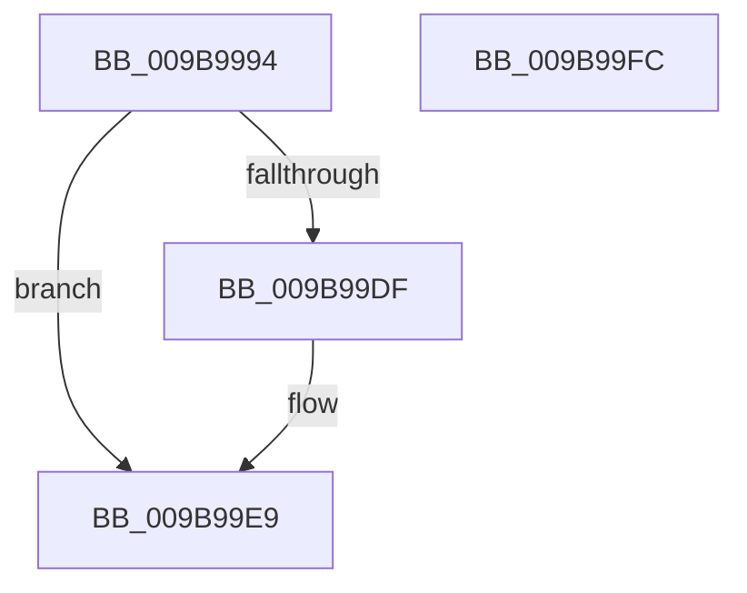

# CmpGetFileSize

- RVA: `0x009B9994`–`0x009B99FD` (길이 `105` bytes)
- VA: `0x00000001409B9994`
- 실행 섹션: `PAGE`
- PDB 이름 있음: `예`; PDB Function 태그: `아니요`
- unwind 정보 RVA: `0x0009EA50`
- 디코드: `28`개 명령, `105/105` bytes 표시
- 미해석 바이트: `0` (있으면 어셈블리에 `.byte`로 보존)

> 이 문서는 커널 이미지의 기계어와 PDB 기호를 분석해 생성했습니다. 4번과 5번은 함수 원형과 자료형을 바이너리 사용 방식에서 추정한 C 해석이며 원본 소스 복구 결과는 아닙니다.

## 1. Dependencies

- 직접 호출 지점: **2**; 고유 호출 대상: **2**
- 직접 호출자로 확인된 함수: **3**
- RIP 상대 이미지 참조: **1**

### Outgoing calls
- `0x009B99D6` → [ZwQueryInformationFile](../../text/6A/ZwQueryInformationFile_function_006AD2F0.md) (function, `0x006AD2F0`)
- `0x009B99F1` → [_security_check_cookie](../../text/6A/_security_check_cookie_function_006AC640.md) (function, `0x006AC640`)

### Direct callers
- [CmpLoadHiveThread](../7D/CmpLoadHiveThread_function_007DB040.md) at `0x007DB683`
- [CmpLoadHiveThread](../7D/CmpLoadHiveThread_function_007DB040.md) at `0x007DB6A3`
- [CmpLoadHiveThread](../7D/CmpLoadHiveThread_function_007DB040.md) at `0x007DB6F3`
- [CmpMountPreloadedHives](../7D/CmpMountPreloadedHives_function_007DBE18.md) at `0x007DC14A`
- [CmpMountPreloadedHives](../7D/CmpMountPreloadedHives_function_007DBE18.md) at `0x007DC161`
- [CmpMountPreloadedHives](../7D/CmpMountPreloadedHives_function_007DBE18.md) at `0x007DC1AE`
- [CmpInitializeActualFileSizes](CmpInitializeActualFileSizes_function_009B8900.md) at `0x009B8926`
- [CmpInitializeActualFileSizes](CmpInitializeActualFileSizes_function_009B8900.md) at `0x009B8987`
- [CmpInitializeActualFileSizes](CmpInitializeActualFileSizes_function_009B8900.md) at `0x009B89AC`
- [CmpInitializeActualFileSizes](CmpInitializeActualFileSizes_function_009B8900.md) at `0x009B89F2`

### Static image references
- `0x009B999A` → RVA `0x00E0A740` (`.data`; read)

## 2. Other-region calls and transfers

- 다른 실행 섹션으로 향하는 call: **2**
  - `0x009B99D6` → [ZwQueryInformationFile](../../text/6A/ZwQueryInformationFile_function_006AD2F0.md) (`PAGE` → `.text`)
  - `0x009B99F1` → [_security_check_cookie](../../text/6A/_security_check_cookie_function_006AC640.md) (`PAGE` → `.text`)
- 별도 외부 분기/꼬리 이동을 확인하지 못했습니다.

## 3. Assembly (complete function range)

```asm
009B9994  40 53                           push rbx
009B9996  48 83 EC 60                     sub rsp, 0x60
009B999A  48 8B 05 9F 0D 45 00            mov rax, qword ptr [rip + 0x450d9f]
009B99A1  48 33 C4                        xor rax, rsp
009B99A4  48 89 44 24 58                  mov qword ptr [rsp + 0x58], rax
009B99A9  33 C0                           xor eax, eax
009B99AB  C7 44 24 20 05 00 00 00         mov dword ptr [rsp + 0x20], 5
009B99B3  0F 57 C0                        xorps xmm0, xmm0
009B99B6  48 89 44 24 50                  mov qword ptr [rsp + 0x50], rax
009B99BB  48 8B DA                        mov rbx, rdx
009B99BE  4C 8D 44 24 40                  lea r8, [rsp + 0x40]
009B99C3  48 8D 54 24 30                  lea rdx, [rsp + 0x30]
009B99C8  44 8D 48 18                     lea r9d, [rax + 0x18]
009B99CC  0F 11 44 24 40                  movups xmmword ptr [rsp + 0x40], xmm0
009B99D1  0F 11 44 24 30                  movups xmmword ptr [rsp + 0x30], xmm0
009B99D6  E8 15 39 CF FF                  call 0x1406ad2f0
009B99DB  85 C0                           test eax, eax
009B99DD  78 0A                           js 0x1409b99e9
009B99DF  48 8B 44 24 48                  mov rax, qword ptr [rsp + 0x48]
009B99E4  48 89 03                        mov qword ptr [rbx], rax
009B99E7  33 C0                           xor eax, eax
009B99E9  48 8B 4C 24 58                  mov rcx, qword ptr [rsp + 0x58]
009B99EE  48 33 CC                        xor rcx, rsp
009B99F1  E8 4A 2C CF FF                  call 0x1406ac640
009B99F6  48 83 C4 60                     add rsp, 0x60
009B99FA  5B                              pop rbx
009B99FB  C3                              ret
009B99FC  CC                              int3
```

## 4. C-style interpretation (structured pseudocode)

```c
__int64 __fastcall CmpGetFileSize(__int64 a1, __int64 a2)
{
    __int64 result;
    __int64 v_rsp;
    unsigned __int64 v_stack_m10;
    unsigned __int64 v_stack_m18;
    unsigned __int64 v_stack_m20;
    unsigned __int64 v_stack_m28;
    unsigned __int64 v_stack_m38;
    unsigned int v_stack_m48;

    v_rsp = (v_rsp) - (96);
    result = (*(unsigned __int64 *)(v_rip + 4525471)) ^ (v_rsp);
    v_stack_m10 = result;
    result = 0;
    v_stack_m48 = 5;
    v_stack_m18 = 0;
    v_stack_m28 = v_xmm0;
    v_stack_m38 = v_xmm0;
    result = ZwQueryInformationFile(a1, v_stack_m38, v_stack_m28, result + 24);
    if (!(sign_flag)) {
        result = v_stack_m20;
        *(unsigned __int64 *)(a2) = result;
        result = 0;
    }
    a1 = (v_stack_m10) ^ (v_rsp);
    result = _security_check_cookie(a1, v_stack_m38, v_stack_m28, result + 24);
    v_rsp = (v_rsp) + (96);
    return result;
}
```

## 5. (Beta) C Style

```c
int64_t CmpGetFileSize(int64_t Arg1, void *Arg2)
{
    uint8_t *arg2 = (uint8_t *)Arg2;

    int64_t result;
    int64_t local_rsp;
    uint64_t v_stack_m10;
    uint64_t v_stack_m18;
    uint64_t v_stack_m20;
    uint64_t v_stack_m28;
    uint64_t v_stack_m38;
    uint32_t v_stack_m48;

    local_rsp = (local_rsp) - (96);
    result = (*(uint64_t *)(v_rip + 0x450D9F)) ^ (local_rsp);
    v_stack_m10 = result;
    result = 0;
    v_stack_m48 = 5;
    v_stack_m18 = 0;
    v_stack_m28 = v_xmm0;
    v_stack_m38 = v_xmm0;
    result = ZwQueryInformationFile(Arg1, v_stack_m38, v_stack_m28, result + 24);
    if (!(sign_flag)) {
        result = v_stack_m20;
        *(uint64_t *)(arg2) = result;
        result = 0;
    }
    Arg1 = (v_stack_m10) ^ (local_rsp);
    result = _security_check_cookie(Arg1, v_stack_m38, v_stack_m28, result + 24);
    local_rsp = (local_rsp) + (96);
    return result;
}
```

### 관측된 메모리 오프셋

구조체 형식이 확인되지 않은 접근은 인자 기준의 오프셋으로만 기록했습니다.

| 기준 인자 | 오프셋 표현 | 폭 (bit) | 접근 |
|---|---:|---:|---|
| `Arg2` | `+ 0x0` | `64` | `W` |

## 6. Execution-region graph

[열기: 2D/3D 그래프와 함수 탐색 컨트롤 패널](../../../control-panel.html?section=page&rva=0x009B9994&view=graph)

- 2D 그래프는 위에서 아래로 흐르고, 3D 그래프는 빈 공간을 드래그해 회전합니다. Shift+드래그는 이동, 휠은 확대·축소, 함수 노드 선택은 대상 보고서 이동입니다.

### Static fallback


