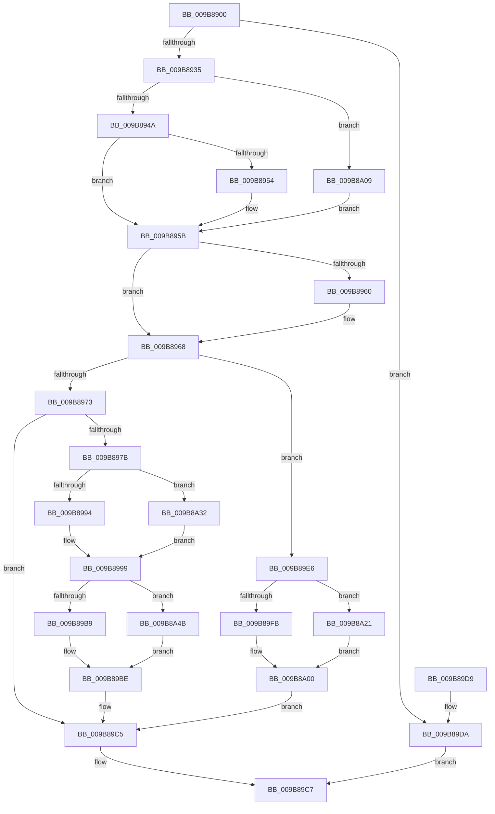

# CmpInitializeActualFileSizes

- RVA: `0x009B8900`–`0x009B8A5F` (길이 `351` bytes)
- VA: `0x00000001409B8900`
- 실행 섹션: `PAGE`
- PDB 이름 있음: `예`; PDB Function 태그: `아니요`
- unwind 정보 RVA: `0x0009E978`
- 디코드: `87`개 명령, `351/351` bytes 표시
- 미해석 바이트: `0` (있으면 어셈블리에 `.byte`로 보존)

> 이 문서는 커널 이미지의 기계어와 PDB 기호를 분석해 생성했습니다. 4번과 5번은 함수 원형과 자료형을 바이너리 사용 방식에서 추정한 C 해석이며 원본 소스 복구 결과는 아닙니다.

## 1. Dependencies

- 직접 호출 지점: **8**; 고유 호출 대상: **2**
- 직접 호출자로 확인된 함수: **1**
- RIP 상대 이미지 참조: **0**

### Outgoing calls
- `0x009B8926` → [CmpGetFileSize](CmpGetFileSize_function_009B9994.md) (function, `0x009B9994`)
- `0x009B8987` → [CmpGetFileSize](CmpGetFileSize_function_009B9994.md) (function, `0x009B9994`)
- `0x009B89AC` → [CmpGetFileSize](CmpGetFileSize_function_009B9994.md) (function, `0x009B9994`)
- `0x009B89DF` → [CmpLogFailureToGetFileSize](CmpLogFailureToGetFileSize_function_009B9F5C.md) (function, `0x009B9F5C`)
- `0x009B89F2` → [CmpGetFileSize](CmpGetFileSize_function_009B9994.md) (function, `0x009B9994`)
- `0x009B8A29` → [CmpLogFailureToGetFileSize](CmpLogFailureToGetFileSize_function_009B9F5C.md) (function, `0x009B9F5C`)
- `0x009B8A3A` → [CmpLogFailureToGetFileSize](CmpLogFailureToGetFileSize_function_009B9F5C.md) (function, `0x009B9F5C`)
- `0x009B8A53` → [CmpLogFailureToGetFileSize](CmpLogFailureToGetFileSize_function_009B9F5C.md) (function, `0x009B9F5C`)

### Direct callers
- [HvLoadHive](HvLoadHive_function_009B8138.md) at `0x009B8242`

### Static image references
- 디코드된 RIP-relative 메모리 참조가 없습니다.

## 2. Other-region calls and transfers

- 다른 실행 섹션으로 향하는 call: **0**
- 별도 외부 분기/꼬리 이동을 확인하지 못했습니다.

## 3. Assembly (complete function range)

```asm
009B8900  48 8B C4                        mov rax, rsp
009B8903  48 89 58 10                     mov qword ptr [rax + 0x10], rbx
009B8907  48 89 70 18                     mov qword ptr [rax + 0x18], rsi
009B890B  57                              push rdi
009B890C  48 83 EC 20                     sub rsp, 0x20
009B8910  48 83 60 08 00                  and qword ptr [rax + 8], 0
009B8915  48 8B F2                        mov rsi, rdx
009B8918  48 8B D9                        mov rbx, rcx
009B891B  48 8D 50 08                     lea rdx, [rax + 8]
009B891F  48 8B 89 08 06 00 00            mov rcx, qword ptr [rcx + 0x608]
009B8926  E8 69 10 00 00                  call 0x1409b9994
009B892B  8B F8                           mov edi, eax
009B892D  85 C0                           test eax, eax
009B892F  0F 88 A5 00 00 00               js 0x1409b89da
009B8935  48 8B 44 24 30                  mov rax, qword ptr [rsp + 0x30]
009B893A  48 89 83 08 07 00 00            mov qword ptr [rbx + 0x708], rax
009B8941  48 85 C0                        test rax, rax
009B8944  0F 84 BF 00 00 00               je 0x1409b8a09
009B894A  B9 00 F0 FF 7F                  mov ecx, 0x7ffff000
009B894F  48 3B C1                        cmp rax, rcx
009B8952  7E 07                           jle 0x1409b895b
009B8954  48 89 8B 08 07 00 00            mov qword ptr [rbx + 0x708], rcx
009B895B  48 85 F6                        test rsi, rsi
009B895E  74 08                           je 0x1409b8968
009B8960  8B 83 08 07 00 00               mov eax, dword ptr [rbx + 0x708]
009B8966  89 06                           mov dword ptr [rsi], eax
009B8968  8B 83 A8 00 00 00               mov eax, dword ptr [rbx + 0xa8]
009B896E  83 F8 01                        cmp eax, 1
009B8971  74 73                           je 0x1409b89e6
009B8973  83 C0 FC                        add eax, -4
009B8976  83 F8 01                        cmp eax, 1
009B8979  77 4A                           ja 0x1409b89c5
009B897B  48 8B 8B 28 06 00 00            mov rcx, qword ptr [rbx + 0x628]
009B8982  48 8D 54 24 30                  lea rdx, [rsp + 0x30]
009B8987  E8 08 10 00 00                  call 0x1409b9994
009B898C  85 C0                           test eax, eax
009B898E  0F 88 9E 00 00 00               js 0x1409b8a32
009B8994  48 8B 44 24 30                  mov rax, qword ptr [rsp + 0x30]
009B8999  48 89 83 10 07 00 00            mov qword ptr [rbx + 0x710], rax
009B89A0  48 8D 54 24 30                  lea rdx, [rsp + 0x30]
009B89A5  48 8B 8B 30 06 00 00            mov rcx, qword ptr [rbx + 0x630]
009B89AC  E8 E3 0F 00 00                  call 0x1409b9994
009B89B1  85 C0                           test eax, eax
009B89B3  0F 88 92 00 00 00               js 0x1409b8a4b
009B89B9  48 8B 44 24 30                  mov rax, qword ptr [rsp + 0x30]
009B89BE  48 89 83 18 07 00 00            mov qword ptr [rbx + 0x718], rax
009B89C5  33 FF                           xor edi, edi
009B89C7  48 8B 5C 24 38                  mov rbx, qword ptr [rsp + 0x38]
009B89CC  8B C7                           mov eax, edi
009B89CE  48 8B 74 24 40                  mov rsi, qword ptr [rsp + 0x40]
009B89D3  48 83 C4 20                     add rsp, 0x20
009B89D7  5F                              pop rdi
009B89D8  C3                              ret
009B89D9  CC                              int3
009B89DA  44 8B C0                        mov r8d, eax
009B89DD  33 D2                           xor edx, edx
009B89DF  E8 78 15 00 00                  call 0x1409b9f5c
009B89E4  EB E1                           jmp 0x1409b89c7
009B89E6  48 8B 8B 10 06 00 00            mov rcx, qword ptr [rbx + 0x610]
009B89ED  48 8D 54 24 30                  lea rdx, [rsp + 0x30]
009B89F2  E8 9D 0F 00 00                  call 0x1409b9994
009B89F7  85 C0                           test eax, eax
009B89F9  78 26                           js 0x1409b8a21
009B89FB  48 8B 44 24 30                  mov rax, qword ptr [rsp + 0x30]
009B8A00  48 89 83 10 07 00 00            mov qword ptr [rbx + 0x710], rax
009B8A07  EB BC                           jmp 0x1409b89c5
009B8A09  48 8B 43 40                     mov rax, qword ptr [rbx + 0x40]
009B8A0D  8B 40 28                        mov eax, dword ptr [rax + 0x28]
009B8A10  05 00 10 00 00                  add eax, 0x1000
009B8A15  48 89 83 08 07 00 00            mov qword ptr [rbx + 0x708], rax
009B8A1C  E9 3A FF FF FF                  jmp 0x1409b895b
009B8A21  44 8B C0                        mov r8d, eax
009B8A24  BA 01 00 00 00                  mov edx, 1
009B8A29  E8 2E 15 00 00                  call 0x1409b9f5c
009B8A2E  33 C0                           xor eax, eax
009B8A30  EB CE                           jmp 0x1409b8a00
009B8A32  44 8B C0                        mov r8d, eax
009B8A35  BA 04 00 00 00                  mov edx, 4
009B8A3A  E8 1D 15 00 00                  call 0x1409b9f5c
009B8A3F  33 C0                           xor eax, eax
009B8A41  48 89 44 24 30                  mov qword ptr [rsp + 0x30], rax
009B8A46  E9 4E FF FF FF                  jmp 0x1409b8999
009B8A4B  44 8B C0                        mov r8d, eax
009B8A4E  BA 05 00 00 00                  mov edx, 5
009B8A53  E8 04 15 00 00                  call 0x1409b9f5c
009B8A58  33 C0                           xor eax, eax
009B8A5A  E9 5F FF FF FF                  jmp 0x1409b89be
```

## 4. C-style interpretation (structured pseudocode)

```c
__int64 __fastcall CmpInitializeActualFileSizes(__int64 a1, __int64 a2)
{
    __int64 result;
    __int64 v_rdi;
    __int64 v_rsp;
    unsigned __int64 v_stack_p10;
    unsigned __int64 v_stack_p18;
    unsigned __int64 v_stack_p30;
    unsigned __int64 v_stack_p8;

    *(unsigned __int64 *)(v_rsp + 16) = v_rbx;
    *(unsigned __int64 *)(v_rsp + 24) = v_rsi;
    v_rsp = (v_rsp) - (32);
    result = CmpGetFileSize(*(unsigned __int64 *)(a1 + 1544), v_rsp + 8, a3, a4);
    if (sign_flag) goto loc_009B89DA;
    *(unsigned __int64 *)(a1 + 1800) = v_stack_p8;
    if (v_stack_p8 == 0) goto loc_009B8A09;
    if (v_stack_p8 >= = ((unsigned int)(0x7FFFF000ULL))) {
        *(unsigned __int64 *)(a1 + 1800) = (unsigned int)(0x7FFFF000ULL);
    }
    result = v_stack_p8;
    if (a2 != 0) {
        result = *(unsigned int *)(a1 + 1800);
        *(unsigned int *)(a2) = (unsigned int)(result);
    }
    if (((unsigned int)((unsigned int)(*(unsigned int *)(a1 + 168)))) == 1) goto loc_009B89E6;
    result = (unsigned int)(((unsigned int)(*(unsigned int *)(a1 + 168))) + (-4));
    if (((unsigned int)(result)) > 1) goto loc_009B89C5;
    result = CmpGetFileSize(*(unsigned __int64 *)(a1 + 1576), v_stack_p8, a3, a4);
    if (sign_flag) goto loc_009B8A32;
loc_009B8999:
    *(unsigned __int64 *)(a1 + 1808) = v_stack_p8;
    result = CmpGetFileSize(*(unsigned __int64 *)(a1 + 1584), v_stack_p8, a3, a4);
    if (sign_flag) goto loc_009B8A4B;
loc_009B89BE:
    *(unsigned __int64 *)(a1 + 1816) = v_stack_p8;
loc_009B89C5:
    v_rdi = 0;
loc_009B89C7:
    v_rsp = (v_rsp) + (32);
    return 0;
loc_009B89DA:
    a2 = 0;
    result = CmpLogFailureToGetFileSize(*(unsigned __int64 *)(a1 + 1584), a2, 0, a4);
    goto loc_009B89C7;
loc_009B89E6:
    result = CmpGetFileSize(*(unsigned __int64 *)(v_stack_p10 + 1552), v_stack_p30, 0, a4);
    if (sign_flag) goto loc_009B8A21;
loc_009B8A00:
    *(unsigned __int64 *)(v_stack_p10 + 1808) = v_stack_p30;
    goto loc_009B89C5;
loc_009B8A09:
    result = (unsigned int)(((unsigned int)(*(unsigned int *)(*(unsigned __int64 *)(v_stack_p10 + 64) + 40))) + (0x1000ULL));
    *(unsigned __int64 *)(v_stack_p10 + 1800) = result;
    goto loc_009B895B;
loc_009B8A21:
    result = CmpLogFailureToGetFileSize(*(unsigned __int64 *)(v_stack_p10 + 1552), 1, (unsigned int)((unsigned int)(result)), a4);
    result = 0;
    goto loc_009B8A00;
loc_009B8A32:
    result = CmpLogFailureToGetFileSize(*(unsigned __int64 *)(v_stack_p10 + 1552), 4, 0, a4);
    result = 0;
    v_stack_p30 = 0;
    goto loc_009B8999;
loc_009B8A4B:
    result = CmpLogFailureToGetFileSize(*(unsigned __int64 *)(v_stack_p10 + 1552), 5, 0, a4);
    result = 0;
    goto loc_009B89BE;
}
```

## 5. (Beta) C Style

```c
int64_t CmpInitializeActualFileSizes(void *Arg1, int64_t Arg2)
{
    uint8_t *arg1 = (uint8_t *)Arg1;

    int64_t result;
    int64_t local_rdi;
    int64_t local_rsp;
    uint64_t v_stack_p10;
    uint64_t v_stack_p18;
    uint64_t v_stack_p30;
    uint64_t v_stack_p8;

    *(uint64_t *)(local_rsp + 0x10) = local_rbx;
    *(uint64_t *)(local_rsp + 0x18) = local_rsi;
    local_rsp = (local_rsp) - (32);
    result = CmpGetFileSize(*(uint64_t *)(arg1 + 0x608), local_rsp + 8, a3, a4);
    if (sign_flag) goto loc_009B89DA;
    *(uint64_t *)(arg1 + 0x708) = v_stack_p8;
    if (v_stack_p8 == 0) goto loc_009B8A09;
    if (v_stack_p8 >= = ((uint32_t)(0x7FFFF000ULL))) {
        *(uint64_t *)(arg1 + 0x708) = (uint32_t)(0x7FFFF000ULL);
    }
    result = v_stack_p8;
    if (Arg2 != 0) {
        result = *(uint32_t *)(arg1 + 0x708);
        *(uint32_t *)(Arg2) = (uint32_t)(result);
    }
    if (((uint32_t)((uint32_t)(*(uint32_t *)(arg1 + 0xA8)))) == 1) goto loc_009B89E6;
    result = (uint32_t)(((uint32_t)(*(uint32_t *)(arg1 + 0xA8))) + (-4));
    if (((uint32_t)(result)) > 1) goto loc_009B89C5;
    result = CmpGetFileSize(*(uint64_t *)(arg1 + 0x628), v_stack_p8, a3, a4);
    if (sign_flag) goto loc_009B8A32;
loc_009B8999:
    *(uint64_t *)(arg1 + 0x710) = v_stack_p8;
    result = CmpGetFileSize(*(uint64_t *)(arg1 + 0x630), v_stack_p8, a3, a4);
    if (sign_flag) goto loc_009B8A4B;
loc_009B89BE:
    *(uint64_t *)(arg1 + 0x718) = v_stack_p8;
loc_009B89C5:
    local_rdi = 0;
loc_009B89C7:
    local_rsp = (local_rsp) + (32);
    return 0;
loc_009B89DA:
    Arg2 = 0;
    result = CmpLogFailureToGetFileSize(*(uint64_t *)(arg1 + 0x630), Arg2, 0, a4);
    goto loc_009B89C7;
loc_009B89E6:
    result = CmpGetFileSize(*(uint64_t *)(v_stack_p10 + 0x610), v_stack_p30, 0, a4);
    if (sign_flag) goto loc_009B8A21;
loc_009B8A00:
    *(uint64_t *)(v_stack_p10 + 0x710) = v_stack_p30;
    goto loc_009B89C5;
loc_009B8A09:
    result = (uint32_t)(((uint32_t)(*(uint32_t *)(*(uint64_t *)(v_stack_p10 + 0x40) + 0x28))) + (0x1000ULL));
    *(uint64_t *)(v_stack_p10 + 0x708) = result;
    goto loc_009B895B;
loc_009B8A21:
    result = CmpLogFailureToGetFileSize(*(uint64_t *)(v_stack_p10 + 0x610), 1, (uint32_t)((uint32_t)(result)), a4);
    result = 0;
    goto loc_009B8A00;
loc_009B8A32:
    result = CmpLogFailureToGetFileSize(*(uint64_t *)(v_stack_p10 + 0x610), 4, 0, a4);
    result = 0;
    v_stack_p30 = 0;
    goto loc_009B8999;
loc_009B8A4B:
    result = CmpLogFailureToGetFileSize(*(uint64_t *)(v_stack_p10 + 0x610), 5, 0, a4);
    result = 0;
    goto loc_009B89BE;
}
```

### 관측된 메모리 오프셋

구조체 형식이 확인되지 않은 접근은 인자 기준의 오프셋으로만 기록했습니다.

| 기준 인자 | 오프셋 표현 | 폭 (bit) | 접근 |
|---|---:|---:|---|
| `Arg1` | `+ 0x40` | `64` | `R` |
| `Arg1` | `+ 0xA8` | `32` | `R` |
| `Arg1` | `+ 0x608` | `64` | `R` |
| `Arg1` | `+ 0x610` | `64` | `R` |
| `Arg1` | `+ 0x628` | `64` | `R` |
| `Arg1` | `+ 0x630` | `64` | `R` |
| `Arg1` | `+ 0x708` | `32` | `R` |
| `Arg1` | `+ 0x708` | `64` | `W` |
| `Arg1` | `+ 0x710` | `64` | `W` |
| `Arg1` | `+ 0x718` | `64` | `W` |

## 6. Execution-region graph

[열기: 2D/3D 그래프와 함수 탐색 컨트롤 패널](../../../control-panel.html?section=page&rva=0x009B8900&view=graph)

- 2D 그래프는 위에서 아래로 흐르고, 3D 그래프는 빈 공간을 드래그해 회전합니다. Shift+드래그는 이동, 휠은 확대·축소, 함수 노드 선택은 대상 보고서 이동입니다.

### Static fallback


