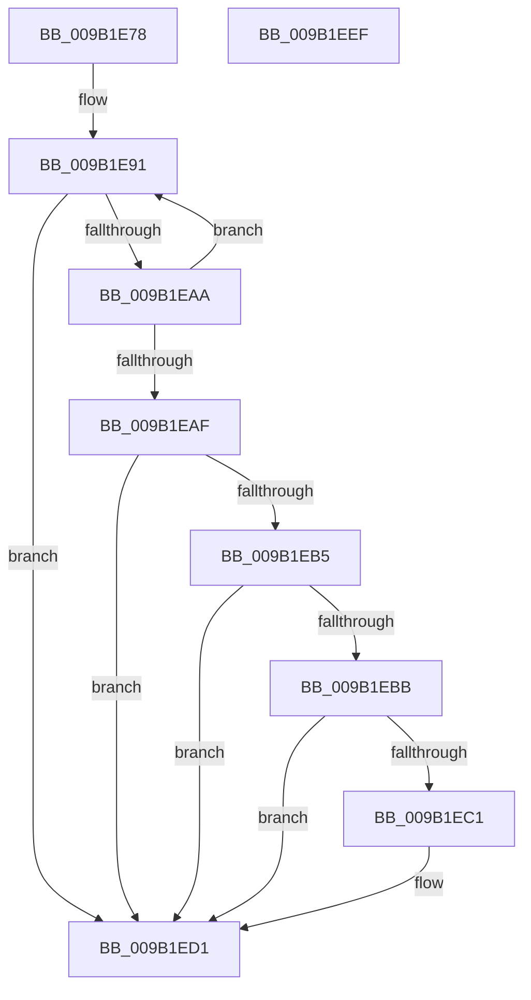

# CmpIsCmRm

- RVA: `0x009B1E78`–`0x009B1EF0` (길이 `120` bytes)
- VA: `0x00000001409B1E78`
- 실행 섹션: `PAGE`
- PDB 이름 있음: `예`; PDB Function 태그: `아니요`
- unwind 정보 RVA: `0x0005CAAC`
- 디코드: `35`개 명령, `120/120` bytes 표시
- 미해석 바이트: `0` (있으면 어셈블리에 `.byte`로 보존)

> 이 문서는 커널 이미지의 기계어와 PDB 기호를 분석해 생성했습니다. 4번과 5번은 함수 원형과 자료형을 바이너리 사용 방식에서 추정한 C 해석이며 원본 소스 복구 결과는 아닙니다.

## 1. Dependencies

- 직접 호출 지점: **4**; 고유 호출 대상: **4**
- 직접 호출자로 확인된 함수: **1**
- RIP 상대 이미지 참조: **2**

### Outgoing calls
- `0x009B1E8C` → [LOCK_CM_RM_LIST](LOCK_CM_RM_LIST_function_009B1490.md) (function, `0x009B1490`)
- `0x009B1EA0` → [CmListGetNextElement](../../pagecmrc/BC/CmListGetNextElement_function_00BC9940.md) (function, `0x00BC9940`)
- `0x009B1ED8` → [ExReleaseFastMutexUnsafe](../../text/25/ExReleaseFastMutexUnsafe_function_002503A0.md) (function, `0x002503A0`)
- `0x009B1EDD` → [KeLeaveCriticalRegion](../../text/25/KeLeaveCriticalRegion_function_0025D8B0.md) (function, `0x0025D8B0`)

### Direct callers
- [CmKtmNotification](CmKtmNotification_function_009B1950.md) at `0x009B19D2`
- [CmKtmNotification](CmKtmNotification_function_009B1950.md) at `0x009B1A7E`

### Static image references
- `0x009B1E99` → RVA `0x00EF56B0` (`.data`; read)
- `0x009B1ED1` → RVA `0x00EF5660` (`.data`; read)

## 2. Other-region calls and transfers

- 다른 실행 섹션으로 향하는 call: **3**
  - `0x009B1EA0` → [CmListGetNextElement](../../pagecmrc/BC/CmListGetNextElement_function_00BC9940.md) (`PAGE` → `PAGECMRC`)
  - `0x009B1ED8` → [ExReleaseFastMutexUnsafe](../../text/25/ExReleaseFastMutexUnsafe_function_002503A0.md) (`PAGE` → `.text`)
  - `0x009B1EDD` → [KeLeaveCriticalRegion](../../text/25/KeLeaveCriticalRegion_function_0025D8B0.md) (`PAGE` → `.text`)
- 별도 외부 분기/꼬리 이동을 확인하지 못했습니다.

## 3. Assembly (complete function range)

```asm
009B1E78  48 89 5C 24 08                  mov qword ptr [rsp + 8], rbx
009B1E7D  57                              push rdi
009B1E7E  48 83 EC 20                     sub rsp, 0x20
009B1E82  33 DB                           xor ebx, ebx
009B1E84  48 8B F9                        mov rdi, rcx
009B1E87  48 89 5C 24 38                  mov qword ptr [rsp + 0x38], rbx
009B1E8C  E8 FF F5 FF FF                  call 0x1409b1490
009B1E91  45 33 C0                        xor r8d, r8d
009B1E94  48 8D 54 24 38                  lea rdx, [rsp + 0x38]
009B1E99  48 8D 0D 10 38 54 00            lea rcx, [rip + 0x543810]
009B1EA0  E8 9B 7A 21 00                  call 0x140bc9940
009B1EA5  48 85 C0                        test rax, rax
009B1EA8  74 27                           je 0x1409b1ed1
009B1EAA  48 3B C7                        cmp rax, rdi
009B1EAD  75 E2                           jne 0x1409b1e91
009B1EAF  48 39 5F 30                     cmp qword ptr [rdi + 0x30], rbx
009B1EB3  74 1C                           je 0x1409b1ed1
009B1EB5  48 39 5F 38                     cmp qword ptr [rdi + 0x38], rbx
009B1EB9  74 16                           je 0x1409b1ed1
009B1EBB  48 39 5F 20                     cmp qword ptr [rdi + 0x20], rbx
009B1EBF  74 10                           je 0x1409b1ed1
009B1EC1  48 39 5F 28                     cmp qword ptr [rdi + 0x28], rbx
009B1EC5  41 8D 48 01                     lea ecx, [r8 + 1]
009B1EC9  0F B6 C3                        movzx eax, bl
009B1ECC  0F 45 C1                        cmovne eax, ecx
009B1ECF  8A D8                           mov bl, al
009B1ED1  48 8D 0D 88 37 54 00            lea rcx, [rip + 0x543788]
009B1ED8  E8 C3 E4 89 FF                  call 0x1402503a0
009B1EDD  E8 CE B9 8A FF                  call 0x14025d8b0
009B1EE2  8A C3                           mov al, bl
009B1EE4  48 8B 5C 24 30                  mov rbx, qword ptr [rsp + 0x30]
009B1EE9  48 83 C4 20                     add rsp, 0x20
009B1EED  5F                              pop rdi
009B1EEE  C3                              ret
009B1EEF  CC                              int3
```

## 4. C-style interpretation (structured pseudocode)

```c
__int64 __fastcall CmpIsCmRm(__int64 a1, __int64 a2, int a3)
{
    __int64 result;
    __int64 v_rbx;
    __int64 v_rsp;
    unsigned __int64 v_stack_p10;
    unsigned __int64 v_stack_p8;

    v_stack_p8 = v_rbx;
    v_rsp = (v_rsp) - (32);
    v_rbx = 0;
    v_stack_p10 = 0;
    result = LOCK_CM_RM_LIST(a1, a2, a3, a4);
loc_009B1E91:
    a3 = 0;
    result = CmListGetNextElement(v_rip + 5519376, v_stack_p10, a3, a4);
    if (result == 0) goto loc_009B1ED1;
    if (result != a1) goto loc_009B1E91;
    if ((*(unsigned __int64 *)(a1 + 48)) == 0) goto loc_009B1ED1;
    if ((*(unsigned __int64 *)(a1 + 56)) == 0) goto loc_009B1ED1;
    if ((*(unsigned __int64 *)(a1 + 32)) != 0) {
        a1 = a3 + 1;
        result = 0;
        if ((*(unsigned __int64 *)(a1 + 40)) != 0) { result = (unsigned int)(a1); }
        v_rbx = (unsigned __int8)(result);
    }
    result = ExReleaseFastMutexUnsafe(v_rip + 5519240, v_stack_p10, a3, a4);
    result = KeLeaveCriticalRegion(v_rip + 5519240, v_stack_p10, a3, a4);
    v_rsp = (v_rsp) + (32);
    return (unsigned __int8)(v_rbx);
}
```

## 5. (Beta) C Style

```c
int64_t CmpIsCmRm(void *Arg1, int64_t Arg2, int32_t Arg3)
{
    uint8_t *arg1 = (uint8_t *)Arg1;

    int64_t result;
    int64_t local_rbx;
    int64_t local_rsp;
    uint64_t v_stack_p10;
    uint64_t v_stack_p8;

    v_stack_p8 = local_rbx;
    local_rsp = (local_rsp) - (32);
    local_rbx = 0;
    v_stack_p10 = 0;
    result = LOCK_CM_RM_LIST(Arg1, Arg2, Arg3, a4);
loc_009B1E91:
    Arg3 = 0;
    result = CmListGetNextElement(v_rip + 5519376, v_stack_p10, Arg3, a4);
    if (result == 0) goto loc_009B1ED1;
    if (result != Arg1) goto loc_009B1E91;
    if ((*(uint64_t *)(arg1 + 0x30)) == 0) goto loc_009B1ED1;
    if ((*(uint64_t *)(arg1 + 0x38)) == 0) goto loc_009B1ED1;
    if ((*(uint64_t *)(arg1 + 0x20)) != 0) {
        Arg1 = Arg3 + 1;
        result = 0;
        if ((*(uint64_t *)(arg1 + 0x28)) != 0) { result = (uint32_t)(Arg1); }
        local_rbx = (uint8_t)(result);
    }
    result = ExReleaseFastMutexUnsafe(v_rip + 5519240, v_stack_p10, Arg3, a4);
    result = KeLeaveCriticalRegion(v_rip + 5519240, v_stack_p10, Arg3, a4);
    local_rsp = (local_rsp) + (32);
    return (uint8_t)(local_rbx);
}
```

### 관측된 메모리 오프셋

구조체 형식이 확인되지 않은 접근은 인자 기준의 오프셋으로만 기록했습니다.

| 기준 인자 | 오프셋 표현 | 폭 (bit) | 접근 |
|---|---:|---:|---|
| `Arg1` | `+ 0x20` | `64` | `R` |
| `Arg1` | `+ 0x28` | `64` | `R` |
| `Arg1` | `+ 0x30` | `64` | `R` |
| `Arg1` | `+ 0x38` | `64` | `R` |

## 6. Execution-region graph

[열기: 2D/3D 그래프와 함수 탐색 컨트롤 패널](../../../control-panel.html?section=page&rva=0x009B1E78&view=graph)

- 2D 그래프는 위에서 아래로 흐르고, 3D 그래프는 빈 공간을 드래그해 회전합니다. Shift+드래그는 이동, 휠은 확대·축소, 함수 노드 선택은 대상 보고서 이동입니다.

### Static fallback


