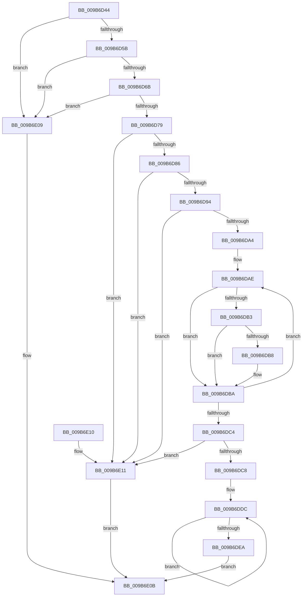

# CmpIsHiveEligibleForLazyReconcile

- RVA: `0x009B6D44`–`0x009B6E15` (길이 `209` bytes)
- VA: `0x00000001409B6D44`
- 실행 섹션: `PAGE`
- PDB 이름 있음: `예`; PDB Function 태그: `아니요`
- unwind 정보 RVA: `0x00069B1C`
- 디코드: `52`개 명령, `209/209` bytes 표시
- 미해석 바이트: `0` (있으면 어셈블리에 `.byte`로 보존)

> 이 문서는 커널 이미지의 기계어와 PDB 기호를 분석해 생성했습니다. 4번과 5번은 함수 원형과 자료형을 바이너리 사용 방식에서 추정한 C 해석이며 원본 소스 복구 결과는 아닙니다.

## 1. Dependencies

- 직접 호출 지점: **1**; 고유 호출 대상: **1**
- 직접 호출자로 확인된 함수: **1**
- RIP 상대 이미지 참조: **3**

### Outgoing calls
- `0x009B6D86` → [HvGetEffectiveLogSizeCapForHive](HvGetEffectiveLogSizeCapForHive_function_009B6408.md) (function, `0x009B6408`)

### Direct callers
- [CmpDoReconcileNextHive](CmpDoReconcileNextHive_function_009B6BE0.md) at `0x009B6C60`

### Static image references
- `0x009B6D6B` → RVA `0x00E0ECC0` (`.data`; read)
- `0x009B6D79` → RVA `0x00EF5718` (`.data`; read)
- `0x009B6DEA` → RVA `0x00E03880` (`.data`; read)

## 2. Other-region calls and transfers

- 다른 실행 섹션으로 향하는 call: **0**
- 별도 외부 분기/꼬리 이동을 확인하지 못했습니다.

## 3. Assembly (complete function range)

```asm
009B6D44  48 83 EC 28                     sub rsp, 0x28
009B6D48  F7 81 A0 00 00 00 01 80 00 00   test dword ptr [rcx + 0xa0], 0x8001
009B6D52  4C 8B D1                        mov r10, rcx
009B6D55  0F 85 AE 00 00 00               jne 0x1409b6e09
009B6D5B  45 33 DB                        xor r11d, r11d
009B6D5E  44 39 99 80 00 00 00            cmp dword ptr [rcx + 0x80], r11d
009B6D65  0F 84 9E 00 00 00               je 0x1409b6e09
009B6D6B  8B 05 4F 7F 45 00               mov eax, dword ptr [rip + 0x457f4f]
009B6D71  85 C0                           test eax, eax
009B6D73  0F 85 90 00 00 00               jne 0x1409b6e09
009B6D79  44 38 1D 98 E9 53 00            cmp byte ptr [rip + 0x53e998], r11b
009B6D80  0F 84 8B 00 00 00               je 0x1409b6e11
009B6D86  E8 7D F6 FF FF                  call 0x1409b6408
009B6D8B  41 39 82 B4 00 00 00            cmp dword ptr [r10 + 0xb4], eax
009B6D92  73 7D                           jae 0x1409b6e11
009B6D94  45 8B 82 A8 00 00 00            mov r8d, dword ptr [r10 + 0xa8]
009B6D9B  41 8B CB                        mov ecx, r11d
009B6D9E  41 83 F8 01                     cmp r8d, 1
009B6DA2  74 6D                           je 0x1409b6e11
009B6DA4  41 8B C3                        mov eax, r11d
009B6DA7  49 8D 92 C0 00 00 00            lea rdx, [r10 + 0xc0]
009B6DAE  41 3B C0                        cmp eax, r8d
009B6DB1  74 07                           je 0x1409b6dba
009B6DB3  44 38 1A                        cmp byte ptr [rdx], r11b
009B6DB6  75 02                           jne 0x1409b6dba
009B6DB8  FF C1                           inc ecx
009B6DBA  FF C0                           inc eax
009B6DBC  48 FF C2                        inc rdx
009B6DBF  83 F8 02                        cmp eax, 2
009B6DC2  72 EA                           jb 0x1409b6dae
009B6DC4  85 C9                           test ecx, ecx
009B6DC6  74 49                           je 0x1409b6e11
009B6DC8  48 B9 B0 03 00 00 80 F7 FF FF   movabs rcx, 0xfffff780000003b0
009B6DD2  49 B9 08 00 00 00 80 F7 FF FF   movabs r9, 0xfffff78000000008
009B6DDC  4C 8B 01                        mov r8, qword ptr [rcx]
009B6DDF  49 8B 11                        mov rdx, qword ptr [r9]
009B6DE2  48 8B 01                        mov rax, qword ptr [rcx]
009B6DE5  4C 3B C0                        cmp r8, rax
009B6DE8  75 F2                           jne 0x1409b6ddc
009B6DEA  8B 05 90 CA 44 00               mov eax, dword ptr [rip + 0x44ca90]
009B6DF0  49 2B D0                        sub rdx, r8
009B6DF3  48 69 C8 80 96 98 00            imul rcx, rax, 0x989680
009B6DFA  49 03 8A 30 10 00 00            add rcx, qword ptr [r10 + 0x1030]
009B6E01  48 3B D1                        cmp rdx, rcx
009B6E04  0F 93 C0                        setae al
009B6E07  EB 02                           jmp 0x1409b6e0b
009B6E09  32 C0                           xor al, al
009B6E0B  48 83 C4 28                     add rsp, 0x28
009B6E0F  C3                              ret
009B6E10  CC                              int3
009B6E11  B0 01                           mov al, 1
009B6E13  EB F6                           jmp 0x1409b6e0b
```

## 4. C-style interpretation (structured pseudocode)

```c
__int64 __fastcall CmpIsHiveEligibleForLazyReconcile(__int64 a1)
{
    __int64 result;
    __int64 v_r11;
    __int64 v_rsp;

    v_rsp = (v_rsp) - (40);
    if (((*(unsigned int *)(a1 + 160)) & (0x8001ULL)) != 0) goto loc_009B6E09;
    v_r11 = 0;
    if ((*(unsigned int *)(a1 + 128)) == 0) goto loc_009B6E09;
    if ((unsigned int)((unsigned int)(*(unsigned int *)(v_rip + 4554575))) != 0) goto loc_009B6E09;
    if ((*(unsigned __int8 *)(v_rip + 5499288)) == 0) goto loc_009B6E11;
    result = HvGetEffectiveLogSizeCapForHive(a1, a2, a3, a4);
    if ((*(unsigned int *)(a1 + 180)) >= ((unsigned int)(result))) goto loc_009B6E11;
    if (((unsigned int)((unsigned int)(*(unsigned int *)(a1 + 168)))) == 1) goto loc_009B6E11;
loc_009B6DAE:
    if (0 == ((unsigned int)((unsigned int)(*(unsigned int *)(a1 + 168))))) goto loc_009B6DBA;
    if ((*(unsigned __int8 *)(a1 + 192)) == 0) {
        a1 = (unsigned int)((0) + 1);
    }
    result = (unsigned int)((0) + 1);
    a2 = (a1 + 192) + 1;
    if (((unsigned int)(result)) < 2) goto loc_009B6DAE;
    if ((unsigned int)(a1) == 0) goto loc_009B6E11;
loc_009B6DDC:
    if ((*(unsigned __int64 *)(a1)) != (*(unsigned __int64 *)(a1))) goto loc_009B6DDC;
    a2 = (*(unsigned __int64 *)(a4)) - (*(unsigned __int64 *)(a1));
    a1 = (a1) * ((unsigned int)(*(unsigned int *)(v_rip + 4508304)));
    a1 = (a1) + (*(unsigned __int64 *)(a1 + 4144));
    result = (a2 >= a1) ? 1 : 0;
    goto loc_009B6E0B;
loc_009B6E09:
    result = 0;
loc_009B6E0B:
    v_rsp = (v_rsp) + (40);
    return result;
loc_009B6E11:
    goto loc_009B6E0B;
}
```

## 5. (Beta) C Style

```c
int64_t CmpIsHiveEligibleForLazyReconcile(void *Arg1)
{
    uint8_t *arg1 = (uint8_t *)Arg1;

    int64_t result;
    int64_t local_r11;
    int64_t local_rsp;

    local_rsp = (local_rsp) - (40);
    if (((*(uint32_t *)(arg1 + 0xA0)) & (0x8001ULL)) != 0) goto loc_009B6E09;
    local_r11 = 0;
    if ((*(uint32_t *)(arg1 + 0x80)) == 0) goto loc_009B6E09;
    if ((uint32_t)((uint32_t)(*(uint32_t *)(v_rip + 0x457F4F))) != 0) goto loc_009B6E09;
    if ((*(uint8_t *)(v_rip + 0x53E998)) == 0) goto loc_009B6E11;
    result = HvGetEffectiveLogSizeCapForHive(Arg1, a2, a3, a4);
    if ((*(uint32_t *)(arg1 + 0xB4)) >= ((uint32_t)(result))) goto loc_009B6E11;
    if (((uint32_t)((uint32_t)(*(uint32_t *)(arg1 + 0xA8)))) == 1) goto loc_009B6E11;
loc_009B6DAE:
    if (0 == ((uint32_t)((uint32_t)(*(uint32_t *)(arg1 + 0xA8))))) goto loc_009B6DBA;
    if ((*(uint8_t *)(arg1 + 0xC0)) == 0) {
        Arg1 = (uint32_t)((0) + 1);
    }
    result = (uint32_t)((0) + 1);
    a2 = (Arg1 + 192) + 1;
    if (((uint32_t)(result)) < 2) goto loc_009B6DAE;
    if ((uint32_t)(Arg1) == 0) goto loc_009B6E11;
loc_009B6DDC:
    if ((*(uint64_t *)(arg1)) != (*(uint64_t *)(arg1))) goto loc_009B6DDC;
    a2 = (*(uint64_t *)(a4)) - (*(uint64_t *)(arg1));
    Arg1 = (Arg1) * ((uint32_t)(*(uint32_t *)(v_rip + 0x44CA90)));
    Arg1 = (Arg1) + (*(uint64_t *)(arg1 + 0x1030));
    result = (a2 >= Arg1) ? 1 : 0;
    goto loc_009B6E0B;
loc_009B6E09:
    result = 0;
loc_009B6E0B:
    local_rsp = (local_rsp) + (40);
    return result;
loc_009B6E11:
    goto loc_009B6E0B;
}
```

### 관측된 메모리 오프셋

구조체 형식이 확인되지 않은 접근은 인자 기준의 오프셋으로만 기록했습니다.

| 기준 인자 | 오프셋 표현 | 폭 (bit) | 접근 |
|---|---:|---:|---|
| `Arg1` | `+ 0x80` | `32` | `R` |
| `Arg1` | `+ 0xA0` | `32` | `R` |

## 6. Execution-region graph

[열기: 2D/3D 그래프와 함수 탐색 컨트롤 패널](../../../control-panel.html?section=page&rva=0x009B6D44&view=graph)

- 2D 그래프는 위에서 아래로 흐르고, 3D 그래프는 빈 공간을 드래그해 회전합니다. Shift+드래그는 이동, 휠은 확대·축소, 함수 노드 선택은 대상 보고서 이동입니다.

### Static fallback


