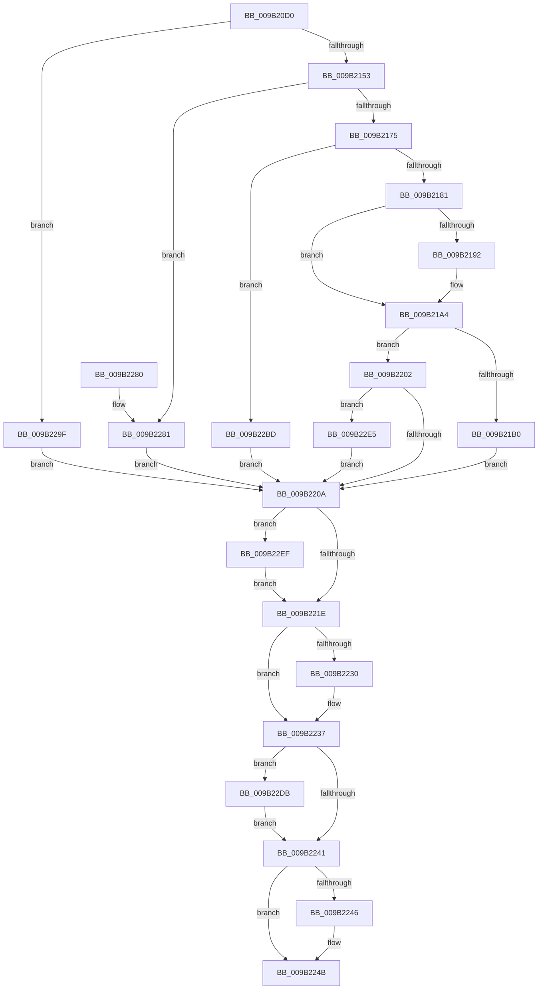

# CmpLateUnloadHiveWorker

- RVA: `0x009B20D0`–`0x009B22F9` (길이 `553` bytes)
- VA: `0x00000001409B20D0`
- 실행 섹션: `PAGE`
- PDB 이름 있음: `예`; PDB Function 태그: `아니요`
- unwind 정보 RVA: `0x0009E354`
- 디코드: `123`개 명령, `553/553` bytes 표시
- 미해석 바이트: `0` (있으면 어셈블리에 `.byte`로 보존)

> 이 문서는 커널 이미지의 기계어와 PDB 기호를 분석해 생성했습니다. 4번과 5번은 함수 원형과 자료형을 바이너리 사용 방식에서 추정한 C 해석이며 원본 소스 복구 결과는 아닙니다.

## 1. Dependencies

- 직접 호출 지점: **19**; 고유 호출 대상: **18**
- 직접 호출자로 확인된 함수: **0**
- RIP 상대 이미지 참조: **3**

### Outgoing calls
- `0x009B2119` → [CmpInitializeThreadInfo](../../text/3F/CmpInitializeThreadInfo_function_003FBE70.md) (function, `0x003FBE70`)
- `0x009B2143` → [CmpAcquireHiveLoadUnloadRundown](../../pagecmrc/BC/CmpAcquireHiveLoadUnloadRundown_function_00BC9C6C.md) (function, `0x00BC9C6C`)
- `0x009B2153` → [LOCK_HIVE_LOAD](LOCK_HIVE_LOAD_function_009B2300.md) (function, `0x009B2300`)
- `0x009B215B` → [CmpLockRegistryFreezeAware](CmpLockRegistryFreezeAware_function_009B4AE4.md) (function, `0x009B4AE4`)
- `0x009B21A7` → [CmpTryToRundownHive](../../text/2A/CmpTryToRundownHive_function_002A4A60.md) (function, `0x002A4A60`)
- `0x009B21D4` → [CmpAttachToRegistryProcess](../../pagecmrc/BC/CmpAttachToRegistryProcess_function_00BC98E0.md) (function, `0x00BC98E0`)
- `0x009B21E0` → [CmpCompleteUnloadKey](CmpCompleteUnloadKey_function_009B32FC.md) (function, `0x009B32FC`)
- `0x009B21E9` → [CmpDetachFromRegistryProcess](../../pagecmrc/BC/CmpDetachFromRegistryProcess_function_00BC9920.md) (function, `0x00BC9920`)
- `0x009B21EE` → [CmpLockRegistry](../../pagecmrc/BC/CmpLockRegistry_function_00BC9B34.md) (function, `0x00BC9B34`)
- `0x009B21F6` → [CmpDereferenceKeyControlBlock](../85/CmpDereferenceKeyControlBlock_function_00851310.md) (function, `0x00851310`)
- `0x009B21FB` → [CmpUnlockRegistry](../../pagecmrc/BC/CmpUnlockRegistry_function_00BC9A84.md) (function, `0x00BC9A84`)
- `0x009B2232` → [ExfUnblockPushLock](../../text/2A/ExfUnblockPushLock_function_002A3FE0.md) (function, `0x002A3FE0`)
- `0x009B2246` → [CmpReleaseHiveLoadUnloadRundown](../../pagecmrc/BC/CmpReleaseHiveLoadUnloadRundown_function_00BC9CAC.md) (function, `0x00BC9CAC`)
- `0x009B224E` → [CmpDereferenceHive](../86/CmpDereferenceHive_function_008632B0.md) (function, `0x008632B0`)
- `0x009B2257` → [CmCleanupThreadInfo](../../text/41/CmCleanupThreadInfo_function_0041FD50.md) (function, `0x0041FD50`)
- `0x009B2263` → [_security_check_cookie](../../text/6A/_security_check_cookie_function_006AC640.md) (function, `0x006AC640`)
- `0x009B22DB` → [UNLOCK_HIVE_LOAD](UNLOCK_HIVE_LOAD_function_009B2EBC.md) (function, `0x009B2EBC`)
- `0x009B22E5` → [CmpDecrementAppHiveUnloadCount](../../text/2A/CmpDecrementAppHiveUnloadCount_function_002A5A38.md) (function, `0x002A5A38`)
- `0x009B22EF` → [CmpUnlockRegistry](../../pagecmrc/BC/CmpUnlockRegistry_function_00BC9A84.md) (function, `0x00BC9A84`)

### Direct callers
- 이 함수 시작 RVA로 연결되는 직접 call은 확인되지 않았습니다. 간접 호출은 완전히 역산할 수 없습니다.

### Static image references
- `0x009B20E8` → RVA `0x00E0A740` (`.data`; read)
- `0x009B2192` → RVA `0x00EF59A8` (`.data`; read)
- `0x009B219E` → RVA `0x00EF59A8` (`.data`; write)

## 2. Other-region calls and transfers

- 다른 실행 섹션으로 향하는 call: **13**
  - `0x009B2119` → [CmpInitializeThreadInfo](../../text/3F/CmpInitializeThreadInfo_function_003FBE70.md) (`PAGE` → `.text`)
  - `0x009B2143` → [CmpAcquireHiveLoadUnloadRundown](../../pagecmrc/BC/CmpAcquireHiveLoadUnloadRundown_function_00BC9C6C.md) (`PAGE` → `PAGECMRC`)
  - `0x009B21A7` → [CmpTryToRundownHive](../../text/2A/CmpTryToRundownHive_function_002A4A60.md) (`PAGE` → `.text`)
  - `0x009B21D4` → [CmpAttachToRegistryProcess](../../pagecmrc/BC/CmpAttachToRegistryProcess_function_00BC98E0.md) (`PAGE` → `PAGECMRC`)
  - `0x009B21E9` → [CmpDetachFromRegistryProcess](../../pagecmrc/BC/CmpDetachFromRegistryProcess_function_00BC9920.md) (`PAGE` → `PAGECMRC`)
  - `0x009B21EE` → [CmpLockRegistry](../../pagecmrc/BC/CmpLockRegistry_function_00BC9B34.md) (`PAGE` → `PAGECMRC`)
  - `0x009B21FB` → [CmpUnlockRegistry](../../pagecmrc/BC/CmpUnlockRegistry_function_00BC9A84.md) (`PAGE` → `PAGECMRC`)
  - `0x009B2232` → [ExfUnblockPushLock](../../text/2A/ExfUnblockPushLock_function_002A3FE0.md) (`PAGE` → `.text`)
  - `0x009B2246` → [CmpReleaseHiveLoadUnloadRundown](../../pagecmrc/BC/CmpReleaseHiveLoadUnloadRundown_function_00BC9CAC.md) (`PAGE` → `PAGECMRC`)
  - `0x009B2257` → [CmCleanupThreadInfo](../../text/41/CmCleanupThreadInfo_function_0041FD50.md) (`PAGE` → `.text`)
  - `0x009B2263` → [_security_check_cookie](../../text/6A/_security_check_cookie_function_006AC640.md) (`PAGE` → `.text`)
  - `0x009B22E5` → [CmpDecrementAppHiveUnloadCount](../../text/2A/CmpDecrementAppHiveUnloadCount_function_002A5A38.md) (`PAGE` → `.text`)
  - `0x009B22EF` → [CmpUnlockRegistry](../../pagecmrc/BC/CmpUnlockRegistry_function_00BC9A84.md) (`PAGE` → `PAGECMRC`)
- 별도 외부 분기/꼬리 이동을 확인하지 못했습니다.

## 3. Assembly (complete function range)

```asm
009B20D0  48 89 5C 24 10                  mov qword ptr [rsp + 0x10], rbx
009B20D5  48 89 74 24 18                  mov qword ptr [rsp + 0x18], rsi
009B20DA  55                              push rbp
009B20DB  57                              push rdi
009B20DC  41 56                           push r14
009B20DE  48 8B EC                        mov rbp, rsp
009B20E1  48 81 EC 80 00 00 00            sub rsp, 0x80
009B20E8  48 8B 05 51 86 45 00            mov rax, qword ptr [rip + 0x458651]
009B20EF  48 33 C4                        xor rax, rsp
009B20F2  48 89 45 F0                     mov qword ptr [rbp - 0x10], rax
009B20F6  0F 57 C9                        xorps xmm1, xmm1
009B20F9  0F 57 C0                        xorps xmm0, xmm0
009B20FC  33 C0                           xor eax, eax
009B20FE  48 8B F9                        mov rdi, rcx
009B2101  48 8D 4D A8                     lea rcx, [rbp - 0x58]
009B2105  48 89 45 B8                     mov qword ptr [rbp - 0x48], rax
009B2109  0F 11 45 A8                     movups xmmword ptr [rbp - 0x58], xmm0
009B210D  0F 11 4D C0                     movups xmmword ptr [rbp - 0x40], xmm1
009B2111  0F 11 4D D0                     movups xmmword ptr [rbp - 0x30], xmm1
009B2115  0F 11 4D E0                     movups xmmword ptr [rbp - 0x20], xmm1
009B2119  E8 52 9D A4 FF                  call 0x1403fbe70
009B211E  32 DB                           xor bl, bl
009B2120  41 BE 01 00 00 00               mov r14d, 1
009B2126  83 65 A0 00                     and dword ptr [rbp - 0x60], 0
009B212A  41 8B C6                        mov eax, r14d
009B212D  F0 0F C1 87 8C 10 00 00         lock xadd dword ptr [rdi + 0x108c], eax
009B2135  83 E0 7F                        and eax, 0x7f
009B2138  C7 84 87 90 10 00 00 16 00 00 00  mov dword ptr [rdi + rax*4 + 0x1090], 0x16
009B2143  E8 24 7B 21 00                  call 0x140bc9c6c
009B2148  40 8A F0                        mov sil, al
009B214B  84 C0                           test al, al
009B214D  0F 84 4C 01 00 00               je 0x1409b229f
009B2153  E8 A8 01 00 00                  call 0x1409b2300
009B2158  41 8A CE                        mov cl, r14b
009B215B  E8 84 29 00 00                  call 0x1409b4ae4
009B2160  8B 87 A0 00 00 00               mov eax, dword ptr [rdi + 0xa0]
009B2166  C7 45 A0 06 00 00 00            mov dword ptr [rbp - 0x60], 6
009B216D  A8 40                           test al, 0x40
009B216F  0F 85 0C 01 00 00               jne 0x1409b2281
009B2175  38 9F 80 0B 00 00               cmp byte ptr [rdi + 0xb80], bl
009B217B  0F 84 3C 01 00 00               je 0x1409b22bd
009B2181  8B 87 10 10 00 00               mov eax, dword ptr [rdi + 0x1010]
009B2187  48 8B 97 78 0B 00 00            mov rdx, qword ptr [rdi + 0xb78]
009B218E  A8 20                           test al, 0x20
009B2190  74 12                           je 0x1409b21a4
009B2192  8B 05 10 38 54 00               mov eax, dword ptr [rip + 0x543810]
009B2198  41 8A DE                        mov bl, r14b
009B219B  41 03 C6                        add eax, r14d
009B219E  89 05 04 38 54 00               mov dword ptr [rip + 0x543804], eax
009B21A4  48 8B CF                        mov rcx, rdi
009B21A7  E8 B4 28 8F FF                  call 0x1402a4a60
009B21AC  84 C0                           test al, al
009B21AE  74 52                           je 0x1409b2202
009B21B0  48 8B 9F 78 0B 00 00            mov rbx, qword ptr [rdi + 0xb78]
009B21B7  41 8B C6                        mov eax, r14d
009B21BA  F0 0F C1 87 8C 10 00 00         lock xadd dword ptr [rdi + 0x108c], eax
009B21C2  83 E0 7F                        and eax, 0x7f
009B21C5  48 8D 4D C0                     lea rcx, [rbp - 0x40]
009B21C9  C7 84 87 90 10 00 00 1E 00 00 00  mov dword ptr [rdi + rax*4 + 0x1090], 0x1e
009B21D4  E8 07 77 21 00                  call 0x140bc98e0
009B21D9  4C 8D 45 A0                     lea r8, [rbp - 0x60]
009B21DD  48 8B CB                        mov rcx, rbx
009B21E0  E8 17 11 00 00                  call 0x1409b32fc
009B21E5  48 8D 4D C0                     lea rcx, [rbp - 0x40]
009B21E9  E8 32 77 21 00                  call 0x140bc9920
009B21EE  E8 41 79 21 00                  call 0x140bc9b34
009B21F3  48 8B CB                        mov rcx, rbx
009B21F6  E8 15 F1 E9 FF                  call 0x140851310
009B21FB  E8 84 78 21 00                  call 0x140bc9a84
009B2200  EB 08                           jmp 0x1409b220a
009B2202  84 DB                           test bl, bl
009B2204  0F 85 DB 00 00 00               jne 0x1409b22e5
009B220A  F6 45 A0 02                     test byte ptr [rbp - 0x60], 2
009B220E  C7 87 C0 12 00 00 00 00 00 00   mov dword ptr [rdi + 0x12c0], 0
009B2218  0F 85 D1 00 00 00               jne 0x1409b22ef
009B221E  48 8D 8F C8 12 00 00            lea rcx, [rdi + 0x12c8]
009B2225  F0 83 0C 24 00                  lock or dword ptr [rsp], 0
009B222A  48 83 39 00                     cmp qword ptr [rcx], 0
009B222E  74 07                           je 0x1409b2237
009B2230  33 D2                           xor edx, edx
009B2232  E8 A9 1D 8F FF                  call 0x1402a3fe0
009B2237  F6 45 A0 04                     test byte ptr [rbp - 0x60], 4
009B223B  0F 85 9A 00 00 00               jne 0x1409b22db
009B2241  40 84 F6                        test sil, sil
009B2244  74 05                           je 0x1409b224b
009B2246  E8 61 7A 21 00                  call 0x140bc9cac
009B224B  48 8B CF                        mov rcx, rdi
009B224E  E8 5D 10 EB FF                  call 0x1408632b0
009B2253  48 8D 4D A8                     lea rcx, [rbp - 0x58]
009B2257  E8 F4 DA A6 FF                  call 0x14041fd50
009B225C  48 8B 4D F0                     mov rcx, qword ptr [rbp - 0x10]
009B2260  48 33 CC                        xor rcx, rsp
009B2263  E8 D8 A3 CF FF                  call 0x1406ac640
009B2268  4C 8D 9C 24 80 00 00 00         lea r11, [rsp + 0x80]
009B2270  49 8B 5B 28                     mov rbx, qword ptr [r11 + 0x28]
009B2274  49 8B 73 30                     mov rsi, qword ptr [r11 + 0x30]
009B2278  49 8B E3                        mov rsp, r11
009B227B  41 5E                           pop r14
009B227D  5F                              pop rdi
009B227E  5D                              pop rbp
009B227F  C3                              ret
009B2280  CC                              int3
009B2281  41 8B C6                        mov eax, r14d
009B2284  F0 0F C1 87 8C 10 00 00         lock xadd dword ptr [rdi + 0x108c], eax
009B228C  83 E0 7F                        and eax, 0x7f
009B228F  C7 84 87 90 10 00 00 17 00 00 00  mov dword ptr [rdi + rax*4 + 0x1090], 0x17
009B229A  E9 6B FF FF FF                  jmp 0x1409b220a
009B229F  41 8B CE                        mov ecx, r14d
009B22A2  F0 0F C1 8F 8C 10 00 00         lock xadd dword ptr [rdi + 0x108c], ecx
009B22AA  83 E1 7F                        and ecx, 0x7f
009B22AD  C7 84 8F 90 10 00 00 18 00 00 00  mov dword ptr [rdi + rcx*4 + 0x1090], 0x18
009B22B8  E9 4D FF FF FF                  jmp 0x1409b220a
009B22BD  41 8B C6                        mov eax, r14d
009B22C0  F0 0F C1 87 8C 10 00 00         lock xadd dword ptr [rdi + 0x108c], eax
009B22C8  83 E0 7F                        and eax, 0x7f
009B22CB  C7 84 87 90 10 00 00 19 00 00 00  mov dword ptr [rdi + rax*4 + 0x1090], 0x19
009B22D6  E9 2F FF FF FF                  jmp 0x1409b220a
009B22DB  E8 DC 0B 00 00                  call 0x1409b2ebc
009B22E0  E9 5C FF FF FF                  jmp 0x1409b2241
009B22E5  E8 4E 37 8F FF                  call 0x1402a5a38
009B22EA  E9 1B FF FF FF                  jmp 0x1409b220a
009B22EF  E8 90 77 21 00                  call 0x140bc9a84
009B22F4  E9 25 FF FF FF                  jmp 0x1409b221e
```

## 4. C-style interpretation (structured pseudocode)

```c
__int64 __fastcall CmpLateUnloadHiveWorker(__int64 a1)
{
    __int64 result;
    __int64 v_rbx;
    __int64 v_rsp;
    unsigned __int64 v_stack_m18;
    unsigned __int64 v_stack_m28;
    unsigned __int64 v_stack_m38;
    unsigned __int64 v_stack_m48;
    unsigned __int64 v_stack_m58;
    unsigned __int64 v_stack_m60;
    unsigned __int64 v_stack_m70;
    unsigned int v_stack_m78;
    unsigned int v_stack_m98;
    unsigned __int64 v_stack_p10;
    unsigned __int64 v_stack_p18;

    v_stack_p10 = v_rbx;
    v_stack_p18 = v_rsi;
    v_rsp = (v_rsp) - (128);
    result = (*(unsigned __int64 *)(v_rip + 4556369)) ^ (v_rsp);
    v_stack_m28 = result;
    result = 0;
    v_stack_m60 = 0;
    v_stack_m70 = v_xmm0;
    v_stack_m58 = v_xmm1;
    v_stack_m48 = v_xmm1;
    v_stack_m38 = v_xmm1;
    result = CmpInitializeThreadInfo(v_stack_m70, a2, a3, a4);
    v_rbx = 0;
    result = (unsigned int)((1) & (127));
    *(unsigned int *)(a1 + result * 4 + 4240) = 22;
    result = CmpAcquireHiveLoadUnloadRundown(v_stack_m70, a2, a3, a4);
    if ((unsigned __int8)(result) == 0) goto loc_009B229F;
    result = LOCK_HIVE_LOAD(v_stack_m70, a2, a3, a4);
    result = CmpLockRegistryFreezeAware(1, a2, a3, a4);
    v_stack_m78 = 6;
    if ((((unsigned __int8)((unsigned int)(*(unsigned int *)(a1 + 160)))) & (64)) != 0) goto loc_009B2281;
    if ((*(unsigned __int8 *)(a1 + 2944)) == 0) goto loc_009B22BD;
    result = (unsigned int)(*(unsigned int *)(a1 + 4112));
    if ((((unsigned __int8)((unsigned int)(*(unsigned int *)(a1 + 4112)))) & (32)) != 0) {
        result = *(unsigned int *)(v_rip + 5519376);
        v_rbx = 1;
        result = (unsigned int)((result) + (1));
        *(unsigned int *)(v_rip + 5519364) = (unsigned int)(result);
    }
    result = CmpTryToRundownHive(a1, *(unsigned __int64 *)(a1 + 2936), a3, a4);
    if ((unsigned __int8)(result) == 0) goto loc_009B2202;
    result = (unsigned int)((1) & (127));
    *(unsigned int *)(a1 + result * 4 + 4240) = 30;
    result = CmpAttachToRegistryProcess(v_stack_m58, *(unsigned __int64 *)(a1 + 2936), a3, a4);
    result = CmpCompleteUnloadKey(*(unsigned __int64 *)(a1 + 2936), *(unsigned __int64 *)(a1 + 2936), v_stack_m78, a4);
    result = CmpDetachFromRegistryProcess(v_stack_m58, *(unsigned __int64 *)(a1 + 2936), v_stack_m78, a4);
    result = CmpLockRegistry(v_stack_m58, *(unsigned __int64 *)(a1 + 2936), v_stack_m78, a4);
    result = CmpDereferenceKeyControlBlock(*(unsigned __int64 *)(a1 + 2936), *(unsigned __int64 *)(a1 + 2936), v_stack_m78, a4);
    result = CmpUnlockRegistry(*(unsigned __int64 *)(a1 + 2936), *(unsigned __int64 *)(a1 + 2936), v_stack_m78, a4);
    goto loc_009B220A;
loc_009B2202:
    if ((unsigned __int8)(*(unsigned __int64 *)(a1 + 2936)) != 0) goto loc_009B22E5;
loc_009B220A:
    *(unsigned int *)(a1 + 4800) = 0;
    if (((v_stack_m78) & (2)) != 0) goto loc_009B22EF;
loc_009B221E:
    if ((*(unsigned __int64 *)(a1 + 4808)) != 0) {
        a2 = 0;
        result = ExfUnblockPushLock(a1 + 4808, a2, v_stack_m78, a4);
    }
    if (((v_stack_m78) & (4)) != 0) goto loc_009B22DB;
loc_009B2241:
    if ((unsigned __int8)((unsigned __int8)(result)) != 0) {
        result = CmpReleaseHiveLoadUnloadRundown(a1 + 4808, a2, v_stack_m78, a4);
    }
    result = CmpDereferenceHive(a1, a2, v_stack_m78, a4);
    result = CmCleanupThreadInfo(v_stack_m70, a2, v_stack_m78, a4);
    a1 = (v_stack_m28) ^ (v_rsp);
    result = _security_check_cookie(a1, a2, v_stack_m78, a4);
    return result;
loc_009B2281:
    result = (unsigned int)((1) & (127));
    *(unsigned int *)(a1 + result * 4 + 4240) = 23;
    goto loc_009B220A;
loc_009B229F:
    a1 = (unsigned int)((1) & (127));
    *(unsigned int *)(a1 + a1 * 4 + 4240) = 24;
    goto loc_009B220A;
loc_009B22BD:
    result = (unsigned int)((1) & (127));
    *(unsigned int *)(a1 + result * 4 + 4240) = 25;
    goto loc_009B220A;
loc_009B22DB:
    result = UNLOCK_HIVE_LOAD(a1, a2, v_stack_m78, a4);
    goto loc_009B2241;
loc_009B22E5:
    result = CmpDecrementAppHiveUnloadCount(a1, a2, v_stack_m78, a4);
    goto loc_009B220A;
loc_009B22EF:
    result = CmpUnlockRegistry(a1, a2, v_stack_m78, a4);
    goto loc_009B221E;
}
```

## 5. (Beta) C Style

```c
int64_t CmpLateUnloadHiveWorker(void *Arg1)
{
    uint8_t *arg1 = (uint8_t *)Arg1;

    int64_t result;
    int64_t local_rbx;
    int64_t local_rsp;
    uint64_t v_stack_m18;
    uint64_t v_stack_m28;
    uint64_t v_stack_m38;
    uint64_t v_stack_m48;
    uint64_t v_stack_m58;
    uint64_t v_stack_m60;
    uint64_t v_stack_m70;
    uint32_t v_stack_m78;
    uint32_t v_stack_m98;
    uint64_t v_stack_p10;
    uint64_t v_stack_p18;

    v_stack_p10 = local_rbx;
    v_stack_p18 = local_rsi;
    local_rsp = (local_rsp) - (128);
    result = (*(uint64_t *)(v_rip + 0x458651)) ^ (local_rsp);
    v_stack_m28 = result;
    result = 0;
    v_stack_m60 = 0;
    v_stack_m70 = v_xmm0;
    v_stack_m58 = v_xmm1;
    v_stack_m48 = v_xmm1;
    v_stack_m38 = v_xmm1;
    result = CmpInitializeThreadInfo(v_stack_m70, a2, a3, a4);
    local_rbx = 0;
    result = (uint32_t)((1) & (127));
    *(uint32_t *)(arg1 + result * 4 + 0x1090) = 22;
    result = CmpAcquireHiveLoadUnloadRundown(v_stack_m70, a2, a3, a4);
    if ((uint8_t)(result) == 0) goto loc_009B229F;
    result = LOCK_HIVE_LOAD(v_stack_m70, a2, a3, a4);
    result = CmpLockRegistryFreezeAware(1, a2, a3, a4);
    v_stack_m78 = 6;
    if ((((uint8_t)((uint32_t)(*(uint32_t *)(arg1 + 0xA0)))) & (64)) != 0) goto loc_009B2281;
    if ((*(uint8_t *)(arg1 + 0xB80)) == 0) goto loc_009B22BD;
    result = (uint32_t)(*(uint32_t *)(arg1 + 0x1010));
    if ((((uint8_t)((uint32_t)(*(uint32_t *)(arg1 + 0x1010)))) & (32)) != 0) {
        result = *(uint32_t *)(v_rip + 0x543810);
        local_rbx = 1;
        result = (uint32_t)((result) + (1));
        *(uint32_t *)(v_rip + 0x543804) = (uint32_t)(result);
    }
    result = CmpTryToRundownHive(Arg1, *(uint64_t *)(arg1 + 0xB78), a3, a4);
    if ((uint8_t)(result) == 0) goto loc_009B2202;
    result = (uint32_t)((1) & (127));
    *(uint32_t *)(arg1 + result * 4 + 0x1090) = 30;
    result = CmpAttachToRegistryProcess(v_stack_m58, *(uint64_t *)(arg1 + 0xB78), a3, a4);
    result = CmpCompleteUnloadKey(*(uint64_t *)(arg1 + 0xB78), *(uint64_t *)(arg1 + 0xB78), v_stack_m78, a4);
    result = CmpDetachFromRegistryProcess(v_stack_m58, *(uint64_t *)(arg1 + 0xB78), v_stack_m78, a4);
    result = CmpLockRegistry(v_stack_m58, *(uint64_t *)(arg1 + 0xB78), v_stack_m78, a4);
    result = CmpDereferenceKeyControlBlock(*(uint64_t *)(arg1 + 0xB78), *(uint64_t *)(arg1 + 0xB78), v_stack_m78, a4);
    result = CmpUnlockRegistry(*(uint64_t *)(arg1 + 0xB78), *(uint64_t *)(arg1 + 0xB78), v_stack_m78, a4);
    goto loc_009B220A;
loc_009B2202:
    if ((uint8_t)(*(uint64_t *)(arg1 + 0xB78)) != 0) goto loc_009B22E5;
loc_009B220A:
    *(uint32_t *)(arg1 + 0x12C0) = 0;
    if (((v_stack_m78) & (2)) != 0) goto loc_009B22EF;
loc_009B221E:
    if ((*(uint64_t *)(arg1 + 0x12C8)) != 0) {
        a2 = 0;
        result = ExfUnblockPushLock(Arg1 + 4808, a2, v_stack_m78, a4);
    }
    if (((v_stack_m78) & (4)) != 0) goto loc_009B22DB;
loc_009B2241:
    if ((uint8_t)((uint8_t)(result)) != 0) {
        result = CmpReleaseHiveLoadUnloadRundown(Arg1 + 4808, a2, v_stack_m78, a4);
    }
    result = CmpDereferenceHive(Arg1, a2, v_stack_m78, a4);
    result = CmCleanupThreadInfo(v_stack_m70, a2, v_stack_m78, a4);
    Arg1 = (v_stack_m28) ^ (local_rsp);
    result = _security_check_cookie(Arg1, a2, v_stack_m78, a4);
    return result;
loc_009B2281:
    result = (uint32_t)((1) & (127));
    *(uint32_t *)(arg1 + result * 4 + 0x1090) = 23;
    goto loc_009B220A;
loc_009B229F:
    Arg1 = (uint32_t)((1) & (127));
    *(uint32_t *)(arg1 + arg1 * 4 + 0x1090) = 24;
    goto loc_009B220A;
loc_009B22BD:
    result = (uint32_t)((1) & (127));
    *(uint32_t *)(arg1 + result * 4 + 0x1090) = 25;
    goto loc_009B220A;
loc_009B22DB:
    result = UNLOCK_HIVE_LOAD(Arg1, a2, v_stack_m78, a4);
    goto loc_009B2241;
loc_009B22E5:
    result = CmpDecrementAppHiveUnloadCount(Arg1, a2, v_stack_m78, a4);
    goto loc_009B220A;
loc_009B22EF:
    result = CmpUnlockRegistry(Arg1, a2, v_stack_m78, a4);
    goto loc_009B221E;
}
```

### 관측된 메모리 오프셋

구조체 형식이 확인되지 않은 접근은 인자 기준의 오프셋으로만 기록했습니다.

| 기준 인자 | 오프셋 표현 | 폭 (bit) | 접근 |
|---|---:|---:|---|
| `Arg1` | `+ 0x0` | `64` | `R` |
| `Arg1` | `+ 0xA0` | `32` | `R` |
| `Arg1` | `+ 0xB78` | `64` | `R` |
| `Arg1` | `+ 0xB80` | `8` | `R` |
| `Arg1` | `+ 0x1010` | `32` | `R` |
| `Arg1` | `+ 0x108C` | `32` | `R/W` |
| `Arg1` | `+ 0x1090 + rax*4` | `32` | `W` |
| `Arg1` | `+ 0x1090 + rcx*4` | `32` | `W` |
| `Arg1` | `+ 0x12C0` | `32` | `W` |
| `Arg1` | `+ 0x12C8` | `64` | `R` |

## 6. Execution-region graph

[열기: 2D/3D 그래프와 함수 탐색 컨트롤 패널](../../../control-panel.html?section=page&rva=0x009B20D0&view=graph)

- 2D 그래프는 위에서 아래로 흐르고, 3D 그래프는 빈 공간을 드래그해 회전합니다. Shift+드래그는 이동, 휠은 확대·축소, 함수 노드 선택은 대상 보고서 이동입니다.

### Static fallback


