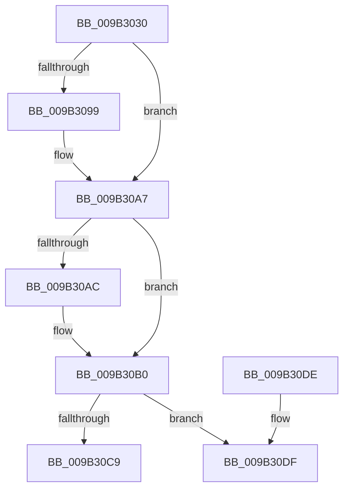

# CmpLockDeletedHashEntryExclusiveByKcb

- RVA: `0x009B3030`–`0x009B30FA` (길이 `202` bytes)
- VA: `0x00000001409B3030`
- 실행 섹션: `PAGE`
- PDB 이름 있음: `예`; PDB Function 태그: `아니요`
- unwind 정보 RVA: `0x00069420`
- 디코드: `56`개 명령, `202/202` bytes 표시
- 미해석 바이트: `0` (있으면 어셈블리에 `.byte`로 보존)

> 이 문서는 커널 이미지의 기계어와 PDB 기호를 분석해 생성했습니다. 4번과 5번은 함수 원형과 자료형을 바이너리 사용 방식에서 추정한 C 해석이며 원본 소스 복구 결과는 아닙니다.

## 1. Dependencies

- 직접 호출 지점: **4**; 고유 호출 대상: **4**
- 직접 호출자로 확인된 함수: **4**
- RIP 상대 이미지 참조: **0**

### Outgoing calls
- `0x009B3089` → [KeAbPreAcquire](../../text/21/KeAbPreAcquire_function_00210230.md) (function, `0x00210230`)
- `0x009B30A2` → [ExfAcquirePushLockExclusiveEx](../../text/20/ExfAcquirePushLockExclusiveEx_function_0020FC90.md) (function, `0x0020FC90`)
- `0x009B30C0` → [CmpReferenceHive](../84/CmpReferenceHive_function_0084FCF0.md) (function, `0x0084FCF0`)
- `0x009B30F4` → [KeBugCheckEx](../../text/4F/KeBugCheckEx_function_004FD660.md) (function, `0x004FD660`)

### Direct callers
- [sub_00851B91](../85/Unknown_function_00851B91.md) at `0x00851C7B`
- [sub_008622EA](../86/Unknown_function_008622EA.md) at `0x008622ED`
- [sub_00863192](../86/Unknown_function_00863192.md) at `0x00863195`
- [CmpDiscardKcb](CmpDiscardKcb_function_009B2F34.md) at `0x009B2F6C`

### Static image references
- 디코드된 RIP-relative 메모리 참조가 없습니다.

## 2. Other-region calls and transfers

- 다른 실행 섹션으로 향하는 call: **3**
  - `0x009B3089` → [KeAbPreAcquire](../../text/21/KeAbPreAcquire_function_00210230.md) (`PAGE` → `.text`)
  - `0x009B30A2` → [ExfAcquirePushLockExclusiveEx](../../text/20/ExfAcquirePushLockExclusiveEx_function_0020FC90.md) (`PAGE` → `.text`)
  - `0x009B30F4` → [KeBugCheckEx](../../text/4F/KeBugCheckEx_function_004FD660.md) (`PAGE` → `.text`)
- 별도 외부 분기/꼬리 이동을 확인하지 못했습니다.

## 3. Assembly (complete function range)

```asm
009B3030  48 89 5C 24 08                  mov qword ptr [rsp + 8], rbx
009B3035  48 89 6C 24 10                  mov qword ptr [rsp + 0x10], rbp
009B303A  48 89 74 24 18                  mov qword ptr [rsp + 0x18], rsi
009B303F  57                              push rdi
009B3040  48 83 EC 30                     sub rsp, 0x30
009B3044  8B 41 10                        mov eax, dword ptr [rcx + 0x10]
009B3047  48 8B E9                        mov rbp, rcx
009B304A  48 8B 71 20                     mov rsi, qword ptr [rcx + 0x20]
009B304E  8B D0                           mov edx, eax
009B3050  C1 EA 09                        shr edx, 9
009B3053  33 D0                           xor edx, eax
009B3055  69 C2 A3 8A 01 00               imul eax, edx, 0x18aa3
009B305B  8B D0                           mov edx, eax
009B305D  44 8B C0                        mov r8d, eax
009B3060  8B 86 88 06 00 00               mov eax, dword ptr [rsi + 0x688]
009B3066  49 C1 E8 09                     shr r8, 9
009B306A  FF C8                           dec eax
009B306C  4C 33 C2                        xor r8, rdx
009B306F  33 D2                           xor edx, edx
009B3071  4C 23 C0                        and r8, rax
009B3074  48 8B 86 80 06 00 00            mov rax, qword ptr [rsi + 0x680]
009B307B  4B 8D 0C 40                     lea rcx, [r8 + r8*2]
009B307F  45 33 C0                        xor r8d, r8d
009B3082  48 8D 1C C8                     lea rbx, [rax + rcx*8]
009B3086  48 8B CB                        mov rcx, rbx
009B3089  E8 A2 D1 85 FF                  call 0x140210230
009B308E  F0 48 0F BA 2B 00               lock bts qword ptr [rbx], 0
009B3094  48 8B F8                        mov rdi, rax
009B3097  73 0E                           jae 0x1409b30a7
009B3099  4C 8B C3                        mov r8, rbx
009B309C  48 8B D0                        mov rdx, rax
009B309F  48 8B CB                        mov rcx, rbx
009B30A2  E8 E9 CB 85 FF                  call 0x14020fc90
009B30A7  48 85 FF                        test rdi, rdi
009B30AA  74 04                           je 0x1409b30b0
009B30AC  C6 47 0A 01                     mov byte ptr [rdi + 0xa], 1
009B30B0  65 48 8B 04 25 88 01 00 00      mov rax, qword ptr gs:[0x188]
009B30B9  48 8B CE                        mov rcx, rsi
009B30BC  48 89 43 08                     mov qword ptr [rbx + 8], rax
009B30C0  E8 2B CC E9 FF                  call 0x14084fcf0
009B30C5  84 C0                           test al, al
009B30C7  74 16                           je 0x1409b30df
009B30C9  48 8B 5C 24 40                  mov rbx, qword ptr [rsp + 0x40]
009B30CE  48 8B 6C 24 48                  mov rbp, qword ptr [rsp + 0x48]
009B30D3  48 8B 74 24 50                  mov rsi, qword ptr [rsp + 0x50]
009B30D8  48 83 C4 30                     add rsp, 0x30
009B30DC  5F                              pop rdi
009B30DD  C3                              ret
009B30DE  CC                              int3
009B30DF  41 B9 08 00 00 00               mov r9d, 8
009B30E5  48 89 6C 24 20                  mov qword ptr [rsp + 0x20], rbp
009B30EA  4C 8B C6                        mov r8, rsi
009B30ED  41 8D 51 0F                     lea edx, [r9 + 0xf]
009B30F1  8D 4A 3A                        lea ecx, [rdx + 0x3a]
009B30F4  E8 67 A5 B4 FF                  call 0x1404fd660
009B30F9  CC                              int3
```

## 4. C-style interpretation (structured pseudocode)

```c
__int64 __fastcall CmpLockDeletedHashEntryExclusiveByKcb(__int64 a1)
{
    __int64 result;
    __int64 v_rsp;
    unsigned __int64 v_stack_p10;
    unsigned __int64 v_stack_p18;
    unsigned __int64 v_stack_p20;
    unsigned __int64 v_stack_p8;

    v_stack_p8 = v_rbx;
    v_stack_p10 = v_rbp;
    v_stack_p18 = v_rsi;
    v_rsp = (v_rsp) - (48);
    a2 = (unsigned int)(((unsigned int)((unsigned int)((unsigned int)(*(unsigned int *)(a1 + 16))))) >> (9));
    a2 = (unsigned int)((a2) ^ ((unsigned int)((unsigned int)(*(unsigned int *)(a1 + 16)))));
    result = (unsigned int)(((unsigned int)(*(unsigned int *)(a1 + 16))) * ((unsigned int)(a2)));
    a3 = ((unsigned int)((unsigned int)(result))) >> (9);
    result = (unsigned int)(((unsigned int)(*(unsigned int *)(*(unsigned __int64 *)(a1 + 32) + 1672))) - 1);
    a3 = (a3) ^ ((unsigned int)((unsigned int)(result)));
    a2 = 0;
    a3 = (a3) & (result);
    a3 = 0;
    result = KeAbPreAcquire(*(unsigned __int64 *)(*(unsigned __int64 *)(a1 + 32) + 1664) + a3 + a3 * 2 * 8, a2, a3, a4);
    if (!(condition_is_above_or_equal)) {
        a3 = *(unsigned __int64 *)(*(unsigned __int64 *)(a1 + 32) + 1664) + a3 + a3 * 2 * 8;
        a2 = result;
        a1 = *(unsigned __int64 *)(*(unsigned __int64 *)(a1 + 32) + 1664) + a3 + a3 * 2 * 8;
        result = ExfAcquirePushLockExclusiveEx(a1, a2, a3, a4);
    }
    if (result != 0) {
        *(unsigned __int8 *)(result + 10) = 1;
    }
    *(unsigned __int64 *)(*(unsigned __int64 *)(*(unsigned __int64 *)(a1 + 32) + 1664) + a3 + a3 * 2 * 8 + 8) = *(unsigned __int64 *)(gs_base + (0 + 392));
    result = CmpReferenceHive(*(unsigned __int64 *)(a1 + 32), a2, a3, a4);
    if ((unsigned __int8)(result) == 0) goto loc_009B30DF;
    v_rsp = (v_rsp) + (48);
    return result;
loc_009B30DF:
    v_stack_p20 = v_stack_p10;
    result = KeBugCheckEx(8 + 15 + 58, 8 + 15, v_stack_p18, 8);
    return result;
}
```

## 5. (Beta) C Style

```c
int64_t CmpLockDeletedHashEntryExclusiveByKcb(void *Arg1)
{
    uint8_t *arg1 = (uint8_t *)Arg1;

    int64_t result;
    int64_t local_rsp;
    uint64_t v_stack_p10;
    uint64_t v_stack_p18;
    uint64_t v_stack_p20;
    uint64_t v_stack_p8;

    v_stack_p8 = local_rbx;
    v_stack_p10 = local_rbp;
    v_stack_p18 = local_rsi;
    local_rsp = (local_rsp) - (48);
    a2 = (uint32_t)(((uint32_t)((uint32_t)((uint32_t)(*(uint32_t *)(arg1 + 0x10))))) >> (9));
    a2 = (uint32_t)((a2) ^ ((uint32_t)((uint32_t)(*(uint32_t *)(arg1 + 0x10)))));
    result = (uint32_t)(((uint32_t)(*(uint32_t *)(arg1 + 0x10))) * ((uint32_t)(a2)));
    a3 = ((uint32_t)((uint32_t)(result))) >> (9);
    result = (uint32_t)(((uint32_t)(*(uint32_t *)(*(uint64_t *)(arg1 + 0x20) + 0x688))) - 1);
    a3 = (a3) ^ ((uint32_t)((uint32_t)(result)));
    a2 = 0;
    a3 = (a3) & (result);
    a3 = 0;
    result = KeAbPreAcquire(*(uint64_t *)(*(uint64_t *)(arg1 + 0x20) + 0x680) + a3 + a3 * 2 * 8, a2, a3, a4);
    if (!(condition_is_above_or_equal)) {
        a3 = *(uint64_t *)(*(uint64_t *)(arg1 + 0x20) + 0x680) + a3 + a3 * 2 * 8;
        a2 = result;
        Arg1 = *(uint64_t *)(*(uint64_t *)(arg1 + 0x20) + 0x680) + a3 + a3 * 2 * 8;
        result = ExfAcquirePushLockExclusiveEx(Arg1, a2, a3, a4);
    }
    if (result != 0) {
        *(uint8_t *)(result + 0xA) = 1;
    }
    *(uint64_t *)(*(uint64_t *)(*(uint64_t *)(arg1 + 0x20) + 0x680) + a3 + a3 * 2 * 8 + 0x8) = *(uint64_t *)(gs_base + (0 + 0x188));
    result = CmpReferenceHive(*(uint64_t *)(arg1 + 0x20), a2, a3, a4);
    if ((uint8_t)(result) == 0) goto loc_009B30DF;
    local_rsp = (local_rsp) + (48);
    return result;
loc_009B30DF:
    v_stack_p20 = v_stack_p10;
    result = KeBugCheckEx(8 + 15 + 58, 8 + 15, v_stack_p18, 8);
    return result;
}
```

### 관측된 메모리 오프셋

구조체 형식이 확인되지 않은 접근은 인자 기준의 오프셋으로만 기록했습니다.

| 기준 인자 | 오프셋 표현 | 폭 (bit) | 접근 |
|---|---:|---:|---|
| `Arg1` | `+ 0x10` | `32` | `R` |
| `Arg1` | `+ 0x20` | `64` | `R` |

## 6. Execution-region graph

[열기: 2D/3D 그래프와 함수 탐색 컨트롤 패널](../../../control-panel.html?section=page&rva=0x009B3030&view=graph)

- 2D 그래프는 위에서 아래로 흐르고, 3D 그래프는 빈 공간을 드래그해 회전합니다. Shift+드래그는 이동, 휠은 확대·축소, 함수 노드 선택은 대상 보고서 이동입니다.

### Static fallback


