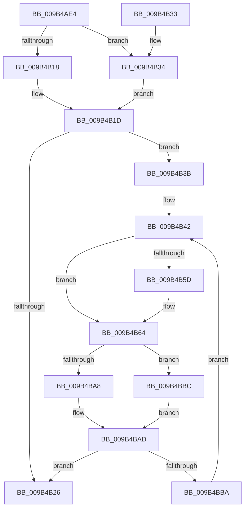

# CmpLockRegistryFreezeAware

- RVA: `0x009B4AE4`–`0x009B4BC3` (길이 `223` bytes)
- VA: `0x00000001409B4AE4`
- 실행 섹션: `PAGE`
- PDB 이름 있음: `예`; PDB Function 태그: `아니요`
- unwind 정보 RVA: `0x0009E550`
- 디코드: `57`개 명령, `223/223` bytes 표시
- 미해석 바이트: `0` (있으면 어셈블리에 `.byte`로 보존)

> 이 문서는 커널 이미지의 기계어와 PDB 기호를 분석해 생성했습니다. 4번과 5번은 함수 원형과 자료형을 바이너리 사용 방식에서 추정한 C 해석이며 원본 소스 복구 결과는 아닙니다.

## 1. Dependencies

- 직접 호출 지점: **10**; 고유 호출 대상: **8**
- 직접 호출자로 확인된 함수: **16**
- RIP 상대 이미지 참조: **4**

### Outgoing calls
- `0x009B4B0F` → [KeInitializeEvent](../../text/40/KeInitializeEvent_function_0040DD10.md) (function, `0x0040DD10`)
- `0x009B4B18` → [CmpLockRegistry](../../pagecmrc/BC/CmpLockRegistry_function_00BC9B34.md) (function, `0x00BC9B34`)
- `0x009B4B34` → [CmpLockRegistryExclusive](../84/CmpLockRegistryExclusive_function_0084F9B4.md) (function, `0x0084F9B4`)
- `0x009B4B47` → [KeResetEvent](../../text/24/KeResetEvent_function_00248350.md) (function, `0x00248350`)
- `0x009B4B4C` → [CmpLockFreezeQueue](../70/CmpLockFreezeQueue_function_007048F0.md) (function, `0x007048F0`)
- `0x009B4B82` → [CmpUnLockFreezeQueue](../70/CmpUnLockFreezeQueue_function_00704894.md) (function, `0x00704894`)
- `0x009B4B87` → [CmpUnlockRegistry](../../pagecmrc/BC/CmpUnlockRegistry_function_00BC9A84.md) (function, `0x00BC9A84`)
- `0x009B4B9F` → [KeWaitForSingleObject](../../text/20/KeWaitForSingleObject_function_0020E6B0.md) (function, `0x0020E6B0`)
- `0x009B4BA8` → [CmpLockRegistryExclusive](../84/CmpLockRegistryExclusive_function_0084F9B4.md) (function, `0x0084F9B4`)
- `0x009B4BBC` → [CmpLockRegistry](../../pagecmrc/BC/CmpLockRegistry_function_00BC9B34.md) (function, `0x00BC9B34`)

### Direct callers
- [CmpTryToRundownHive](../../text/2A/CmpTryToRundownHive_function_002A4A60.md) at `0x002A4AE3`
- [CmpTryToRundownHive](../../text/2A/CmpTryToRundownHive_function_002A4A60.md) at `0x002A4BCB`
- [CmpLoadKeyCommon](../../text/46/CmpLoadKeyCommon_function_0046E9F8.md) at `0x0046EA93`
- [CmpLoadKeyCommon](../../text/46/CmpLoadKeyCommon_function_0046E9F8.md) at `0x0046EB29`
- [CmpLoadKeyCommon](../../text/46/CmpLoadKeyCommon_function_0046E9F8.md) at `0x0046EC8E`
- [sub_006DAE8A](../../text/6D/Unknown_function_006DAE8A.md) at `0x006DAE9D`
- [ExpWatchProductTypeWork](../6F/ExpWatchProductTypeWork_function_006FFCA0.md) at `0x00700017`
- [CmRestoreKey](../7D/CmRestoreKey_function_007DCF04.md) at `0x007DD0CC`
- [CmRestoreKey](../7D/CmRestoreKey_function_007DCF04.md) at `0x007DD2E6`
- [CmRestoreKey](../7D/CmRestoreKey_function_007DCF04.md) at `0x007DD3E3`
- [CmRestoreKey](../7D/CmRestoreKey_function_007DCF04.md) at `0x007DD4BE`
- [CmRestoreKey](../7D/CmRestoreKey_function_007DCF04.md) at `0x007DD509`
- [CmpBecomeActiveFlusherAndReconciler](../7E/CmpBecomeActiveFlusherAndReconciler_function_007E7E20.md) at `0x007E7E42`
- [CmpDoFlushNextHive](../84/CmpDoFlushNextHive_function_0084C7C0.md) at `0x0084C859`
- [CmLoadAppKey](../87/CmLoadAppKey_function_00876FFC.md) at `0x00877750`
- [CmLoadAppKey](../87/CmLoadAppKey_function_00876FFC.md) at `0x00877ADD`
- [CmpPerformUnloadKey](../9A/CmpPerformUnloadKey_function_009AFA28.md) at `0x009AFAAD`
- [CmpPerformUnloadKey](../9A/CmpPerformUnloadKey_function_009AFA28.md) at `0x009AFC96`
- [CmpPerformUnloadKey](../9A/CmpPerformUnloadKey_function_009AFA28.md) at `0x009AFEE5`
- [CmpLateUnloadHiveWorker](CmpLateUnloadHiveWorker_function_009B20D0.md) at `0x009B215B`
- [CmpFlushHive](CmpFlushHive_function_009B3DC0.md) at `0x009B3F7D`
- [NtFlushKey](../A8/NtFlushKey_function_00A8A030.md) at `0x00A8A162`
- [CmpResolveHiveLoadConflict](../A9/CmpResolveHiveLoadConflict_function_00A9E78C.md) at `0x00A9E89A`
- [sub_00B15E66](../B1/Unknown_function_00B15E66.md) at `0x00B15E88`
- [sub_00B179DA](../B1/Unknown_function_00B179DA.md) at `0x00B17A9B`
- [sub_00B2D90C](../B2/Unknown_function_00B2D90C.md) at `0x00B2DA31`

### Static image references
- `0x009B4B1D` → RVA `0x00EEFBF8` (`.data`; read)
- `0x009B4B3B` → RVA `0x00EF71D0` (`.data`; read)
- `0x009B4B51` → RVA `0x00EF71D8` (`.data`; read)
- `0x009B4B7B` → RVA `0x00EF71D8` (`.data`; write)

## 2. Other-region calls and transfers

- 다른 실행 섹션으로 향하는 call: **6**
  - `0x009B4B0F` → [KeInitializeEvent](../../text/40/KeInitializeEvent_function_0040DD10.md) (`PAGE` → `.text`)
  - `0x009B4B18` → [CmpLockRegistry](../../pagecmrc/BC/CmpLockRegistry_function_00BC9B34.md) (`PAGE` → `PAGECMRC`)
  - `0x009B4B47` → [KeResetEvent](../../text/24/KeResetEvent_function_00248350.md) (`PAGE` → `.text`)
  - `0x009B4B87` → [CmpUnlockRegistry](../../pagecmrc/BC/CmpUnlockRegistry_function_00BC9A84.md) (`PAGE` → `PAGECMRC`)
  - `0x009B4B9F` → [KeWaitForSingleObject](../../text/20/KeWaitForSingleObject_function_0020E6B0.md) (`PAGE` → `.text`)
  - `0x009B4BBC` → [CmpLockRegistry](../../pagecmrc/BC/CmpLockRegistry_function_00BC9B34.md) (`PAGE` → `PAGECMRC`)
- 별도 외부 분기/꼬리 이동을 확인하지 못했습니다.

## 3. Assembly (complete function range)

```asm
009B4AE4  48 89 5C 24 08                  mov qword ptr [rsp + 8], rbx
009B4AE9  57                              push rdi
009B4AEA  48 83 EC 60                     sub rsp, 0x60
009B4AEE  33 C0                           xor eax, eax
009B4AF0  0F 57 C0                        xorps xmm0, xmm0
009B4AF3  8A D9                           mov bl, cl
009B4AF5  48 89 44 24 50                  mov qword ptr [rsp + 0x50], rax
009B4AFA  45 33 C0                        xor r8d, r8d
009B4AFD  48 8D 4C 24 40                  lea rcx, [rsp + 0x40]
009B4B02  0F 11 44 24 30                  movups xmmword ptr [rsp + 0x30], xmm0
009B4B07  8D 50 01                        lea edx, [rax + 1]
009B4B0A  0F 11 44 24 40                  movups xmmword ptr [rsp + 0x40], xmm0
009B4B0F  E8 FC 91 A5 FF                  call 0x14040dd10
009B4B14  84 DB                           test bl, bl
009B4B16  75 1C                           jne 0x1409b4b34
009B4B18  E8 17 50 21 00                  call 0x140bc9b34
009B4B1D  83 3D D4 B0 53 00 01            cmp dword ptr [rip + 0x53b0d4], 1
009B4B24  74 15                           je 0x1409b4b3b
009B4B26  48 8B 5C 24 70                  mov rbx, qword ptr [rsp + 0x70]
009B4B2B  33 C0                           xor eax, eax
009B4B2D  48 83 C4 60                     add rsp, 0x60
009B4B31  5F                              pop rdi
009B4B32  C3                              ret
009B4B33  CC                              int3
009B4B34  E8 7B AE E9 FF                  call 0x14084f9b4
009B4B39  EB E2                           jmp 0x1409b4b1d
009B4B3B  48 8D 3D 8E 26 54 00            lea rdi, [rip + 0x54268e]
009B4B42  48 8D 4C 24 40                  lea rcx, [rsp + 0x40]
009B4B47  E8 04 38 89 FF                  call 0x140248350
009B4B4C  E8 9F FD D4 FF                  call 0x1407048f0
009B4B51  48 8B 05 80 26 54 00            mov rax, qword ptr [rip + 0x542680]
009B4B58  48 39 38                        cmp qword ptr [rax], rdi
009B4B5B  74 07                           je 0x1409b4b64
009B4B5D  B9 03 00 00 00                  mov ecx, 3
009B4B62  CD 29                           int 0x29
009B4B64  48 89 44 24 38                  mov qword ptr [rsp + 0x38], rax
009B4B69  48 8D 4C 24 30                  lea rcx, [rsp + 0x30]
009B4B6E  48 89 7C 24 30                  mov qword ptr [rsp + 0x30], rdi
009B4B73  48 89 08                        mov qword ptr [rax], rcx
009B4B76  48 8D 44 24 30                  lea rax, [rsp + 0x30]
009B4B7B  48 89 05 56 26 54 00            mov qword ptr [rip + 0x542656], rax
009B4B82  E8 0D FD D4 FF                  call 0x140704894
009B4B87  E8 F8 4E 21 00                  call 0x140bc9a84
009B4B8C  48 83 64 24 20 00               and qword ptr [rsp + 0x20], 0
009B4B92  48 8D 4C 24 40                  lea rcx, [rsp + 0x40]
009B4B97  45 33 C9                        xor r9d, r9d
009B4B9A  45 33 C0                        xor r8d, r8d
009B4B9D  33 D2                           xor edx, edx
009B4B9F  E8 0C 9B 85 FF                  call 0x14020e6b0
009B4BA4  84 DB                           test bl, bl
009B4BA6  74 14                           je 0x1409b4bbc
009B4BA8  E8 07 AE E9 FF                  call 0x14084f9b4
009B4BAD  83 3D 44 B0 53 00 01            cmp dword ptr [rip + 0x53b044], 1
009B4BB4  0F 85 6C FF FF FF               jne 0x1409b4b26
009B4BBA  EB 86                           jmp 0x1409b4b42
009B4BBC  E8 73 4F 21 00                  call 0x140bc9b34
009B4BC1  EB EA                           jmp 0x1409b4bad
```

## 4. C-style interpretation (structured pseudocode)

```c
__int64 __fastcall CmpLockRegistryFreezeAware(unsigned __int8 a1, __int64 a2, int a3, int a4)
{
    __int64 result;
    __int64 v_rsp;
    unsigned __int64 v_stack_m18;
    unsigned __int64 v_stack_m28;
    unsigned __int64 v_stack_m38;
    unsigned __int64 v_stack_p20;
    unsigned __int64 v_stack_p30;
    unsigned __int64 v_stack_p38;
    unsigned __int64 v_stack_p40;
    unsigned __int64 v_stack_p8;

    v_stack_p8 = v_rbx;
    v_rsp = (v_rsp) - (96);
    result = 0;
    v_stack_m18 = 0;
    a3 = 0;
    v_stack_m38 = v_xmm0;
    v_stack_m28 = v_xmm0;
    result = KeInitializeEvent(v_stack_m28, result + 1, a3, a4);
    if (a1 != 0) goto loc_009B4B34;
    result = CmpLockRegistry(v_stack_m28, result + 1, a3, a4);
loc_009B4B1D:
    if ((*(unsigned int *)(v_rip + 5484756)) == 1) goto loc_009B4B3B;
loc_009B4B26:
    result = 0;
    v_rsp = (v_rsp) + (96);
    return result;
loc_009B4B34:
    result = CmpLockRegistryExclusive(v_stack_m28, result + 1, a3, a4);
    goto loc_009B4B1D;
loc_009B4B3B:
loc_009B4B42:
    result = KeResetEvent(v_stack_p40, result + 1, a3, a4);
    result = CmpLockFreezeQueue(v_stack_p40, result + 1, a3, a4);
    if ((*(unsigned __int64 *)(*(unsigned __int64 *)(v_rip + 5514880))) != (v_rip + 5514894)) {
        a1 = 3;
    }
    v_stack_p38 = *(unsigned __int64 *)(v_rip + 5514880);
    v_stack_p30 = v_rip + 5514894;
    *(unsigned __int64 *)(*(unsigned __int64 *)(v_rip + 5514880)) = v_stack_p30;
    *(unsigned __int64 *)(v_rip + 5514838) = v_stack_p30;
    result = CmpUnLockFreezeQueue(v_stack_p30, result + 1, a3, a4);
    result = CmpUnlockRegistry(v_stack_p30, result + 1, a3, a4);
    a4 = 0;
    a3 = 0;
    a2 = 0;
    result = KeWaitForSingleObject(v_stack_p40, a2, a3, a4);
    if ((unsigned __int8)(v_stack_p8) == 0) goto loc_009B4BBC;
    result = CmpLockRegistryExclusive(v_stack_p40, a2, a3, a4);
loc_009B4BAD:
    if ((*(unsigned int *)(v_rip + 5484612)) != 1) goto loc_009B4B26;
    goto loc_009B4B42;
loc_009B4BBC:
    result = CmpLockRegistry(v_stack_p40, a2, a3, a4);
    goto loc_009B4BAD;
}
```

## 5. (Beta) C Style

```c
int64_t CmpLockRegistryFreezeAware(uint8_t Arg1, int64_t Arg2, int32_t Arg3, int32_t Arg4)
{
    int64_t result;
    int64_t local_rsp;
    uint64_t v_stack_m18;
    uint64_t v_stack_m28;
    uint64_t v_stack_m38;
    uint64_t v_stack_p20;
    uint64_t v_stack_p30;
    uint64_t v_stack_p38;
    uint64_t v_stack_p40;
    uint64_t v_stack_p8;

    v_stack_p8 = local_rbx;
    local_rsp = (local_rsp) - (96);
    result = 0;
    v_stack_m18 = 0;
    Arg3 = 0;
    v_stack_m38 = v_xmm0;
    v_stack_m28 = v_xmm0;
    result = KeInitializeEvent(v_stack_m28, result + 1, Arg3, Arg4);
    if (Arg1 != 0) goto loc_009B4B34;
    result = CmpLockRegistry(v_stack_m28, result + 1, Arg3, Arg4);
loc_009B4B1D:
    if ((*(uint32_t *)(v_rip + 0x53B0D4)) == 1) goto loc_009B4B3B;
loc_009B4B26:
    result = 0;
    local_rsp = (local_rsp) + (96);
    return result;
loc_009B4B34:
    result = CmpLockRegistryExclusive(v_stack_m28, result + 1, Arg3, Arg4);
    goto loc_009B4B1D;
loc_009B4B3B:
loc_009B4B42:
    result = KeResetEvent(v_stack_p40, result + 1, Arg3, Arg4);
    result = CmpLockFreezeQueue(v_stack_p40, result + 1, Arg3, Arg4);
    if ((*(uint64_t *)(*(uint64_t *)(v_rip + 0x542680))) != (v_rip + 5514894)) {
        Arg1 = 3;
    }
    v_stack_p38 = *(uint64_t *)(v_rip + 0x542680);
    v_stack_p30 = v_rip + 5514894;
    *(uint64_t *)(*(uint64_t *)(v_rip + 0x542680)) = v_stack_p30;
    *(uint64_t *)(v_rip + 0x542656) = v_stack_p30;
    result = CmpUnLockFreezeQueue(v_stack_p30, result + 1, Arg3, Arg4);
    result = CmpUnlockRegistry(v_stack_p30, result + 1, Arg3, Arg4);
    Arg4 = 0;
    Arg3 = 0;
    Arg2 = 0;
    result = KeWaitForSingleObject(v_stack_p40, Arg2, Arg3, Arg4);
    if ((uint8_t)(v_stack_p8) == 0) goto loc_009B4BBC;
    result = CmpLockRegistryExclusive(v_stack_p40, Arg2, Arg3, Arg4);
loc_009B4BAD:
    if ((*(uint32_t *)(v_rip + 0x53B044)) != 1) goto loc_009B4B26;
    goto loc_009B4B42;
loc_009B4BBC:
    result = CmpLockRegistry(v_stack_p40, Arg2, Arg3, Arg4);
    goto loc_009B4BAD;
}
```

## 6. Execution-region graph

[열기: 2D/3D 그래프와 함수 탐색 컨트롤 패널](../../../control-panel.html?section=page&rva=0x009B4AE4&view=graph)

- 2D 그래프는 위에서 아래로 흐르고, 3D 그래프는 빈 공간을 드래그해 회전합니다. Shift+드래그는 이동, 휠은 확대·축소, 함수 노드 선택은 대상 보고서 이동입니다.

### Static fallback


