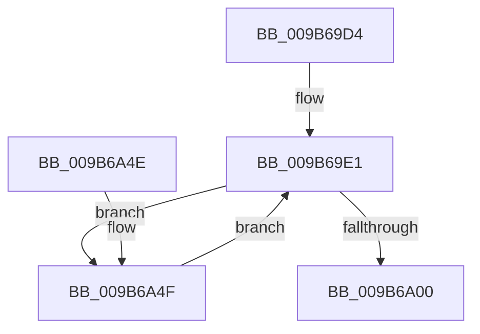

# CmpLogDirtyVectorUse

- RVA: `0x009B69D4`–`0x009B6A53` (길이 `127` bytes)
- VA: `0x00000001409B69D4`
- 실행 섹션: `PAGE`
- PDB 이름 있음: `예`; PDB Function 태그: `아니요`
- unwind 정보 RVA: `0x00069B1C`
- 디코드: `29`개 명령, `127/127` bytes 표시
- 미해석 바이트: `0` (있으면 어셈블리에 `.byte`로 보존)

> 이 문서는 커널 이미지의 기계어와 PDB 기호를 분석해 생성했습니다. 4번과 5번은 함수 원형과 자료형을 바이너리 사용 방식에서 추정한 C 해석이며 원본 소스 복구 결과는 아닙니다.

## 1. Dependencies

- 직접 호출 지점: **1**; 고유 호출 대상: **1**
- 직접 호출자로 확인된 함수: **3**
- RIP 상대 이미지 참조: **0**

### Outgoing calls
- `0x009B6A44` → [RtlCaptureStackBackTrace](../../text/2F/RtlCaptureStackBackTrace_function_002F9FF0.md) (function, `0x002F9FF0`)

### Direct callers
- [HvpGenerateLogEntryDirtyData](../../text/43/HvpGenerateLogEntryDirtyData_function_00433ABC.md) at `0x00433B87`
- [sub_00859517](../85/Unknown_function_00859517.md) at `0x00859573`
- [HvpGenerateLogEntry](HvpGenerateLogEntry_function_009B65F0.md) at `0x009B6658`

### Static image references
- 디코드된 RIP-relative 메모리 참조가 없습니다.

## 2. Other-region calls and transfers

- 다른 실행 섹션으로 향하는 call: **1**
  - `0x009B6A44` → [RtlCaptureStackBackTrace](../../text/2F/RtlCaptureStackBackTrace_function_002F9FF0.md) (`PAGE` → `.text`)
- 별도 외부 분기/꼬리 이동을 확인하지 못했습니다.

## 3. Assembly (complete function range)

```asm
009B69D4  48 83 EC 28                     sub rsp, 0x28
009B69D8  4C 8B D9                        mov r11, rcx
009B69DB  8B 89 88 0B 00 00               mov ecx, dword ptr [rcx + 0xb88]
009B69E1  8D 41 01                        lea eax, [rcx + 1]
009B69E4  41 3B 83 8C 0B 00 00            cmp eax, dword ptr [r11 + 0xb8c]
009B69EB  45 1B D2                        sbb r10d, r10d
009B69EE  44 23 D0                        and r10d, eax
009B69F1  8B C1                           mov eax, ecx
009B69F3  F0 45 0F B1 93 88 0B 00 00      lock cmpxchg dword ptr [r11 + 0xb88], r10d
009B69FC  3B C8                           cmp ecx, eax
009B69FE  75 4F                           jne 0x1409b6a4f
009B6A00  8B C1                           mov eax, ecx
009B6A02  48 8D 0C C0                     lea rcx, [rax + rax*8]
009B6A06  65 48 8B 04 25 88 01 00 00      mov rax, qword ptr gs:[0x188]
009B6A0F  45 89 84 CB 9C 0B 00 00         mov dword ptr [r11 + rcx*8 + 0xb9c], r8d
009B6A17  4D 8D 83 A8 0B 00 00            lea r8, [r11 + 0xba8]
009B6A1E  45 89 8C CB A0 0B 00 00         mov dword ptr [r11 + rcx*8 + 0xba0], r9d
009B6A26  4D 8D 04 C8                     lea r8, [r8 + rcx*8]
009B6A2A  41 89 94 CB 98 0B 00 00         mov dword ptr [r11 + rcx*8 + 0xb98], edx
009B6A32  45 33 C9                        xor r9d, r9d
009B6A35  49 89 84 CB 90 0B 00 00         mov qword ptr [r11 + rcx*8 + 0xb90], rax
009B6A3D  41 8D 51 06                     lea edx, [r9 + 6]
009B6A41  8D 4A FB                        lea ecx, [rdx - 5]
009B6A44  E8 A7 35 94 FF                  call 0x1402f9ff0
009B6A49  48 83 C4 28                     add rsp, 0x28
009B6A4D  C3                              ret
009B6A4E  CC                              int3
009B6A4F  8B C8                           mov ecx, eax
009B6A51  EB 8E                           jmp 0x1409b69e1
```

## 4. C-style interpretation (structured pseudocode)

```c
__int64 __fastcall CmpLogDirtyVectorUse(__int64 a1, int a2, int a3, int a4)
{
    __int64 result;
    __int64 v_r10;
    __int64 v_rsp;

    v_rsp = (v_rsp) - (40);
loc_009B69E1:
    v_r10 = (unsigned int)((v_r10) & ((unsigned int)((unsigned int)(*(unsigned int *)(a1 + 2952)) + 1)));
    if (((unsigned int)((unsigned int)(*(unsigned int *)(a1 + 2952)))) != ((unsigned int)((unsigned int)((unsigned int)((unsigned int)(*(unsigned int *)(a1 + 2952))))))) goto loc_009B6A4F;
    *(unsigned int *)(a1 + (unsigned int)((unsigned int)((unsigned int)(*(unsigned int *)(a1 + 2952)))) + (unsigned int)((unsigned int)((unsigned int)(*(unsigned int *)(a1 + 2952)))) * 8 * 8 + 2972) = a3;
    *(unsigned int *)(a1 + (unsigned int)((unsigned int)((unsigned int)(*(unsigned int *)(a1 + 2952)))) + (unsigned int)((unsigned int)((unsigned int)(*(unsigned int *)(a1 + 2952)))) * 8 * 8 + 2976) = a4;
    *(unsigned int *)(a1 + (unsigned int)((unsigned int)((unsigned int)(*(unsigned int *)(a1 + 2952)))) + (unsigned int)((unsigned int)((unsigned int)(*(unsigned int *)(a1 + 2952)))) * 8 * 8 + 2968) = a2;
    a4 = 0;
    *(unsigned __int64 *)(a1 + (unsigned int)((unsigned int)((unsigned int)(*(unsigned int *)(a1 + 2952)))) + (unsigned int)((unsigned int)((unsigned int)(*(unsigned int *)(a1 + 2952)))) * 8 * 8 + 2960) = *(unsigned __int64 *)(gs_base + (0 + 392));
    result = RtlCaptureStackBackTrace(a4 + 6 - 5, a4 + 6, a1 + 2984 + (unsigned int)((unsigned int)((unsigned int)(*(unsigned int *)(a1 + 2952)))) + (unsigned int)((unsigned int)((unsigned int)(*(unsigned int *)(a1 + 2952)))) * 8 * 8, a4);
    v_rsp = (v_rsp) + (40);
    return result;
loc_009B6A4F:
    goto loc_009B69E1;
}
```

## 5. (Beta) C Style

```c
int64_t CmpLogDirtyVectorUse(void *Arg1, int32_t Arg2, int32_t Arg3, int32_t Arg4)
{
    uint8_t *arg1 = (uint8_t *)Arg1;

    int64_t result;
    int64_t local_r10;
    int64_t local_rsp;

    local_rsp = (local_rsp) - (40);
loc_009B69E1:
    local_r10 = (uint32_t)((local_r10) & ((uint32_t)((uint32_t)(*(uint32_t *)(arg1 + 0xB88)) + 1)));
    if (((uint32_t)((uint32_t)(*(uint32_t *)(arg1 + 0xB88)))) != ((uint32_t)((uint32_t)((uint32_t)((uint32_t)(*(uint32_t *)(arg1 + 0xB88))))))) goto loc_009B6A4F;
    *(uint32_t *)(arg1 + (uint32_t)((uint32_t)((uint32_t)(*(uint32_t *)(arg1 + 0xB88)))) + (uint32_t)((uint32_t)((uint32_t)(*(uint32_t *)(arg1 + 0xB88)))) * 8 * 8 + 0xB9C) = Arg3;
    *(uint32_t *)(arg1 + (uint32_t)((uint32_t)((uint32_t)(*(uint32_t *)(arg1 + 0xB88)))) + (uint32_t)((uint32_t)((uint32_t)(*(uint32_t *)(arg1 + 0xB88)))) * 8 * 8 + 0xBA0) = Arg4;
    *(uint32_t *)(arg1 + (uint32_t)((uint32_t)((uint32_t)(*(uint32_t *)(arg1 + 0xB88)))) + (uint32_t)((uint32_t)((uint32_t)(*(uint32_t *)(arg1 + 0xB88)))) * 8 * 8 + 0xB98) = Arg2;
    Arg4 = 0;
    *(uint64_t *)(arg1 + (uint32_t)((uint32_t)((uint32_t)(*(uint32_t *)(arg1 + 0xB88)))) + (uint32_t)((uint32_t)((uint32_t)(*(uint32_t *)(arg1 + 0xB88)))) * 8 * 8 + 0xB90) = *(uint64_t *)(gs_base + (0 + 0x188));
    result = RtlCaptureStackBackTrace(Arg4 + 6 - 5, Arg4 + 6, Arg1 + 2984 + (uint32_t)((uint32_t)((uint32_t)(*(uint32_t *)(arg1 + 0xB88)))) + (uint32_t)((uint32_t)((uint32_t)(*(uint32_t *)(arg1 + 0xB88)))) * 8 * 8, Arg4);
    local_rsp = (local_rsp) + (40);
    return result;
loc_009B6A4F:
    goto loc_009B69E1;
}
```

### 관측된 메모리 오프셋

구조체 형식이 확인되지 않은 접근은 인자 기준의 오프셋으로만 기록했습니다.

| 기준 인자 | 오프셋 표현 | 폭 (bit) | 접근 |
|---|---:|---:|---|
| `Arg1` | `+ 0x0 + rcx*8` | `64` | `R` |
| `Arg1` | `+ 0xB88` | `32` | `R` |
| `Arg1` | `+ 0xB8C` | `32` | `R` |
| `Arg1` | `+ 0xB90 + rcx*8` | `64` | `W` |
| `Arg1` | `+ 0xB98 + rcx*8` | `32` | `W` |
| `Arg1` | `+ 0xB9C + rcx*8` | `32` | `W` |
| `Arg1` | `+ 0xBA0 + rcx*8` | `32` | `W` |
| `Arg1` | `+ 0xBA8` | `64` | `R` |

## 6. Execution-region graph

[열기: 2D/3D 그래프와 함수 탐색 컨트롤 패널](../../../control-panel.html?section=page&rva=0x009B69D4&view=graph)

- 2D 그래프는 위에서 아래로 흐르고, 3D 그래프는 빈 공간을 드래그해 회전합니다. Shift+드래그는 이동, 휠은 확대·축소, 함수 노드 선택은 대상 보고서 이동입니다.

### Static fallback


