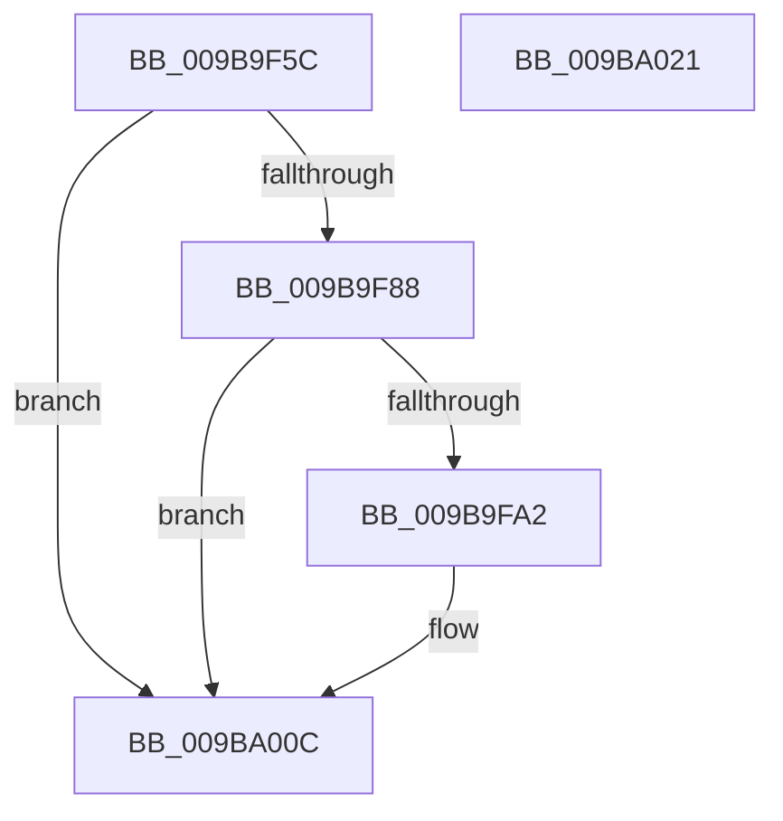

# CmpLogFailureToGetFileSize

- RVA: `0x009B9F5C`–`0x009BA022` (길이 `198` bytes)
- VA: `0x00000001409B9F5C`
- 실행 섹션: `PAGE`
- PDB 이름 있음: `예`; PDB Function 태그: `아니요`
- unwind 정보 RVA: `0x0009EA9C`
- 디코드: `41`개 명령, `198/198` bytes 표시
- 미해석 바이트: `0` (있으면 어셈블리에 `.byte`로 보존)

> 이 문서는 커널 이미지의 기계어와 PDB 기호를 분석해 생성했습니다. 4번과 5번은 함수 원형과 자료형을 바이너리 사용 방식에서 추정한 C 해석이며 원본 소스 복구 결과는 아닙니다.

## 1. Dependencies

- 직접 호출 지점: **3**; 고유 호출 대상: **3**
- 직접 호출자로 확인된 함수: **3**
- RIP 상대 이미지 참조: **3**

### Outgoing calls
- `0x009B9F99` → [tlgKeywordOn](../../text/42/tlgKeywordOn_function_0042EAA0.md) (function, `0x0042EAA0`)
- `0x009BA007` → [tlgWriteTransfer_EtwWriteTransfer](../../text/42/tlgWriteTransfer_EtwWriteTransfer_function_004260E0.md) (function, `0x004260E0`)
- `0x009BA013` → [_security_check_cookie](../../text/6A/_security_check_cookie_function_006AC640.md) (function, `0x006AC640`)

### Direct callers
- [CmpLoadHiveThread](../7D/CmpLoadHiveThread_function_007DB040.md) at `0x007DB6B6`
- [CmpLoadHiveThread](../7D/CmpLoadHiveThread_function_007DB040.md) at `0x007DB706`
- [CmpMountPreloadedHives](../7D/CmpMountPreloadedHives_function_007DBE18.md) at `0x007DC174`
- [CmpMountPreloadedHives](../7D/CmpMountPreloadedHives_function_007DBE18.md) at `0x007DC1C1`
- [CmpInitializeActualFileSizes](CmpInitializeActualFileSizes_function_009B8900.md) at `0x009B89DF`
- [CmpInitializeActualFileSizes](CmpInitializeActualFileSizes_function_009B8900.md) at `0x009B8A29`
- [CmpInitializeActualFileSizes](CmpInitializeActualFileSizes_function_009B8900.md) at `0x009B8A3A`
- [CmpInitializeActualFileSizes](CmpInitializeActualFileSizes_function_009B8900.md) at `0x009B8A53`

### Static image references
- `0x009B9F6A` → RVA `0x00E0A740` (`.data`; read)
- `0x009B9F78` → RVA `0x00E09F58` (`.data`; read)
- `0x009B9FAE` → RVA `0x00057418` (`.rdata`; read)

## 2. Other-region calls and transfers

- 다른 실행 섹션으로 향하는 call: **3**
  - `0x009B9F99` → [tlgKeywordOn](../../text/42/tlgKeywordOn_function_0042EAA0.md) (`PAGE` → `.text`)
  - `0x009BA007` → [tlgWriteTransfer_EtwWriteTransfer](../../text/42/tlgWriteTransfer_EtwWriteTransfer_function_004260E0.md) (`PAGE` → `.text`)
  - `0x009BA013` → [_security_check_cookie](../../text/6A/_security_check_cookie_function_006AC640.md) (`PAGE` → `.text`)
- 별도 외부 분기/꼬리 이동을 확인하지 못했습니다.

## 3. Assembly (complete function range)

```asm
009B9F5C  40 55                           push rbp
009B9F5E  48 8D 6C 24 A9                  lea rbp, [rsp - 0x57]
009B9F63  48 81 EC A0 00 00 00            sub rsp, 0xa0
009B9F6A  48 8B 05 CF 07 45 00            mov rax, qword ptr [rip + 0x4507cf]
009B9F71  48 33 C4                        xor rax, rsp
009B9F74  48 89 45 47                     mov qword ptr [rbp + 0x47], rax
009B9F78  83 3D D9 FF 44 00 05            cmp dword ptr [rip + 0x44ffd9], 5
009B9F7F  44 8B CA                        mov r9d, edx
009B9F82  0F 86 84 00 00 00               jbe 0x1409ba00c
009B9F88  48 BA 00 00 00 00 00 40 00 00   movabs rdx, 0x400000000000
009B9F92  48 8D 0D BF FF 44 00            lea rcx, [rip + 0x44ffbf]
009B9F99  E8 02 4B A7 FF                  call 0x14042eaa0
009B9F9E  84 C0                           test al, al
009B9FA0  74 6A                           je 0x1409ba00c
009B9FA2  48 8D 45 E7                     lea rax, [rbp - 0x19]
009B9FA6  44 88 4D E7                     mov byte ptr [rbp - 0x19], r9b
009B9FAA  48 89 45 17                     mov qword ptr [rbp + 0x17], rax
009B9FAE  48 8D 15 63 D4 69 FF            lea rdx, [rip - 0x962b9d]
009B9FB5  48 8D 45 EB                     lea rax, [rbp - 0x15]
009B9FB9  44 89 45 EB                     mov dword ptr [rbp - 0x15], r8d
009B9FBD  48 89 45 27                     mov qword ptr [rbp + 0x27], rax
009B9FC1  48 8D 0D 90 FF 44 00            lea rcx, [rip + 0x44ff90]
009B9FC8  48 8D 45 EF                     lea rax, [rbp - 0x11]
009B9FCC  48 C7 45 1F 01 00 00 00         mov qword ptr [rbp + 0x1f], 1
009B9FD4  48 89 45 37                     mov qword ptr [rbp + 0x37], rax
009B9FD8  45 33 C9                        xor r9d, r9d
009B9FDB  48 8D 45 F7                     lea rax, [rbp - 9]
009B9FDF  48 C7 45 2F 04 00 00 00         mov qword ptr [rbp + 0x2f], 4
009B9FE7  48 89 44 24 28                  mov qword ptr [rsp + 0x28], rax
009B9FEC  45 33 C0                        xor r8d, r8d
009B9FEF  C7 44 24 20 05 00 00 00         mov dword ptr [rsp + 0x20], 5
009B9FF7  48 C7 45 EF 00 00 00 01         mov qword ptr [rbp - 0x11], 0x1000000
009B9FFF  48 C7 45 3F 08 00 00 00         mov qword ptr [rbp + 0x3f], 8
009BA007  E8 D4 C0 A6 FF                  call 0x1404260e0
009BA00C  48 8B 4D 47                     mov rcx, qword ptr [rbp + 0x47]
009BA010  48 33 CC                        xor rcx, rsp
009BA013  E8 28 26 CF FF                  call 0x1406ac640
009BA018  48 81 C4 A0 00 00 00            add rsp, 0xa0
009BA01F  5D                              pop rbp
009BA020  C3                              ret
009BA021  CC                              int3
```

## 4. C-style interpretation (structured pseudocode)

```c
__int64 __fastcall CmpLogFailureToGetFileSize(__int64 a1, int a2, int a3)
{
    __int64 result;
    __int64 v_rsp;
    unsigned __int64 v_stack_m18;
    unsigned __int64 v_stack_m20;
    unsigned __int64 v_stack_m28;
    unsigned __int64 v_stack_m30;
    unsigned __int64 v_stack_m38;
    unsigned __int64 v_stack_m40;
    unsigned __int64 v_stack_m48;
    unsigned __int64 v_stack_m5F;
    unsigned __int64 v_stack_m68;
    unsigned __int64 v_stack_m70;
    unsigned __int64 v_stack_m74;
    unsigned __int64 v_stack_m78;
    unsigned __int64 v_stack_m80;
    unsigned int v_stack_m88;

    v_rsp = (v_rsp) - (160);
    result = (*(unsigned __int64 *)(v_rip + 4523983)) ^ (v_rsp);
    v_stack_m18 = result;
    if ((*(unsigned int *)(v_rip + 4521945)) <= 5) goto loc_009BA00C;
    result = tlgKeywordOn(v_rip + 4521919, a2, a3, (unsigned int)(a2));
    if ((unsigned __int8)(result) != 0) {
        result = v_stack_m78;
        v_stack_m78 = (unsigned __int8)((unsigned int)(a2));
        v_stack_m48 = result;
        a2 = v_rip - 9841565;
        result = v_stack_m74;
        v_stack_m74 = a3;
        v_stack_m38 = result;
        a1 = v_rip + 4521872;
        result = v_stack_m70;
        v_stack_m40 = 1;
        v_stack_m28 = result;
        a4 = 0;
        result = v_stack_m68;
        v_stack_m30 = 4;
        v_stack_m80 = result;
        a3 = 0;
        v_stack_m88 = 5;
        v_stack_m70 = 0x1000000ULL;
        v_stack_m20 = 8;
        result = tlgWriteTransfer_EtwWriteTransfer(a1, a2, a3, a4);
    }
    a1 = (v_stack_m18) ^ (v_rsp);
    result = _security_check_cookie(a1, a2, a3, a4);
    v_rsp = (v_rsp) + (160);
    return result;
}
```

## 5. (Beta) C Style

```c
int64_t CmpLogFailureToGetFileSize(int64_t Arg1, int32_t Arg2, int32_t Arg3)
{
    int64_t result;
    int64_t local_rsp;
    uint64_t v_stack_m18;
    uint64_t v_stack_m20;
    uint64_t v_stack_m28;
    uint64_t v_stack_m30;
    uint64_t v_stack_m38;
    uint64_t v_stack_m40;
    uint64_t v_stack_m48;
    uint64_t v_stack_m5F;
    uint64_t v_stack_m68;
    uint64_t v_stack_m70;
    uint64_t v_stack_m74;
    uint64_t v_stack_m78;
    uint64_t v_stack_m80;
    uint32_t v_stack_m88;

    local_rsp = (local_rsp) - (160);
    result = (*(uint64_t *)(v_rip + 0x4507CF)) ^ (local_rsp);
    v_stack_m18 = result;
    if ((*(uint32_t *)(v_rip + 0x44FFD9)) <= 5) goto loc_009BA00C;
    result = tlgKeywordOn(v_rip + 4521919, Arg2, Arg3, (uint32_t)(Arg2));
    if ((uint8_t)(result) != 0) {
        result = v_stack_m78;
        v_stack_m78 = (uint8_t)((uint32_t)(Arg2));
        v_stack_m48 = result;
        Arg2 = v_rip - 9841565;
        result = v_stack_m74;
        v_stack_m74 = Arg3;
        v_stack_m38 = result;
        Arg1 = v_rip + 4521872;
        result = v_stack_m70;
        v_stack_m40 = 1;
        v_stack_m28 = result;
        a4 = 0;
        result = v_stack_m68;
        v_stack_m30 = 4;
        v_stack_m80 = result;
        Arg3 = 0;
        v_stack_m88 = 5;
        v_stack_m70 = 0x1000000ULL;
        v_stack_m20 = 8;
        result = tlgWriteTransfer_EtwWriteTransfer(Arg1, Arg2, Arg3, a4);
    }
    Arg1 = (v_stack_m18) ^ (local_rsp);
    result = _security_check_cookie(Arg1, Arg2, Arg3, a4);
    local_rsp = (local_rsp) + (160);
    return result;
}
```

## 6. Execution-region graph

[열기: 2D/3D 그래프와 함수 탐색 컨트롤 패널](../../../control-panel.html?section=page&rva=0x009B9F5C&view=graph)

- 2D 그래프는 위에서 아래로 흐르고, 3D 그래프는 빈 공간을 드래그해 회전합니다. Shift+드래그는 이동, 휠은 확대·축소, 함수 노드 선택은 대상 보고서 이동입니다.

### Static fallback


