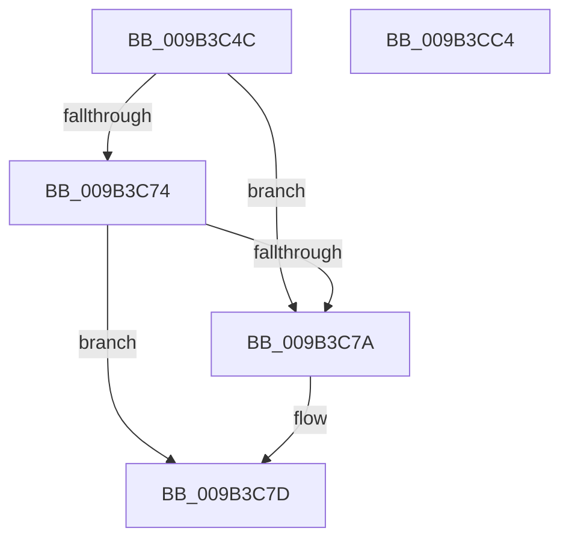

# CmpMarkKeyUnbacked

- RVA: `0x009B3C4C`–`0x009B3CC5` (길이 `121` bytes)
- VA: `0x00000001409B3C4C`
- 실행 섹션: `PAGE`
- PDB 이름 있음: `예`; PDB Function 태그: `아니요`
- unwind 정보 RVA: `0x0005CAAC`
- 디코드: `30`개 명령, `121/121` bytes 표시
- 미해석 바이트: `0` (있으면 어셈블리에 `.byte`로 보존)

> 이 문서는 커널 이미지의 기계어와 PDB 기호를 분석해 생성했습니다. 4번과 5번은 함수 원형과 자료형을 바이너리 사용 방식에서 추정한 C 해석이며 원본 소스 복구 결과는 아닙니다.

## 1. Dependencies

- 직접 호출 지점: **1**; 고유 호출 대상: **1**
- 직접 호출자로 확인된 함수: **13**
- RIP 상대 이미지 참조: **0**

### Outgoing calls
- `0x009B3C83` → [CmpCleanUpKcbCachedSymlink](../84/CmpCleanUpKcbCachedSymlink_function_0084DF6C.md) (function, `0x0084DF6C`)

### Direct callers
- [CmDeleteLayeredKey](../../text/41/CmDeleteLayeredKey_function_0041B598.md) at `0x0041B7E4`
- [CmpRemoveHiveFromNamespace](../../text/49/CmpRemoveHiveFromNamespace_function_0049C4CC.md) at `0x0049C536`
- [sub_006ED542](../../text/6E/Unknown_function_006ED542.md) at `0x006ED644`
- [CmpRefreshWorkerRoutine](../7D/CmpRefreshWorkerRoutine_function_007DEF60.md) at `0x007DEF95`
- [CmRenameKey](../7E/CmRenameKey_function_007E8F48.md) at `0x007E975F`
- [CmpInvalidateAllHigherLayerKcbsPostCallback](../7F/CmpInvalidateAllHigherLayerKcbsPostCallback_function_007F15A0.md) at `0x007F15D9`
- [CmDeleteKey](../84/CmDeleteKey_function_00848E5C.md) at `0x008492CA`
- [CmpCommitDiscardReplacePost](../86/CmpCommitDiscardReplacePost_function_008624D4.md) at `0x008626B7`
- [CmpCompleteUnloadKey](CmpCompleteUnloadKey_function_009B32FC.md) at `0x009B33D7`
- [CmpLightWeightCommitDeleteKeyUoW](../A5/CmpLightWeightCommitDeleteKeyUoW_function_00A54610.md) at `0x00A5471F`
- [CmpInvalidateSubtreeWorker](../AA/CmpInvalidateSubtreeWorker_function_00AA3970.md) at `0x00AA39B0`
- [sub_00B16440](../B1/Unknown_function_00B16440.md) at `0x00B165C3`
- [sub_00B1787E](../B1/Unknown_function_00B1787E.md) at `0x00B1790E`

### Static image references
- 디코드된 RIP-relative 메모리 참조가 없습니다.

## 2. Other-region calls and transfers

- 다른 실행 섹션으로 향하는 call: **0**
- 별도 외부 분기/꼬리 이동을 확인하지 못했습니다.

## 3. Assembly (complete function range)

```asm
009B3C4C  48 89 5C 24 08                  mov qword ptr [rsp + 8], rbx
009B3C51  57                              push rdi
009B3C52  48 83 EC 20                     sub rsp, 0x20
009B3C56  83 49 28 FF                     or dword ptr [rcx + 0x28], 0xffffffff
009B3C5A  B8 01 00 00 00                  mov eax, 1
009B3C5F  48 01 81 30 01 00 00            add qword ptr [rcx + 0x130], rax
009B3C66  48 8B D9                        mov rbx, rcx
009B3C69  48 8B 49 48                     mov rcx, qword ptr [rcx + 0x48]
009B3C6D  33 FF                           xor edi, edi
009B3C6F  48 85 C9                        test rcx, rcx
009B3C72  74 06                           je 0x1409b3c7a
009B3C74  80 79 41 03                     cmp byte ptr [rcx + 0x41], 3
009B3C78  74 03                           je 0x1409b3c7d
009B3C7A  40 8A C7                        mov al, dil
009B3C7D  48 8B CB                        mov rcx, rbx
009B3C80  88 43 41                        mov byte ptr [rbx + 0x41], al
009B3C83  E8 E4 A2 E9 FF                  call 0x14084df6c
009B3C88  83 4B 64 FF                     or dword ptr [rbx + 0x64], 0xffffffff
009B3C8C  66 83 A3 BA 00 00 00 04         and word ptr [rbx + 0xba], 4
009B3C94  81 A3 B8 00 00 00 00 FF FF FF   and dword ptr [rbx + 0xb8], 0xffffff00
009B3C9E  40 88 BB B9 00 00 00            mov byte ptr [rbx + 0xb9], dil
009B3CA5  89 7B 60                        mov dword ptr [rbx + 0x60], edi
009B3CA8  89 7B 70                        mov dword ptr [rbx + 0x70], edi
009B3CAB  48 89 BB A8 00 00 00            mov qword ptr [rbx + 0xa8], rdi
009B3CB2  48 89 BB B0 00 00 00            mov qword ptr [rbx + 0xb0], rdi
009B3CB9  48 8B 5C 24 30                  mov rbx, qword ptr [rsp + 0x30]
009B3CBE  48 83 C4 20                     add rsp, 0x20
009B3CC2  5F                              pop rdi
009B3CC3  C3                              ret
009B3CC4  CC                              int3
```

## 4. C-style interpretation (structured pseudocode)

```c
__int64 __fastcall CmpMarkKeyUnbacked(__int64 a1)
{
    __int64 result;
    __int64 v_rdi;
    __int64 v_rsp;
    unsigned __int64 v_stack_p8;

    v_stack_p8 = v_rbx;
    v_rsp = (v_rsp) - (32);
    v_rdi = 0;
    if (*(unsigned __int64 *)(a1 + 72) == 0) goto loc_009B3C7A;
    result = 1;
    if ((*(unsigned __int8 *)(*(unsigned __int64 *)(a1 + 72) + 65)) != 3) {
        result = 0;
    }
    *(unsigned __int8 *)(a1 + 65) = (unsigned __int8)(result);
    result = CmpCleanUpKcbCachedSymlink(a1, a2, a3, a4);
    *(unsigned __int8 *)(a1 + 185) = 0;
    *(unsigned int *)(a1 + 96) = 0;
    *(unsigned int *)(a1 + 112) = 0;
    *(unsigned __int64 *)(a1 + 168) = 0;
    *(unsigned __int64 *)(a1 + 176) = 0;
    v_rsp = (v_rsp) + (32);
    return result;
}
```

## 5. (Beta) C Style

```c
int64_t CmpMarkKeyUnbacked(void *Arg1)
{
    uint8_t *arg1 = (uint8_t *)Arg1;

    int64_t result;
    int64_t local_rdi;
    int64_t local_rsp;
    uint64_t v_stack_p8;

    v_stack_p8 = local_rbx;
    local_rsp = (local_rsp) - (32);
    local_rdi = 0;
    if (*(uint64_t *)(arg1 + 0x48) == 0) goto loc_009B3C7A;
    result = 1;
    if ((*(uint8_t *)(*(uint64_t *)(arg1 + 0x48) + 0x41)) != 3) {
        result = 0;
    }
    *(uint8_t *)(arg1 + 0x41) = (uint8_t)(result);
    result = CmpCleanUpKcbCachedSymlink(Arg1, a2, a3, a4);
    *(uint8_t *)(arg1 + 0xB9) = 0;
    *(uint32_t *)(arg1 + 0x60) = 0;
    *(uint32_t *)(arg1 + 0x70) = 0;
    *(uint64_t *)(arg1 + 0xA8) = 0;
    *(uint64_t *)(arg1 + 0xB0) = 0;
    local_rsp = (local_rsp) + (32);
    return result;
}
```

### 관측된 메모리 오프셋

구조체 형식이 확인되지 않은 접근은 인자 기준의 오프셋으로만 기록했습니다.

| 기준 인자 | 오프셋 표현 | 폭 (bit) | 접근 |
|---|---:|---:|---|
| `Arg1` | `+ 0x28` | `32` | `R/W` |
| `Arg1` | `+ 0x41` | `8` | `W` |
| `Arg1` | `+ 0x48` | `64` | `R` |
| `Arg1` | `+ 0x60` | `32` | `W` |
| `Arg1` | `+ 0x64` | `32` | `R/W` |
| `Arg1` | `+ 0x70` | `32` | `W` |
| `Arg1` | `+ 0xA8` | `64` | `W` |
| `Arg1` | `+ 0xB0` | `64` | `W` |
| `Arg1` | `+ 0xB8` | `32` | `R/W` |
| `Arg1` | `+ 0xB9` | `8` | `W` |
| `Arg1` | `+ 0xBA` | `16` | `R/W` |
| `Arg1` | `+ 0x130` | `64` | `R/W` |

## 6. Execution-region graph

[열기: 2D/3D 그래프와 함수 탐색 컨트롤 패널](../../../control-panel.html?section=page&rva=0x009B3C4C&view=graph)

- 2D 그래프는 위에서 아래로 흐르고, 3D 그래프는 빈 공간을 드래그해 회전합니다. Shift+드래그는 이동, 휠은 확대·축소, 함수 노드 선택은 대상 보고서 이동입니다.

### Static fallback


