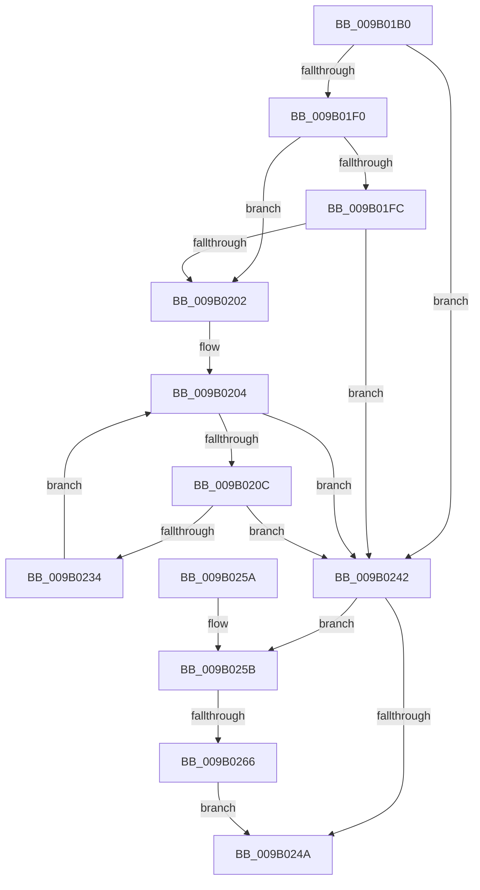

# CmpPrepareForSubtreeInvalidation

- RVA: `0x009B01B0`–`0x009B026D` (길이 `189` bytes)
- VA: `0x00000001409B01B0`
- 실행 섹션: `PAGE`
- PDB 이름 있음: `예`; PDB Function 태그: `예`
- unwind 정보 RVA: `0x0009E11C`
- 디코드: `52`개 명령, `189/189` bytes 표시
- 미해석 바이트: `0` (있으면 어셈블리에 `.byte`로 보존)

> 이 문서는 커널 이미지의 기계어와 PDB 기호를 분석해 생성했습니다. 4번과 5번은 함수 원형과 자료형을 바이너리 사용 방식에서 추정한 C 해석이며 원본 소스 복구 결과는 아닙니다.

## 1. Dependencies

- 직접 호출 지점: **2**; 고유 호출 대상: **2**
- 직접 호출자로 확인된 함수: **6**
- RIP 상대 이미지 참조: **1**

### Outgoing calls
- `0x009B01E2` → [CmpCleanUpKCBCacheTable](CmpCleanUpKCBCacheTable_function_009B0478.md) (function, `0x009B0478`)
- `0x009B022A` → [CmpEnumerateKcbCacheBucket](CmpEnumerateKcbCacheBucket_function_009B03E4.md) (function, `0x009B03E4`)

### Direct callers
- [CmpSaveBootControlSet](../7D/CmpSaveBootControlSet_function_007DC744.md) at `0x007DCA26`
- [CmRestoreKey](../7D/CmRestoreKey_function_007DCF04.md) at `0x007DD454`
- [CmRenameKey](../7E/CmRenameKey_function_007E8F48.md) at `0x007E939B`
- [CmRenameKey](../7E/CmRenameKey_function_007E8F48.md) at `0x007E95B7`
- [CmpPrepareToInvalidateAllHigherLayerKcbsPostCallback](../7F/CmpPrepareToInvalidateAllHigherLayerKcbsPostCallback_function_007F17D0.md) at `0x007F17E0`
- [CmpPerformUnloadKey](../9A/CmpPerformUnloadKey_function_009AFA28.md) at `0x009AFDCD`
- [sub_00B1787E](../B1/Unknown_function_00B1787E.md) at `0x00B178B5`

### Static image references
- `0x009B021C` → RVA `0x007EB070` (`CmpPrepareForSubtreeInvalidationWorker`; read)

## 2. Other-region calls and transfers

- 다른 실행 섹션으로 향하는 call: **0**
- call이 아닌 외부 분기/꼬리 이동: **1**
  - `0x009B0260` → [sub_00B2DA6A](../B2/Unknown_function_00B2DA6A.md) (`tail-transfer`)

## 3. Assembly (complete function range)

```asm
009B01B0  48 8B C4                        mov rax, rsp
009B01B3  48 89 58 08                     mov qword ptr [rax + 8], rbx
009B01B7  48 89 70 10                     mov qword ptr [rax + 0x10], rsi
009B01BB  57                              push rdi
009B01BC  48 83 EC 40                     sub rsp, 0x40
009B01C0  48 8B 71 20                     mov rsi, qword ptr [rcx + 0x20]
009B01C4  48 8B F9                        mov rdi, rcx
009B01C7  48 83 60 DC 00                  and qword ptr [rax - 0x24], 0
009B01CC  48 8B CE                        mov rcx, rsi
009B01CF  83 60 E4 00                     and dword ptr [rax - 0x1c], 0
009B01D3  83 60 F4 00                     and dword ptr [rax - 0xc], 0
009B01D7  83 60 D8 00                     and dword ptr [rax - 0x28], 0
009B01DB  4C 89 40 E8                     mov qword ptr [rax - 0x18], r8
009B01DF  89 50 F0                        mov dword ptr [rax - 0x10], edx
009B01E2  E8 91 02 00 00                  call 0x1409b0478
009B01E7  48 8B 0F                        mov rcx, qword ptr [rdi]
009B01EA  48 83 F9 01                     cmp rcx, 1
009B01EE  74 52                           je 0x1409b0242
009B01F0  F7 87 B8 00 00 00 00 00 04 00   test dword ptr [rdi + 0xb8], 0x40000
009B01FA  74 06                           je 0x1409b0202
009B01FC  48 83 F9 02                     cmp rcx, 2
009B0200  74 40                           je 0x1409b0242
009B0202  33 DB                           xor ebx, ebx
009B0204  3B 9E 78 06 00 00               cmp ebx, dword ptr [rsi + 0x678]
009B020A  73 36                           jae 0x1409b0242
009B020C  48 8B 86 70 06 00 00            mov rax, qword ptr [rsi + 0x670]
009B0213  48 8D 0C 5B                     lea rcx, [rbx + rbx*2]
009B0217  4C 8D 4C 24 20                  lea r9, [rsp + 0x20]
009B021C  4C 8D 05 4D AE E3 FF            lea r8, [rip - 0x1c51b3]
009B0223  48 8D 14 C8                     lea rdx, [rax + rcx*8]
009B0227  48 8B CF                        mov rcx, rdi
009B022A  E8 B5 01 00 00                  call 0x1409b03e4
009B022F  83 F8 01                        cmp eax, 1
009B0232  74 0E                           je 0x1409b0242
009B0234  8D 4B FF                        lea ecx, [rbx - 1]
009B0237  83 F8 02                        cmp eax, 2
009B023A  0F 45 CB                        cmovne ecx, ebx
009B023D  8D 59 01                        lea ebx, [rcx + 1]
009B0240  EB C2                           jmp 0x1409b0204
009B0242  8B 44 24 20                     mov eax, dword ptr [rsp + 0x20]
009B0246  85 C0                           test eax, eax
009B0248  79 11                           jns 0x1409b025b
009B024A  48 8B 5C 24 50                  mov rbx, qword ptr [rsp + 0x50]
009B024F  48 8B 74 24 58                  mov rsi, qword ptr [rsp + 0x58]
009B0254  48 83 C4 40                     add rsp, 0x40
009B0258  5F                              pop rdi
009B0259  C3                              ret
009B025A  CC                              int3
009B025B  83 7C 24 24 00                  cmp dword ptr [rsp + 0x24], 0
009B0260  0F 84 04 D8 17 00               je 0x140b2da6a
009B0266  B8 21 01 00 C0                  mov eax, 0xc0000121
009B026B  EB DD                           jmp 0x1409b024a
```

## 4. C-style interpretation (structured pseudocode)

```c
__int64 __fastcall CmpPrepareForSubtreeInvalidation(__int64 a1, int a2, __int64 a3)
{
    __int64 result;
    __int64 v_rbx;
    __int64 v_rsp;
    unsigned __int64 v_stack_m28;
    unsigned __int64 v_stack_p10;
    unsigned int v_stack_p24;
    unsigned __int64 v_stack_p8;

    *(unsigned __int64 *)(v_rsp + 8) = v_rbx;
    *(unsigned __int64 *)(v_rsp + 16) = v_rsi;
    v_rsp = (v_rsp) - (64);
    *(unsigned __int64 *)(v_rsp - 24) = a3;
    *(unsigned int *)(v_rsp - 16) = a2;
    result = CmpCleanUpKCBCacheTable(*(unsigned __int64 *)(a1 + 32), a2, a3, a4);
    if ((*(unsigned __int64 *)(a1)) == 1) goto loc_009B0242;
    if (((*(unsigned int *)(a1 + 184)) & (0x40000ULL)) == 0) goto loc_009B0202;
    if ((*(unsigned __int64 *)(a1)) == 2) goto loc_009B0242;
loc_009B0202:
    v_rbx = 0;
loc_009B0204:
    if (0 >= (*(unsigned int *)(*(unsigned __int64 *)(a1 + 32) + 1656))) goto loc_009B0242;
    result = CmpEnumerateKcbCacheBucket(a1, *(unsigned __int64 *)(*(unsigned __int64 *)(a1 + 32) + 1648) + v_rbx + v_rbx * 2 * 8, v_rip - 1855923, v_stack_m28);
    if (((unsigned int)(result)) == 1) goto loc_009B0242;
    a1 = v_rbx - 1;
    if (((unsigned int)(result)) != 2) { a1 = 0; }
    goto loc_009B0204;
loc_009B0242:
    if (!sign_flag) goto loc_009B025B;
loc_009B024A:
    v_rsp = (v_rsp) + (64);
    return (unsigned int)(v_stack_m28);
loc_009B025B:
    goto loc_009B024A;
}
```

## 5. (Beta) C Style

```c
int64_t CmpPrepareForSubtreeInvalidation(void *Arg1, int32_t Arg2, int64_t Arg3)
{
    uint8_t *arg1 = (uint8_t *)Arg1;

    int64_t result;
    int64_t local_rbx;
    int64_t local_rsp;
    uint64_t v_stack_m28;
    uint64_t v_stack_p10;
    uint32_t v_stack_p24;
    uint64_t v_stack_p8;

    *(uint64_t *)(local_rsp + 0x8) = local_rbx;
    *(uint64_t *)(local_rsp + 0x10) = local_rsi;
    local_rsp = (local_rsp) - (64);
    *(uint64_t *)(local_rsp - 0x18) = Arg3;
    *(uint32_t *)(local_rsp - 0x10) = Arg2;
    result = CmpCleanUpKCBCacheTable(*(uint64_t *)(arg1 + 0x20), Arg2, Arg3, a4);
    if ((*(uint64_t *)(arg1)) == 1) goto loc_009B0242;
    if (((*(uint32_t *)(arg1 + 0xB8)) & (0x40000ULL)) == 0) goto loc_009B0202;
    if ((*(uint64_t *)(arg1)) == 2) goto loc_009B0242;
loc_009B0202:
    local_rbx = 0;
loc_009B0204:
    if (0 >= (*(uint32_t *)(*(uint64_t *)(arg1 + 0x20) + 0x678))) goto loc_009B0242;
    result = CmpEnumerateKcbCacheBucket(Arg1, *(uint64_t *)(*(uint64_t *)(arg1 + 0x20) + 0x670) + local_rbx + local_rbx * 2 * 8, v_rip - 1855923, v_stack_m28);
    if (((uint32_t)(result)) == 1) goto loc_009B0242;
    Arg1 = local_rbx - 1;
    if (((uint32_t)(result)) != 2) { Arg1 = 0; }
    goto loc_009B0204;
loc_009B0242:
    if (!sign_flag) goto loc_009B025B;
loc_009B024A:
    local_rsp = (local_rsp) + (64);
    return (uint32_t)(v_stack_m28);
loc_009B025B:
    goto loc_009B024A;
}
```

### 관측된 메모리 오프셋

구조체 형식이 확인되지 않은 접근은 인자 기준의 오프셋으로만 기록했습니다.

| 기준 인자 | 오프셋 표현 | 폭 (bit) | 접근 |
|---|---:|---:|---|
| `Arg1` | `+ 0x0` | `64` | `R` |
| `Arg1` | `+ 0x20` | `64` | `R` |
| `Arg1` | `+ 0xB8` | `32` | `R` |

## 6. Execution-region graph

[열기: 2D/3D 그래프와 함수 탐색 컨트롤 패널](../../../control-panel.html?section=page&rva=0x009B01B0&view=graph)

- 2D 그래프는 위에서 아래로 흐르고, 3D 그래프는 빈 공간을 드래그해 회전합니다. Shift+드래그는 이동, 휠은 확대·축소, 함수 노드 선택은 대상 보고서 이동입니다.

### Static fallback


