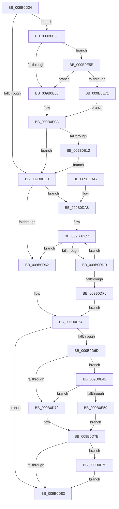

# CmpPrepareLightWeightTransaction

- RVA: `0x009B0D24`–`0x009B0EA5` (길이 `385` bytes)
- VA: `0x00000001409B0D24`
- 실행 섹션: `PAGE`
- PDB 이름 있음: `예`; PDB Function 태그: `아니요`
- unwind 정보 RVA: `0x0009E1EC`
- 디코드: `94`개 명령, `385/385` bytes 표시
- 미해석 바이트: `0` (있으면 어셈블리에 `.byte`로 보존)

> 이 문서는 커널 이미지의 기계어와 PDB 기호를 분석해 생성했습니다. 4번과 5번은 함수 원형과 자료형을 바이너리 사용 방식에서 추정한 C 해석이며 원본 소스 복구 결과는 아닙니다.

## 1. Dependencies

- 직접 호출 지점: **9**; 고유 호출 대상: **8**
- 직접 호출자로 확인된 함수: **1**
- RIP 상대 이미지 참조: **7**

### Outgoing calls
- `0x009B0D8D` → [_security_check_cookie](../../text/6A/_security_check_cookie_function_006AC640.md) (function, `0x006AC640`)
- `0x009B0DA8` → [LOCK_TRANSACTION_LIST](../87/LOCK_TRANSACTION_LIST_function_00874AD4.md) (function, `0x00874AD4`)
- `0x009B0DB7` → [ExReleaseFastMutexUnsafe](../../text/25/ExReleaseFastMutexUnsafe_function_002503A0.md) (function, `0x002503A0`)
- `0x009B0DBC` → [KeLeaveCriticalRegion](../../text/25/KeLeaveCriticalRegion_function_0025D8B0.md) (function, `0x0025D8B0`)
- `0x009B0DD3` → [CmListGetNextElement](../../pagecmrc/BC/CmListGetNextElement_function_00BC9940.md) (function, `0x00BC9940`)
- `0x009B0DE5` → [CmpProcessLightWeightUOW](CmpProcessLightWeightUOW_function_009B0EAC.md) (function, `0x009B0EAC`)
- `0x009B0DF6` → [CmpCleanupLightWeightPrepare](CmpCleanupLightWeightPrepare_function_009B0A18.md) (function, `0x009B0A18`)
- `0x009B0E38` → [tlgWriteTransfer_EtwWriteTransfer](../../text/42/tlgWriteTransfer_EtwWriteTransfer_function_004260E0.md) (function, `0x004260E0`)
- `0x009B0E9B` → [tlgWriteTransfer_EtwWriteTransfer](../../text/42/tlgWriteTransfer_EtwWriteTransfer_function_004260E0.md) (function, `0x004260E0`)

### Direct callers
- [CmpCommitLightWeightTransaction](CmpCommitLightWeightTransaction_function_009B0868.md) at `0x009B08B6`

### Static image references
- `0x009B0D36` → RVA `0x00E0A740` (`.data`; read)
- `0x009B0D45` → RVA `0x00E09F58` (`.data`; read)
- `0x009B0D6D` → RVA `0x00E09F68` (`.data`; reference)
- `0x009B0DB0` → RVA `0x00EF5820` (`.data`; read)
- `0x009B0E1F` → RVA `0x00056BBF` (`.rdata`; read)
- `0x009B0E42` → RVA `0x00E09F70` (`.data`; read)
- `0x009B0E82` → RVA `0x00056B8E` (`.rdata`; read)

## 2. Other-region calls and transfers

- 다른 실행 섹션으로 향하는 call: **6**
  - `0x009B0D8D` → [_security_check_cookie](../../text/6A/_security_check_cookie_function_006AC640.md) (`PAGE` → `.text`)
  - `0x009B0DB7` → [ExReleaseFastMutexUnsafe](../../text/25/ExReleaseFastMutexUnsafe_function_002503A0.md) (`PAGE` → `.text`)
  - `0x009B0DBC` → [KeLeaveCriticalRegion](../../text/25/KeLeaveCriticalRegion_function_0025D8B0.md) (`PAGE` → `.text`)
  - `0x009B0DD3` → [CmListGetNextElement](../../pagecmrc/BC/CmListGetNextElement_function_00BC9940.md) (`PAGE` → `PAGECMRC`)
  - `0x009B0E38` → [tlgWriteTransfer_EtwWriteTransfer](../../text/42/tlgWriteTransfer_EtwWriteTransfer_function_004260E0.md) (`PAGE` → `.text`)
  - `0x009B0E9B` → [tlgWriteTransfer_EtwWriteTransfer](../../text/42/tlgWriteTransfer_EtwWriteTransfer_function_004260E0.md) (`PAGE` → `.text`)
- 별도 외부 분기/꼬리 이동을 확인하지 못했습니다.

## 3. Assembly (complete function range)

```asm
009B0D24  48 89 5C 24 18                  mov qword ptr [rsp + 0x18], rbx
009B0D29  48 89 6C 24 20                  mov qword ptr [rsp + 0x20], rbp
009B0D2E  56                              push rsi
009B0D2F  57                              push rdi
009B0D30  41 56                           push r14
009B0D32  48 83 EC 60                     sub rsp, 0x60
009B0D36  48 8B 05 03 9A 45 00            mov rax, qword ptr [rip + 0x459a03]
009B0D3D  48 33 C4                        xor rax, rsp
009B0D40  48 89 44 24 58                  mov qword ptr [rsp + 0x58], rax
009B0D45  83 3D 0C 92 45 00 05            cmp dword ptr [rip + 0x45920c], 5
009B0D4C  4C 8B F2                        mov r14, rdx
009B0D4F  48 8B F1                        mov rsi, rcx
009B0D52  BB 01 00 00 00                  mov ebx, 1
009B0D57  0F 87 A3 00 00 00               ja 0x1409b0e00
009B0D5D  48 85 F6                        test rsi, rsi
009B0D60  75 46                           jne 0x1409b0da8
009B0D62  33 FF                           xor edi, edi
009B0D64  83 3D ED 91 45 00 05            cmp dword ptr [rip + 0x4591ed], 5
009B0D6B  76 16                           jbe 0x1409b0d83
009B0D6D  84 1D F5 91 45 00               test byte ptr [rip + 0x4591f5], bl
009B0D73  0F 85 C9 00 00 00               jne 0x1409b0e42
009B0D79  32 DB                           xor bl, bl
009B0D7B  84 DB                           test bl, bl
009B0D7D  0F 85 F2 00 00 00               jne 0x1409b0e75
009B0D83  8B C7                           mov eax, edi
009B0D85  48 8B 4C 24 58                  mov rcx, qword ptr [rsp + 0x58]
009B0D8A  48 33 CC                        xor rcx, rsp
009B0D8D  E8 AE B8 CF FF                  call 0x1406ac640
009B0D92  4C 8D 5C 24 60                  lea r11, [rsp + 0x60]
009B0D97  49 8B 5B 30                     mov rbx, qword ptr [r11 + 0x30]
009B0D9B  49 8B 6B 38                     mov rbp, qword ptr [r11 + 0x38]
009B0D9F  49 8B E3                        mov rsp, r11
009B0DA2  41 5E                           pop r14
009B0DA4  5F                              pop rdi
009B0DA5  5E                              pop rsi
009B0DA6  C3                              ret
009B0DA7  CC                              int3
009B0DA8  E8 27 3D EC FF                  call 0x140874ad4
009B0DAD  09 5E 30                        or dword ptr [rsi + 0x30], ebx
009B0DB0  48 8D 0D 69 4A 54 00            lea rcx, [rip + 0x544a69]
009B0DB7  E8 E4 F5 89 FF                  call 0x1402503a0
009B0DBC  E8 EF CA 8A FF                  call 0x14025d8b0
009B0DC1  48 83 64 24 30 00               and qword ptr [rsp + 0x30], 0
009B0DC7  45 33 C0                        xor r8d, r8d
009B0DCA  48 8D 54 24 30                  lea rdx, [rsp + 0x30]
009B0DCF  48 8D 4E 10                     lea rcx, [rsi + 0x10]
009B0DD3  E8 68 8B 21 00                  call 0x140bc9940
009B0DD8  48 85 C0                        test rax, rax
009B0DDB  74 85                           je 0x1409b0d62
009B0DDD  4D 8B CE                        mov r9, r14
009B0DE0  33 D2                           xor edx, edx
009B0DE2  48 8B C8                        mov rcx, rax
009B0DE5  E8 C2 00 00 00                  call 0x1409b0eac
009B0DEA  8B F8                           mov edi, eax
009B0DEC  85 C0                           test eax, eax
009B0DEE  79 D7                           jns 0x1409b0dc7
009B0DF0  4D 8B C6                        mov r8, r14
009B0DF3  48 8B CE                        mov rcx, rsi
009B0DF6  E8 1D FC FF FF                  call 0x1409b0a18
009B0DFB  E9 64 FF FF FF                  jmp 0x1409b0d64
009B0E00  84 1D 62 91 45 00               test byte ptr [rip + 0x459162], bl
009B0E06  75 56                           jne 0x1409b0e5e
009B0E08  32 C0                           xor al, al
009B0E0A  84 C0                           test al, al
009B0E0C  0F 84 4B FF FF FF               je 0x1409b0d5d
009B0E12  48 8D 44 24 38                  lea rax, [rsp + 0x38]
009B0E17  45 33 C9                        xor r9d, r9d
009B0E1A  48 89 44 24 28                  mov qword ptr [rsp + 0x28], rax
009B0E1F  48 8D 15 99 5D 6A FF            lea rdx, [rip - 0x95a267]
009B0E26  45 33 C0                        xor r8d, r8d
009B0E29  C7 44 24 20 02 00 00 00         mov dword ptr [rsp + 0x20], 2
009B0E31  48 8D 0D 20 91 45 00            lea rcx, [rip + 0x459120]
009B0E38  E8 A3 52 A7 FF                  call 0x1404260e0
009B0E3D  E9 1B FF FF FF                  jmp 0x1409b0d5d
009B0E42  48 8B 05 27 91 45 00            mov rax, qword ptr [rip + 0x459127]
009B0E49  48 23 C3                        and rax, rbx
009B0E4C  48 3B 05 1D 91 45 00            cmp rax, qword ptr [rip + 0x45911d]
009B0E53  0F 85 20 FF FF FF               jne 0x1409b0d79
009B0E59  E9 1D FF FF FF                  jmp 0x1409b0d7b
009B0E5E  48 8B 05 0B 91 45 00            mov rax, qword ptr [rip + 0x45910b]
009B0E65  48 23 C3                        and rax, rbx
009B0E68  48 3B 05 01 91 45 00            cmp rax, qword ptr [rip + 0x459101]
009B0E6F  75 97                           jne 0x1409b0e08
009B0E71  8A C3                           mov al, bl
009B0E73  EB 95                           jmp 0x1409b0e0a
009B0E75  48 8D 44 24 38                  lea rax, [rsp + 0x38]
009B0E7A  45 33 C9                        xor r9d, r9d
009B0E7D  48 89 44 24 28                  mov qword ptr [rsp + 0x28], rax
009B0E82  48 8D 15 05 5D 6A FF            lea rdx, [rip - 0x95a2fb]
009B0E89  45 33 C0                        xor r8d, r8d
009B0E8C  C7 44 24 20 02 00 00 00         mov dword ptr [rsp + 0x20], 2
009B0E94  48 8D 0D BD 90 45 00            lea rcx, [rip + 0x4590bd]
009B0E9B  E8 40 52 A7 FF                  call 0x1404260e0
009B0EA0  E9 DE FE FF FF                  jmp 0x1409b0d83
```

## 4. C-style interpretation (structured pseudocode)

```c
__int64 __fastcall CmpPrepareLightWeightTransaction(__int64 a1, __int64 a2, int a3)
{
    __int64 result;
    __int64 v_rbx;
    __int64 v_rdi;
    __int64 v_rsp;
    unsigned __int64 v_stack_m18;
    unsigned __int64 v_stack_m20;
    unsigned __int64 v_stack_m28;
    unsigned __int64 v_stack_m30;
    unsigned __int64 v_stack_m38;
    unsigned int v_stack_m40;
    unsigned __int64 v_stack_p18;
    unsigned __int64 v_stack_p20;

    v_stack_p18 = v_rbx;
    v_stack_p20 = v_rbp;
    v_rsp = (v_rsp) - (96);
    result = (*(unsigned __int64 *)(v_rip + 4561411)) ^ (v_rsp);
    v_stack_m20 = result;
    if ((*(unsigned int *)(v_rip + 4559372)) > 5) goto loc_009B0E00;
loc_009B0D5D:
    if (a1 != 0) goto loc_009B0DA8;
loc_009B0D62:
    v_rdi = 0;
loc_009B0D64:
    if ((*(unsigned int *)(v_rip + 4559341)) <= 5) goto loc_009B0D83;
    if (((*(unsigned __int8 *)(v_rip + 4559349)) & (1)) != 0) goto loc_009B0E42;
loc_009B0D79:
    v_rbx = 0;
loc_009B0D7B:
    if (0 != 0) goto loc_009B0E75;
loc_009B0D83:
    a1 = (v_stack_m20) ^ (v_rsp);
    result = _security_check_cookie(a1, a2, a3, a4);
    return result;
loc_009B0DA8:
    result = LOCK_TRANSACTION_LIST(a1, a2, a3, a4);
    result = ExReleaseFastMutexUnsafe(v_rip + 5524073, a2, a3, a4);
    result = KeLeaveCriticalRegion(v_rip + 5524073, a2, a3, a4);
loc_009B0DC7:
    a3 = 0;
    result = CmListGetNextElement(a1 + 16, v_stack_m30, a3, a4);
    if (result == 0) goto loc_009B0D62;
    a2 = 0;
    result = CmpProcessLightWeightUOW(result, a2, a3, a2);
    if (!sign_flag) goto loc_009B0DC7;
    result = CmpCleanupLightWeightPrepare(a1, a2, 0, a2);
    goto loc_009B0D64;
loc_009B0E00:
    if (((*(unsigned __int8 *)(v_rip + 4559202)) & ((unsigned __int8)(*(unsigned __int64 *)(v_stack_m18 + 48)))) != 0) goto loc_009B0E5E;
loc_009B0E08:
    result = 0;
loc_009B0E0A:
    if (0 == 0) goto loc_009B0D5D;
    a4 = 0;
    v_stack_m38 = v_stack_m28;
    a3 = 0;
    v_stack_m40 = 2;
    result = tlgWriteTransfer_EtwWriteTransfer(v_rip + 4559136, v_rip - 9806439, a3, a4);
    goto loc_009B0D5D;
loc_009B0E42:
    result = (*(unsigned __int64 *)(v_rip + 4559143)) & (*(unsigned __int64 *)(v_stack_m18 + 48));
    if (result != (*(unsigned __int64 *)(v_rip + 4559133))) goto loc_009B0D79;
    goto loc_009B0D7B;
loc_009B0E5E:
    result = (*(unsigned __int64 *)(v_rip + 4559115)) & (*(unsigned __int64 *)(v_stack_m18 + 48));
    if (result != (*(unsigned __int64 *)(v_rip + 4559105))) goto loc_009B0E08;
    goto loc_009B0E0A;
loc_009B0E75:
    a4 = 0;
    v_stack_m38 = v_stack_m28;
    a3 = 0;
    v_stack_m40 = 2;
    result = tlgWriteTransfer_EtwWriteTransfer(v_rip + 4559037, v_rip - 9806587, a3, a4);
    goto loc_009B0D83;
}
```

## 5. (Beta) C Style

```c
int64_t CmpPrepareLightWeightTransaction(int64_t Arg1, int64_t Arg2, int32_t Arg3)
{
    int64_t result;
    int64_t local_rbx;
    int64_t local_rdi;
    int64_t local_rsp;
    uint64_t v_stack_m18;
    uint64_t v_stack_m20;
    uint64_t v_stack_m28;
    uint64_t v_stack_m30;
    uint64_t v_stack_m38;
    uint32_t v_stack_m40;
    uint64_t v_stack_p18;
    uint64_t v_stack_p20;

    v_stack_p18 = local_rbx;
    v_stack_p20 = local_rbp;
    local_rsp = (local_rsp) - (96);
    result = (*(uint64_t *)(v_rip + 0x459A03)) ^ (local_rsp);
    v_stack_m20 = result;
    if ((*(uint32_t *)(v_rip + 0x45920C)) > 5) goto loc_009B0E00;
loc_009B0D5D:
    if (Arg1 != 0) goto loc_009B0DA8;
loc_009B0D62:
    local_rdi = 0;
loc_009B0D64:
    if ((*(uint32_t *)(v_rip + 0x4591ED)) <= 5) goto loc_009B0D83;
    if (((*(uint8_t *)(v_rip + 0x4591F5)) & (1)) != 0) goto loc_009B0E42;
loc_009B0D79:
    local_rbx = 0;
loc_009B0D7B:
    if (0 != 0) goto loc_009B0E75;
loc_009B0D83:
    Arg1 = (v_stack_m20) ^ (local_rsp);
    result = _security_check_cookie(Arg1, Arg2, Arg3, a4);
    return result;
loc_009B0DA8:
    result = LOCK_TRANSACTION_LIST(Arg1, Arg2, Arg3, a4);
    result = ExReleaseFastMutexUnsafe(v_rip + 5524073, Arg2, Arg3, a4);
    result = KeLeaveCriticalRegion(v_rip + 5524073, Arg2, Arg3, a4);
loc_009B0DC7:
    Arg3 = 0;
    result = CmListGetNextElement(Arg1 + 16, v_stack_m30, Arg3, a4);
    if (result == 0) goto loc_009B0D62;
    Arg2 = 0;
    result = CmpProcessLightWeightUOW(result, Arg2, Arg3, Arg2);
    if (!sign_flag) goto loc_009B0DC7;
    result = CmpCleanupLightWeightPrepare(Arg1, Arg2, 0, Arg2);
    goto loc_009B0D64;
loc_009B0E00:
    if (((*(uint8_t *)(v_rip + 0x459162)) & ((uint8_t)(*(uint64_t *)(v_stack_m18 + 0x30)))) != 0) goto loc_009B0E5E;
loc_009B0E08:
    result = 0;
loc_009B0E0A:
    if (0 == 0) goto loc_009B0D5D;
    a4 = 0;
    v_stack_m38 = v_stack_m28;
    Arg3 = 0;
    v_stack_m40 = 2;
    result = tlgWriteTransfer_EtwWriteTransfer(v_rip + 4559136, v_rip - 9806439, Arg3, a4);
    goto loc_009B0D5D;
loc_009B0E42:
    result = (*(uint64_t *)(v_rip + 0x459127)) & (*(uint64_t *)(v_stack_m18 + 0x30));
    if (result != (*(uint64_t *)(v_rip + 0x45911D))) goto loc_009B0D79;
    goto loc_009B0D7B;
loc_009B0E5E:
    result = (*(uint64_t *)(v_rip + 0x45910B)) & (*(uint64_t *)(v_stack_m18 + 0x30));
    if (result != (*(uint64_t *)(v_rip + 0x459101))) goto loc_009B0E08;
    goto loc_009B0E0A;
loc_009B0E75:
    a4 = 0;
    v_stack_m38 = v_stack_m28;
    Arg3 = 0;
    v_stack_m40 = 2;
    result = tlgWriteTransfer_EtwWriteTransfer(v_rip + 4559037, v_rip - 9806587, Arg3, a4);
    goto loc_009B0D83;
}
```

## 6. Execution-region graph

[열기: 2D/3D 그래프와 함수 탐색 컨트롤 패널](../../../control-panel.html?section=page&rva=0x009B0D24&view=graph)

- 2D 그래프는 위에서 아래로 흐르고, 3D 그래프는 빈 공간을 드래그해 회전합니다. Shift+드래그는 이동, 휠은 확대·축소, 함수 노드 선택은 대상 보고서 이동입니다.

### Static fallback


