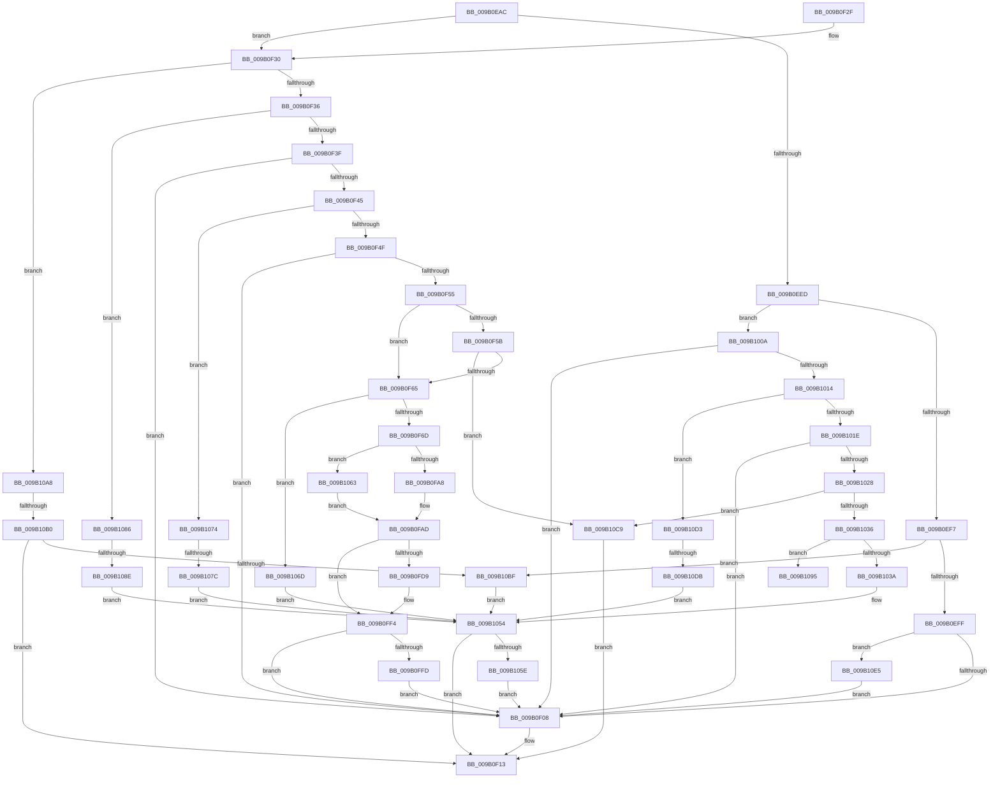

# CmpProcessLightWeightUOW

- RVA: `0x009B0EAC`–`0x009B10F5` (길이 `585` bytes)
- VA: `0x00000001409B0EAC`
- 실행 섹션: `PAGE`
- PDB 이름 있음: `예`; PDB Function 태그: `예`
- unwind 정보 RVA: `0x0009E20C`
- 디코드: `147`개 명령, `585/585` bytes 표시
- 미해석 바이트: `0` (있으면 어셈블리에 `.byte`로 보존)

> 이 문서는 커널 이미지의 기계어와 PDB 기호를 분석해 생성했습니다. 4번과 5번은 함수 원형과 자료형을 바이너리 사용 방식에서 추정한 C 해석이며 원본 소스 복구 결과는 아닙니다.

## 1. Dependencies

- 직접 호출 지점: **15**; 고유 호출 대상: **14**
- 직접 호출자로 확인된 함수: **2**
- RIP 상대 이미지 참조: **1**

### Outgoing calls
- `0x009B0F0E` → [CmpSignalDeferredPosts](../84/CmpSignalDeferredPosts_function_008484B0.md) (function, `0x008484B0`)
- `0x009B0F70` → [CmpLightWeightCommitSetValueKeyUoW](../A3/CmpLightWeightCommitSetValueKeyUoW_function_00A39FA0.md) (function, `0x00A39FA0`)
- `0x009B0F88` → [CmpStartKcbStackForTopLayerKcb](../84/CmpStartKcbStackForTopLayerKcb_function_00848390.md) (function, `0x00848390`)
- `0x009B0FC7` → [CmpReportNotifyHelper](../8C/CmpReportNotifyHelper_function_008C7230.md) (function, `0x008C7230`)
- `0x009B0FEF` → [CmpReportNotifyHelper](../8C/CmpReportNotifyHelper_function_008C7230.md) (function, `0x008C7230`)
- `0x009B1000` → [CmSiFreeMemory](../../text/47/CmSiFreeMemory_function_00475D80.md) (function, `0x00475D80`)
- `0x009B104F` → [HvpMarkCellDirty](../85/HvpMarkCellDirty_function_00858080.md) (function, `0x00858080`)
- `0x009B106D` → [CmpLightWeightPrepareSetValueKeyUoW](../A0/CmpLightWeightPrepareSetValueKeyUoW_function_00A0EF28.md) (function, `0x00A0EF28`)
- `0x009B107F` → [CmpLightWeightPrepareDeleteKeyUoW](../A5/CmpLightWeightPrepareDeleteKeyUoW_function_00A54494.md) (function, `0x00A54494`)
- `0x009B108E` → [CmpLightWeightPrepareAddKeyUoW](../A5/CmpLightWeightPrepareAddKeyUoW_function_00A547FC.md) (function, `0x00A547FC`)
- `0x009B1098` → [CmpLightWeightCommitRecreateKeyUoW](../A5/CmpLightWeightCommitRecreateKeyUoW_function_00A543CC.md) (function, `0x00A543CC`)
- `0x009B10B0` → [CmpLightWeightPrepareDeleteValueKeyUoW](../A0/CmpLightWeightPrepareDeleteValueKeyUoW_function_00A0F3D8.md) (function, `0x00A0F3D8`)
- `0x009B10C2` → [CmpLightWeightPrepareSetKeyUserFlags](../A5/CmpLightWeightPrepareSetKeyUserFlags_function_00A553FC.md) (function, `0x00A553FC`)
- `0x009B10DB` → [CmpLightWeightPrepareSetSecDescUoW](../94/CmpLightWeightPrepareSetSecDescUoW_function_0094B098.md) (function, `0x0094B098`)
- `0x009B10EB` → [CmpLightWeightCommitSetUserFlagsUoW](../A5/CmpLightWeightCommitSetUserFlagsUoW_function_00A5FB7C.md) (function, `0x00A5FB7C`)

### Direct callers
- [CmpCommitPreparedLightWeightTransaction](CmpCommitPreparedLightWeightTransaction_function_009B0B88.md) at `0x009B0C60`
- [CmpPrepareLightWeightTransaction](CmpPrepareLightWeightTransaction_function_009B0D24.md) at `0x009B0DE5`

### Static image references
- `0x009B0FCC` → RVA `0x00FD9A90` (`PAGEDATA`; read)

## 2. Other-region calls and transfers

- 다른 실행 섹션으로 향하는 call: **1**
  - `0x009B1000` → [CmSiFreeMemory](../../text/47/CmSiFreeMemory_function_00475D80.md) (`PAGE` → `.text`)
- call이 아닌 외부 분기/꼬리 이동: **5**
  - `0x009B1076` → [sub_00B2DAE6](../B2/Unknown_function_00B2DAE6.md) (`tail-transfer`)
  - `0x009B1088` → [sub_00B2DAE6 + 0x27](../B2/Unknown_function_00B2DAE6.md) (`tail-transfer`)
  - `0x009B10A3` → [sub_00B2DAE6 + 0x3D](../B2/Unknown_function_00B2DAE6.md) (`tail-transfer`)
  - `0x009B10AA` → [sub_00B2DAE6 + 0x50](../B2/Unknown_function_00B2DAE6.md) (`tail-transfer`)
  - `0x009B10D5` → [sub_00B2DAE6 + 0x32](../B2/Unknown_function_00B2DAE6.md) (`tail-transfer`)

## 3. Assembly (complete function range)

```asm
009B0EAC  48 8B C4                        mov rax, rsp
009B0EAF  48 89 58 08                     mov qword ptr [rax + 8], rbx
009B0EB3  48 89 70 10                     mov qword ptr [rax + 0x10], rsi
009B0EB7  48 89 78 18                     mov qword ptr [rax + 0x18], rdi
009B0EBB  4C 89 70 20                     mov qword ptr [rax + 0x20], r14
009B0EBF  55                              push rbp
009B0EC0  48 8B EC                        mov rbp, rsp
009B0EC3  48 83 EC 60                     sub rsp, 0x60
009B0EC7  44 8B 51 44                     mov r10d, dword ptr [rcx + 0x44]
009B0ECB  48 8D 45 D0                     lea rax, [rbp - 0x30]
009B0ECF  48 89 45 D8                     mov qword ptr [rbp - 0x28], rax
009B0ED3  48 8D 45 D0                     lea rax, [rbp - 0x30]
009B0ED7  48 89 45 D0                     mov qword ptr [rbp - 0x30], rax
009B0EDB  4D 8B F1                        mov r14, r9
009B0EDE  41 8B D8                        mov ebx, r8d
009B0EE1  48 8B F2                        mov rsi, rdx
009B0EE4  48 8B F9                        mov rdi, rcx
009B0EE7  41 83 FA 06                     cmp r10d, 6
009B0EEB  7E 43                           jle 0x1409b0f30
009B0EED  41 83 EA 07                     sub r10d, 7
009B0EF1  0F 85 13 01 00 00               jne 0x1409b100a
009B0EF7  85 DB                           test ebx, ebx
009B0EF9  0F 84 C0 01 00 00               je 0x1409b10bf
009B0EFF  83 FB 01                        cmp ebx, 1
009B0F02  0F 84 DD 01 00 00               je 0x1409b10e5
009B0F08  33 DB                           xor ebx, ebx
009B0F0A  48 8D 4D D0                     lea rcx, [rbp - 0x30]
009B0F0E  E8 9D 75 E9 FF                  call 0x1408484b0
009B0F13  4C 8D 5C 24 60                  lea r11, [rsp + 0x60]
009B0F18  8B C3                           mov eax, ebx
009B0F1A  49 8B 5B 10                     mov rbx, qword ptr [r11 + 0x10]
009B0F1E  49 8B 73 18                     mov rsi, qword ptr [r11 + 0x18]
009B0F22  49 8B 7B 20                     mov rdi, qword ptr [r11 + 0x20]
009B0F26  4D 8B 73 28                     mov r14, qword ptr [r11 + 0x28]
009B0F2A  49 8B E3                        mov rsp, r11
009B0F2D  5D                              pop rbp
009B0F2E  C3                              ret
009B0F2F  CC                              int3
009B0F30  0F 84 72 01 00 00               je 0x1409b10a8
009B0F36  45 85 D2                        test r10d, r10d
009B0F39  0F 84 47 01 00 00               je 0x1409b1086
009B0F3F  41 83 EA 01                     sub r10d, 1
009B0F43  74 C3                           je 0x1409b0f08
009B0F45  41 83 EA 01                     sub r10d, 1
009B0F49  0F 84 25 01 00 00               je 0x1409b1074
009B0F4F  41 83 EA 01                     sub r10d, 1
009B0F53  74 B3                           je 0x1409b0f08
009B0F55  41 83 EA 01                     sub r10d, 1
009B0F59  74 0A                           je 0x1409b0f65
009B0F5B  41 83 FA 01                     cmp r10d, 1
009B0F5F  0F 85 64 01 00 00               jne 0x1409b10c9
009B0F65  85 DB                           test ebx, ebx
009B0F67  0F 84 00 01 00 00               je 0x1409b106d
009B0F6D  4D 8B C6                        mov r8, r14
009B0F70  E8 2B 90 08 00                  call 0x140a39fa0
009B0F75  48 8B 57 30                     mov rdx, qword ptr [rdi + 0x30]
009B0F79  48 8D 4D E0                     lea rcx, [rbp - 0x20]
009B0F7D  0F 57 C0                        xorps xmm0, xmm0
009B0F80  0F 11 45 E0                     movups xmmword ptr [rbp - 0x20], xmm0
009B0F84  0F 11 45 F0                     movups xmmword ptr [rbp - 0x10], xmm0
009B0F88  E8 03 74 E9 FF                  call 0x140848390
009B0F8D  B8 02 00 00 00                  mov eax, 2
009B0F92  66 39 45 E2                     cmp word ptr [rbp - 0x1e], ax
009B0F96  0F AE E8                        lfence
009B0F99  48 0F BF 45 E2                  movsx rax, word ptr [rbp - 0x1e]
009B0F9E  48 8B 5D F8                     mov rbx, qword ptr [rbp - 8]
009B0FA2  0F 8D BB 00 00 00               jge 0x1409b1063
009B0FA8  48 8B 7C C5 E8                  mov rdi, qword ptr [rbp + rax*8 - 0x18]
009B0FAD  48 8B 57 20                     mov rdx, qword ptr [rdi + 0x20]
009B0FB1  48 8D 45 D0                     lea rax, [rbp - 0x30]
009B0FB5  41 B9 04 00 00 00               mov r9d, 4
009B0FBB  48 89 44 24 20                  mov qword ptr [rsp + 0x20], rax
009B0FC0  45 33 C0                        xor r8d, r8d
009B0FC3  48 8D 4D E0                     lea rcx, [rbp - 0x20]
009B0FC7  E8 64 62 F1 FF                  call 0x1408c7230
009B0FCC  48 8B 15 BD 8A 62 00            mov rdx, qword ptr [rip + 0x628abd]
009B0FD3  48 39 57 20                     cmp qword ptr [rdi + 0x20], rdx
009B0FD7  74 1B                           je 0x1409b0ff4
009B0FD9  48 8D 45 D0                     lea rax, [rbp - 0x30]
009B0FDD  41 B9 04 00 00 00               mov r9d, 4
009B0FE3  45 33 C0                        xor r8d, r8d
009B0FE6  48 89 44 24 20                  mov qword ptr [rsp + 0x20], rax
009B0FEB  48 8D 4D E0                     lea rcx, [rbp - 0x20]
009B0FEF  E8 3C 62 F1 FF                  call 0x1408c7230
009B0FF4  48 85 DB                        test rbx, rbx
009B0FF7  0F 84 0B FF FF FF               je 0x1409b0f08
009B0FFD  48 8B CB                        mov rcx, rbx
009B1000  E8 7B 4D AC FF                  call 0x140475d80
009B1005  E9 FE FE FF FF                  jmp 0x1409b0f08
009B100A  41 83 EA 01                     sub r10d, 1
009B100E  0F 84 F4 FE FF FF               je 0x1409b0f08
009B1014  41 83 EA 01                     sub r10d, 1
009B1018  0F 84 B5 00 00 00               je 0x1409b10d3
009B101E  41 83 EA 04                     sub r10d, 4
009B1022  0F 84 E0 FE FF FF               je 0x1409b0f08
009B1028  B8 02 00 00 00                  mov eax, 2
009B102D  44 3B D0                        cmp r10d, eax
009B1030  0F 85 93 00 00 00               jne 0x1409b10c9
009B1036  85 DB                           test ebx, ebx
009B1038  75 5B                           jne 0x1409b1095
009B103A  48 8B 41 30                     mov rax, qword ptr [rcx + 0x30]
009B103E  45 33 C9                        xor r9d, r9d
009B1041  45 33 C0                        xor r8d, r8d
009B1044  48 8B 48 20                     mov rcx, qword ptr [rax + 0x20]
009B1048  48 8B 40 48                     mov rax, qword ptr [rax + 0x48]
009B104C  8B 50 28                        mov edx, dword ptr [rax + 0x28]
009B104F  E8 2C 70 EA FF                  call 0x140858080
009B1054  8B D8                           mov ebx, eax
009B1056  85 C0                           test eax, eax
009B1058  0F 88 B5 FE FF FF               js 0x1409b0f13
009B105E  E9 A5 FE FF FF                  jmp 0x1409b0f08
009B1063  48 8B 7C C3 F0                  mov rdi, qword ptr [rbx + rax*8 - 0x10]
009B1068  E9 40 FF FF FF                  jmp 0x1409b0fad
009B106D  E8 B6 DE 05 00                  call 0x140a0ef28
009B1072  EB E0                           jmp 0x1409b1054
009B1074  85 DB                           test ebx, ebx
009B1076  0F 85 6A CA 17 00               jne 0x140b2dae6
009B107C  49 8B D6                        mov rdx, r14
009B107F  E8 10 34 0A 00                  call 0x140a54494
009B1084  EB CE                           jmp 0x1409b1054
009B1086  85 DB                           test ebx, ebx
009B1088  0F 85 7F CA 17 00               jne 0x140b2db0d
009B108E  E8 69 37 0A 00                  call 0x140a547fc
009B1093  EB BF                           jmp 0x1409b1054
009B1095  4D 8B C6                        mov r8, r14
009B1098  E8 2F 33 0A 00                  call 0x140a543cc
009B109D  41 B8 01 00 00 00               mov r8d, 1
009B10A3  E9 7B CA 17 00                  jmp 0x140b2db23
009B10A8  85 DB                           test ebx, ebx
009B10AA  0F 85 86 CA 17 00               jne 0x140b2db36
009B10B0  E8 23 E3 05 00                  call 0x140a0f3d8
009B10B5  8B D8                           mov ebx, eax
009B10B7  85 C0                           test eax, eax
009B10B9  0F 88 54 FE FF FF               js 0x1409b0f13
009B10BF  48 8B CF                        mov rcx, rdi
009B10C2  E8 35 43 0A 00                  call 0x140a553fc
009B10C7  EB 8B                           jmp 0x1409b1054
009B10C9  BB 0D 00 00 C0                  mov ebx, 0xc000000d
009B10CE  E9 40 FE FF FF                  jmp 0x1409b0f13
009B10D3  85 DB                           test ebx, ebx
009B10D5  0F 85 3D CA 17 00               jne 0x140b2db18
009B10DB  E8 B8 9F F9 FF                  call 0x14094b098
009B10E0  E9 6F FF FF FF                  jmp 0x1409b1054
009B10E5  48 8B D6                        mov rdx, rsi
009B10E8  48 8B CF                        mov rcx, rdi
009B10EB  E8 8C EA 0A 00                  call 0x140a5fb7c
009B10F0  E9 13 FE FF FF                  jmp 0x1409b0f08
```

## 4. C-style interpretation (structured pseudocode)

```c
__int64 __fastcall CmpProcessLightWeightUOW(__int64 a1, __int64 a2, int a3, __int64 a4)
{
    __int64 result;
    __int64 v_r10;
    __int64 v_rbx;
    __int64 v_rsp;
    unsigned __int64 v_stack_m10;
    unsigned __int64 v_stack_m18;
    unsigned __int16 v_stack_m26;
    unsigned __int64 v_stack_m28;
    unsigned __int64 v_stack_m30;
    unsigned __int64 v_stack_m38;
    unsigned __int64 v_stack_m40;
    unsigned __int64 v_stack_m8;

    *(unsigned __int64 *)(v_rsp + 8) = v_rbx;
    *(unsigned __int64 *)(v_rsp + 16) = v_rsi;
    *(unsigned __int64 *)(v_rsp + 24) = v_rdi;
    *(unsigned __int64 *)(v_rsp + 32) = v_r14;
    v_rsp = (v_rsp) - (96);
    v_stack_m30 = v_stack_m38;
    v_stack_m38 = v_stack_m38;
    if (((unsigned int)((unsigned int)(*(unsigned int *)(a1 + 68)))) <= 6) goto loc_009B0F30;
    v_r10 = (unsigned int)(((unsigned int)(*(unsigned int *)(a1 + 68))) - (7));
    if (condition_is_not_equal) goto loc_009B100A;
    if ((unsigned int)((unsigned int)(a3)) == 0) goto loc_009B10BF;
    if (((unsigned int)((unsigned int)(a3))) == 1) goto loc_009B10E5;
loc_009B0F08:
    v_rbx = 0;
    result = CmpSignalDeferredPosts(v_stack_m38, a2, a3, a4);
loc_009B0F13:
    return 0;
loc_009B0F30:
    if (condition_is_equal) goto loc_009B10A8;
    if ((unsigned int)(v_r10) == 0) goto loc_009B1086;
    v_r10 = (unsigned int)((v_r10) - (1));
    if (condition_is_equal) goto loc_009B0F08;
    v_r10 = (unsigned int)((v_r10) - (1));
    if (condition_is_equal) goto loc_009B1074;
    v_r10 = (unsigned int)((v_r10) - (1));
    if (condition_is_equal) goto loc_009B0F08;
    v_r10 = (unsigned int)((v_r10) - (1));
    if (condition_is_equal) goto loc_009B0F65;
    if (((unsigned int)(v_r10)) != 1) goto loc_009B10C9;
loc_009B0F65:
    if ((unsigned int)(*(unsigned __int64 *)(v_stack_m8 + 16)) == 0) goto loc_009B106D;
    result = CmpLightWeightCommitSetValueKeyUoW(v_stack_m38, a2, *(unsigned __int64 *)(v_stack_m8 + 40), a4);
    v_stack_m28 = v_xmm0;
    v_stack_m18 = v_xmm0;
    result = CmpStartKcbStackForTopLayerKcb(v_stack_m28, *(unsigned __int64 *)(*(unsigned __int64 *)(v_stack_m8 + 32) + 48), *(unsigned __int64 *)(v_stack_m8 + 40), a4);
    if (v_stack_m26 >= 2) goto loc_009B1063;
loc_009B0FAD:
    v_stack_m40 = v_stack_m38;
    a3 = 0;
    result = CmpReportNotifyHelper(v_stack_m28, *(unsigned __int64 *)(*(unsigned __int64 *)(v_rsp + (__int16)(v_stack_m26) * 8 - 24) + 32), a3, 4);
    if ((*(unsigned __int64 *)(*(unsigned __int64 *)(v_rsp + (__int16)(v_stack_m26) * 8 - 24) + 32)) != (*(unsigned __int64 *)(v_rip + 6458045))) {
        result = v_stack_m38;
        a4 = 4;
        a3 = 0;
        v_stack_m40 = result;
        a1 = v_stack_m28;
        result = CmpReportNotifyHelper(a1, *(unsigned __int64 *)(v_rip + 6458045), a3, a4);
    }
    if (v_stack_m10 == 0) goto loc_009B0F08;
    result = CmSiFreeMemory(v_stack_m10, *(unsigned __int64 *)(v_rip + 6458045), a3, a4);
    goto loc_009B0F08;
loc_009B100A:
    v_r10 = (unsigned int)((v_r10) - (1));
    if (condition_is_equal) goto loc_009B0F08;
    v_r10 = (unsigned int)((v_r10) - (1));
    if (condition_is_equal) goto loc_009B10D3;
    v_r10 = (unsigned int)((v_r10) - (4));
    if (condition_is_equal) goto loc_009B0F08;
    if (((unsigned int)(v_r10)) != 2) goto loc_009B10C9;
    if ((unsigned int)(v_stack_m10) != 0) goto loc_009B1095;
    a4 = 0;
    a3 = 0;
    result = HvpMarkCellDirty(*(unsigned __int64 *)(*(unsigned __int64 *)(v_stack_m10 + 48) + 32), (unsigned int)(*(unsigned int *)(*(unsigned __int64 *)(*(unsigned __int64 *)(v_stack_m10 + 48) + 72) + 40)), a3, a4);
loc_009B1054:
    if (sign_flag) goto loc_009B0F13;
    goto loc_009B0F08;
loc_009B1063:
    goto loc_009B0FAD;
loc_009B106D:
    result = CmpLightWeightPrepareSetValueKeyUoW(*(unsigned __int64 *)(*(unsigned __int64 *)(v_stack_m10 + 48) + 32), (unsigned int)(*(unsigned int *)(*(unsigned __int64 *)(*(unsigned __int64 *)(v_stack_m10 + 48) + 72) + 40)), a3, a4);
    goto loc_009B1054;
loc_009B1074:
    result = CmpLightWeightPrepareDeleteKeyUoW(*(unsigned __int64 *)(*(unsigned __int64 *)(v_stack_m10 + 48) + 32), *(unsigned __int64 *)(v_stack_m8 + 40), a3, a4);
    goto loc_009B1054;
loc_009B1086:
    result = CmpLightWeightPrepareAddKeyUoW(*(unsigned __int64 *)(*(unsigned __int64 *)(v_stack_m10 + 48) + 32), *(unsigned __int64 *)(v_stack_m8 + 40), a3, a4);
    goto loc_009B1054;
loc_009B1095:
    result = CmpLightWeightCommitRecreateKeyUoW(*(unsigned __int64 *)(*(unsigned __int64 *)(v_stack_m10 + 48) + 32), *(unsigned __int64 *)(v_stack_m8 + 40), *(unsigned __int64 *)(v_stack_m8 + 40), a4);
loc_009B10A8:
    result = CmpLightWeightPrepareDeleteValueKeyUoW(*(unsigned __int64 *)(*(unsigned __int64 *)(v_stack_m10 + 48) + 32), *(unsigned __int64 *)(v_stack_m8 + 40), 1, a4);
    if (sign_flag) goto loc_009B0F13;
loc_009B10BF:
    result = CmpLightWeightPrepareSetKeyUserFlags(*(unsigned __int64 *)((unsigned int)((unsigned int)(result)) + result * 8 - 16), *(unsigned __int64 *)(v_stack_m8 + 40), 1, a4);
    goto loc_009B1054;
loc_009B10C9:
    goto loc_009B0F13;
loc_009B10D3:
    result = CmpLightWeightPrepareSetSecDescUoW(*(unsigned __int64 *)((unsigned int)((unsigned int)(result)) + result * 8 - 16), *(unsigned __int64 *)(v_stack_m8 + 40), 1, a4);
    goto loc_009B1054;
loc_009B10E5:
    result = CmpLightWeightCommitSetUserFlagsUoW(*(unsigned __int64 *)((unsigned int)((unsigned int)(result)) + result * 8 - 16), *(unsigned __int64 *)(v_stack_m8 + 24), 1, a4);
    goto loc_009B0F08;
}
```

## 5. (Beta) C Style

```c
int64_t CmpProcessLightWeightUOW(void *Arg1, int64_t Arg2, int32_t Arg3, int64_t Arg4)
{
    uint8_t *arg1 = (uint8_t *)Arg1;

    int64_t result;
    int64_t local_r10;
    int64_t local_rbx;
    int64_t local_rsp;
    uint64_t v_stack_m10;
    uint64_t v_stack_m18;
    uint16_t v_stack_m26;
    uint64_t v_stack_m28;
    uint64_t v_stack_m30;
    uint64_t v_stack_m38;
    uint64_t v_stack_m40;
    uint64_t v_stack_m8;

    *(uint64_t *)(local_rsp + 0x8) = local_rbx;
    *(uint64_t *)(local_rsp + 0x10) = local_rsi;
    *(uint64_t *)(local_rsp + 0x18) = local_rdi;
    *(uint64_t *)(local_rsp + 0x20) = local_r14;
    local_rsp = (local_rsp) - (96);
    v_stack_m30 = v_stack_m38;
    v_stack_m38 = v_stack_m38;
    if (((uint32_t)((uint32_t)(*(uint32_t *)(arg1 + 0x44)))) <= 6) goto loc_009B0F30;
    local_r10 = (uint32_t)(((uint32_t)(*(uint32_t *)(arg1 + 0x44))) - (7));
    if (condition_is_not_equal) goto loc_009B100A;
    if ((uint32_t)((uint32_t)(Arg3)) == 0) goto loc_009B10BF;
    if (((uint32_t)((uint32_t)(Arg3))) == 1) goto loc_009B10E5;
loc_009B0F08:
    local_rbx = 0;
    result = CmpSignalDeferredPosts(v_stack_m38, Arg2, Arg3, Arg4);
loc_009B0F13:
    return 0;
loc_009B0F30:
    if (condition_is_equal) goto loc_009B10A8;
    if ((uint32_t)(local_r10) == 0) goto loc_009B1086;
    local_r10 = (uint32_t)((local_r10) - (1));
    if (condition_is_equal) goto loc_009B0F08;
    local_r10 = (uint32_t)((local_r10) - (1));
    if (condition_is_equal) goto loc_009B1074;
    local_r10 = (uint32_t)((local_r10) - (1));
    if (condition_is_equal) goto loc_009B0F08;
    local_r10 = (uint32_t)((local_r10) - (1));
    if (condition_is_equal) goto loc_009B0F65;
    if (((uint32_t)(local_r10)) != 1) goto loc_009B10C9;
loc_009B0F65:
    if ((uint32_t)(*(uint64_t *)(v_stack_m8 + 0x10)) == 0) goto loc_009B106D;
    result = CmpLightWeightCommitSetValueKeyUoW(v_stack_m38, Arg2, *(uint64_t *)(v_stack_m8 + 0x28), Arg4);
    v_stack_m28 = v_xmm0;
    v_stack_m18 = v_xmm0;
    result = CmpStartKcbStackForTopLayerKcb(v_stack_m28, *(uint64_t *)(*(uint64_t *)(v_stack_m8 + 0x20) + 0x30), *(uint64_t *)(v_stack_m8 + 0x28), Arg4);
    if (v_stack_m26 >= 2) goto loc_009B1063;
loc_009B0FAD:
    v_stack_m40 = v_stack_m38;
    Arg3 = 0;
    result = CmpReportNotifyHelper(v_stack_m28, *(uint64_t *)(*(uint64_t *)(local_rsp + (int16_t)(v_stack_m26) * 8 - 0x18) + 0x20), Arg3, 4);
    if ((*(uint64_t *)(*(uint64_t *)(local_rsp + (int16_t)(v_stack_m26) * 8 - 0x18) + 0x20)) != (*(uint64_t *)(v_rip + 0x628ABD))) {
        result = v_stack_m38;
        Arg4 = 4;
        Arg3 = 0;
        v_stack_m40 = result;
        Arg1 = v_stack_m28;
        result = CmpReportNotifyHelper(Arg1, *(uint64_t *)(v_rip + 0x628ABD), Arg3, Arg4);
    }
    if (v_stack_m10 == 0) goto loc_009B0F08;
    result = CmSiFreeMemory(v_stack_m10, *(uint64_t *)(v_rip + 0x628ABD), Arg3, Arg4);
    goto loc_009B0F08;
loc_009B100A:
    local_r10 = (uint32_t)((local_r10) - (1));
    if (condition_is_equal) goto loc_009B0F08;
    local_r10 = (uint32_t)((local_r10) - (1));
    if (condition_is_equal) goto loc_009B10D3;
    local_r10 = (uint32_t)((local_r10) - (4));
    if (condition_is_equal) goto loc_009B0F08;
    if (((uint32_t)(local_r10)) != 2) goto loc_009B10C9;
    if ((uint32_t)(v_stack_m10) != 0) goto loc_009B1095;
    Arg4 = 0;
    Arg3 = 0;
    result = HvpMarkCellDirty(*(uint64_t *)(*(uint64_t *)(v_stack_m10 + 0x30) + 0x20), (uint32_t)(*(uint32_t *)(*(uint64_t *)(*(uint64_t *)(v_stack_m10 + 0x30) + 0x48) + 0x28)), Arg3, Arg4);
loc_009B1054:
    if (sign_flag) goto loc_009B0F13;
    goto loc_009B0F08;
loc_009B1063:
    goto loc_009B0FAD;
loc_009B106D:
    result = CmpLightWeightPrepareSetValueKeyUoW(*(uint64_t *)(*(uint64_t *)(v_stack_m10 + 0x30) + 0x20), (uint32_t)(*(uint32_t *)(*(uint64_t *)(*(uint64_t *)(v_stack_m10 + 0x30) + 0x48) + 0x28)), Arg3, Arg4);
    goto loc_009B1054;
loc_009B1074:
    result = CmpLightWeightPrepareDeleteKeyUoW(*(uint64_t *)(*(uint64_t *)(v_stack_m10 + 0x30) + 0x20), *(uint64_t *)(v_stack_m8 + 0x28), Arg3, Arg4);
    goto loc_009B1054;
loc_009B1086:
    result = CmpLightWeightPrepareAddKeyUoW(*(uint64_t *)(*(uint64_t *)(v_stack_m10 + 0x30) + 0x20), *(uint64_t *)(v_stack_m8 + 0x28), Arg3, Arg4);
    goto loc_009B1054;
loc_009B1095:
    result = CmpLightWeightCommitRecreateKeyUoW(*(uint64_t *)(*(uint64_t *)(v_stack_m10 + 0x30) + 0x20), *(uint64_t *)(v_stack_m8 + 0x28), *(uint64_t *)(v_stack_m8 + 0x28), Arg4);
loc_009B10A8:
    result = CmpLightWeightPrepareDeleteValueKeyUoW(*(uint64_t *)(*(uint64_t *)(v_stack_m10 + 0x30) + 0x20), *(uint64_t *)(v_stack_m8 + 0x28), 1, Arg4);
    if (sign_flag) goto loc_009B0F13;
loc_009B10BF:
    result = CmpLightWeightPrepareSetKeyUserFlags(*(uint64_t *)((uint32_t)((uint32_t)(result)) + result * 8 - 0x10), *(uint64_t *)(v_stack_m8 + 0x28), 1, Arg4);
    goto loc_009B1054;
loc_009B10C9:
    goto loc_009B0F13;
loc_009B10D3:
    result = CmpLightWeightPrepareSetSecDescUoW(*(uint64_t *)((uint32_t)((uint32_t)(result)) + result * 8 - 0x10), *(uint64_t *)(v_stack_m8 + 0x28), 1, Arg4);
    goto loc_009B1054;
loc_009B10E5:
    result = CmpLightWeightCommitSetUserFlagsUoW(*(uint64_t *)((uint32_t)((uint32_t)(result)) + result * 8 - 0x10), *(uint64_t *)(v_stack_m8 + 0x18), 1, Arg4);
    goto loc_009B0F08;
}
```

### 관측된 메모리 오프셋

구조체 형식이 확인되지 않은 접근은 인자 기준의 오프셋으로만 기록했습니다.

| 기준 인자 | 오프셋 표현 | 폭 (bit) | 접근 |
|---|---:|---:|---|
| `Arg1` | `+ 0x30` | `64` | `R` |
| `Arg1` | `+ 0x44` | `32` | `R` |

## 6. Execution-region graph

[열기: 2D/3D 그래프와 함수 탐색 컨트롤 패널](../../../control-panel.html?section=page&rva=0x009B0EAC&view=graph)

- 2D 그래프는 위에서 아래로 흐르고, 3D 그래프는 빈 공간을 드래그해 회전합니다. Shift+드래그는 이동, 휠은 확대·축소, 함수 노드 선택은 대상 보고서 이동입니다.

### Static fallback


