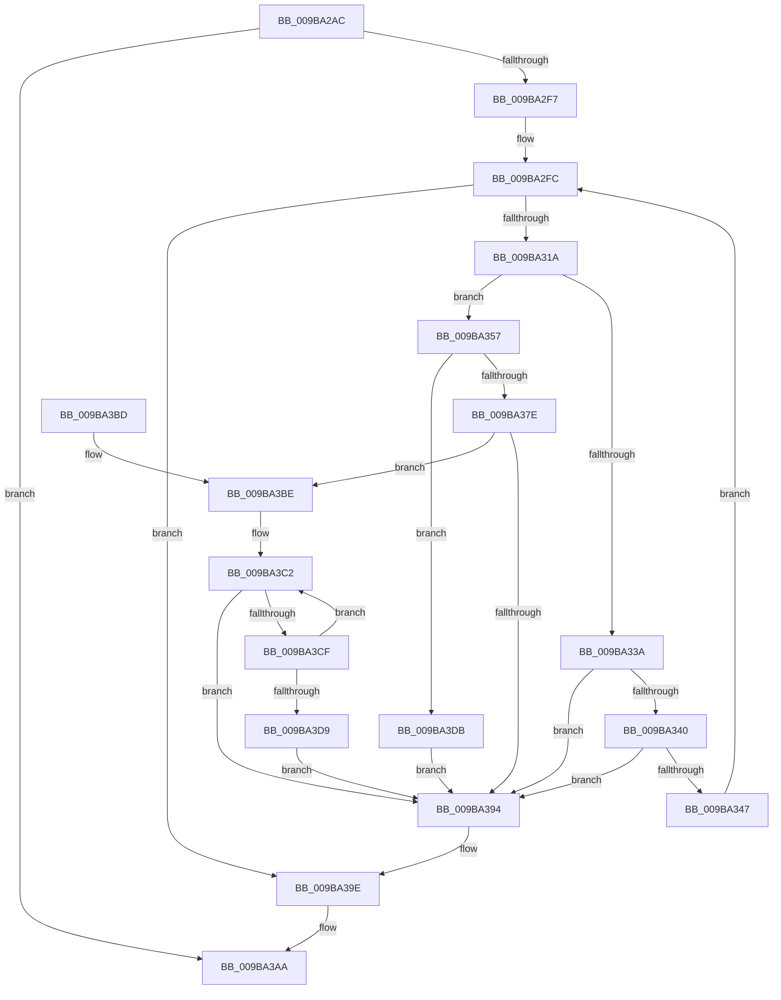

# CmpQueryNameString

- RVA: `0x009BA2AC`–`0x009BA3E2` (길이 `310` bytes)
- VA: `0x00000001409BA2AC`
- 실행 섹션: `PAGE`
- PDB 이름 있음: `예`; PDB Function 태그: `아니요`
- unwind 정보 RVA: `0x0009EB00`
- 디코드: `90`개 명령, `310/310` bytes 표시
- 미해석 바이트: `0` (있으면 어셈블리에 `.byte`로 보존)

> 이 문서는 커널 이미지의 기계어와 PDB 기호를 분석해 생성했습니다. 4번과 5번은 함수 원형과 자료형을 바이너리 사용 방식에서 추정한 C 해석이며 원본 소스 복구 결과는 아닙니다.

## 1. Dependencies

- 직접 호출 지점: **8**; 고유 호출 대상: **6**
- 직접 호출자로 확인된 함수: **7**
- RIP 상대 이미지 참조: **1**

### Outgoing calls
- `0x009BA2E8` → [ObReferenceObjectByHandle](../86/ObReferenceObjectByHandle_function_00868DB0.md) (function, `0x00868DB0`)
- `0x009BA309` → [ExAllocatePool2](../../poolcode/B8/ExAllocatePool2_function_00B820F0.md) (function, `0x00B820F0`)
- `0x009BA32F` → [ObQueryNameStringMode](../8A/ObQueryNameStringMode_function_008A7ED0.md) (function, `0x008A7ED0`)
- `0x009BA34C` → [ExFreePoolWithTag](../../poolcode/B8/ExFreePoolWithTag_function_00B82870.md) (function, `0x00B82870`)
- `0x009BA370` → [ExAllocatePool2](../../poolcode/B8/ExAllocatePool2_function_00B820F0.md) (function, `0x00B820F0`)
- `0x009BA384` → [RtlAppendUnicodeStringToString](../../text/40/RtlAppendUnicodeStringToString_function_0040FA50.md) (function, `0x0040FA50`)
- `0x009BA399` → [ExFreePoolWithTag](../../poolcode/B8/ExFreePoolWithTag_function_00B82870.md) (function, `0x00B82870`)
- `0x009BA3A3` → [ObfDereferenceObject](../../text/2F/ObfDereferenceObject_function_002F9350.md) (function, `0x002F9350`)

### Direct callers
- [CmpTraceHiveRestoreStart](../7E/CmpTraceHiveRestoreStart_function_007E6624.md) at `0x007E668B`
- [CmpAddRemoveRMLogContainer](../7F/CmpAddRemoveRMLogContainer_function_007F01A0.md) at `0x007F020B`
- [CmpStartRMLog](../7F/CmpStartRMLog_function_007F0AFC.md) at `0x007F0C44`
- [CmpIsFileInSystemConfig](../7F/CmpIsFileInSystemConfig_function_007F1F80.md) at `0x007F204F`
- [CmpInitCmRM](../87/CmpInitCmRM_function_0087C700.md) at `0x0087CB95`
- [CmKtmNotification](CmKtmNotification_function_009B1950.md) at `0x009B1D5D`
- [CmpTraceHiveMountBaseFileMounted](CmpTraceHiveMountBaseFileMounted_function_009B8D0C.md) at `0x009B8D8C`

### Static image references
- `0x009BA2BF` → RVA `0x00EF7C68` (`.data`; read)

## 2. Other-region calls and transfers

- 다른 실행 섹션으로 향하는 call: **6**
  - `0x009BA309` → [ExAllocatePool2](../../poolcode/B8/ExAllocatePool2_function_00B820F0.md) (`PAGE` → `POOLCODE`)
  - `0x009BA34C` → [ExFreePoolWithTag](../../poolcode/B8/ExFreePoolWithTag_function_00B82870.md) (`PAGE` → `POOLCODE`)
  - `0x009BA370` → [ExAllocatePool2](../../poolcode/B8/ExAllocatePool2_function_00B820F0.md) (`PAGE` → `POOLCODE`)
  - `0x009BA384` → [RtlAppendUnicodeStringToString](../../text/40/RtlAppendUnicodeStringToString_function_0040FA50.md) (`PAGE` → `.text`)
  - `0x009BA399` → [ExFreePoolWithTag](../../poolcode/B8/ExFreePoolWithTag_function_00B82870.md) (`PAGE` → `POOLCODE`)
  - `0x009BA3A3` → [ObfDereferenceObject](../../text/2F/ObfDereferenceObject_function_002F9350.md) (`PAGE` → `.text`)
- 별도 외부 분기/꼬리 이동을 확인하지 못했습니다.

## 3. Assembly (complete function range)

```asm
009BA2AC  4C 8B DC                        mov r11, rsp
009BA2AF  49 89 5B 08                     mov qword ptr [r11 + 8], rbx
009BA2B3  49 89 6B 10                     mov qword ptr [r11 + 0x10], rbp
009BA2B7  56                              push rsi
009BA2B8  57                              push rdi
009BA2B9  41 56                           push r14
009BA2BB  48 83 EC 30                     sub rsp, 0x30
009BA2BF  48 8B 05 A2 D9 53 00            mov rax, qword ptr [rip + 0x53d9a2]
009BA2C6  33 ED                           xor ebp, ebp
009BA2C8  4C 8B F2                        mov r14, rdx
009BA2CB  49 89 6B E0                     mov qword ptr [r11 - 0x20], rbp
009BA2CF  45 33 C9                        xor r9d, r9d
009BA2D2  89 6C 24 60                     mov dword ptr [rsp + 0x60], ebp
009BA2D6  49 89 6B 20                     mov qword ptr [r11 + 0x20], rbp
009BA2DA  4C 8B 00                        mov r8, qword ptr [rax]
009BA2DD  8D 55 01                        lea edx, [rbp + 1]
009BA2E0  49 8D 43 20                     lea rax, [r11 + 0x20]
009BA2E4  49 89 43 D8                     mov qword ptr [r11 - 0x28], rax
009BA2E8  E8 C3 EA EA FF                  call 0x140868db0
009BA2ED  8B D8                           mov ebx, eax
009BA2EF  85 C0                           test eax, eax
009BA2F1  0F 88 B3 00 00 00               js 0x1409ba3aa
009BA2F7  BE 10 01 00 00                  mov esi, 0x110
009BA2FC  8B D6                           mov edx, esi
009BA2FE  B9 00 01 00 00                  mov ecx, 0x100
009BA303  41 B8 43 4D 53 62               mov r8d, 0x62534d43
009BA309  E8 E2 7D 1C 00                  call 0x140b820f0
009BA30E  48 8B F8                        mov rdi, rax
009BA311  48 85 C0                        test rax, rax
009BA314  0F 84 84 00 00 00               je 0x1409ba39e
009BA31A  48 8B 4C 24 68                  mov rcx, qword ptr [rsp + 0x68]
009BA31F  4C 8D 4C 24 60                  lea r9, [rsp + 0x60]
009BA324  44 8B C6                        mov r8d, esi
009BA327  40 88 6C 24 20                  mov byte ptr [rsp + 0x20], bpl
009BA32C  48 8B D0                        mov rdx, rax
009BA32F  E8 9C DB EE FF                  call 0x1408a7ed0
009BA334  8B D8                           mov ebx, eax
009BA336  85 C0                           test eax, eax
009BA338  79 1D                           jns 0x1409ba357
009BA33A  39 74 24 60                     cmp dword ptr [rsp + 0x60], esi
009BA33E  76 54                           jbe 0x1409ba394
009BA340  3D 05 00 00 80                  cmp eax, 0x80000005
009BA345  75 4D                           jne 0x1409ba394
009BA347  33 D2                           xor edx, edx
009BA349  48 8B CF                        mov rcx, rdi
009BA34C  E8 1F 85 1C 00                  call 0x140b82870
009BA351  8B 74 24 60                     mov esi, dword ptr [rsp + 0x60]
009BA355  EB A5                           jmp 0x1409ba2fc
009BA357  66 41 89 2E                     mov word ptr [r14], bp
009BA35B  B9 00 01 00 00                  mov ecx, 0x100
009BA360  0F B7 07                        movzx eax, word ptr [rdi]
009BA363  41 B8 53 74 72 67               mov r8d, 0x67727453
009BA369  8B D0                           mov edx, eax
009BA36B  66 41 89 46 02                  mov word ptr [r14 + 2], ax
009BA370  E8 7B 7D 1C 00                  call 0x140b820f0
009BA375  49 89 46 08                     mov qword ptr [r14 + 8], rax
009BA379  48 85 C0                        test rax, rax
009BA37C  74 5D                           je 0x1409ba3db
009BA37E  48 8B D7                        mov rdx, rdi
009BA381  49 8B CE                        mov rcx, r14
009BA384  E8 C7 56 A5 FF                  call 0x14040fa50
009BA389  41 0F B7 16                     movzx edx, word ptr [r14]
009BA38D  8B D8                           mov ebx, eax
009BA38F  66 85 D2                        test dx, dx
009BA392  75 2A                           jne 0x1409ba3be
009BA394  33 D2                           xor edx, edx
009BA396  48 8B CF                        mov rcx, rdi
009BA399  E8 D2 84 1C 00                  call 0x140b82870
009BA39E  48 8B 4C 24 68                  mov rcx, qword ptr [rsp + 0x68]
009BA3A3  E8 A8 EF 93 FF                  call 0x1402f9350
009BA3A8  8B C3                           mov eax, ebx
009BA3AA  48 8B 5C 24 50                  mov rbx, qword ptr [rsp + 0x50]
009BA3AF  48 8B 6C 24 58                  mov rbp, qword ptr [rsp + 0x58]
009BA3B4  48 83 C4 30                     add rsp, 0x30
009BA3B8  41 5E                           pop r14
009BA3BA  5F                              pop rdi
009BA3BB  5E                              pop rsi
009BA3BC  C3                              ret
009BA3BD  CC                              int3
009BA3BE  49 8B 4E 08                     mov rcx, qword ptr [r14 + 8]
009BA3C2  0F B7 C2                        movzx eax, dx
009BA3C5  48 D1 E8                        shr rax, 1
009BA3C8  66 39 6C 41 FE                  cmp word ptr [rcx + rax*2 - 2], bp
009BA3CD  75 C5                           jne 0x1409ba394
009BA3CF  66 83 EA 02                     sub dx, 2
009BA3D3  66 41 89 16                     mov word ptr [r14], dx
009BA3D7  75 E9                           jne 0x1409ba3c2
009BA3D9  EB B9                           jmp 0x1409ba394
009BA3DB  BB 17 00 00 C0                  mov ebx, 0xc0000017
009BA3E0  EB B2                           jmp 0x1409ba394
```

## 4. C-style interpretation (structured pseudocode)

```c
__int64 __fastcall CmpQueryNameString(__int64 a1, __int64 a2, __int64 a3, int a4)
{
    __int64 result;
    __int64 v_rbp;
    __int64 v_rsp;
    unsigned __int8 v_stack_m28;
    unsigned __int64 v_stack_p10;
    unsigned int v_stack_p18;
    unsigned __int64 v_stack_p20;
    unsigned __int64 v_stack_p8;

    *(unsigned __int64 *)(v_rsp + 8) = v_rbx;
    *(unsigned __int64 *)(v_rsp + 16) = v_rbp;
    v_rsp = (v_rsp) - (48);
    v_rbp = 0;
    *(unsigned __int64 *)(v_rsp - 32) = 0;
    a4 = 0;
    v_stack_p18 = 0;
    *(unsigned __int64 *)(v_rsp + 32) = 0;
    *(unsigned __int64 *)(v_rsp - 40) = v_rsp + 32;
    result = ObReferenceObjectByHandle(a1, v_rbp + 1, *(unsigned __int64 *)(*(unsigned __int64 *)(v_rip + 5495202)), a4);
    if (sign_flag) goto loc_009BA3AA;
loc_009BA2FC:
    result = ExAllocatePool2(256, 272, (unsigned int)(0x62534D43ULL), a4);
    if (result == 0) goto loc_009BA39E;
    v_stack_m28 = 0;
    result = ObQueryNameStringMode(v_stack_p20, result, 272, v_stack_p18);
    if (!sign_flag) goto loc_009BA357;
    if (v_stack_p18 <= 272) goto loc_009BA394;
    if (((unsigned int)(result)) != 0x80000005ULL) goto loc_009BA394;
    a2 = 0;
    result = ExFreePoolWithTag(result, a2, 272, v_stack_p18);
    goto loc_009BA2FC;
loc_009BA357:
    *(unsigned __int16 *)(a2) = 0;
    *(unsigned __int16 *)(a2 + 2) = (unsigned __int16)(*(unsigned __int16 *)(result));
    result = ExAllocatePool2(256, (unsigned int)((unsigned int)(*(unsigned __int16 *)(result))), (unsigned int)(0x67727453ULL), v_stack_p18);
    *(unsigned __int64 *)(a2 + 8) = result;
    if (result == 0) goto loc_009BA3DB;
    result = RtlAppendUnicodeStringToString(0, result, (unsigned int)(0x67727453ULL), v_stack_p18);
    if ((unsigned __int16)(*(unsigned __int16 *)(a2)) != 0) goto loc_009BA3BE;
loc_009BA394:
    a2 = 0;
    result = ExFreePoolWithTag(result, a2, (unsigned int)(0x67727453ULL), v_stack_p18);
loc_009BA39E:
    result = ObfDereferenceObject(v_stack_p20, a2, (unsigned int)(0x67727453ULL), v_stack_p18);
loc_009BA3AA:
    v_rsp = (v_rsp) + (48);
    return (unsigned int)((unsigned int)((unsigned int)((unsigned int)(result))));
loc_009BA3BE:
loc_009BA3C2:
    result = (0) >> (1);
    if ((*(unsigned __int16 *)(*(unsigned __int64 *)(a2 + 8) + result * 2 - 2)) != ((unsigned __int16)(v_stack_p10))) goto loc_009BA394;
    a2 = (unsigned __int16)((a2) - (2));
    *(unsigned __int16 *)(a2) = (unsigned __int16)(a2);
    if (condition_is_not_equal) goto loc_009BA3C2;
    goto loc_009BA394;
loc_009BA3DB:
    goto loc_009BA394;
}
```

## 5. (Beta) C Style

```c
int64_t CmpQueryNameString(int64_t Arg1, void *Arg2, int64_t Arg3, int32_t Arg4)
{
    uint8_t *arg2 = (uint8_t *)Arg2;

    int64_t result;
    int64_t local_rbp;
    int64_t local_rsp;
    uint8_t v_stack_m28;
    uint64_t v_stack_p10;
    uint32_t v_stack_p18;
    uint64_t v_stack_p20;
    uint64_t v_stack_p8;

    *(uint64_t *)(local_rsp + 0x8) = local_rbx;
    *(uint64_t *)(local_rsp + 0x10) = local_rbp;
    local_rsp = (local_rsp) - (48);
    local_rbp = 0;
    *(uint64_t *)(local_rsp - 0x20) = 0;
    Arg4 = 0;
    v_stack_p18 = 0;
    *(uint64_t *)(local_rsp + 0x20) = 0;
    *(uint64_t *)(local_rsp - 0x28) = local_rsp + 32;
    result = ObReferenceObjectByHandle(Arg1, local_rbp + 1, *(uint64_t *)(*(uint64_t *)(v_rip + 0x53D9A2)), Arg4);
    if (sign_flag) goto loc_009BA3AA;
loc_009BA2FC:
    result = ExAllocatePool2(256, 272, (uint32_t)(0x62534D43ULL), Arg4);
    if (result == 0) goto loc_009BA39E;
    v_stack_m28 = 0;
    result = ObQueryNameStringMode(v_stack_p20, result, 272, v_stack_p18);
    if (!sign_flag) goto loc_009BA357;
    if (v_stack_p18 <= 272) goto loc_009BA394;
    if (((uint32_t)(result)) != 0x80000005ULL) goto loc_009BA394;
    Arg2 = 0;
    result = ExFreePoolWithTag(result, Arg2, 272, v_stack_p18);
    goto loc_009BA2FC;
loc_009BA357:
    *(uint16_t *)(arg2) = 0;
    *(uint16_t *)(arg2 + 0x2) = (uint16_t)(*(uint16_t *)(result));
    result = ExAllocatePool2(256, (uint32_t)((uint32_t)(*(uint16_t *)(result))), (uint32_t)(0x67727453ULL), v_stack_p18);
    *(uint64_t *)(arg2 + 0x8) = result;
    if (result == 0) goto loc_009BA3DB;
    result = RtlAppendUnicodeStringToString(0, result, (uint32_t)(0x67727453ULL), v_stack_p18);
    if ((uint16_t)(*(uint16_t *)(arg2)) != 0) goto loc_009BA3BE;
loc_009BA394:
    Arg2 = 0;
    result = ExFreePoolWithTag(result, Arg2, (uint32_t)(0x67727453ULL), v_stack_p18);
loc_009BA39E:
    result = ObfDereferenceObject(v_stack_p20, Arg2, (uint32_t)(0x67727453ULL), v_stack_p18);
loc_009BA3AA:
    local_rsp = (local_rsp) + (48);
    return (uint32_t)((uint32_t)((uint32_t)((uint32_t)(result))));
loc_009BA3BE:
loc_009BA3C2:
    result = (0) >> (1);
    if ((*(uint16_t *)(*(uint64_t *)(arg2 + 0x8) + result * 2 - 0x2)) != ((uint16_t)(v_stack_p10))) goto loc_009BA394;
    Arg2 = (uint16_t)((Arg2) - (2));
    *(uint16_t *)(arg2) = (uint16_t)(Arg2);
    if (condition_is_not_equal) goto loc_009BA3C2;
    goto loc_009BA394;
loc_009BA3DB:
    goto loc_009BA394;
}
```

### 관측된 메모리 오프셋

구조체 형식이 확인되지 않은 접근은 인자 기준의 오프셋으로만 기록했습니다.

| 기준 인자 | 오프셋 표현 | 폭 (bit) | 접근 |
|---|---:|---:|---|
| `Arg2` | `+ 0x0` | `16` | `R` |
| `Arg2` | `+ 0x0` | `16` | `W` |
| `Arg2` | `+ 0x2` | `16` | `W` |
| `Arg2` | `+ 0x8` | `64` | `R` |
| `Arg2` | `+ 0x8` | `64` | `W` |

## 6. Execution-region graph

[열기: 2D/3D 그래프와 함수 탐색 컨트롤 패널](../../../control-panel.html?section=page&rva=0x009BA2AC&view=graph)

- 2D 그래프는 위에서 아래로 흐르고, 3D 그래프는 빈 공간을 드래그해 회전합니다. Shift+드래그는 이동, 휠은 확대·축소, 함수 노드 선택은 대상 보고서 이동입니다.

### Static fallback


