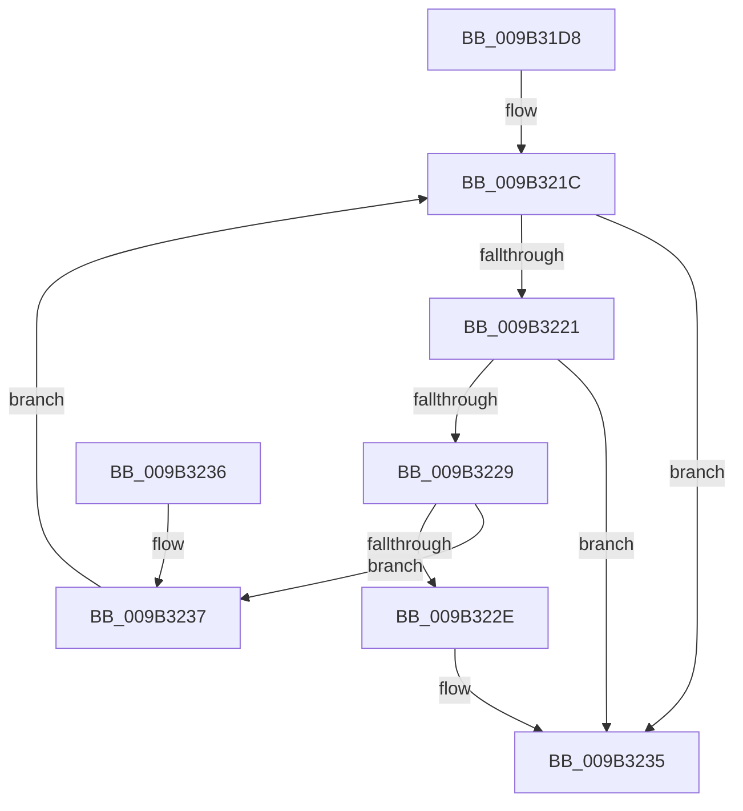

# CmpRemoveKeyHash

- RVA: `0x009B31D8`–`0x009B323D` (길이 `101` bytes)
- VA: `0x00000001409B31D8`
- 실행 섹션: `PAGE`
- PDB 이름 있음: `예`; PDB Function 태그: `아니요`
- unwind 정보 RVA: `0x000DB714`
- 디코드: `31`개 명령, `101/101` bytes 표시
- 미해석 바이트: `0` (있으면 어셈블리에 `.byte`로 보존)

> 이 문서는 커널 이미지의 기계어와 PDB 기호를 분석해 생성했습니다. 4번과 5번은 함수 원형과 자료형을 바이너리 사용 방식에서 추정한 C 해석이며 원본 소스 복구 결과는 아닙니다.

## 1. Dependencies

- 직접 호출 지점: **0**; 고유 호출 대상: **0**
- 직접 호출자로 확인된 함수: **3**
- RIP 상대 이미지 참조: **0**

### Outgoing calls
- 직접 디코드된 call 명령이 없습니다.

### Direct callers
- [CmRenameKey](../7E/CmRenameKey_function_007E8F48.md) at `0x007E9E7C`
- [CmpRehashKcbSubtree](../7E/CmpRehashKcbSubtree_function_007EB0C4.md) at `0x007EB131`
- [CmpDiscardKcb](CmpDiscardKcb_function_009B2F34.md) at `0x009B2F64`

### Static image references
- 디코드된 RIP-relative 메모리 참조가 없습니다.

## 2. Other-region calls and transfers

- 다른 실행 섹션으로 향하는 call: **0**
- 별도 외부 분기/꼬리 이동을 확인하지 못했습니다.

## 3. Assembly (complete function range)

```asm
009B31D8  8B 02                           mov eax, dword ptr [rdx]
009B31DA  4C 8B D1                        mov r10, rcx
009B31DD  8B 89 78 06 00 00               mov ecx, dword ptr [rcx + 0x678]
009B31E3  44 8B C0                        mov r8d, eax
009B31E6  41 C1 E8 09                     shr r8d, 9
009B31EA  4C 8B DA                        mov r11, rdx
009B31ED  44 33 C0                        xor r8d, eax
009B31F0  FF C9                           dec ecx
009B31F2  41 69 C0 A3 8A 01 00            imul eax, r8d, 0x18aa3
009B31F9  44 8B C8                        mov r9d, eax
009B31FC  49 C1 E9 09                     shr r9, 9
009B3200  44 8B C0                        mov r8d, eax
009B3203  49 8B 82 70 06 00 00            mov rax, qword ptr [r10 + 0x670]
009B320A  4D 33 C8                        xor r9, r8
009B320D  4C 23 C9                        and r9, rcx
009B3210  49 8D 51 01                     lea rdx, [r9 + 1]
009B3214  49 8D 14 51                     lea rdx, [r9 + rdx*2]
009B3218  48 8D 14 D0                     lea rdx, [rax + rdx*8]
009B321C  48 85 D2                        test rdx, rdx
009B321F  74 14                           je 0x1409b3235
009B3221  48 8B 02                        mov rax, qword ptr [rdx]
009B3224  48 85 C0                        test rax, rax
009B3227  74 0C                           je 0x1409b3235
009B3229  49 3B C3                        cmp rax, r11
009B322C  75 09                           jne 0x1409b3237
009B322E  48 8B 40 08                     mov rax, qword ptr [rax + 8]
009B3232  48 89 02                        mov qword ptr [rdx], rax
009B3235  C3                              ret
009B3236  CC                              int3
009B3237  48 8D 50 08                     lea rdx, [rax + 8]
009B323B  EB DF                           jmp 0x1409b321c
```

## 4. C-style interpretation (structured pseudocode)

```c
__int64 __fastcall CmpRemoveKeyHash(__int64 a1, __int64 a2)
{
    __int64 result;

    a3 = (unsigned int)(((unsigned int)((unsigned int)((unsigned int)(*(unsigned int *)(a2))))) >> (9));
    a3 = (unsigned int)((a3) ^ ((unsigned int)((unsigned int)(*(unsigned int *)(a2)))));
    a1 = (unsigned int)(((unsigned int)(*(unsigned int *)(a1 + 1656))) - 1);
    result = (unsigned int)(((unsigned int)(*(unsigned int *)(a2))) * ((unsigned int)(a3)));
    a4 = ((unsigned int)((unsigned int)(result))) >> (9);
    a4 = (a4) ^ ((unsigned int)((unsigned int)(result)));
    a4 = (a4) & (a1);
loc_009B321C:
    if (*(unsigned __int64 *)(a1 + 1648) + a4 + a4 + 1 * 2 * 8 == 0) goto loc_009B3235;
    if (*(unsigned __int64 *)(*(unsigned __int64 *)(a1 + 1648) + a4 + a4 + 1 * 2 * 8) == 0) goto loc_009B3235;
    if ((*(unsigned __int64 *)(*(unsigned __int64 *)(a1 + 1648) + a4 + a4 + 1 * 2 * 8)) != a2) goto loc_009B3237;
    *(unsigned __int64 *)(*(unsigned __int64 *)(a1 + 1648) + a4 + a4 + 1 * 2 * 8) = *(unsigned __int64 *)(*(unsigned __int64 *)(*(unsigned __int64 *)(a1 + 1648) + a4 + a4 + 1 * 2 * 8) + 8);
loc_009B3235:
    return *(unsigned __int64 *)(*(unsigned __int64 *)(*(unsigned __int64 *)(a1 + 1648) + a4 + a4 + 1 * 2 * 8) + 8);
loc_009B3237:
    goto loc_009B321C;
}
```

## 5. (Beta) C Style

```c
int64_t CmpRemoveKeyHash(void *Arg1, void *Arg2)
{
    uint8_t *arg1 = (uint8_t *)Arg1;
    uint8_t *arg2 = (uint8_t *)Arg2;

    int64_t result;

    a3 = (uint32_t)(((uint32_t)((uint32_t)((uint32_t)(*(uint32_t *)(arg2))))) >> (9));
    a3 = (uint32_t)((a3) ^ ((uint32_t)((uint32_t)(*(uint32_t *)(arg2)))));
    Arg1 = (uint32_t)(((uint32_t)(*(uint32_t *)(arg1 + 0x678))) - 1);
    result = (uint32_t)(((uint32_t)(*(uint32_t *)(arg2))) * ((uint32_t)(a3)));
    a4 = ((uint32_t)((uint32_t)(result))) >> (9);
    a4 = (a4) ^ ((uint32_t)((uint32_t)(result)));
    a4 = (a4) & (Arg1);
loc_009B321C:
    if (*(uint64_t *)(arg1 + 0x670) + a4 + a4 + 1 * 2 * 8 == 0) goto loc_009B3235;
    if (*(uint64_t *)(*(uint64_t *)(arg1 + 0x670) + a4 + a4 + 0x1 * 2 * 8) == 0) goto loc_009B3235;
    if ((*(uint64_t *)(*(uint64_t *)(arg1 + 0x670) + a4 + a4 + 0x1 * 2 * 8)) != Arg2) goto loc_009B3237;
    *(uint64_t *)(*(uint64_t *)(arg1 + 0x670) + a4 + a4 + 0x1 * 2 * 8) = *(uint64_t *)(*(uint64_t *)(*(uint64_t *)(arg1 + 0x670) + a4 + a4 + 0x1 * 2 * 8) + 0x8);
loc_009B3235:
    return *(uint64_t *)(*(uint64_t *)(*(uint64_t *)(arg1 + 0x670) + a4 + a4 + 0x1 * 2 * 8) + 0x8);
loc_009B3237:
    goto loc_009B321C;
}
```

### 관측된 메모리 오프셋

구조체 형식이 확인되지 않은 접근은 인자 기준의 오프셋으로만 기록했습니다.

| 기준 인자 | 오프셋 표현 | 폭 (bit) | 접근 |
|---|---:|---:|---|
| `Arg1` | `+ 0x670` | `64` | `R` |
| `Arg1` | `+ 0x678` | `32` | `R` |
| `Arg2` | `+ 0x0` | `32` | `R` |

## 6. Execution-region graph

[열기: 2D/3D 그래프와 함수 탐색 컨트롤 패널](../../../control-panel.html?section=page&rva=0x009B31D8&view=graph)

- 2D 그래프는 위에서 아래로 흐르고, 3D 그래프는 빈 공간을 드래그해 회전합니다. Shift+드래그는 이동, 휠은 확대·축소, 함수 노드 선택은 대상 보고서 이동입니다.

### Static fallback


