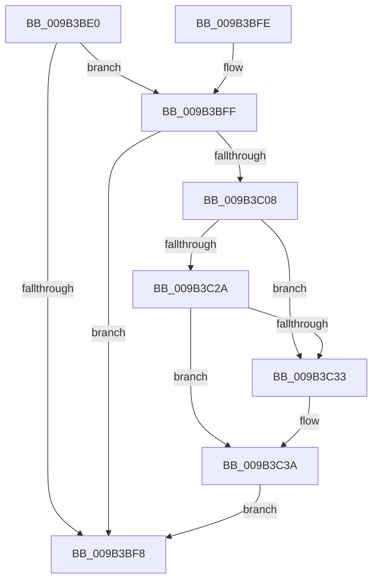

# CmpRemoveLayerLinkForDiscardedKcb

- RVA: `0x009B3BE0`–`0x009B3C43` (길이 `99` bytes)
- VA: `0x00000001409B3BE0`
- 실행 섹션: `PAGE`
- PDB 이름 있음: `예`; PDB Function 태그: `아니요`
- unwind 정보 RVA: `0x000818CC`
- 디코드: `30`개 명령, `99/99` bytes 표시
- 미해석 바이트: `0` (있으면 어셈블리에 `.byte`로 보존)

> 이 문서는 커널 이미지의 기계어와 PDB 기호를 분석해 생성했습니다. 4번과 5번은 함수 원형과 자료형을 바이너리 사용 방식에서 추정한 C 해석이며 원본 소스 복구 결과는 아닙니다.

## 1. Dependencies

- 직접 호출 지점: **1**; 고유 호출 대상: **1**
- 직접 호출자로 확인된 함수: **3**
- RIP 상대 이미지 참조: **0**

### Outgoing calls
- `0x009B3C15` → [CmpDelayDerefKeyControlBlock](../84/CmpDelayDerefKeyControlBlock_function_0084FA50.md) (function, `0x0084FA50`)

### Direct callers
- [CmpRemoveHiveFromNamespace](../../text/49/CmpRemoveHiveFromNamespace_function_0049C4CC.md) at `0x0049C549`
- [CmpCompleteUnloadKey](CmpCompleteUnloadKey_function_009B32FC.md) at `0x009B33EC`
- [CmpInvalidateSubtreeWorker](../AA/CmpInvalidateSubtreeWorker_function_00AA3970.md) at `0x00AA39E0`

### Static image references
- 디코드된 RIP-relative 메모리 참조가 없습니다.

## 2. Other-region calls and transfers

- 다른 실행 섹션으로 향하는 call: **0**
- 별도 외부 분기/꼬리 이동을 확인하지 못했습니다.

## 3. Assembly (complete function range)

```asm
009B3BE0  40 53                           push rbx
009B3BE2  48 83 EC 20                     sub rsp, 0x20
009B3BE6  48 8B 81 C0 00 00 00            mov rax, qword ptr [rcx + 0xc0]
009B3BED  45 33 C0                        xor r8d, r8d
009B3BF0  48 8B D9                        mov rbx, rcx
009B3BF3  48 85 C0                        test rax, rax
009B3BF6  75 07                           jne 0x1409b3bff
009B3BF8  48 83 C4 20                     add rsp, 0x20
009B3BFC  5B                              pop rbx
009B3BFD  C3                              ret
009B3BFE  CC                              int3
009B3BFF  48 8B 48 18                     mov rcx, qword ptr [rax + 0x18]
009B3C03  48 85 C9                        test rcx, rcx
009B3C06  74 F0                           je 0x1409b3bf8
009B3C08  48 8B 49 10                     mov rcx, qword ptr [rcx + 0x10]
009B3C0C  4C 89 40 18                     mov qword ptr [rax + 0x18], r8
009B3C10  66 44 89 43 42                  mov word ptr [rbx + 0x42], r8w
009B3C15  E8 36 BE E9 FF                  call 0x14084fa50
009B3C1A  48 8B 8B C0 00 00 00            mov rcx, qword ptr [rbx + 0xc0]
009B3C21  48 8B 11                        mov rdx, qword ptr [rcx]
009B3C24  48 39 4A 08                     cmp qword ptr [rdx + 8], rcx
009B3C28  75 09                           jne 0x1409b3c33
009B3C2A  48 8B 41 08                     mov rax, qword ptr [rcx + 8]
009B3C2E  48 39 08                        cmp qword ptr [rax], rcx
009B3C31  74 07                           je 0x1409b3c3a
009B3C33  B9 03 00 00 00                  mov ecx, 3
009B3C38  CD 29                           int 0x29
009B3C3A  48 89 10                        mov qword ptr [rax], rdx
009B3C3D  48 89 42 08                     mov qword ptr [rdx + 8], rax
009B3C41  EB B5                           jmp 0x1409b3bf8
```

## 4. C-style interpretation (structured pseudocode)

```c
__int64 __fastcall CmpRemoveLayerLinkForDiscardedKcb(__int64 a1, __int64 a2, int a3)
{
    __int64 result;
    __int64 v_rsp;

    v_rsp = (v_rsp) - (32);
    a3 = 0;
    if (*(unsigned __int64 *)(a1 + 192) != 0) goto loc_009B3BFF;
loc_009B3BF8:
    v_rsp = (v_rsp) + (32);
    return *(unsigned __int64 *)(a1 + 192);
loc_009B3BFF:
    if (*(unsigned __int64 *)(*(unsigned __int64 *)(a1 + 192) + 24) == 0) goto loc_009B3BF8;
    *(unsigned __int64 *)(*(unsigned __int64 *)(a1 + 192) + 24) = 0;
    *(unsigned __int16 *)(a1 + 66) = 0;
    result = CmpDelayDerefKeyControlBlock(*(unsigned __int64 *)(*(unsigned __int64 *)(*(unsigned __int64 *)(a1 + 192) + 24) + 16), a2, a3, a4);
    if ((*(unsigned __int64 *)(*(unsigned __int64 *)(*(unsigned __int64 *)(a1 + 192)) + 8)) != (*(unsigned __int64 *)(a1 + 192))) goto loc_009B3C33;
    if ((*(unsigned __int64 *)(*(unsigned __int64 *)(*(unsigned __int64 *)(a1 + 192) + 8))) != (*(unsigned __int64 *)(a1 + 192))) {
        a1 = 3;
    }
    *(unsigned __int64 *)(*(unsigned __int64 *)(*(unsigned __int64 *)(a1 + 192) + 8)) = *(unsigned __int64 *)(*(unsigned __int64 *)(a1 + 192));
    *(unsigned __int64 *)(*(unsigned __int64 *)(*(unsigned __int64 *)(a1 + 192)) + 8) = *(unsigned __int64 *)(*(unsigned __int64 *)(a1 + 192) + 8);
    goto loc_009B3BF8;
}
```

## 5. (Beta) C Style

```c
int64_t CmpRemoveLayerLinkForDiscardedKcb(void *Arg1, int64_t Arg2, int32_t Arg3)
{
    uint8_t *arg1 = (uint8_t *)Arg1;

    int64_t result;
    int64_t local_rsp;

    local_rsp = (local_rsp) - (32);
    Arg3 = 0;
    if (*(uint64_t *)(arg1 + 0xC0) != 0) goto loc_009B3BFF;
loc_009B3BF8:
    local_rsp = (local_rsp) + (32);
    return *(uint64_t *)(arg1 + 0xC0);
loc_009B3BFF:
    if (*(uint64_t *)(*(uint64_t *)(arg1 + 0xC0) + 0x18) == 0) goto loc_009B3BF8;
    *(uint64_t *)(*(uint64_t *)(arg1 + 0xC0) + 0x18) = 0;
    *(uint16_t *)(arg1 + 0x42) = 0;
    result = CmpDelayDerefKeyControlBlock(*(uint64_t *)(*(uint64_t *)(*(uint64_t *)(arg1 + 0xC0) + 0x18) + 0x10), Arg2, Arg3, a4);
    if ((*(uint64_t *)(*(uint64_t *)(*(uint64_t *)(arg1 + 0xC0)) + 0x8)) != (*(uint64_t *)(arg1 + 0xC0))) goto loc_009B3C33;
    if ((*(uint64_t *)(*(uint64_t *)(*(uint64_t *)(arg1 + 0xC0) + 0x8))) != (*(uint64_t *)(arg1 + 0xC0))) {
        Arg1 = 3;
    }
    *(uint64_t *)(*(uint64_t *)(*(uint64_t *)(arg1 + 0xC0) + 0x8)) = *(uint64_t *)(*(uint64_t *)(arg1 + 0xC0));
    *(uint64_t *)(*(uint64_t *)(*(uint64_t *)(arg1 + 0xC0)) + 0x8) = *(uint64_t *)(*(uint64_t *)(arg1 + 0xC0) + 0x8);
    goto loc_009B3BF8;
}
```

### 관측된 메모리 오프셋

구조체 형식이 확인되지 않은 접근은 인자 기준의 오프셋으로만 기록했습니다.

| 기준 인자 | 오프셋 표현 | 폭 (bit) | 접근 |
|---|---:|---:|---|
| `Arg1` | `+ 0x42` | `16` | `W` |
| `Arg1` | `+ 0xC0` | `64` | `R` |

## 6. Execution-region graph

[열기: 2D/3D 그래프와 함수 탐색 컨트롤 패널](../../../control-panel.html?section=page&rva=0x009B3BE0&view=graph)

- 2D 그래프는 위에서 아래로 흐르고, 3D 그래프는 빈 공간을 드래그해 회전합니다. Shift+드래그는 이동, 휠은 확대·축소, 함수 노드 선택은 대상 보고서 이동입니다.

### Static fallback


