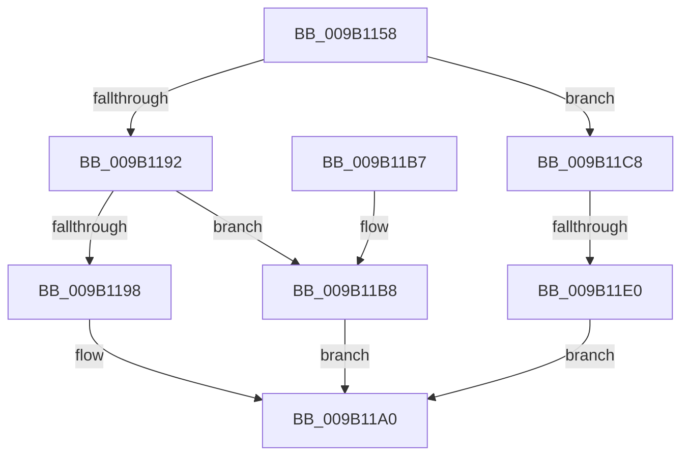

# CmpRollbackLightWeightTransaction

- RVA: `0x009B1158`–`0x009B11E7` (길이 `143` bytes)
- VA: `0x00000001409B1158`
- 실행 섹션: `PAGE`
- PDB 이름 있음: `예`; PDB Function 태그: `예`
- unwind 정보 RVA: `0x0009E244`
- 디코드: `41`개 명령, `143/143` bytes 표시
- 미해석 바이트: `0` (있으면 어셈블리에 `.byte`로 보존)

> 이 문서는 커널 이미지의 기계어와 PDB 기호를 분석해 생성했습니다. 4번과 5번은 함수 원형과 자료형을 바이너리 사용 방식에서 추정한 C 해석이며 원본 소스 복구 결과는 아닙니다.

## 1. Dependencies

- 직접 호출 지점: **3**; 고유 호출 대상: **3**
- 직접 호출자로 확인된 함수: **6**
- RIP 상대 이미지 참조: **0**

### Outgoing calls
- `0x009B1179` → [CmpInitializeThreadInfo](../../text/3F/CmpInitializeThreadInfo_function_003FBE70.md) (function, `0x003FBE70`)
- `0x009B119B` → [CmpAbortLightWeightTransaction](CmpAbortLightWeightTransaction_function_009B11F0.md) (function, `0x009B11F0`)
- `0x009B11A5` → [CmCleanupThreadInfo](../../text/41/CmCleanupThreadInfo_function_0041FD50.md) (function, `0x0041FD50`)

### Direct callers
- [NtRollbackRegistryTransaction](../7E/NtRollbackRegistryTransaction_function_007E0F30.md) at `0x007E0FEC`
- [CmpRollbackTransactionArray](../94/CmpRollbackTransactionArray_function_0094B3AC.md) at `0x0094B3E9`
- [CmpPerformUnloadKey](../9A/CmpPerformUnloadKey_function_009AFA28.md) at `0x009AFFF2`
- [CmpPerformUnloadKey](../9A/CmpPerformUnloadKey_function_009AFA28.md) at `0x009B0039`
- [CmpPerformUnloadKey](../9A/CmpPerformUnloadKey_function_009AFA28.md) at `0x009B00BB`
- [CmpCloseLightWeightTransaction](CmpCloseLightWeightTransaction_function_009B1100.md) at `0x009B1145`
- [CmpAbortRollbackPacket](../AB/CmpAbortRollbackPacket_function_00ABEA80.md) at `0x00ABEAD1`
- [sub_00B160F4](../B1/Unknown_function_00B160F4.md) at `0x00B161A8`

### Static image references
- 디코드된 RIP-relative 메모리 참조가 없습니다.

## 2. Other-region calls and transfers

- 다른 실행 섹션으로 향하는 call: **2**
  - `0x009B1179` → [CmpInitializeThreadInfo](../../text/3F/CmpInitializeThreadInfo_function_003FBE70.md) (`PAGE` → `.text`)
  - `0x009B11A5` → [CmCleanupThreadInfo](../../text/41/CmCleanupThreadInfo_function_0041FD50.md) (`PAGE` → `.text`)
- call이 아닌 외부 분기/꼬리 이동: **1**
  - `0x009B11DA` → [sub_00B2DB58](../B2/Unknown_function_00B2DB58.md) (`tail-transfer`)

## 3. Assembly (complete function range)

```asm
009B1158  48 89 5C 24 10                  mov qword ptr [rsp + 0x10], rbx
009B115D  57                              push rdi
009B115E  48 83 EC 50                     sub rsp, 0x50
009B1162  0F 57 C0                        xorps xmm0, xmm0
009B1165  33 C0                           xor eax, eax
009B1167  48 8B F9                        mov rdi, rcx
009B116A  48 89 44 24 40                  mov qword ptr [rsp + 0x40], rax
009B116F  48 8D 4C 24 30                  lea rcx, [rsp + 0x30]
009B1174  0F 11 44 24 30                  movups xmmword ptr [rsp + 0x30], xmm0
009B1179  E8 F2 AC A4 FF                  call 0x1403fbe70
009B117E  33 C0                           xor eax, eax
009B1180  44 8D 48 03                     lea r9d, [rax + 3]
009B1184  F0 44 0F B1 0F                  lock cmpxchg dword ptr [rdi], r9d
009B1189  89 44 24 60                     mov dword ptr [rsp + 0x60], eax
009B118D  83 F8 01                        cmp eax, 1
009B1190  74 36                           je 0x1409b11c8
009B1192  33 DB                           xor ebx, ebx
009B1194  85 C0                           test eax, eax
009B1196  75 20                           jne 0x1409b11b8
009B1198  48 8B CF                        mov rcx, rdi
009B119B  E8 50 00 00 00                  call 0x1409b11f0
009B11A0  48 8D 4C 24 30                  lea rcx, [rsp + 0x30]
009B11A5  E8 A6 EB A6 FF                  call 0x14041fd50
009B11AA  8B C3                           mov eax, ebx
009B11AC  48 8B 5C 24 68                  mov rbx, qword ptr [rsp + 0x68]
009B11B1  48 83 C4 50                     add rsp, 0x50
009B11B5  5F                              pop rdi
009B11B6  C3                              ret
009B11B7  CC                              int3
009B11B8  BB 03 00 19 C0                  mov ebx, 0xc0190003
009B11BD  41 3B C1                        cmp eax, r9d
009B11C0  8D 4B 12                        lea ecx, [rbx + 0x12]
009B11C3  0F 44 D9                        cmove ebx, ecx
009B11C6  EB D8                           jmp 0x1409b11a0
009B11C8  B8 01 00 00 00                  mov eax, 1
009B11CD  44 8D 48 03                     lea r9d, [rax + 3]
009B11D1  F0 44 0F B1 0F                  lock cmpxchg dword ptr [rdi], r9d
009B11D6  89 44 24 60                     mov dword ptr [rsp + 0x60], eax
009B11DA  0F 84 78 C9 17 00               je 0x140b2db58
009B11E0  BB 03 00 19 C0                  mov ebx, 0xc0190003
009B11E5  EB B9                           jmp 0x1409b11a0
```

## 4. C-style interpretation (structured pseudocode)

```c
__int64 __fastcall CmpRollbackLightWeightTransaction(__int64 a1)
{
    __int64 result;
    __int64 v_rbx;
    __int64 v_rsp;
    unsigned __int64 v_stack_m18;
    unsigned __int64 v_stack_m28;
    unsigned __int64 v_stack_p10;
    unsigned int v_stack_p60;
    unsigned int v_stack_p8;

    v_stack_p10 = v_rbx;
    v_rsp = (v_rsp) - (80);
    result = 0;
    v_stack_m18 = 0;
    v_stack_m28 = v_xmm0;
    result = CmpInitializeThreadInfo(v_stack_m28, a2, a3, a4);
    result = 0;
    v_stack_p8 = 0;
    if (0 == 1) goto loc_009B11C8;
    v_rbx = 0;
    if (0 != 0) goto loc_009B11B8;
    result = CmpAbortLightWeightTransaction(a1, a2, a3, result + 3);
loc_009B11A0:
    result = CmCleanupThreadInfo(v_stack_m28, a2, a3, result + 3);
    v_rsp = (v_rsp) + (80);
    return 0;
loc_009B11B8:
    v_rbx = (unsigned int)(0xC0190003ULL);
    if (0 == ((unsigned int)(result + 3))) { v_rbx = (unsigned int)((unsigned int)(0xC0190003ULL) + 18); }
    goto loc_009B11A0;
loc_009B11C8:
    v_stack_p60 = 1;
    goto loc_009B11A0;
}
```

## 5. (Beta) C Style

```c
int64_t CmpRollbackLightWeightTransaction(void *Arg1)
{
    uint8_t *arg1 = (uint8_t *)Arg1;

    int64_t result;
    int64_t local_rbx;
    int64_t local_rsp;
    uint64_t v_stack_m18;
    uint64_t v_stack_m28;
    uint64_t v_stack_p10;
    uint32_t v_stack_p60;
    uint32_t v_stack_p8;

    v_stack_p10 = local_rbx;
    local_rsp = (local_rsp) - (80);
    result = 0;
    v_stack_m18 = 0;
    v_stack_m28 = v_xmm0;
    result = CmpInitializeThreadInfo(v_stack_m28, a2, a3, a4);
    result = 0;
    v_stack_p8 = 0;
    if (0 == 1) goto loc_009B11C8;
    local_rbx = 0;
    if (0 != 0) goto loc_009B11B8;
    result = CmpAbortLightWeightTransaction(Arg1, a2, a3, result + 3);
loc_009B11A0:
    result = CmCleanupThreadInfo(v_stack_m28, a2, a3, result + 3);
    local_rsp = (local_rsp) + (80);
    return 0;
loc_009B11B8:
    local_rbx = (uint32_t)(0xC0190003ULL);
    if (0 == ((uint32_t)(result + 3))) { local_rbx = (uint32_t)((uint32_t)(0xC0190003ULL) + 18); }
    goto loc_009B11A0;
loc_009B11C8:
    v_stack_p60 = 1;
    goto loc_009B11A0;
}
```

### 관측된 메모리 오프셋

구조체 형식이 확인되지 않은 접근은 인자 기준의 오프셋으로만 기록했습니다.

| 기준 인자 | 오프셋 표현 | 폭 (bit) | 접근 |
|---|---:|---:|---|
| `Arg1` | `+ 0x0` | `32` | `R` |

## 6. Execution-region graph

[열기: 2D/3D 그래프와 함수 탐색 컨트롤 패널](../../../control-panel.html?section=page&rva=0x009B1158&view=graph)

- 2D 그래프는 위에서 아래로 흐르고, 3D 그래프는 빈 공간을 드래그해 회전합니다. Shift+드래그는 이동, 휠은 확대·축소, 함수 노드 선택은 대상 보고서 이동입니다.

### Static fallback


