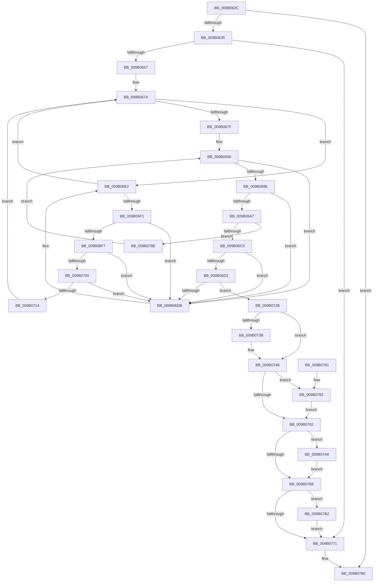

# CmpRunDownCmRM

- RVA: `0x009B062C`–`0x009B07BC` (길이 `400` bytes)
- VA: `0x00000001409B062C`
- 실행 섹션: `PAGE`
- PDB 이름 있음: `예`; PDB Function 태그: `아니요`
- unwind 정보 RVA: `0x0009E190`
- 디코드: `107`개 명령, `400/400` bytes 표시
- 미해석 바이트: `0` (있으면 어셈블리에 `.byte`로 보존)

> 이 문서는 커널 이미지의 기계어와 PDB 기호를 분석해 생성했습니다. 4번과 5번은 함수 원형과 자료형을 바이너리 사용 방식에서 추정한 C 해석이며 원본 소스 복구 결과는 아닙니다.

## 1. Dependencies

- 직접 호출 지점: **10**; 고유 호출 대상: **7**
- 직접 호출자로 확인된 함수: **1**
- RIP 상대 이미지 참조: **3**

### Outgoing calls
- `0x009B0667` → [LOCK_TRANSACTION_LIST](../87/LOCK_TRANSACTION_LIST_function_00874AD4.md) (function, `0x00874AD4`)
- `0x009B0686` → [ExReleaseFastMutexUnsafe](../../text/25/ExReleaseFastMutexUnsafe_function_002503A0.md) (function, `0x002503A0`)
- `0x009B068B` → [KeLeaveCriticalRegion](../../text/25/KeLeaveCriticalRegion_function_0025D8B0.md) (function, `0x0025D8B0`)
- `0x009B06C0` → [LOCK_CM_RM_LIST](LOCK_CM_RM_LIST_function_009B1490.md) (function, `0x009B1490`)
- `0x009B074F` → [ExReleaseFastMutexUnsafe](../../text/25/ExReleaseFastMutexUnsafe_function_002503A0.md) (function, `0x002503A0`)
- `0x009B0754` → [KeLeaveCriticalRegion](../../text/25/KeLeaveCriticalRegion_function_0025D8B0.md) (function, `0x0025D8B0`)
- `0x009B0782` → [ObDereferenceObjectDeferDelete](../../text/3F/ObDereferenceObjectDeferDelete_function_003FCE40.md) (function, `0x003FCE40`)
- `0x009B079C` → [CmpCleanupTransactionState](../84/CmpCleanupTransactionState_function_008428E0.md) (function, `0x008428E0`)
- `0x009B07A6` → [ObDereferenceObjectDeferDelete](../../text/3F/ObDereferenceObjectDeferDelete_function_003FCE40.md) (function, `0x003FCE40`)
- `0x009B07B5` → [CmpDelayFreeCmRm](../AC/CmpDelayFreeCmRm_function_00AC71B8.md) (function, `0x00AC71B8`)

### Direct callers
- [CmShutdownCmRM](CmShutdownCmRM_function_009B05E0.md) at `0x009B0601`

### Static image references
- `0x009B066C` → RVA `0x00EF57A0` (`.data`; read)
- `0x009B067F` → RVA `0x00EF5820` (`.data`; read)
- `0x009B0748` → RVA `0x00EF5660` (`.data`; read)

## 2. Other-region calls and transfers

- 다른 실행 섹션으로 향하는 call: **6**
  - `0x009B0686` → [ExReleaseFastMutexUnsafe](../../text/25/ExReleaseFastMutexUnsafe_function_002503A0.md) (`PAGE` → `.text`)
  - `0x009B068B` → [KeLeaveCriticalRegion](../../text/25/KeLeaveCriticalRegion_function_0025D8B0.md) (`PAGE` → `.text`)
  - `0x009B074F` → [ExReleaseFastMutexUnsafe](../../text/25/ExReleaseFastMutexUnsafe_function_002503A0.md) (`PAGE` → `.text`)
  - `0x009B0754` → [KeLeaveCriticalRegion](../../text/25/KeLeaveCriticalRegion_function_0025D8B0.md) (`PAGE` → `.text`)
  - `0x009B0782` → [ObDereferenceObjectDeferDelete](../../text/3F/ObDereferenceObjectDeferDelete_function_003FCE40.md) (`PAGE` → `.text`)
  - `0x009B07A6` → [ObDereferenceObjectDeferDelete](../../text/3F/ObDereferenceObjectDeferDelete_function_003FCE40.md) (`PAGE` → `.text`)
- 별도 외부 분기/꼬리 이동을 확인하지 못했습니다.

## 3. Assembly (complete function range)

```asm
009B062C  48 85 C9                        test rcx, rcx
009B062F  0F 84 4B 01 00 00               je 0x1409b0780
009B0635  48 89 5C 24 08                  mov qword ptr [rsp + 8], rbx
009B063A  48 89 7C 24 10                  mov qword ptr [rsp + 0x10], rdi
009B063F  55                              push rbp
009B0640  48 8B EC                        mov rbp, rsp
009B0643  48 83 EC 30                     sub rsp, 0x30
009B0647  83 79 40 00                     cmp dword ptr [rcx + 0x40], 0
009B064B  40 8A FA                        mov dil, dl
009B064E  48 8B D9                        mov rbx, rcx
009B0651  0F 85 1A 01 00 00               jne 0x1409b0771
009B0657  48 8D 45 F0                     lea rax, [rbp - 0x10]
009B065B  48 89 45 F8                     mov qword ptr [rbp - 8], rax
009B065F  48 8D 45 F0                     lea rax, [rbp - 0x10]
009B0663  48 89 45 F0                     mov qword ptr [rbp - 0x10], rax
009B0667  E8 68 44 EC FF                  call 0x140874ad4
009B066C  48 8B 0D 2D 51 54 00            mov rcx, qword ptr [rip + 0x54512d]
009B0673  4C 8D 0D 26 51 54 00            lea r9, [rip + 0x545126]
009B067A  49 3B C9                        cmp rcx, r9
009B067D  75 63                           jne 0x1409b06e2
009B067F  48 8D 0D 9A 51 54 00            lea rcx, [rip + 0x54519a]
009B0686  E8 15 FD 89 FF                  call 0x1402503a0
009B068B  E8 20 D2 8A FF                  call 0x14025d8b0
009B0690  48 8B 55 F0                     mov rdx, qword ptr [rbp - 0x10]
009B0694  48 8D 45 F0                     lea rax, [rbp - 0x10]
009B0698  48 39 42 08                     cmp qword ptr [rdx + 8], rax
009B069C  75 3D                           jne 0x1409b06db
009B069E  48 8B 02                        mov rax, qword ptr [rdx]
009B06A1  48 39 50 08                     cmp qword ptr [rax + 8], rdx
009B06A5  75 34                           jne 0x1409b06db
009B06A7  48 89 45 F0                     mov qword ptr [rbp - 0x10], rax
009B06AB  48 8D 4D F0                     lea rcx, [rbp - 0x10]
009B06AF  48 89 48 08                     mov qword ptr [rax + 8], rcx
009B06B3  48 8D 45 F0                     lea rax, [rbp - 0x10]
009B06B7  48 3B D0                        cmp rdx, rax
009B06BA  0F 85 CE 00 00 00               jne 0x1409b078e
009B06C0  E8 CB 0D 00 00                  call 0x1409b1490
009B06C5  83 4B 68 08                     or dword ptr [rbx + 0x68], 8
009B06C9  48 8B 0B                        mov rcx, qword ptr [rbx]
009B06CC  48 39 59 08                     cmp qword ptr [rcx + 8], rbx
009B06D0  75 09                           jne 0x1409b06db
009B06D2  48 8B 43 08                     mov rax, qword ptr [rbx + 8]
009B06D6  48 39 18                        cmp qword ptr [rax], rbx
009B06D9  74 50                           je 0x1409b072b
009B06DB  B9 03 00 00 00                  mov ecx, 3
009B06E0  CD 29                           int 0x29
009B06E2  48 8B C1                        mov rax, rcx
009B06E5  48 8B D1                        mov rdx, rcx
009B06E8  48 8B 09                        mov rcx, qword ptr [rcx]
009B06EB  48 39 58 20                     cmp qword ptr [rax + 0x20], rbx
009B06EF  75 89                           jne 0x1409b067a
009B06F1  48 39 41 08                     cmp qword ptr [rcx + 8], rax
009B06F5  75 E4                           jne 0x1409b06db
009B06F7  48 8B 40 08                     mov rax, qword ptr [rax + 8]
009B06FB  48 39 10                        cmp qword ptr [rax], rdx
009B06FE  75 DB                           jne 0x1409b06db
009B0700  48 89 08                        mov qword ptr [rax], rcx
009B0703  4C 8D 45 F0                     lea r8, [rbp - 0x10]
009B0707  48 89 41 08                     mov qword ptr [rcx + 8], rax
009B070B  48 8B 45 F8                     mov rax, qword ptr [rbp - 8]
009B070F  4C 39 00                        cmp qword ptr [rax], r8
009B0712  75 C7                           jne 0x1409b06db
009B0714  48 89 42 08                     mov qword ptr [rdx + 8], rax
009B0718  4C 8D 45 F0                     lea r8, [rbp - 0x10]
009B071C  4C 89 02                        mov qword ptr [rdx], r8
009B071F  48 89 10                        mov qword ptr [rax], rdx
009B0722  48 89 55 F8                     mov qword ptr [rbp - 8], rdx
009B0726  E9 4F FF FF FF                  jmp 0x1409b067a
009B072B  48 89 08                        mov qword ptr [rax], rcx
009B072E  48 89 41 08                     mov qword ptr [rcx + 8], rax
009B0732  48 8B 43 50                     mov rax, qword ptr [rbx + 0x50]
009B0736  48 85 C0                        test rax, rax
009B0739  74 0D                           je 0x1409b0748
009B073B  48 83 A0 38 10 00 00 00         and qword ptr [rax + 0x1038], 0
009B0743  48 83 63 50 00                  and qword ptr [rbx + 0x50], 0
009B0748  48 8D 0D 11 4F 54 00            lea rcx, [rip + 0x544f11]
009B074F  E8 4C FC 89 FF                  call 0x1402503a0
009B0754  E8 57 D1 8A FF                  call 0x14025d8b0
009B0759  48 8B 4B 38                     mov rcx, qword ptr [rbx + 0x38]
009B075D  48 85 C9                        test rcx, rcx
009B0760  75 20                           jne 0x1409b0782
009B0762  48 8B 4B 28                     mov rcx, qword ptr [rbx + 0x28]
009B0766  48 85 C9                        test rcx, rcx
009B0769  75 3B                           jne 0x1409b07a6
009B076B  40 80 FF 01                     cmp dil, 1
009B076F  74 41                           je 0x1409b07b2
009B0771  48 8B 5C 24 40                  mov rbx, qword ptr [rsp + 0x40]
009B0776  48 8B 7C 24 48                  mov rdi, qword ptr [rsp + 0x48]
009B077B  48 83 C4 30                     add rsp, 0x30
009B077F  5D                              pop rbp
009B0780  C3                              ret
009B0781  CC                              int3
009B0782  E8 B9 C6 A4 FF                  call 0x1403fce40
009B0787  48 83 63 38 00                  and qword ptr [rbx + 0x38], 0
009B078C  EB D4                           jmp 0x1409b0762
009B078E  45 33 C9                        xor r9d, r9d
009B0791  48 83 C2 E0                     add rdx, -0x20
009B0795  48 8B CB                        mov rcx, rbx
009B0798  45 8D 41 04                     lea r8d, [r9 + 4]
009B079C  E8 3F 21 E9 FF                  call 0x1408428e0
009B07A1  E9 EA FE FF FF                  jmp 0x1409b0690
009B07A6  E8 95 C6 A4 FF                  call 0x1403fce40
009B07AB  48 83 63 28 00                  and qword ptr [rbx + 0x28], 0
009B07B0  EB B9                           jmp 0x1409b076b
009B07B2  48 8B CB                        mov rcx, rbx
009B07B5  E8 FE 69 11 00                  call 0x140ac71b8
009B07BA  EB B5                           jmp 0x1409b0771
```

## 4. C-style interpretation (structured pseudocode)

```c
__int64 __fastcall CmpRunDownCmRM(__int64 a1, unsigned __int8 a2)
{
    __int64 result;
    __int64 v_rsp;
    unsigned __int64 v_stack_m10;
    unsigned __int64 v_stack_m18;
    unsigned __int64 v_stack_p10;
    unsigned __int64 v_stack_p8;

    if (a1 == 0) goto loc_009B0780;
    v_stack_p8 = v_rbx;
    v_stack_p10 = v_rdi;
    v_rsp = (v_rsp) - (48);
    if ((*(unsigned int *)(a1 + 64)) != 0) goto loc_009B0771;
    v_stack_m10 = v_stack_m18;
    v_stack_m18 = v_stack_m18;
    result = LOCK_TRANSACTION_LIST(a1, a2, a3, a4);
loc_009B067A:
    if ((*(unsigned __int64 *)(v_rip + 5525805)) != (v_rip + 5525798)) goto loc_009B06E2;
    result = ExReleaseFastMutexUnsafe(v_rip + 5525914, a2, a3, v_rip + 5525798);
    result = KeLeaveCriticalRegion(v_rip + 5525914, a2, a3, v_rip + 5525798);
loc_009B0690:
    if ((*(unsigned __int64 *)(v_stack_m18 + 8)) != v_stack_m18) goto loc_009B06DB;
    if ((*(unsigned __int64 *)(*(unsigned __int64 *)(v_stack_m18) + 8)) != v_stack_m18) goto loc_009B06DB;
    v_stack_m18 = *(unsigned __int64 *)(v_stack_m18);
    *(unsigned __int64 *)(*(unsigned __int64 *)(v_stack_m18) + 8) = v_stack_m18;
    if (v_stack_m18 != v_stack_m18) goto loc_009B078E;
    result = LOCK_CM_RM_LIST(v_stack_m18, v_stack_m18, a3, v_rip + 5525798);
    if ((*(unsigned __int64 *)(*(unsigned __int64 *)(a1) + 8)) != a1) goto loc_009B06DB;
    if ((*(unsigned __int64 *)(*(unsigned __int64 *)(a1 + 8))) == a1) goto loc_009B072B;
loc_009B06DB:
loc_009B06E2:
    if ((*(unsigned __int64 *)(3 + 32)) != a1) goto loc_009B067A;
    if ((*(unsigned __int64 *)(*(unsigned __int64 *)(3) + 8)) != 3) goto loc_009B06DB;
    if ((*(unsigned __int64 *)(*(unsigned __int64 *)(3 + 8))) != 3) goto loc_009B06DB;
    *(unsigned __int64 *)(*(unsigned __int64 *)(3 + 8)) = *(unsigned __int64 *)(3);
    *(unsigned __int64 *)(*(unsigned __int64 *)(3) + 8) = *(unsigned __int64 *)(3 + 8);
    if ((*(unsigned __int64 *)(v_stack_m10)) != v_stack_m18) goto loc_009B06DB;
    *(unsigned __int64 *)(3 + 8) = v_stack_m10;
    *(unsigned __int64 *)(3) = v_stack_m18;
    *(unsigned __int64 *)(v_stack_m10) = 3;
    v_stack_m10 = 3;
    goto loc_009B067A;
loc_009B072B:
    *(unsigned __int64 *)(v_stack_m10) = *(unsigned __int64 *)(3);
    *(unsigned __int64 *)(*(unsigned __int64 *)(3) + 8) = v_stack_m10;
    if (*(unsigned __int64 *)(a1 + 80) != 0) {
    }
    result = ExReleaseFastMutexUnsafe(v_rip + 5525265, 3, v_stack_m18, v_rip + 5525798);
    result = KeLeaveCriticalRegion(v_rip + 5525265, 3, v_stack_m18, v_rip + 5525798);
    if (*(unsigned __int64 *)(a1 + 56) != 0) goto loc_009B0782;
loc_009B0762:
    if (*(unsigned __int64 *)(a1 + 40) != 0) goto loc_009B07A6;
loc_009B076B:
    if (a2 == 1) goto loc_009B07B2;
loc_009B0771:
    v_rsp = (v_rsp) + (48);
loc_009B0780:
    return result;
loc_009B0782:
    result = ObDereferenceObjectDeferDelete(*(unsigned __int64 *)(a1 + 40), 3, v_stack_m18, v_rip + 5525798);
    goto loc_009B0762;
loc_009B078E:
    a4 = 0;
    a2 = (3) + (-32);
    result = CmpCleanupTransactionState(v_stack_p8, a2, a4 + 4, a4);
    goto loc_009B0690;
loc_009B07A6:
    result = ObDereferenceObjectDeferDelete(v_stack_p8, a2, a4 + 4, a4);
    goto loc_009B076B;
loc_009B07B2:
    result = CmpDelayFreeCmRm(v_stack_p8, a2, a4 + 4, a4);
    goto loc_009B0771;
}
```

## 5. (Beta) C Style

```c
int64_t CmpRunDownCmRM(int64_t Arg1, uint8_t Arg2)
{
    int64_t result;
    int64_t local_rsp;
    uint64_t v_stack_m10;
    uint64_t v_stack_m18;
    uint64_t v_stack_p10;
    uint64_t v_stack_p8;

    if (Arg1 == 0) goto loc_009B0780;
    v_stack_p8 = local_rbx;
    v_stack_p10 = local_rdi;
    local_rsp = (local_rsp) - (48);
    if ((*(uint32_t *)(Arg1 + 0x40)) != 0) goto loc_009B0771;
    v_stack_m10 = v_stack_m18;
    v_stack_m18 = v_stack_m18;
    result = LOCK_TRANSACTION_LIST(Arg1, Arg2, a3, a4);
loc_009B067A:
    if ((*(uint64_t *)(v_rip + 0x54512D)) != (v_rip + 5525798)) goto loc_009B06E2;
    result = ExReleaseFastMutexUnsafe(v_rip + 5525914, Arg2, a3, v_rip + 5525798);
    result = KeLeaveCriticalRegion(v_rip + 5525914, Arg2, a3, v_rip + 5525798);
loc_009B0690:
    if ((*(uint64_t *)(v_stack_m18 + 0x8)) != v_stack_m18) goto loc_009B06DB;
    if ((*(uint64_t *)(*(uint64_t *)(v_stack_m18) + 0x8)) != v_stack_m18) goto loc_009B06DB;
    v_stack_m18 = *(uint64_t *)(v_stack_m18);
    *(uint64_t *)(*(uint64_t *)(v_stack_m18) + 0x8) = v_stack_m18;
    if (v_stack_m18 != v_stack_m18) goto loc_009B078E;
    result = LOCK_CM_RM_LIST(v_stack_m18, v_stack_m18, a3, v_rip + 5525798);
    if ((*(uint64_t *)(*(uint64_t *)(Arg1) + 0x8)) != Arg1) goto loc_009B06DB;
    if ((*(uint64_t *)(*(uint64_t *)(Arg1 + 0x8))) == Arg1) goto loc_009B072B;
loc_009B06DB:
loc_009B06E2:
    if ((*(uint64_t *)(3 + 0x20)) != Arg1) goto loc_009B067A;
    if ((*(uint64_t *)(*(uint64_t *)(3) + 0x8)) != 3) goto loc_009B06DB;
    if ((*(uint64_t *)(*(uint64_t *)(3 + 0x8))) != 3) goto loc_009B06DB;
    *(uint64_t *)(*(uint64_t *)(3 + 0x8)) = *(uint64_t *)(3);
    *(uint64_t *)(*(uint64_t *)(3) + 0x8) = *(uint64_t *)(3 + 0x8);
    if ((*(uint64_t *)(v_stack_m10)) != v_stack_m18) goto loc_009B06DB;
    *(uint64_t *)(3 + 0x8) = v_stack_m10;
    *(uint64_t *)(3) = v_stack_m18;
    *(uint64_t *)(v_stack_m10) = 3;
    v_stack_m10 = 3;
    goto loc_009B067A;
loc_009B072B:
    *(uint64_t *)(v_stack_m10) = *(uint64_t *)(3);
    *(uint64_t *)(*(uint64_t *)(3) + 0x8) = v_stack_m10;
    if (*(uint64_t *)(Arg1 + 0x50) != 0) {
    }
    result = ExReleaseFastMutexUnsafe(v_rip + 5525265, 3, v_stack_m18, v_rip + 5525798);
    result = KeLeaveCriticalRegion(v_rip + 5525265, 3, v_stack_m18, v_rip + 5525798);
    if (*(uint64_t *)(Arg1 + 0x38) != 0) goto loc_009B0782;
loc_009B0762:
    if (*(uint64_t *)(Arg1 + 0x28) != 0) goto loc_009B07A6;
loc_009B076B:
    if (Arg2 == 1) goto loc_009B07B2;
loc_009B0771:
    local_rsp = (local_rsp) + (48);
loc_009B0780:
    return result;
loc_009B0782:
    result = ObDereferenceObjectDeferDelete(*(uint64_t *)(Arg1 + 0x28), 3, v_stack_m18, v_rip + 5525798);
    goto loc_009B0762;
loc_009B078E:
    a4 = 0;
    Arg2 = (3) + (-32);
    result = CmpCleanupTransactionState(v_stack_p8, Arg2, a4 + 4, a4);
    goto loc_009B0690;
loc_009B07A6:
    result = ObDereferenceObjectDeferDelete(v_stack_p8, Arg2, a4 + 4, a4);
    goto loc_009B076B;
loc_009B07B2:
    result = CmpDelayFreeCmRm(v_stack_p8, Arg2, a4 + 4, a4);
    goto loc_009B0771;
}
```

## 6. Execution-region graph

[열기: 2D/3D 그래프와 함수 탐색 컨트롤 패널](../../../control-panel.html?section=page&rva=0x009B062C&view=graph)

- 2D 그래프는 위에서 아래로 흐르고, 3D 그래프는 빈 공간을 드래그해 회전합니다. Shift+드래그는 이동, 휠은 확대·축소, 함수 노드 선택은 대상 보고서 이동입니다.

### Static fallback


