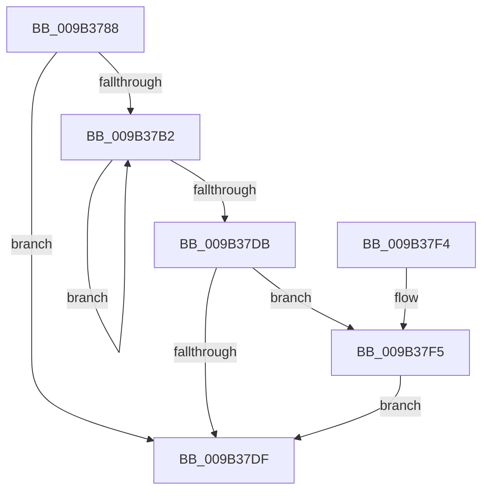

# CmpSignalUnloadEventArrayForHive

- RVA: `0x009B3788`–`0x009B3801` (길이 `121` bytes)
- VA: `0x00000001409B3788`
- 실행 섹션: `PAGE`
- PDB 이름 있음: `예`; PDB Function 태그: `아니요`
- unwind 정보 RVA: `0x0007293C`
- 디코드: `36`개 명령, `121/121` bytes 표시
- 미해석 바이트: `0` (있으면 어셈블리에 `.byte`로 보존)

> 이 문서는 커널 이미지의 기계어와 PDB 기호를 분석해 생성했습니다. 4번과 5번은 함수 원형과 자료형을 바이너리 사용 방식에서 추정한 C 해석이며 원본 소스 복구 결과는 아닙니다.

## 1. Dependencies

- 직접 호출 지점: **3**; 고유 호출 대상: **3**
- 직접 호출자로 확인된 함수: **1**
- RIP 상대 이미지 참조: **0**

### Outgoing calls
- `0x009B37BE` → [KeSetEvent](../../text/33/KeSetEvent_function_0033F310.md) (function, `0x0033F310`)
- `0x009B37CA` → [ObfDereferenceObject](../../text/2F/ObfDereferenceObject_function_002F9350.md) (function, `0x002F9350`)
- `0x009B37FA` → [ExFreePoolWithTag](../../poolcode/B8/ExFreePoolWithTag_function_00B82870.md) (function, `0x00B82870`)

### Direct callers
- [CmpCompleteUnloadKey](CmpCompleteUnloadKey_function_009B32FC.md) at `0x009B34E2`

### Static image references
- 디코드된 RIP-relative 메모리 참조가 없습니다.

## 2. Other-region calls and transfers

- 다른 실행 섹션으로 향하는 call: **3**
  - `0x009B37BE` → [KeSetEvent](../../text/33/KeSetEvent_function_0033F310.md) (`PAGE` → `.text`)
  - `0x009B37CA` → [ObfDereferenceObject](../../text/2F/ObfDereferenceObject_function_002F9350.md) (`PAGE` → `.text`)
  - `0x009B37FA` → [ExFreePoolWithTag](../../poolcode/B8/ExFreePoolWithTag_function_00B82870.md) (`PAGE` → `POOLCODE`)
- 별도 외부 분기/꼬리 이동을 확인하지 못했습니다.

## 3. Assembly (complete function range)

```asm
009B3788  48 89 5C 24 08                  mov qword ptr [rsp + 8], rbx
009B378D  48 89 6C 24 10                  mov qword ptr [rsp + 0x10], rbp
009B3792  48 89 74 24 18                  mov qword ptr [rsp + 0x18], rsi
009B3797  57                              push rdi
009B3798  48 83 EC 20                     sub rsp, 0x20
009B379C  8B 81 68 0B 00 00               mov eax, dword ptr [rcx + 0xb68]
009B37A2  48 8D B9 70 0B 00 00            lea rdi, [rcx + 0xb70]
009B37A9  33 ED                           xor ebp, ebp
009B37AB  48 8B F1                        mov rsi, rcx
009B37AE  85 C0                           test eax, eax
009B37B0  74 2D                           je 0x1409b37df
009B37B2  48 8B 0F                        mov rcx, qword ptr [rdi]
009B37B5  45 33 C0                        xor r8d, r8d
009B37B8  33 D2                           xor edx, edx
009B37BA  48 8B 0C E9                     mov rcx, qword ptr [rcx + rbp*8]
009B37BE  E8 4D BB 98 FF                  call 0x14033f310
009B37C3  48 8B 0F                        mov rcx, qword ptr [rdi]
009B37C6  48 8B 0C E9                     mov rcx, qword ptr [rcx + rbp*8]
009B37CA  E8 81 5B 94 FF                  call 0x1402f9350
009B37CF  8B 86 68 0B 00 00               mov eax, dword ptr [rsi + 0xb68]
009B37D5  FF C5                           inc ebp
009B37D7  3B E8                           cmp ebp, eax
009B37D9  72 D7                           jb 0x1409b37b2
009B37DB  85 C0                           test eax, eax
009B37DD  75 16                           jne 0x1409b37f5
009B37DF  48 8B 5C 24 30                  mov rbx, qword ptr [rsp + 0x30]
009B37E4  48 8B 6C 24 38                  mov rbp, qword ptr [rsp + 0x38]
009B37E9  48 8B 74 24 40                  mov rsi, qword ptr [rsp + 0x40]
009B37EE  48 83 C4 20                     add rsp, 0x20
009B37F2  5F                              pop rdi
009B37F3  C3                              ret
009B37F4  CC                              int3
009B37F5  48 8B 0F                        mov rcx, qword ptr [rdi]
009B37F8  33 D2                           xor edx, edx
009B37FA  E8 71 F0 1C 00                  call 0x140b82870
009B37FF  EB DE                           jmp 0x1409b37df
```

## 4. C-style interpretation (structured pseudocode)

```c
__int64 __fastcall CmpSignalUnloadEventArrayForHive(__int64 a1, int a2, int a3)
{
    __int64 result;
    __int64 v_rbp;
    __int64 v_rsp;
    unsigned __int64 v_stack_p10;
    unsigned __int64 v_stack_p18;
    unsigned __int64 v_stack_p8;

    v_stack_p8 = v_rbx;
    v_stack_p10 = v_rbp;
    v_stack_p18 = v_rsi;
    v_rsp = (v_rsp) - (32);
    v_rbp = 0;
    if ((unsigned int)((unsigned int)(*(unsigned int *)(a1 + 2920))) == 0) goto loc_009B37DF;
loc_009B37B2:
    a3 = 0;
    a2 = 0;
    result = KeSetEvent(*(unsigned __int64 *)(*(unsigned __int64 *)(a1 + 2928) + v_rbp * 8), a2, a3, a4);
    result = ObfDereferenceObject(*(unsigned __int64 *)(*(unsigned __int64 *)(a1 + 2928) + v_rbp * 8), a2, a3, a4);
    v_rbp = (unsigned int)((v_rbp) + 1);
    if (((unsigned int)(v_rbp)) < ((unsigned int)((unsigned int)(*(unsigned int *)(a1 + 2920))))) goto loc_009B37B2;
    if ((unsigned int)((unsigned int)(*(unsigned int *)(a1 + 2920))) != 0) goto loc_009B37F5;
loc_009B37DF:
    v_rsp = (v_rsp) + (32);
    return (unsigned int)(*(unsigned int *)(a1 + 2920));
loc_009B37F5:
    a2 = 0;
    result = ExFreePoolWithTag(*(unsigned __int64 *)(a1 + 2928), a2, a3, a4);
    goto loc_009B37DF;
}
```

## 5. (Beta) C Style

```c
int64_t CmpSignalUnloadEventArrayForHive(void *Arg1, int32_t Arg2, int32_t Arg3)
{
    uint8_t *arg1 = (uint8_t *)Arg1;

    int64_t result;
    int64_t local_rbp;
    int64_t local_rsp;
    uint64_t v_stack_p10;
    uint64_t v_stack_p18;
    uint64_t v_stack_p8;

    v_stack_p8 = local_rbx;
    v_stack_p10 = local_rbp;
    v_stack_p18 = local_rsi;
    local_rsp = (local_rsp) - (32);
    local_rbp = 0;
    if ((uint32_t)((uint32_t)(*(uint32_t *)(arg1 + 0xB68))) == 0) goto loc_009B37DF;
loc_009B37B2:
    Arg3 = 0;
    Arg2 = 0;
    result = KeSetEvent(*(uint64_t *)(*(uint64_t *)(arg1 + 0xB70) + local_rbp * 8), Arg2, Arg3, a4);
    result = ObfDereferenceObject(*(uint64_t *)(*(uint64_t *)(arg1 + 0xB70) + local_rbp * 8), Arg2, Arg3, a4);
    local_rbp = (uint32_t)((local_rbp) + 1);
    if (((uint32_t)(local_rbp)) < ((uint32_t)((uint32_t)(*(uint32_t *)(arg1 + 0xB68))))) goto loc_009B37B2;
    if ((uint32_t)((uint32_t)(*(uint32_t *)(arg1 + 0xB68))) != 0) goto loc_009B37F5;
loc_009B37DF:
    local_rsp = (local_rsp) + (32);
    return (uint32_t)(*(uint32_t *)(arg1 + 0xB68));
loc_009B37F5:
    Arg2 = 0;
    result = ExFreePoolWithTag(*(uint64_t *)(arg1 + 0xB70), Arg2, Arg3, a4);
    goto loc_009B37DF;
}
```

### 관측된 메모리 오프셋

구조체 형식이 확인되지 않은 접근은 인자 기준의 오프셋으로만 기록했습니다.

| 기준 인자 | 오프셋 표현 | 폭 (bit) | 접근 |
|---|---:|---:|---|
| `Arg1` | `+ 0x0` | `64` | `R` |
| `Arg1` | `+ 0xB68` | `32` | `R` |
| `Arg1` | `+ 0xB70` | `64` | `R` |

## 6. Execution-region graph

[열기: 2D/3D 그래프와 함수 탐색 컨트롤 패널](../../../control-panel.html?section=page&rva=0x009B3788&view=graph)

- 2D 그래프는 위에서 아래로 흐르고, 3D 그래프는 빈 공간을 드래그해 회전합니다. Shift+드래그는 이동, 휠은 확대·축소, 함수 노드 선택은 대상 보고서 이동입니다.

### Static fallback


