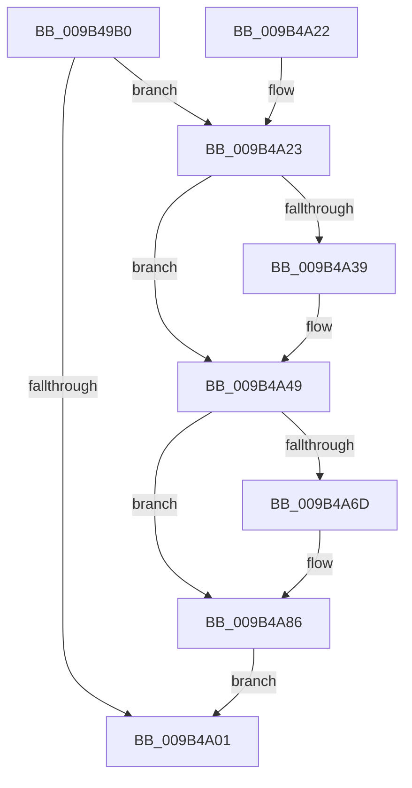

# CmpTraceHiveFlushStart

- RVA: `0x009B49B0`–`0x009B4ADD` (길이 `301` bytes)
- VA: `0x00000001409B49B0`
- 실행 섹션: `PAGE`
- PDB 이름 있음: `예`; PDB Function 태그: `아니요`
- unwind 정보 RVA: `0x0009E530`
- 디코드: `76`개 명령, `301/301` bytes 표시
- 미해석 바이트: `0` (있으면 어셈블리에 `.byte`로 보존)

> 이 문서는 커널 이미지의 기계어와 PDB 기호를 분석해 생성했습니다. 4번과 5번은 함수 원형과 자료형을 바이너리 사용 방식에서 추정한 C 해석이며 원본 소스 복구 결과는 아닙니다.

## 1. Dependencies

- 직접 호출 지점: **3**; 고유 호출 대상: **3**
- 직접 호출자로 확인된 함수: **1**
- RIP 상대 이미지 참조: **3**

### Outgoing calls
- `0x009B49F6` → [EtwEventEnabled](../../text/39/EtwEventEnabled_function_00392450.md) (function, `0x00392450`)
- `0x009B4A08` → [_security_check_cookie](../../text/6A/_security_check_cookie_function_006AC640.md) (function, `0x006AC640`)
- `0x009B4AD3` → [EtwWrite](../../text/41/EtwWrite_function_0041C720.md) (function, `0x0041C720`)

### Direct callers
- [CmpFlushHive](CmpFlushHive_function_009B3DC0.md) at `0x009B3F2B`

### Static image references
- `0x009B49CB` → RVA `0x00E0A740` (`.data`; read)
- `0x009B49D9` → RVA `0x00013C40` (`.rdata`; read)
- `0x009B49E6` → RVA `0x00FD8018` (`PAGEDATA`; read)

## 2. Other-region calls and transfers

- 다른 실행 섹션으로 향하는 call: **3**
  - `0x009B49F6` → [EtwEventEnabled](../../text/39/EtwEventEnabled_function_00392450.md) (`PAGE` → `.text`)
  - `0x009B4A08` → [_security_check_cookie](../../text/6A/_security_check_cookie_function_006AC640.md) (`PAGE` → `.text`)
  - `0x009B4AD3` → [EtwWrite](../../text/41/EtwWrite_function_0041C720.md) (`PAGE` → `.text`)
- 별도 외부 분기/꼬리 이동을 확인하지 못했습니다.

## 3. Assembly (complete function range)

```asm
009B49B0  48 8B C4                        mov rax, rsp
009B49B3  48 89 58 08                     mov qword ptr [rax + 8], rbx
009B49B7  48 89 78 10                     mov qword ptr [rax + 0x10], rdi
009B49BB  44 89 40 18                     mov dword ptr [rax + 0x18], r8d
009B49BF  55                              push rbp
009B49C0  48 8D 68 A1                     lea rbp, [rax - 0x5f]
009B49C4  48 81 EC B0 00 00 00            sub rsp, 0xb0
009B49CB  48 8B 05 6E 5D 45 00            mov rax, qword ptr [rip + 0x455d6e]
009B49D2  48 33 C4                        xor rax, rsp
009B49D5  48 89 45 47                     mov qword ptr [rbp + 0x47], rax
009B49D9  0F 10 05 60 F2 65 FF            movups xmm0, xmmword ptr [rip - 0x9a0da0]
009B49E0  48 8B FA                        mov rdi, rdx
009B49E3  48 8B D9                        mov rbx, rcx
009B49E6  48 8B 0D 2B 36 62 00            mov rcx, qword ptr [rip + 0x62362b]
009B49ED  48 8D 55 DF                     lea rdx, [rbp - 0x21]
009B49F1  F3 0F 7F 45 DF                  movdqu xmmword ptr [rbp - 0x21], xmm0
009B49F6  E8 55 DA 9D FF                  call 0x140392450
009B49FB  33 D2                           xor edx, edx
009B49FD  84 C0                           test al, al
009B49FF  75 22                           jne 0x1409b4a23
009B4A01  48 8B 4D 47                     mov rcx, qword ptr [rbp + 0x47]
009B4A05  48 33 CC                        xor rcx, rsp
009B4A08  E8 33 7C CF FF                  call 0x1406ac640
009B4A0D  4C 8D 9C 24 B0 00 00 00         lea r11, [rsp + 0xb0]
009B4A15  49 8B 5B 10                     mov rbx, qword ptr [r11 + 0x10]
009B4A19  49 8B 7B 18                     mov rdi, qword ptr [r11 + 0x18]
009B4A1D  49 8B E3                        mov rsp, r11
009B4A20  5D                              pop rbp
009B4A21  C3                              ret
009B4A22  CC                              int3
009B4A23  48 8B 43 08                     mov rax, qword ptr [rbx + 8]
009B4A27  44 8B CA                        mov r9d, edx
009B4A2A  66 89 55 D7                     mov word ptr [rbp - 0x29], dx
009B4A2E  41 B8 01 00 00 00               mov r8d, 1
009B4A34  48 85 C0                        test rax, rax
009B4A37  74 10                           je 0x1409b4a49
009B4A39  48 89 45 F7                     mov qword ptr [rbp - 9], rax
009B4A3D  45 8B C8                        mov r9d, r8d
009B4A40  0F B7 03                        movzx eax, word ptr [rbx]
009B4A43  89 45 FF                        mov dword ptr [rbp - 1], eax
009B4A46  89 55 03                        mov dword ptr [rbp + 3], edx
009B4A49  41 8B C1                        mov eax, r9d
009B4A4C  48 8D 4D D7                     lea rcx, [rbp - 0x29]
009B4A50  48 03 C0                        add rax, rax
009B4A53  45 03 C8                        add r9d, r8d
009B4A56  48 89 4C C5 F7                  mov qword ptr [rbp + rax*8 - 9], rcx
009B4A5B  48 C7 44 C5 FF 02 00 00 00      mov qword ptr [rbp + rax*8 - 1], 2
009B4A64  48 8B 47 08                     mov rax, qword ptr [rdi + 8]
009B4A68  48 85 C0                        test rax, rax
009B4A6B  74 19                           je 0x1409b4a86
009B4A6D  41 8B C9                        mov ecx, r9d
009B4A70  48 03 C9                        add rcx, rcx
009B4A73  45 03 C8                        add r9d, r8d
009B4A76  48 89 44 CD F7                  mov qword ptr [rbp + rcx*8 - 9], rax
009B4A7B  0F B7 07                        movzx eax, word ptr [rdi]
009B4A7E  89 44 CD FF                     mov dword ptr [rbp + rcx*8 - 1], eax
009B4A82  89 54 CD 03                     mov dword ptr [rbp + rcx*8 + 3], edx
009B4A86  41 8B C1                        mov eax, r9d
009B4A89  48 8D 4D D7                     lea rcx, [rbp - 0x29]
009B4A8D  48 03 C0                        add rax, rax
009B4A90  48 8D 55 DF                     lea rdx, [rbp - 0x21]
009B4A94  45 03 C8                        add r9d, r8d
009B4A97  45 33 C0                        xor r8d, r8d
009B4A9A  48 89 4C C5 F7                  mov qword ptr [rbp + rax*8 - 9], rcx
009B4A9F  48 8D 4D 77                     lea rcx, [rbp + 0x77]
009B4AA3  48 C7 44 C5 FF 02 00 00 00      mov qword ptr [rbp + rax*8 - 1], 2
009B4AAC  41 8B C1                        mov eax, r9d
009B4AAF  48 03 C0                        add rax, rax
009B4AB2  41 FF C1                        inc r9d
009B4AB5  48 89 4C C5 F7                  mov qword ptr [rbp + rax*8 - 9], rcx
009B4ABA  48 8B 0D 57 35 62 00            mov rcx, qword ptr [rip + 0x623557]
009B4AC1  48 C7 44 C5 FF 04 00 00 00      mov qword ptr [rbp + rax*8 - 1], 4
009B4ACA  48 8D 45 F7                     lea rax, [rbp - 9]
009B4ACE  48 89 44 24 20                  mov qword ptr [rsp + 0x20], rax
009B4AD3  E8 48 7C A6 FF                  call 0x14041c720
009B4AD8  E9 24 FF FF FF                  jmp 0x1409b4a01
```

## 4. C-style interpretation (structured pseudocode)

```c
__int64 __fastcall CmpTraceHiveFlushStart(__int64 a1, __int64 a2, int a3)
{
    __int64 result;
    __int64 v_rsp;
    unsigned __int64 v_stack_m8;
    unsigned __int64 v_stack_m90;

    *(unsigned __int64 *)(v_rsp + 8) = v_rbx;
    *(unsigned __int64 *)(v_rsp + 16) = v_rdi;
    *(unsigned int *)(v_rsp + 24) = a3;
    v_rsp = (v_rsp) - (176);
    result = (*(unsigned __int64 *)(v_rip + 4545902)) ^ (v_rsp);
    *(unsigned __int64 *)(v_rsp - 95 + 71) = result;
    *(unsigned __int64 *)(v_rsp - 95 - 33) = v_xmm0;
    result = EtwEventEnabled(*(unsigned __int64 *)(v_rip + 6436395), v_rsp - 95 - 33, a3, a4);
    a2 = 0;
    if ((unsigned __int8)(result) != 0) goto loc_009B4A23;
loc_009B4A01:
    a1 = (*(unsigned __int64 *)(v_rsp - 95 + 71)) ^ (v_rsp);
    result = _security_check_cookie(a1, a2, a3, a4);
    return result;
loc_009B4A23:
    *(unsigned __int16 *)(v_rsp - 95 - 41) = 0;
    result = *(unsigned __int64 *)(*(unsigned __int64 *)(v_stack_m8 + 16) + 8);
    if (*(unsigned __int64 *)(*(unsigned __int64 *)(v_stack_m8 + 16) + 8) != 0) {
        *(unsigned __int64 *)(v_rsp - 95 - 9) = *(unsigned __int64 *)(*(unsigned __int64 *)(v_stack_m8 + 16) + 8);
        a4 = 1;
        result = *(unsigned __int16 *)(*(unsigned __int64 *)(v_stack_m8 + 16));
        *(unsigned int *)(v_rsp - 95 - 1) = (unsigned int)(result);
        *(unsigned int *)(v_rsp - 95 + 3) = 0;
    }
    result = ((unsigned int)((unsigned int)(a4))) + ((unsigned int)((unsigned int)(a4)));
    a4 = (unsigned int)((a4) + (1));
    *(unsigned __int64 *)(v_rsp - 95 + result * 8 - 9) = v_rsp - 95 - 41;
    *(unsigned __int64 *)(v_rsp - 95 + result * 8 - 1) = 2;
    result = *(unsigned __int64 *)(*(unsigned __int64 *)(v_stack_m8 + 24) + 8);
    if (*(unsigned __int64 *)(*(unsigned __int64 *)(v_stack_m8 + 24) + 8) != 0) {
        a1 = (unsigned int)(a4);
        a1 = (a1) + (a1);
        a4 = (unsigned int)((a4) + (1));
        *(unsigned __int64 *)(v_rsp - 95 + a1 * 8 - 9) = *(unsigned __int64 *)(*(unsigned __int64 *)(v_stack_m8 + 24) + 8);
        result = *(unsigned __int16 *)(*(unsigned __int64 *)(v_stack_m8 + 24));
        *(unsigned int *)(v_rsp - 95 + a1 * 8 - 1) = (unsigned int)(result);
        *(unsigned int *)(v_rsp - 95 + a1 * 8 + 3) = 0;
    }
    result = ((unsigned int)((unsigned int)(a4))) + ((unsigned int)((unsigned int)(a4)));
    a4 = (unsigned int)((a4) + (1));
    a3 = 0;
    *(unsigned __int64 *)(v_rsp - 95 + result * 8 - 9) = v_rsp - 95 - 41;
    *(unsigned __int64 *)(v_rsp - 95 + result * 8 - 1) = 2;
    result = ((unsigned int)((unsigned int)(a4))) + ((unsigned int)((unsigned int)(a4)));
    a4 = (unsigned int)((a4) + 1);
    *(unsigned __int64 *)(v_rsp - 95 + result * 8 - 9) = v_rsp - 95 + 119;
    *(unsigned __int64 *)(v_rsp - 95 + result * 8 - 1) = 4;
    v_stack_m90 = v_rsp - 95 - 9;
    result = EtwWrite(*(unsigned __int64 *)(v_rip + 6436183), v_rsp - 95 - 33, a3, a4);
    goto loc_009B4A01;
}
```

## 5. (Beta) C Style

```c
int64_t CmpTraceHiveFlushStart(void *Arg1, void *Arg2, int32_t Arg3)
{
    uint8_t *arg1 = (uint8_t *)Arg1;
    uint8_t *arg2 = (uint8_t *)Arg2;

    int64_t result;
    int64_t local_rsp;
    uint64_t v_stack_m8;
    uint64_t v_stack_m90;

    *(uint64_t *)(local_rsp + 0x8) = local_rbx;
    *(uint64_t *)(local_rsp + 0x10) = local_rdi;
    *(uint32_t *)(local_rsp + 0x18) = Arg3;
    local_rsp = (local_rsp) - (176);
    result = (*(uint64_t *)(v_rip + 0x455D6E)) ^ (local_rsp);
    *(uint64_t *)(local_rsp - 0x5F + 0x47) = result;
    *(uint64_t *)(local_rsp - 0x5F - 0x21) = v_xmm0;
    result = EtwEventEnabled(*(uint64_t *)(v_rip + 0x62362B), local_rsp - 95 - 33, Arg3, a4);
    Arg2 = 0;
    if ((uint8_t)(result) != 0) goto loc_009B4A23;
loc_009B4A01:
    Arg1 = (*(uint64_t *)(local_rsp - 0x5F + 0x47)) ^ (local_rsp);
    result = _security_check_cookie(Arg1, Arg2, Arg3, a4);
    return result;
loc_009B4A23:
    *(uint16_t *)(local_rsp - 0x5F - 0x29) = 0;
    result = *(uint64_t *)(*(uint64_t *)(v_stack_m8 + 0x10) + 0x8);
    if (*(uint64_t *)(*(uint64_t *)(v_stack_m8 + 0x10) + 0x8) != 0) {
        *(uint64_t *)(local_rsp - 0x5F - 0x9) = *(uint64_t *)(*(uint64_t *)(v_stack_m8 + 0x10) + 0x8);
        a4 = 1;
        result = *(uint16_t *)(*(uint64_t *)(v_stack_m8 + 0x10));
        *(uint32_t *)(local_rsp - 0x5F - 0x1) = (uint32_t)(result);
        *(uint32_t *)(local_rsp - 0x5F + 0x3) = 0;
    }
    result = ((uint32_t)((uint32_t)(a4))) + ((uint32_t)((uint32_t)(a4)));
    a4 = (uint32_t)((a4) + (1));
    *(uint64_t *)(local_rsp - 0x5F + result * 8 - 0x9) = local_rsp - 95 - 41;
    *(uint64_t *)(local_rsp - 0x5F + result * 8 - 0x1) = 2;
    result = *(uint64_t *)(*(uint64_t *)(v_stack_m8 + 0x18) + 0x8);
    if (*(uint64_t *)(*(uint64_t *)(v_stack_m8 + 0x18) + 0x8) != 0) {
        Arg1 = (uint32_t)(a4);
        Arg1 = (Arg1) + (Arg1);
        a4 = (uint32_t)((a4) + (1));
        *(uint64_t *)(local_rsp - 0x5F + arg1 * 8 - 0x9) = *(uint64_t *)(*(uint64_t *)(v_stack_m8 + 0x18) + 0x8);
        result = *(uint16_t *)(*(uint64_t *)(v_stack_m8 + 0x18));
        *(uint32_t *)(local_rsp - 0x5F + arg1 * 8 - 0x1) = (uint32_t)(result);
        *(uint32_t *)(local_rsp - 0x5F + arg1 * 8 + 0x3) = 0;
    }
    result = ((uint32_t)((uint32_t)(a4))) + ((uint32_t)((uint32_t)(a4)));
    a4 = (uint32_t)((a4) + (1));
    Arg3 = 0;
    *(uint64_t *)(local_rsp - 0x5F + result * 8 - 0x9) = local_rsp - 95 - 41;
    *(uint64_t *)(local_rsp - 0x5F + result * 8 - 0x1) = 2;
    result = ((uint32_t)((uint32_t)(a4))) + ((uint32_t)((uint32_t)(a4)));
    a4 = (uint32_t)((a4) + 1);
    *(uint64_t *)(local_rsp - 0x5F + result * 8 - 0x9) = local_rsp - 95 + 119;
    *(uint64_t *)(local_rsp - 0x5F + result * 8 - 0x1) = 4;
    v_stack_m90 = local_rsp - 95 - 9;
    result = EtwWrite(*(uint64_t *)(v_rip + 0x623557), local_rsp - 95 - 33, Arg3, a4);
    goto loc_009B4A01;
}
```

### 관측된 메모리 오프셋

구조체 형식이 확인되지 않은 접근은 인자 기준의 오프셋으로만 기록했습니다.

| 기준 인자 | 오프셋 표현 | 폭 (bit) | 접근 |
|---|---:|---:|---|
| `Arg1` | `+ 0x0` | `16` | `R` |
| `Arg1` | `+ 0x8` | `64` | `R` |
| `Arg2` | `+ 0x0` | `16` | `R` |
| `Arg2` | `+ 0x8` | `64` | `R` |

## 6. Execution-region graph

[열기: 2D/3D 그래프와 함수 탐색 컨트롤 패널](../../../control-panel.html?section=page&rva=0x009B49B0&view=graph)

- 2D 그래프는 위에서 아래로 흐르고, 3D 그래프는 빈 공간을 드래그해 회전합니다. Shift+드래그는 이동, 휠은 확대·축소, 함수 노드 선택은 대상 보고서 이동입니다.

### Static fallback


