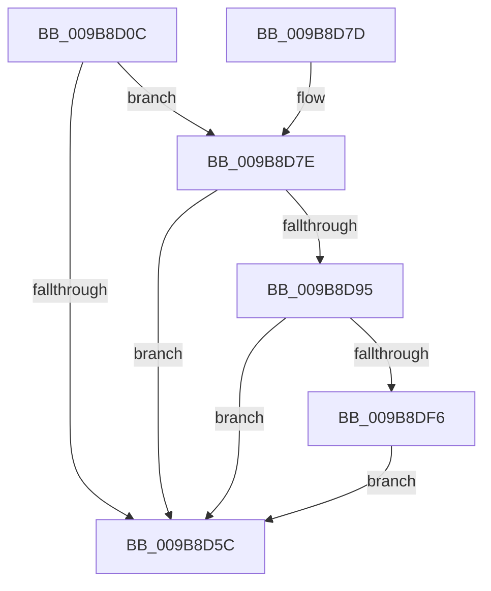

# CmpTraceHiveMountBaseFileMounted

- RVA: `0x009B8D0C`–`0x009B8E03` (길이 `247` bytes)
- VA: `0x00000001409B8D0C`
- 실행 섹션: `PAGE`
- PDB 이름 있음: `예`; PDB Function 태그: `아니요`
- unwind 정보 RVA: `0x0009E9BC`
- 디코드: `61`개 명령, `247/247` bytes 표시
- 미해석 바이트: `0` (있으면 어셈블리에 `.byte`로 보존)

> 이 문서는 커널 이미지의 기계어와 PDB 기호를 분석해 생성했습니다. 4번과 5번은 함수 원형과 자료형을 바이너리 사용 방식에서 추정한 C 해석이며 원본 소스 복구 결과는 아닙니다.

## 1. Dependencies

- 직접 호출 지점: **5**; 고유 호출 대상: **5**
- 직접 호출자로 확인된 함수: **1**
- RIP 상대 이미지 참조: **3**

### Outgoing calls
- `0x009B8D53` → [EtwEventEnabled](../../text/39/EtwEventEnabled_function_00392450.md) (function, `0x00392450`)
- `0x009B8D63` → [_security_check_cookie](../../text/6A/_security_check_cookie_function_006AC640.md) (function, `0x006AC640`)
- `0x009B8D8C` → [CmpQueryNameString](CmpQueryNameString_function_009BA2AC.md) (function, `0x009BA2AC`)
- `0x009B8DE8` → [EtwWrite](../../text/41/EtwWrite_function_0041C720.md) (function, `0x0041C720`)
- `0x009B8DF9` → [ExFreePool](../../poolcode/B8/ExFreePool_function_00B82850.md) (function, `0x00B82850`)

### Direct callers
- [HvLoadHive](HvLoadHive_function_009B8138.md) at `0x009B8327`

### Static image references
- `0x009B8D26` → RVA `0x00E0A740` (`.data`; read)
- `0x009B8D34` → RVA `0x00013C70` (`.rdata`; read)
- `0x009B8D42` → RVA `0x00FD8018` (`PAGEDATA`; read)

## 2. Other-region calls and transfers

- 다른 실행 섹션으로 향하는 call: **4**
  - `0x009B8D53` → [EtwEventEnabled](../../text/39/EtwEventEnabled_function_00392450.md) (`PAGE` → `.text`)
  - `0x009B8D63` → [_security_check_cookie](../../text/6A/_security_check_cookie_function_006AC640.md) (`PAGE` → `.text`)
  - `0x009B8DE8` → [EtwWrite](../../text/41/EtwWrite_function_0041C720.md) (`PAGE` → `.text`)
  - `0x009B8DF9` → [ExFreePool](../../poolcode/B8/ExFreePool_function_00B82850.md) (`PAGE` → `POOLCODE`)
- 별도 외부 분기/꼬리 이동을 확인하지 못했습니다.

## 3. Assembly (complete function range)

```asm
009B8D0C  48 8B C4                        mov rax, rsp
009B8D0F  48 89 58 18                     mov qword ptr [rax + 0x18], rbx
009B8D13  48 89 78 20                     mov qword ptr [rax + 0x20], rdi
009B8D17  89 50 10                        mov dword ptr [rax + 0x10], edx
009B8D1A  55                              push rbp
009B8D1B  48 8D 68 A1                     lea rbp, [rax - 0x5f]
009B8D1F  48 81 EC 90 00 00 00            sub rsp, 0x90
009B8D26  48 8B 05 13 1A 45 00            mov rax, qword ptr [rip + 0x451a13]
009B8D2D  48 33 C4                        xor rax, rsp
009B8D30  48 89 45 4F                     mov qword ptr [rbp + 0x4f], rax
009B8D34  0F 10 05 35 AF 65 FF            movups xmm0, xmmword ptr [rip - 0x9a50cb]
009B8D3B  48 8B D9                        mov rbx, rcx
009B8D3E  48 8D 55 0F                     lea rdx, [rbp + 0xf]
009B8D42  48 8B 0D CF F2 61 00            mov rcx, qword ptr [rip + 0x61f2cf]
009B8D49  33 FF                           xor edi, edi
009B8D4B  F3 0F 7F 45 0F                  movdqu xmmword ptr [rbp + 0xf], xmm0
009B8D50  89 7D 03                        mov dword ptr [rbp + 3], edi
009B8D53  E8 F8 96 9D FF                  call 0x140392450
009B8D58  84 C0                           test al, al
009B8D5A  75 22                           jne 0x1409b8d7e
009B8D5C  48 8B 4D 4F                     mov rcx, qword ptr [rbp + 0x4f]
009B8D60  48 33 CC                        xor rcx, rsp
009B8D63  E8 D8 38 CF FF                  call 0x1406ac640
009B8D68  4C 8D 9C 24 90 00 00 00         lea r11, [rsp + 0x90]
009B8D70  49 8B 5B 20                     mov rbx, qword ptr [r11 + 0x20]
009B8D74  49 8B 7B 28                     mov rdi, qword ptr [r11 + 0x28]
009B8D78  49 8B E3                        mov rsp, r11
009B8D7B  5D                              pop rbp
009B8D7C  C3                              ret
009B8D7D  CC                              int3
009B8D7E  48 8D 55 FF                     lea rdx, [rbp - 1]
009B8D82  48 89 7D 07                     mov qword ptr [rbp + 7], rdi
009B8D86  48 8B CB                        mov rcx, rbx
009B8D89  89 7D FF                        mov dword ptr [rbp - 1], edi
009B8D8C  E8 1B 15 00 00                  call 0x1409ba2ac
009B8D91  85 C0                           test eax, eax
009B8D93  78 C7                           js 0x1409b8d5c
009B8D95  0F B7 45 FF                     movzx eax, word ptr [rbp - 1]
009B8D99  48 8D 55 0F                     lea rdx, [rbp + 0xf]
009B8D9D  48 8B 5D 07                     mov rbx, qword ptr [rbp + 7]
009B8DA1  41 B9 03 00 00 00               mov r9d, 3
009B8DA7  48 8B 0D 6A F2 61 00            mov rcx, qword ptr [rip + 0x61f26a]
009B8DAE  45 33 C0                        xor r8d, r8d
009B8DB1  89 45 27                        mov dword ptr [rbp + 0x27], eax
009B8DB4  48 8D 45 F7                     lea rax, [rbp - 9]
009B8DB8  48 89 45 2F                     mov qword ptr [rbp + 0x2f], rax
009B8DBC  48 8D 45 6F                     lea rax, [rbp + 0x6f]
009B8DC0  48 89 45 3F                     mov qword ptr [rbp + 0x3f], rax
009B8DC4  48 8D 45 1F                     lea rax, [rbp + 0x1f]
009B8DC8  48 89 44 24 20                  mov qword ptr [rsp + 0x20], rax
009B8DCD  48 89 5D 1F                     mov qword ptr [rbp + 0x1f], rbx
009B8DD1  89 7D 2B                        mov dword ptr [rbp + 0x2b], edi
009B8DD4  66 89 7D F7                     mov word ptr [rbp - 9], di
009B8DD8  48 C7 45 37 02 00 00 00         mov qword ptr [rbp + 0x37], 2
009B8DE0  48 C7 45 47 04 00 00 00         mov qword ptr [rbp + 0x47], 4
009B8DE8  E8 33 39 A6 FF                  call 0x14041c720
009B8DED  48 85 DB                        test rbx, rbx
009B8DF0  0F 84 66 FF FF FF               je 0x1409b8d5c
009B8DF6  48 8B CB                        mov rcx, rbx
009B8DF9  E8 52 9A 1C 00                  call 0x140b82850
009B8DFE  E9 59 FF FF FF                  jmp 0x1409b8d5c
```

## 4. C-style interpretation (structured pseudocode)

```c
__int64 __fastcall CmpTraceHiveMountBaseFileMounted(__int64 a1, int a2, int a3)
{
    __int64 result;
    __int64 v_rdi;
    __int64 v_rsp;
    unsigned __int64 v_stack_m70;
    unsigned __int64 v_stack_m8;

    *(unsigned __int64 *)(v_rsp + 24) = v_rbx;
    *(unsigned __int64 *)(v_rsp + 32) = v_rdi;
    *(unsigned int *)(v_rsp + 16) = a2;
    v_rsp = (v_rsp) - (144);
    result = (*(unsigned __int64 *)(v_rip + 4528659)) ^ (v_rsp);
    *(unsigned __int64 *)(v_rsp - 95 + 79) = result;
    v_rdi = 0;
    *(unsigned __int64 *)(v_rsp - 95 + 15) = v_xmm0;
    *(unsigned int *)(v_rsp - 95 + 3) = 0;
    result = EtwEventEnabled(*(unsigned __int64 *)(v_rip + 6419151), v_rsp - 95 + 15, a3, a4);
    if ((unsigned __int8)(result) != 0) goto loc_009B8D7E;
loc_009B8D5C:
    a1 = (*(unsigned __int64 *)(v_rsp - 95 + 79)) ^ (v_rsp);
    result = _security_check_cookie(a1, v_rsp - 95 + 15, a3, a4);
    return result;
loc_009B8D7E:
    *(unsigned __int64 *)(v_rsp - 95 + 7) = *(unsigned __int64 *)(v_stack_m8 + 40);
    *(unsigned int *)(v_rsp - 95 - 1) = (unsigned int)(*(unsigned __int64 *)(v_stack_m8 + 40));
    result = CmpQueryNameString(*(unsigned __int64 *)(v_stack_m8 + 32), v_rsp - 95 - 1, a3, a4);
    if (sign_flag) goto loc_009B8D5C;
    a3 = 0;
    *(unsigned int *)(v_rsp - 95 + 39) = (unsigned int)(*(unsigned __int16 *)(v_rsp - 95 - 1));
    *(unsigned __int64 *)(v_rsp - 95 + 47) = v_rsp - 95 - 9;
    *(unsigned __int64 *)(v_rsp - 95 + 63) = v_rsp - 95 + 111;
    v_stack_m70 = v_rsp - 95 + 31;
    *(unsigned __int64 *)(v_rsp - 95 + 31) = *(unsigned __int64 *)(v_rsp - 95 + 7);
    *(unsigned int *)(v_rsp - 95 + 43) = (unsigned int)(*(unsigned __int64 *)(v_stack_m8 + 40));
    *(unsigned __int16 *)(v_rsp - 95 - 9) = (unsigned __int16)(*(unsigned __int64 *)(v_stack_m8 + 40));
    *(unsigned __int64 *)(v_rsp - 95 + 55) = 2;
    *(unsigned __int64 *)(v_rsp - 95 + 71) = 4;
    result = EtwWrite(*(unsigned __int64 *)(v_rip + 6419050), v_rsp - 95 + 15, a3, 3);
    if (*(unsigned __int64 *)(v_rsp - 95 + 7) == 0) goto loc_009B8D5C;
    result = ExFreePool(*(unsigned __int64 *)(v_rsp - 95 + 7), v_rsp - 95 + 15, a3, 3);
    goto loc_009B8D5C;
}
```

## 5. (Beta) C Style

```c
int64_t CmpTraceHiveMountBaseFileMounted(int64_t Arg1, int32_t Arg2, int32_t Arg3)
{
    int64_t result;
    int64_t local_rdi;
    int64_t local_rsp;
    uint64_t v_stack_m70;
    uint64_t v_stack_m8;

    *(uint64_t *)(local_rsp + 0x18) = local_rbx;
    *(uint64_t *)(local_rsp + 0x20) = local_rdi;
    *(uint32_t *)(local_rsp + 0x10) = Arg2;
    local_rsp = (local_rsp) - (144);
    result = (*(uint64_t *)(v_rip + 0x451A13)) ^ (local_rsp);
    *(uint64_t *)(local_rsp - 0x5F + 0x4F) = result;
    local_rdi = 0;
    *(uint64_t *)(local_rsp - 0x5F + 0xF) = v_xmm0;
    *(uint32_t *)(local_rsp - 0x5F + 0x3) = 0;
    result = EtwEventEnabled(*(uint64_t *)(v_rip + 0x61F2CF), local_rsp - 95 + 15, Arg3, a4);
    if ((uint8_t)(result) != 0) goto loc_009B8D7E;
loc_009B8D5C:
    Arg1 = (*(uint64_t *)(local_rsp - 0x5F + 0x4F)) ^ (local_rsp);
    result = _security_check_cookie(Arg1, local_rsp - 95 + 15, Arg3, a4);
    return result;
loc_009B8D7E:
    *(uint64_t *)(local_rsp - 0x5F + 0x7) = *(uint64_t *)(v_stack_m8 + 0x28);
    *(uint32_t *)(local_rsp - 0x5F - 0x1) = (uint32_t)(*(uint64_t *)(v_stack_m8 + 0x28));
    result = CmpQueryNameString(*(uint64_t *)(v_stack_m8 + 0x20), local_rsp - 95 - 1, Arg3, a4);
    if (sign_flag) goto loc_009B8D5C;
    Arg3 = 0;
    *(uint32_t *)(local_rsp - 0x5F + 0x27) = (uint32_t)(*(uint16_t *)(local_rsp - 0x5F - 0x1));
    *(uint64_t *)(local_rsp - 0x5F + 0x2F) = local_rsp - 95 - 9;
    *(uint64_t *)(local_rsp - 0x5F + 0x3F) = local_rsp - 95 + 111;
    v_stack_m70 = local_rsp - 95 + 31;
    *(uint64_t *)(local_rsp - 0x5F + 0x1F) = *(uint64_t *)(local_rsp - 0x5F + 0x7);
    *(uint32_t *)(local_rsp - 0x5F + 0x2B) = (uint32_t)(*(uint64_t *)(v_stack_m8 + 0x28));
    *(uint16_t *)(local_rsp - 0x5F - 0x9) = (uint16_t)(*(uint64_t *)(v_stack_m8 + 0x28));
    *(uint64_t *)(local_rsp - 0x5F + 0x37) = 2;
    *(uint64_t *)(local_rsp - 0x5F + 0x47) = 4;
    result = EtwWrite(*(uint64_t *)(v_rip + 0x61F26A), local_rsp - 95 + 15, Arg3, 3);
    if (*(uint64_t *)(local_rsp - 0x5F + 0x7) == 0) goto loc_009B8D5C;
    result = ExFreePool(*(uint64_t *)(local_rsp - 0x5F + 0x7), local_rsp - 95 + 15, Arg3, 3);
    goto loc_009B8D5C;
}
```

## 6. Execution-region graph

[열기: 2D/3D 그래프와 함수 탐색 컨트롤 패널](../../../control-panel.html?section=page&rva=0x009B8D0C&view=graph)

- 2D 그래프는 위에서 아래로 흐르고, 3D 그래프는 빈 공간을 드래그해 회전합니다. Shift+드래그는 이동, 휠은 확대·축소, 함수 노드 선택은 대상 보고서 이동입니다.

### Static fallback


