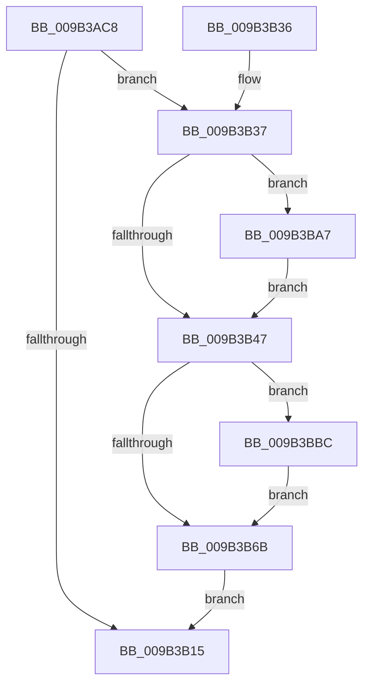

# CmpTraceHiveUnloadStart

- RVA: `0x009B3AC8`–`0x009B3BD7` (길이 `271` bytes)
- VA: `0x00000001409B3AC8`
- 실행 섹션: `PAGE`
- PDB 이름 있음: `예`; PDB Function 태그: `아니요`
- unwind 정보 RVA: `0x0009E4D4`
- 디코드: `69`개 명령, `271/271` bytes 표시
- 미해석 바이트: `0` (있으면 어셈블리에 `.byte`로 보존)

> 이 문서는 커널 이미지의 기계어와 PDB 기호를 분석해 생성했습니다. 4번과 5번은 함수 원형과 자료형을 바이너리 사용 방식에서 추정한 C 해석이며 원본 소스 복구 결과는 아닙니다.

## 1. Dependencies

- 직접 호출 지점: **3**; 고유 호출 대상: **3**
- 직접 호출자로 확인된 함수: **1**
- RIP 상대 이미지 참조: **3**

### Outgoing calls
- `0x009B3B0A` → [EtwEventEnabled](../../text/39/EtwEventEnabled_function_00392450.md) (function, `0x00392450`)
- `0x009B3B1C` → [_security_check_cookie](../../text/6A/_security_check_cookie_function_006AC640.md) (function, `0x006AC640`)
- `0x009B3B9D` → [EtwWrite](../../text/41/EtwWrite_function_0041C720.md) (function, `0x0041C720`)

### Direct callers
- [CmpCompleteUnloadKey](CmpCompleteUnloadKey_function_009B32FC.md) at `0x009B337E`

### Static image references
- `0x009B3ADF` → RVA `0x00E0A740` (`.data`; read)
- `0x009B3AED` → RVA `0x00013C60` (`.rdata`; read)
- `0x009B3AFA` → RVA `0x00FD8018` (`PAGEDATA`; read)

## 2. Other-region calls and transfers

- 다른 실행 섹션으로 향하는 call: **3**
  - `0x009B3B0A` → [EtwEventEnabled](../../text/39/EtwEventEnabled_function_00392450.md) (`PAGE` → `.text`)
  - `0x009B3B1C` → [_security_check_cookie](../../text/6A/_security_check_cookie_function_006AC640.md) (`PAGE` → `.text`)
  - `0x009B3B9D` → [EtwWrite](../../text/41/EtwWrite_function_0041C720.md) (`PAGE` → `.text`)
- 별도 외부 분기/꼬리 이동을 확인하지 못했습니다.

## 3. Assembly (complete function range)

```asm
009B3AC8  48 89 5C 24 08                  mov qword ptr [rsp + 8], rbx
009B3ACD  48 89 7C 24 10                  mov qword ptr [rsp + 0x10], rdi
009B3AD2  55                              push rbp
009B3AD3  48 8D 6C 24 A9                  lea rbp, [rsp - 0x57]
009B3AD8  48 81 EC A0 00 00 00            sub rsp, 0xa0
009B3ADF  48 8B 05 5A 6C 45 00            mov rax, qword ptr [rip + 0x456c5a]
009B3AE6  48 33 C4                        xor rax, rsp
009B3AE9  48 89 45 47                     mov qword ptr [rbp + 0x47], rax
009B3AED  0F 10 05 6C 01 66 FF            movups xmm0, xmmword ptr [rip - 0x99fe94]
009B3AF4  48 8B FA                        mov rdi, rdx
009B3AF7  48 8B D9                        mov rbx, rcx
009B3AFA  48 8B 0D 17 45 62 00            mov rcx, qword ptr [rip + 0x624517]
009B3B01  48 8D 55 EF                     lea rdx, [rbp - 0x11]
009B3B05  F3 0F 7F 45 EF                  movdqu xmmword ptr [rbp - 0x11], xmm0
009B3B0A  E8 41 E9 9D FF                  call 0x140392450
009B3B0F  33 D2                           xor edx, edx
009B3B11  84 C0                           test al, al
009B3B13  75 22                           jne 0x1409b3b37
009B3B15  48 8B 4D 47                     mov rcx, qword ptr [rbp + 0x47]
009B3B19  48 33 CC                        xor rcx, rsp
009B3B1C  E8 1F 8B CF FF                  call 0x1406ac640
009B3B21  4C 8D 9C 24 A0 00 00 00         lea r11, [rsp + 0xa0]
009B3B29  49 8B 5B 10                     mov rbx, qword ptr [r11 + 0x10]
009B3B2D  49 8B 7B 18                     mov rdi, qword ptr [r11 + 0x18]
009B3B31  49 8B E3                        mov rsp, r11
009B3B34  5D                              pop rbp
009B3B35  C3                              ret
009B3B36  CC                              int3
009B3B37  48 8B 43 08                     mov rax, qword ptr [rbx + 8]
009B3B3B  44 8B CA                        mov r9d, edx
009B3B3E  66 89 55 E7                     mov word ptr [rbp - 0x19], dx
009B3B42  48 85 C0                        test rax, rax
009B3B45  75 60                           jne 0x1409b3ba7
009B3B47  41 8B C1                        mov eax, r9d
009B3B4A  48 8D 4D E7                     lea rcx, [rbp - 0x19]
009B3B4E  48 03 C0                        add rax, rax
009B3B51  41 FF C1                        inc r9d
009B3B54  48 89 4C C5 07                  mov qword ptr [rbp + rax*8 + 7], rcx
009B3B59  48 C7 44 C5 0F 02 00 00 00      mov qword ptr [rbp + rax*8 + 0xf], 2
009B3B62  48 8B 47 08                     mov rax, qword ptr [rdi + 8]
009B3B66  48 85 C0                        test rax, rax
009B3B69  75 51                           jne 0x1409b3bbc
009B3B6B  41 8B C1                        mov eax, r9d
009B3B6E  48 8D 4D E7                     lea rcx, [rbp - 0x19]
009B3B72  48 03 C0                        add rax, rax
009B3B75  48 8D 55 EF                     lea rdx, [rbp - 0x11]
009B3B79  41 FF C1                        inc r9d
009B3B7C  45 33 C0                        xor r8d, r8d
009B3B7F  48 89 4C C5 07                  mov qword ptr [rbp + rax*8 + 7], rcx
009B3B84  48 8B 0D 8D 44 62 00            mov rcx, qword ptr [rip + 0x62448d]
009B3B8B  48 C7 44 C5 0F 02 00 00 00      mov qword ptr [rbp + rax*8 + 0xf], 2
009B3B94  48 8D 45 07                     lea rax, [rbp + 7]
009B3B98  48 89 44 24 20                  mov qword ptr [rsp + 0x20], rax
009B3B9D  E8 7E 8B A6 FF                  call 0x14041c720
009B3BA2  E9 6E FF FF FF                  jmp 0x1409b3b15
009B3BA7  48 89 45 07                     mov qword ptr [rbp + 7], rax
009B3BAB  41 B9 01 00 00 00               mov r9d, 1
009B3BB1  0F B7 03                        movzx eax, word ptr [rbx]
009B3BB4  89 45 0F                        mov dword ptr [rbp + 0xf], eax
009B3BB7  89 55 13                        mov dword ptr [rbp + 0x13], edx
009B3BBA  EB 8B                           jmp 0x1409b3b47
009B3BBC  41 8B C9                        mov ecx, r9d
009B3BBF  48 03 C9                        add rcx, rcx
009B3BC2  41 FF C1                        inc r9d
009B3BC5  48 89 44 CD 07                  mov qword ptr [rbp + rcx*8 + 7], rax
009B3BCA  0F B7 07                        movzx eax, word ptr [rdi]
009B3BCD  89 44 CD 0F                     mov dword ptr [rbp + rcx*8 + 0xf], eax
009B3BD1  89 54 CD 13                     mov dword ptr [rbp + rcx*8 + 0x13], edx
009B3BD5  EB 94                           jmp 0x1409b3b6b
```

## 4. C-style interpretation (structured pseudocode)

```c
__int64 __fastcall CmpTraceHiveUnloadStart(__int64 a1, __int64 a2, int a3)
{
    __int64 result;
    __int64 v_rsp;
    unsigned __int64 v_stack_m18;
    unsigned int v_stack_m4C;
    unsigned int v_stack_m50;
    unsigned __int64 v_stack_m58;
    unsigned __int64 v_stack_m5F;
    unsigned __int64 v_stack_m70;
    unsigned __int16 v_stack_m78;
    unsigned __int64 v_stack_m8;
    unsigned __int64 v_stack_m80;
    unsigned __int64 v_stack_p10;
    unsigned __int64 v_stack_p8;

    v_stack_p8 = v_rbx;
    v_stack_p10 = v_rdi;
    v_rsp = (v_rsp) - (160);
    result = (*(unsigned __int64 *)(v_rip + 4549722)) ^ (v_rsp);
    v_stack_m18 = result;
    v_stack_m70 = v_xmm0;
    result = EtwEventEnabled(*(unsigned __int64 *)(v_rip + 6440215), v_stack_m70, a3, a4);
    a2 = 0;
    if ((unsigned __int8)(result) != 0) goto loc_009B3B37;
loc_009B3B15:
    a1 = (v_stack_m18) ^ (v_rsp);
    result = _security_check_cookie(a1, a2, a3, a4);
    return result;
loc_009B3B37:
    v_stack_m78 = 0;
    if (*(unsigned __int64 *)(*(unsigned __int64 *)(v_stack_m8 + 16) + 8) != 0) goto loc_009B3BA7;
loc_009B3B47:
    result = (0) + (0);
    a4 = (unsigned int)((0) + 1);
    *(unsigned __int64 *)(v_stack_m5F + result * 8 + 7) = v_stack_m78;
    *(unsigned __int64 *)(v_stack_m5F + result * 8 + 15) = 2;
    if (*(unsigned __int64 *)(*(unsigned __int64 *)(v_stack_m8 + 24) + 8) != 0) goto loc_009B3BBC;
loc_009B3B6B:
    result = ((unsigned int)((unsigned int)(a4))) + ((unsigned int)((unsigned int)(a4)));
    a4 = (unsigned int)((a4) + 1);
    a3 = 0;
    *(unsigned __int64 *)(v_stack_m5F + result * 8 + 7) = v_stack_m78;
    *(unsigned __int64 *)(v_stack_m5F + result * 8 + 15) = 2;
    v_stack_m80 = v_stack_m58;
    result = EtwWrite(*(unsigned __int64 *)(v_rip + 6440077), v_stack_m70, a3, a4);
    goto loc_009B3B15;
loc_009B3BA7:
    v_stack_m58 = result;
    v_stack_m50 = (unsigned int)(*(unsigned __int16 *)(*(unsigned __int64 *)(v_stack_m8 + 16)));
    v_stack_m4C = (unsigned int)(v_stack_m70);
    goto loc_009B3B47;
loc_009B3BBC:
    a1 = (1) + (1);
    a4 = (unsigned int)((1) + 1);
    *(unsigned __int64 *)(v_stack_m5F + a1 * 8 + 7) = *(unsigned __int16 *)(*(unsigned __int64 *)(v_stack_m8 + 16));
    *(unsigned int *)(v_stack_m5F + a1 * 8 + 15) = (unsigned int)(*(unsigned __int16 *)(*(unsigned __int64 *)(v_stack_m8 + 24)));
    *(unsigned int *)(v_stack_m5F + a1 * 8 + 19) = (unsigned int)(v_stack_m70);
    goto loc_009B3B6B;
}
```

## 5. (Beta) C Style

```c
int64_t CmpTraceHiveUnloadStart(void *Arg1, void *Arg2, int32_t Arg3)
{
    uint8_t *arg1 = (uint8_t *)Arg1;
    uint8_t *arg2 = (uint8_t *)Arg2;

    int64_t result;
    int64_t local_rsp;
    uint64_t v_stack_m18;
    uint32_t v_stack_m4C;
    uint32_t v_stack_m50;
    uint64_t v_stack_m58;
    uint64_t v_stack_m5F;
    uint64_t v_stack_m70;
    uint16_t v_stack_m78;
    uint64_t v_stack_m8;
    uint64_t v_stack_m80;
    uint64_t v_stack_p10;
    uint64_t v_stack_p8;

    v_stack_p8 = local_rbx;
    v_stack_p10 = local_rdi;
    local_rsp = (local_rsp) - (160);
    result = (*(uint64_t *)(v_rip + 0x456C5A)) ^ (local_rsp);
    v_stack_m18 = result;
    v_stack_m70 = v_xmm0;
    result = EtwEventEnabled(*(uint64_t *)(v_rip + 0x624517), v_stack_m70, Arg3, a4);
    Arg2 = 0;
    if ((uint8_t)(result) != 0) goto loc_009B3B37;
loc_009B3B15:
    Arg1 = (v_stack_m18) ^ (local_rsp);
    result = _security_check_cookie(Arg1, Arg2, Arg3, a4);
    return result;
loc_009B3B37:
    v_stack_m78 = 0;
    if (*(uint64_t *)(*(uint64_t *)(v_stack_m8 + 0x10) + 0x8) != 0) goto loc_009B3BA7;
loc_009B3B47:
    result = (0) + (0);
    a4 = (uint32_t)((0) + 1);
    *(uint64_t *)(v_stack_m5F + result * 8 + 0x7) = v_stack_m78;
    *(uint64_t *)(v_stack_m5F + result * 8 + 0xF) = 2;
    if (*(uint64_t *)(*(uint64_t *)(v_stack_m8 + 0x18) + 0x8) != 0) goto loc_009B3BBC;
loc_009B3B6B:
    result = ((uint32_t)((uint32_t)(a4))) + ((uint32_t)((uint32_t)(a4)));
    a4 = (uint32_t)((a4) + 1);
    Arg3 = 0;
    *(uint64_t *)(v_stack_m5F + result * 8 + 0x7) = v_stack_m78;
    *(uint64_t *)(v_stack_m5F + result * 8 + 0xF) = 2;
    v_stack_m80 = v_stack_m58;
    result = EtwWrite(*(uint64_t *)(v_rip + 0x62448D), v_stack_m70, Arg3, a4);
    goto loc_009B3B15;
loc_009B3BA7:
    v_stack_m58 = result;
    v_stack_m50 = (uint32_t)(*(uint16_t *)(*(uint64_t *)(v_stack_m8 + 0x10)));
    v_stack_m4C = (uint32_t)(v_stack_m70);
    goto loc_009B3B47;
loc_009B3BBC:
    Arg1 = (1) + (1);
    a4 = (uint32_t)((1) + 1);
    *(uint64_t *)(v_stack_m5F + arg1 * 8 + 0x7) = *(uint16_t *)(*(uint64_t *)(v_stack_m8 + 0x10));
    *(uint32_t *)(v_stack_m5F + arg1 * 8 + 0xF) = (uint32_t)(*(uint16_t *)(*(uint64_t *)(v_stack_m8 + 0x18)));
    *(uint32_t *)(v_stack_m5F + arg1 * 8 + 0x13) = (uint32_t)(v_stack_m70);
    goto loc_009B3B6B;
}
```

### 관측된 메모리 오프셋

구조체 형식이 확인되지 않은 접근은 인자 기준의 오프셋으로만 기록했습니다.

| 기준 인자 | 오프셋 표현 | 폭 (bit) | 접근 |
|---|---:|---:|---|
| `Arg1` | `+ 0x0` | `16` | `R` |
| `Arg1` | `+ 0x8` | `64` | `R` |
| `Arg2` | `+ 0x0` | `16` | `R` |
| `Arg2` | `+ 0x8` | `64` | `R` |

## 6. Execution-region graph

[열기: 2D/3D 그래프와 함수 탐색 컨트롤 패널](../../../control-panel.html?section=page&rva=0x009B3AC8&view=graph)

- 2D 그래프는 위에서 아래로 흐르고, 3D 그래프는 빈 공간을 드래그해 회전합니다. Shift+드래그는 이동, 휠은 확대·축소, 함수 노드 선택은 대상 보고서 이동입니다.

### Static fallback


