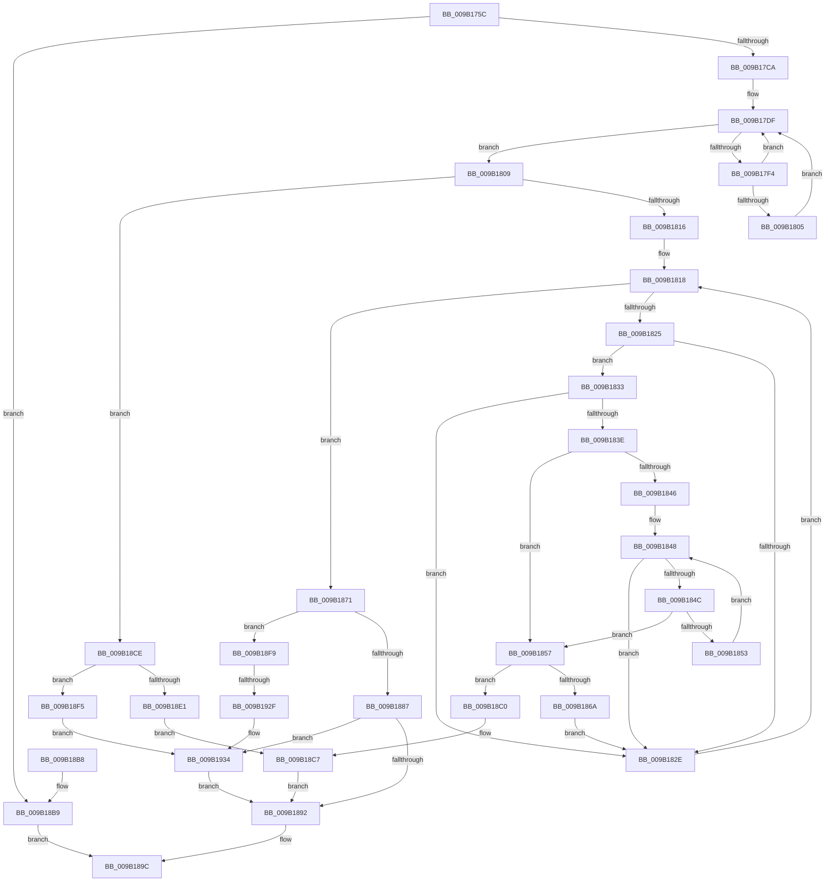

# CmpTransMgrPrepare

- RVA: `0x009B175C`–`0x009B193E` (길이 `482` bytes)
- VA: `0x00000001409B175C`
- 실행 섹션: `PAGE`
- PDB 이름 있음: `예`; PDB Function 태그: `예`
- unwind 정보 RVA: `0x0009E2C8`
- 디코드: `138`개 명령, `482/482` bytes 표시
- 미해석 바이트: `0` (있으면 어셈블리에 `.byte`로 보존)

> 이 문서는 커널 이미지의 기계어와 PDB 기호를 분석해 생성했습니다. 4번과 5번은 함수 원형과 자료형을 바이너리 사용 방식에서 추정한 C 해석이며 원본 소스 복구 결과는 아닙니다.

## 1. Dependencies

- 직접 호출 지점: **22**; 고유 호출 대상: **18**
- 직접 호출자로 확인된 함수: **2**
- RIP 상대 이미지 참조: **3**

### Outgoing calls
- `0x009B179E` → [LOCK_TRANSACTION_LIST](../87/LOCK_TRANSACTION_LIST_function_00874AD4.md) (function, `0x00874AD4`)
- `0x009B17B3` → [ExReleaseFastMutexUnsafe](../../text/25/ExReleaseFastMutexUnsafe_function_002503A0.md) (function, `0x002503A0`)
- `0x009B17B8` → [KeLeaveCriticalRegion](../../text/25/KeLeaveCriticalRegion_function_0025D8B0.md) (function, `0x0025D8B0`)
- `0x009B17CF` → [CmpAttachToRegistryProcess](../../pagecmrc/BC/CmpAttachToRegistryProcess_function_00BC98E0.md) (function, `0x00BC98E0`)
- `0x009B17D4` → [CmpLockRegistry](../../pagecmrc/BC/CmpLockRegistry_function_00BC9B34.md) (function, `0x00BC9B34`)
- `0x009B17EA` → [CmListGetNextElement](../../pagecmrc/BC/CmListGetNextElement_function_00BC9940.md) (function, `0x00BC9940`)
- `0x009B1818` → [CmpGetNextActiveHive](../84/CmpGetNextActiveHive_function_0084E2A0.md) (function, `0x0084E2A0`)
- `0x009B1857` → [CmpUnlockRegistry](../../pagecmrc/BC/CmpUnlockRegistry_function_00BC9A84.md) (function, `0x00BC9A84`)
- `0x009B185F` → [CmpTransMgrSyncHive](CmpTransMgrSyncHive_function_009B07C4.md) (function, `0x009B07C4`)
- `0x009B186A` → [CmpLockRegistry](../../pagecmrc/BC/CmpLockRegistry_function_00BC9B34.md) (function, `0x00BC9B34`)
- `0x009B1897` → [CmpDetachFromRegistryProcess](../../pagecmrc/BC/CmpDetachFromRegistryProcess_function_00BC9920.md) (function, `0x00BC9920`)
- `0x009B18A6` → [_security_check_cookie](../../text/6A/_security_check_cookie_function_006AC640.md) (function, `0x006AC640`)
- `0x009B18C7` → [ExReleaseRundownProtection](../../text/34/ExReleaseRundownProtection_function_00349E80.md) (function, `0x00349E80`)
- `0x009B18D8` → [ExAcquireRundownProtection](../../text/21/ExAcquireRundownProtection_function_00216620.md) (function, `0x00216620`)
- `0x009B18E1` → [CmpUnlockRegistry](../../pagecmrc/BC/CmpUnlockRegistry_function_00BC9A84.md) (function, `0x00BC9A84`)
- `0x009B18E9` → [CmpTransMgrSyncHive](CmpTransMgrSyncHive_function_009B07C4.md) (function, `0x009B07C4`)
- `0x009B18FC` → [HvLockHiveFlusherExclusive](../../pagecmrc/BC/HvLockHiveFlusherExclusive_function_00BC9C50.md) (function, `0x00BC9C50`)
- `0x009B1904` → [HvLockHiveWriter](../85/HvLockHiveWriter_function_00859894.md) (function, `0x00859894`)
- `0x009B1915` → [HvpMarkDirty](../85/HvpMarkDirty_function_008593C0.md) (function, `0x008593C0`)
- `0x009B191F` → [HvUnlockHiveWriter](../85/HvUnlockHiveWriter_function_008598E4.md) (function, `0x008598E4`)
- `0x009B192F` → [HvUnlockHiveFlusherExclusive](../../pagecmrc/BC/HvUnlockHiveFlusherExclusive_function_00BC9C34.md) (function, `0x00BC9C34`)
- `0x009B1934` → [CmpUnlockRegistry](../../pagecmrc/BC/CmpUnlockRegistry_function_00BC9A84.md) (function, `0x00BC9A84`)

### Direct callers
- [CmpRmUnDoPhase](../7F/CmpRmUnDoPhase_function_007F0968.md) at `0x007F0A41`
- [CmKtmNotification](CmKtmNotification_function_009B1950.md) at `0x009B1AA4`

### Static image references
- `0x009B1769` → RVA `0x00E0A740` (`.data`; read)
- `0x009B17A8` → RVA `0x00EF5820` (`.data`; read)
- `0x009B1871` → RVA `0x00E09AE0` (`.data`; read)

## 2. Other-region calls and transfers

- 다른 실행 섹션으로 향하는 call: **15**
  - `0x009B17B3` → [ExReleaseFastMutexUnsafe](../../text/25/ExReleaseFastMutexUnsafe_function_002503A0.md) (`PAGE` → `.text`)
  - `0x009B17B8` → [KeLeaveCriticalRegion](../../text/25/KeLeaveCriticalRegion_function_0025D8B0.md) (`PAGE` → `.text`)
  - `0x009B17CF` → [CmpAttachToRegistryProcess](../../pagecmrc/BC/CmpAttachToRegistryProcess_function_00BC98E0.md) (`PAGE` → `PAGECMRC`)
  - `0x009B17D4` → [CmpLockRegistry](../../pagecmrc/BC/CmpLockRegistry_function_00BC9B34.md) (`PAGE` → `PAGECMRC`)
  - `0x009B17EA` → [CmListGetNextElement](../../pagecmrc/BC/CmListGetNextElement_function_00BC9940.md) (`PAGE` → `PAGECMRC`)
  - `0x009B1857` → [CmpUnlockRegistry](../../pagecmrc/BC/CmpUnlockRegistry_function_00BC9A84.md) (`PAGE` → `PAGECMRC`)
  - `0x009B186A` → [CmpLockRegistry](../../pagecmrc/BC/CmpLockRegistry_function_00BC9B34.md) (`PAGE` → `PAGECMRC`)
  - `0x009B1897` → [CmpDetachFromRegistryProcess](../../pagecmrc/BC/CmpDetachFromRegistryProcess_function_00BC9920.md) (`PAGE` → `PAGECMRC`)
  - `0x009B18A6` → [_security_check_cookie](../../text/6A/_security_check_cookie_function_006AC640.md) (`PAGE` → `.text`)
  - `0x009B18C7` → [ExReleaseRundownProtection](../../text/34/ExReleaseRundownProtection_function_00349E80.md) (`PAGE` → `.text`)
  - `0x009B18D8` → [ExAcquireRundownProtection](../../text/21/ExAcquireRundownProtection_function_00216620.md) (`PAGE` → `.text`)
  - `0x009B18E1` → [CmpUnlockRegistry](../../pagecmrc/BC/CmpUnlockRegistry_function_00BC9A84.md) (`PAGE` → `PAGECMRC`)
  - `0x009B18FC` → [HvLockHiveFlusherExclusive](../../pagecmrc/BC/HvLockHiveFlusherExclusive_function_00BC9C50.md) (`PAGE` → `PAGECMRC`)
  - `0x009B192F` → [HvUnlockHiveFlusherExclusive](../../pagecmrc/BC/HvUnlockHiveFlusherExclusive_function_00BC9C34.md) (`PAGE` → `PAGECMRC`)
  - `0x009B1934` → [CmpUnlockRegistry](../../pagecmrc/BC/CmpUnlockRegistry_function_00BC9A84.md) (`PAGE` → `PAGECMRC`)
- call이 아닌 외부 분기/꼬리 이동: **1**
  - `0x009B1929` → [sub_00B2DB96](../B2/Unknown_function_00B2DB96.md) (`tail-transfer`)

## 3. Assembly (complete function range)

```asm
009B175C  40 53                           push rbx
009B175E  55                              push rbp
009B175F  56                              push rsi
009B1760  57                              push rdi
009B1761  41 56                           push r14
009B1763  41 57                           push r15
009B1765  48 83 EC 68                     sub rsp, 0x68
009B1769  48 8B 05 D0 8F 45 00            mov rax, qword ptr [rip + 0x458fd0]
009B1770  48 33 C4                        xor rax, rsp
009B1773  48 89 44 24 58                  mov qword ptr [rsp + 0x58], rax
009B1778  0F 57 C0                        xorps xmm0, xmm0
009B177B  41 C6 01 00                     mov byte ptr [r9], 0
009B177F  41 83 20 00                     and dword ptr [r8], 0
009B1783  4D 8B F9                        mov r15, r9
009B1786  0F 11 44 24 28                  movups xmmword ptr [rsp + 0x28], xmm0
009B178B  49 8B D8                        mov rbx, r8
009B178E  4C 8B F2                        mov r14, rdx
009B1791  0F 11 44 24 38                  movups xmmword ptr [rsp + 0x38], xmm0
009B1796  48 8B E9                        mov rbp, rcx
009B1799  0F 11 44 24 48                  movups xmmword ptr [rsp + 0x48], xmm0
009B179E  E8 31 33 EC FF                  call 0x140874ad4
009B17A3  BE 01 00 00 00                  mov esi, 1
009B17A8  48 8D 0D 71 40 54 00            lea rcx, [rip + 0x544071]
009B17AF  41 09 76 30                     or dword ptr [r14 + 0x30], esi
009B17B3  E8 E8 EB 89 FF                  call 0x1402503a0
009B17B8  E8 F3 C0 8A FF                  call 0x14025d8b0
009B17BD  49 8D 7E 10                     lea rdi, [r14 + 0x10]
009B17C1  48 39 3F                        cmp qword ptr [rdi], rdi
009B17C4  0F 84 EF 00 00 00               je 0x1409b18b9
009B17CA  48 8D 4C 24 28                  lea rcx, [rsp + 0x28]
009B17CF  E8 0C 81 21 00                  call 0x140bc98e0
009B17D4  E8 5B 83 21 00                  call 0x140bc9b34
009B17D9  48 83 64 24 20 00               and qword ptr [rsp + 0x20], 0
009B17DF  45 33 C0                        xor r8d, r8d
009B17E2  48 8D 54 24 20                  lea rdx, [rsp + 0x20]
009B17E7  48 8B CF                        mov rcx, rdi
009B17EA  E8 51 81 21 00                  call 0x140bc9940
009B17EF  48 85 C0                        test rax, rax
009B17F2  74 15                           je 0x1409b1809
009B17F4  48 8B 40 30                     mov rax, qword ptr [rax + 0x30]
009B17F8  48 8B 48 20                     mov rcx, qword ptr [rax + 0x20]
009B17FC  48 39 A9 38 10 00 00            cmp qword ptr [rcx + 0x1038], rbp
009B1803  75 DA                           jne 0x1409b17df
009B1805  01 33                           add dword ptr [rbx], esi
009B1807  EB D6                           jmp 0x1409b17df
009B1809  48 8B 5D 50                     mov rbx, qword ptr [rbp + 0x50]
009B180D  48 85 DB                        test rbx, rbx
009B1810  0F 85 B8 00 00 00               jne 0x1409b18ce
009B1816  33 C9                           xor ecx, ecx
009B1818  E8 83 CA E9 FF                  call 0x14084e2a0
009B181D  48 8B F8                        mov rdi, rax
009B1820  48 85 C0                        test rax, rax
009B1823  74 4C                           je 0x1409b1871
009B1825  48 39 A8 38 10 00 00            cmp qword ptr [rax + 0x1038], rbp
009B182C  74 05                           je 0x1409b1833
009B182E  48 8B CF                        mov rcx, rdi
009B1831  EB E5                           jmp 0x1409b1818
009B1833  8B 8F A0 00 00 00               mov ecx, dword ptr [rdi + 0xa0]
009B1839  F6 C1 02                        test cl, 2
009B183C  75 F0                           jne 0x1409b182e
009B183E  41 8B 56 70                     mov edx, dword ptr [r14 + 0x70]
009B1842  85 D2                           test edx, edx
009B1844  74 11                           je 0x1409b1857
009B1846  33 C9                           xor ecx, ecx
009B1848  3B CA                           cmp ecx, edx
009B184A  73 E2                           jae 0x1409b182e
009B184C  49 3B 7C CE 78                  cmp rdi, qword ptr [r14 + rcx*8 + 0x78]
009B1851  74 04                           je 0x1409b1857
009B1853  03 CE                           add ecx, esi
009B1855  EB F1                           jmp 0x1409b1848
009B1857  E8 28 82 21 00                  call 0x140bc9a84
009B185C  48 8B CF                        mov rcx, rdi
009B185F  E8 60 EF FF FF                  call 0x1409b07c4
009B1864  8B D8                           mov ebx, eax
009B1866  85 C0                           test eax, eax
009B1868  78 56                           js 0x1409b18c0
009B186A  E8 C5 82 21 00                  call 0x140bc9b34
009B186F  EB BD                           jmp 0x1409b182e
009B1871  48 8B 3D 68 82 45 00            mov rdi, qword ptr [rip + 0x458268]
009B1878  48 8B 47 40                     mov rax, qword ptr [rdi + 0x40]
009B187C  8B 88 90 00 00 00               mov ecx, dword ptr [rax + 0x90]
009B1882  40 84 CE                        test sil, cl
009B1885  74 72                           je 0x1409b18f9
009B1887  33 DB                           xor ebx, ebx
009B1889  40 84 F6                        test sil, sil
009B188C  0F 85 A2 00 00 00               jne 0x1409b1934
009B1892  48 8D 4C 24 28                  lea rcx, [rsp + 0x28]
009B1897  E8 84 80 21 00                  call 0x140bc9920
009B189C  8B C3                           mov eax, ebx
009B189E  48 8B 4C 24 58                  mov rcx, qword ptr [rsp + 0x58]
009B18A3  48 33 CC                        xor rcx, rsp
009B18A6  E8 95 AD CF FF                  call 0x1406ac640
009B18AB  48 83 C4 68                     add rsp, 0x68
009B18AF  41 5F                           pop r15
009B18B1  41 5E                           pop r14
009B18B3  5F                              pop rdi
009B18B4  5E                              pop rsi
009B18B5  5D                              pop rbp
009B18B6  5B                              pop rbx
009B18B7  C3                              ret
009B18B8  CC                              int3
009B18B9  41 88 37                        mov byte ptr [r15], sil
009B18BC  33 DB                           xor ebx, ebx
009B18BE  EB DC                           jmp 0x1409b189c
009B18C0  48 8D 8F 68 06 00 00            lea rcx, [rdi + 0x668]
009B18C7  E8 B4 85 99 FF                  call 0x140349e80
009B18CC  EB C4                           jmp 0x1409b1892
009B18CE  48 8D BB 68 06 00 00            lea rdi, [rbx + 0x668]
009B18D5  48 8B CF                        mov rcx, rdi
009B18D8  E8 43 4D 86 FF                  call 0x140216620
009B18DD  84 C0                           test al, al
009B18DF  74 14                           je 0x1409b18f5
009B18E1  E8 9E 81 21 00                  call 0x140bc9a84
009B18E6  48 8B CB                        mov rcx, rbx
009B18E9  E8 D6 EE FF FF                  call 0x1409b07c4
009B18EE  8B D8                           mov ebx, eax
009B18F0  48 8B CF                        mov rcx, rdi
009B18F3  EB D2                           jmp 0x1409b18c7
009B18F5  33 DB                           xor ebx, ebx
009B18F7  EB 3B                           jmp 0x1409b1934
009B18F9  48 8B CF                        mov rcx, rdi
009B18FC  E8 4F 83 21 00                  call 0x140bc9c50
009B1901  48 8B CF                        mov rcx, rdi
009B1904  E8 8B 7F EA FF                  call 0x140859894
009B1909  45 33 C9                        xor r9d, r9d
009B190C  33 D2                           xor edx, edx
009B190E  48 8B CF                        mov rcx, rdi
009B1911  45 8D 41 20                     lea r8d, [r9 + 0x20]
009B1915  E8 A6 7A EA FF                  call 0x1408593c0
009B191A  48 8B CF                        mov rcx, rdi
009B191D  8B D8                           mov ebx, eax
009B191F  E8 C0 7F EA FF                  call 0x1408598e4
009B1924  48 8B CF                        mov rcx, rdi
009B1927  85 DB                           test ebx, ebx
009B1929  0F 89 67 C2 17 00               jns 0x140b2db96
009B192F  E8 00 83 21 00                  call 0x140bc9c34
009B1934  E8 4B 81 21 00                  call 0x140bc9a84
009B1939  E9 54 FF FF FF                  jmp 0x1409b1892
```

## 4. C-style interpretation (structured pseudocode)

```c
__int64 __fastcall CmpTransMgrPrepare(__int64 a1, __int64 a2, __int64 a3, __int64 a4)
{
    __int64 result;
    __int64 v_rbx;
    __int64 v_rsp;
    unsigned __int64 v_stack_m40;
    unsigned __int64 v_stack_m50;
    unsigned __int64 v_stack_m60;
    unsigned __int64 v_stack_m70;
    unsigned __int64 v_stack_m78;

    v_rsp = (v_rsp) - (104);
    result = (*(unsigned __int64 *)(v_rip + 4558800)) ^ (v_rsp);
    v_stack_m40 = result;
    *(unsigned __int8 *)(a4) = 0;
    v_stack_m70 = v_xmm0;
    v_stack_m60 = v_xmm0;
    v_stack_m50 = v_xmm0;
    result = LOCK_TRANSACTION_LIST(a1, a2, a3, a4);
    result = ExReleaseFastMutexUnsafe(v_rip + 5521521, a2, a3, a4);
    result = KeLeaveCriticalRegion(v_rip + 5521521, a2, a3, a4);
    if ((*(unsigned __int64 *)(a2 + 16)) == (a2 + 16)) goto loc_009B18B9;
    result = CmpAttachToRegistryProcess(v_stack_m70, a2, a3, a4);
    result = CmpLockRegistry(v_stack_m70, a2, a3, a4);
loc_009B17DF:
    a3 = 0;
    result = CmListGetNextElement(a2 + 16, v_stack_m78, a3, a4);
    if (result == 0) goto loc_009B1809;
    if ((*(unsigned __int64 *)(*(unsigned __int64 *)(*(unsigned __int64 *)(result + 48) + 32) + 4152)) != a1) goto loc_009B17DF;
    goto loc_009B17DF;
loc_009B1809:
    if (*(unsigned __int64 *)(a1 + 80) != 0) goto loc_009B18CE;
    a1 = 0;
loc_009B1818:
    result = CmpGetNextActiveHive(a1, v_stack_m78, a3, a4);
    if (result == 0) goto loc_009B1871;
    if ((*(unsigned __int64 *)(result + 4152)) == 0) goto loc_009B1833;
loc_009B182E:
    goto loc_009B1818;
loc_009B1833:
    if ((((unsigned __int8)((unsigned int)(*(unsigned int *)(result + 160)))) & (2)) != 0) goto loc_009B182E;
    if ((unsigned int)((unsigned int)(*(unsigned int *)(a2 + 112))) == 0) goto loc_009B1857;
    a1 = 0;
loc_009B1848:
    if (0 >= ((unsigned int)((unsigned int)(*(unsigned int *)(a2 + 112))))) goto loc_009B182E;
    if (result == (*(unsigned __int64 *)(a2 + a1 * 8 + 120))) goto loc_009B1857;
    a1 = (unsigned int)((a1) + (1));
    goto loc_009B1848;
loc_009B1857:
    result = CmpUnlockRegistry(a1, (unsigned int)(*(unsigned int *)(a2 + 112)), a3, a4);
    result = CmpTransMgrSyncHive(result, (unsigned int)(*(unsigned int *)(a2 + 112)), a3, a4);
    if (sign_flag) goto loc_009B18C0;
    result = CmpLockRegistry(result, (unsigned int)(*(unsigned int *)(a2 + 112)), a3, a4);
    goto loc_009B182E;
loc_009B1871:
    if (((1) & ((unsigned __int8)((unsigned int)(*(unsigned int *)(*(unsigned __int64 *)(*(unsigned __int64 *)(v_rip + 4555368) + 64) + 144))))) == 0) goto loc_009B18F9;
    v_rbx = 0;
    if (1 != 0) goto loc_009B1934;
loc_009B1892:
    result = CmpDetachFromRegistryProcess(v_stack_m70, (unsigned int)(*(unsigned int *)(a2 + 112)), a3, a4);
loc_009B189C:
    a1 = (v_stack_m40) ^ (v_rsp);
    result = _security_check_cookie(a1, (unsigned int)(*(unsigned int *)(a2 + 112)), a3, a4);
    v_rsp = (v_rsp) + (104);
    return result;
loc_009B18B9:
    *(unsigned __int8 *)(a4) = 1;
    v_rbx = 0;
    goto loc_009B189C;
loc_009B18C0:
loc_009B18C7:
    result = ExReleaseRundownProtection(*(unsigned __int64 *)(v_rip + 4555368) + 1640, (unsigned int)(*(unsigned int *)(a2 + 112)), a3, a4);
    goto loc_009B1892;
loc_009B18CE:
    result = ExAcquireRundownProtection(v_rbx + 1640, (unsigned int)(*(unsigned int *)(a2 + 112)), a3, a4);
    if ((unsigned __int8)(result) == 0) goto loc_009B18F5;
    result = CmpUnlockRegistry(v_rbx + 1640, (unsigned int)(*(unsigned int *)(a2 + 112)), a3, a4);
    result = CmpTransMgrSyncHive(0, (unsigned int)(*(unsigned int *)(a2 + 112)), a3, a4);
    goto loc_009B18C7;
loc_009B18F5:
    v_rbx = 0;
    goto loc_009B1934;
loc_009B18F9:
    result = HvLockHiveFlusherExclusive(v_rbx + 1640, (unsigned int)(*(unsigned int *)(a2 + 112)), a3, a4);
    result = HvLockHiveWriter(v_rbx + 1640, (unsigned int)(*(unsigned int *)(a2 + 112)), a3, a4);
    a4 = 0;
    a2 = 0;
    result = HvpMarkDirty(v_rbx + 1640, a2, a4 + 32, a4);
    result = HvUnlockHiveWriter(v_rbx + 1640, a2, a4 + 32, a4);
    result = HvUnlockHiveFlusherExclusive(v_rbx + 1640, a2, a4 + 32, a4);
loc_009B1934:
    result = CmpUnlockRegistry(v_rbx + 1640, a2, a4 + 32, a4);
    goto loc_009B1892;
}
```

## 5. (Beta) C Style

```c
int64_t CmpTransMgrPrepare(void *Arg1, void *Arg2, void *Arg3, void *Arg4)
{
    uint8_t *arg1 = (uint8_t *)Arg1;
    uint8_t *arg2 = (uint8_t *)Arg2;
    uint8_t *arg3 = (uint8_t *)Arg3;
    uint8_t *arg4 = (uint8_t *)Arg4;

    int64_t result;
    int64_t local_rbx;
    int64_t local_rsp;
    uint64_t v_stack_m40;
    uint64_t v_stack_m50;
    uint64_t v_stack_m60;
    uint64_t v_stack_m70;
    uint64_t v_stack_m78;

    local_rsp = (local_rsp) - (104);
    result = (*(uint64_t *)(v_rip + 0x458FD0)) ^ (local_rsp);
    v_stack_m40 = result;
    *(uint8_t *)(arg4) = 0;
    v_stack_m70 = v_xmm0;
    v_stack_m60 = v_xmm0;
    v_stack_m50 = v_xmm0;
    result = LOCK_TRANSACTION_LIST(Arg1, Arg2, Arg3, Arg4);
    result = ExReleaseFastMutexUnsafe(v_rip + 5521521, Arg2, Arg3, Arg4);
    result = KeLeaveCriticalRegion(v_rip + 5521521, Arg2, Arg3, Arg4);
    if ((*(uint64_t *)(arg2 + 0x10)) == (Arg2 + 16)) goto loc_009B18B9;
    result = CmpAttachToRegistryProcess(v_stack_m70, Arg2, Arg3, Arg4);
    result = CmpLockRegistry(v_stack_m70, Arg2, Arg3, Arg4);
loc_009B17DF:
    Arg3 = 0;
    result = CmListGetNextElement(Arg2 + 16, v_stack_m78, Arg3, Arg4);
    if (result == 0) goto loc_009B1809;
    if ((*(uint64_t *)(*(uint64_t *)(*(uint64_t *)(result + 0x30) + 0x20) + 0x1038)) != Arg1) goto loc_009B17DF;
    goto loc_009B17DF;
loc_009B1809:
    if (*(uint64_t *)(arg1 + 0x50) != 0) goto loc_009B18CE;
    Arg1 = 0;
loc_009B1818:
    result = CmpGetNextActiveHive(Arg1, v_stack_m78, Arg3, Arg4);
    if (result == 0) goto loc_009B1871;
    if ((*(uint64_t *)(result + 0x1038)) == 0) goto loc_009B1833;
loc_009B182E:
    goto loc_009B1818;
loc_009B1833:
    if ((((uint8_t)((uint32_t)(*(uint32_t *)(result + 0xA0)))) & (2)) != 0) goto loc_009B182E;
    if ((uint32_t)((uint32_t)(*(uint32_t *)(arg2 + 0x70))) == 0) goto loc_009B1857;
    Arg1 = 0;
loc_009B1848:
    if (0 >= ((uint32_t)((uint32_t)(*(uint32_t *)(arg2 + 0x70))))) goto loc_009B182E;
    if (result == (*(uint64_t *)(arg2 + arg1 * 8 + 0x78))) goto loc_009B1857;
    Arg1 = (uint32_t)((Arg1) + (1));
    goto loc_009B1848;
loc_009B1857:
    result = CmpUnlockRegistry(Arg1, (uint32_t)(*(uint32_t *)(arg2 + 0x70)), Arg3, Arg4);
    result = CmpTransMgrSyncHive(result, (uint32_t)(*(uint32_t *)(arg2 + 0x70)), Arg3, Arg4);
    if (sign_flag) goto loc_009B18C0;
    result = CmpLockRegistry(result, (uint32_t)(*(uint32_t *)(arg2 + 0x70)), Arg3, Arg4);
    goto loc_009B182E;
loc_009B1871:
    if (((1) & ((uint8_t)((uint32_t)(*(uint32_t *)(*(uint64_t *)(*(uint64_t *)(v_rip + 0x458268) + 0x40) + 0x90))))) == 0) goto loc_009B18F9;
    local_rbx = 0;
    if (1 != 0) goto loc_009B1934;
loc_009B1892:
    result = CmpDetachFromRegistryProcess(v_stack_m70, (uint32_t)(*(uint32_t *)(arg2 + 0x70)), Arg3, Arg4);
loc_009B189C:
    Arg1 = (v_stack_m40) ^ (local_rsp);
    result = _security_check_cookie(Arg1, (uint32_t)(*(uint32_t *)(arg2 + 0x70)), Arg3, Arg4);
    local_rsp = (local_rsp) + (104);
    return result;
loc_009B18B9:
    *(uint8_t *)(arg4) = 1;
    local_rbx = 0;
    goto loc_009B189C;
loc_009B18C0:
loc_009B18C7:
    result = ExReleaseRundownProtection(*(uint64_t *)(v_rip + 0x458268) + 1640, (uint32_t)(*(uint32_t *)(arg2 + 0x70)), Arg3, Arg4);
    goto loc_009B1892;
loc_009B18CE:
    result = ExAcquireRundownProtection(local_rbx + 1640, (uint32_t)(*(uint32_t *)(arg2 + 0x70)), Arg3, Arg4);
    if ((uint8_t)(result) == 0) goto loc_009B18F5;
    result = CmpUnlockRegistry(local_rbx + 1640, (uint32_t)(*(uint32_t *)(arg2 + 0x70)), Arg3, Arg4);
    result = CmpTransMgrSyncHive(0, (uint32_t)(*(uint32_t *)(arg2 + 0x70)), Arg3, Arg4);
    goto loc_009B18C7;
loc_009B18F5:
    local_rbx = 0;
    goto loc_009B1934;
loc_009B18F9:
    result = HvLockHiveFlusherExclusive(local_rbx + 1640, (uint32_t)(*(uint32_t *)(arg2 + 0x70)), Arg3, Arg4);
    result = HvLockHiveWriter(local_rbx + 1640, (uint32_t)(*(uint32_t *)(arg2 + 0x70)), Arg3, Arg4);
    Arg4 = 0;
    Arg2 = 0;
    result = HvpMarkDirty(local_rbx + 1640, Arg2, Arg4 + 32, Arg4);
    result = HvUnlockHiveWriter(local_rbx + 1640, Arg2, Arg4 + 32, Arg4);
    result = HvUnlockHiveFlusherExclusive(local_rbx + 1640, Arg2, Arg4 + 32, Arg4);
loc_009B1934:
    result = CmpUnlockRegistry(local_rbx + 1640, Arg2, Arg4 + 32, Arg4);
    goto loc_009B1892;
}
```

### 관측된 메모리 오프셋

구조체 형식이 확인되지 않은 접근은 인자 기준의 오프셋으로만 기록했습니다.

| 기준 인자 | 오프셋 표현 | 폭 (bit) | 접근 |
|---|---:|---:|---|
| `Arg1` | `+ 0x50` | `64` | `R` |
| `Arg2` | `+ 0x0` | `64` | `R` |
| `Arg2` | `+ 0x10` | `64` | `R` |
| `Arg2` | `+ 0x30` | `32` | `R/W` |
| `Arg2` | `+ 0x70` | `32` | `R` |
| `Arg2` | `+ 0x78 + rcx*8` | `64` | `R` |
| `Arg3` | `+ 0x0` | `32` | `R/W` |
| `Arg4` | `+ 0x0` | `8` | `W` |

## 6. Execution-region graph

[열기: 2D/3D 그래프와 함수 탐색 컨트롤 패널](../../../control-panel.html?section=page&rva=0x009B175C&view=graph)

- 2D 그래프는 위에서 아래로 흐르고, 3D 그래프는 빈 공간을 드래그해 회전합니다. Shift+드래그는 이동, 휠은 확대·축소, 함수 노드 선택은 대상 보고서 이동입니다.

### Static fallback


