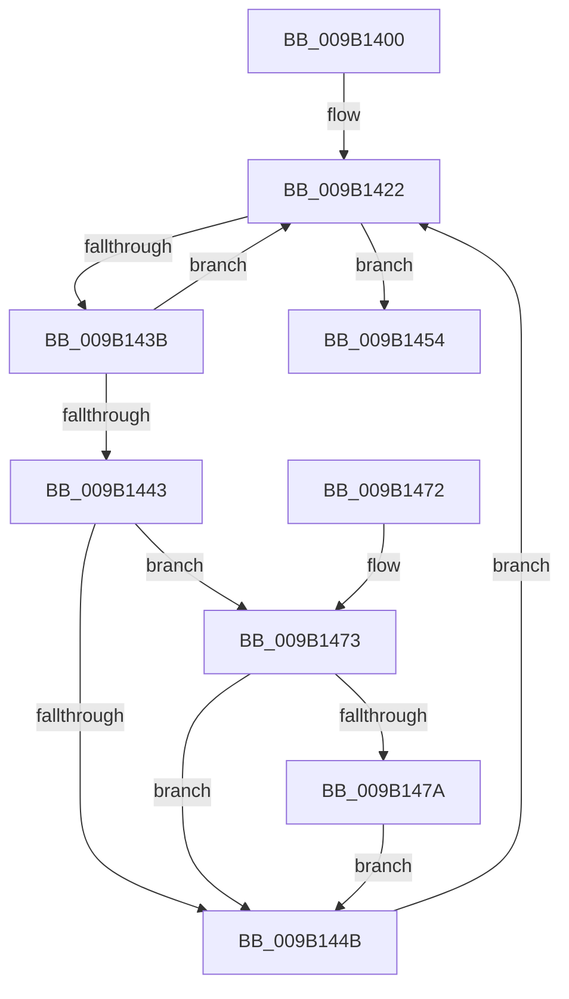

# CmpTransMgrRollback

- RVA: `0x009B1400`–`0x009B1487` (길이 `135` bytes)
- VA: `0x00000001409B1400`
- 실행 섹션: `PAGE`
- PDB 이름 있음: `예`; PDB Function 태그: `아니요`
- unwind 정보 RVA: `0x0009E27C`
- 디코드: `40`개 명령, `135/135` bytes 표시
- 미해석 바이트: `0` (있으면 어셈블리에 `.byte`로 보존)

> 이 문서는 커널 이미지의 기계어와 PDB 기호를 분석해 생성했습니다. 4번과 5번은 함수 원형과 자료형을 바이너리 사용 방식에서 추정한 C 해석이며 원본 소스 복구 결과는 아닙니다.

## 1. Dependencies

- 직접 호출 지점: **4**; 고유 호출 대상: **4**
- 직접 호출자로 확인된 함수: **5**
- RIP 상대 이미지 참조: **1**

### Outgoing calls
- `0x009B1419` → [LOCK_TRANSACTION_LIST](../87/LOCK_TRANSACTION_LIST_function_00874AD4.md) (function, `0x00874AD4`)
- `0x009B142E` → [CmListGetNextElement](../../pagecmrc/BC/CmListGetNextElement_function_00BC9940.md) (function, `0x00BC9940`)
- `0x009B145B` → [ExReleaseFastMutexUnsafe](../../text/25/ExReleaseFastMutexUnsafe_function_002503A0.md) (function, `0x002503A0`)
- `0x009B1460` → [KeLeaveCriticalRegion](../../text/25/KeLeaveCriticalRegion_function_0025D8B0.md) (function, `0x0025D8B0`)

### Direct callers
- [CmpRmUnDoPhase](../7F/CmpRmUnDoPhase_function_007F0968.md) at `0x007F0A7A`
- [CmpAbortLightWeightTransaction](CmpAbortLightWeightTransaction_function_009B11F0.md) at `0x009B1242`
- [CmKtmNotification](CmKtmNotification_function_009B1950.md) at `0x009B1BE3`
- [CmRmFinalizeRecovery](../AB/CmRmFinalizeRecovery_function_00ABEB68.md) at `0x00ABEBE7`
- [sub_00B2DBCA](../B2/Unknown_function_00B2DBCA.md) at `0x00B2DBCE`

### Static image references
- `0x009B1454` → RVA `0x00EF5820` (`.data`; read)

## 2. Other-region calls and transfers

- 다른 실행 섹션으로 향하는 call: **3**
  - `0x009B142E` → [CmListGetNextElement](../../pagecmrc/BC/CmListGetNextElement_function_00BC9940.md) (`PAGE` → `PAGECMRC`)
  - `0x009B145B` → [ExReleaseFastMutexUnsafe](../../text/25/ExReleaseFastMutexUnsafe_function_002503A0.md) (`PAGE` → `.text`)
  - `0x009B1460` → [KeLeaveCriticalRegion](../../text/25/KeLeaveCriticalRegion_function_0025D8B0.md) (`PAGE` → `.text`)
- 별도 외부 분기/꼬리 이동을 확인하지 못했습니다.

## 3. Assembly (complete function range)

```asm
009B1400  48 89 5C 24 10                  mov qword ptr [rsp + 0x10], rbx
009B1405  57                              push rdi
009B1406  48 83 EC 20                     sub rsp, 0x20
009B140A  48 83 64 24 30 00               and qword ptr [rsp + 0x30], 0
009B1410  48 8B FA                        mov rdi, rdx
009B1413  83 22 00                        and dword ptr [rdx], 0
009B1416  48 8B D9                        mov rbx, rcx
009B1419  E8 B6 36 EC FF                  call 0x140874ad4
009B141E  83 4B 30 02                     or dword ptr [rbx + 0x30], 2
009B1422  45 33 C0                        xor r8d, r8d
009B1425  48 8D 54 24 30                  lea rdx, [rsp + 0x30]
009B142A  48 8D 4B 10                     lea rcx, [rbx + 0x10]
009B142E  E8 0D 85 21 00                  call 0x140bc9940
009B1433  4C 8B C0                        mov r8, rax
009B1436  48 85 C0                        test rax, rax
009B1439  74 19                           je 0x1409b1454
009B143B  8B 50 40                        mov edx, dword ptr [rax + 0x40]
009B143E  F6 C2 01                        test dl, 1
009B1441  75 DF                           jne 0x1409b1422
009B1443  FF 07                           inc dword ptr [rdi]
009B1445  83 78 44 00                     cmp dword ptr [rax + 0x44], 0
009B1449  74 28                           je 0x1409b1473
009B144B  83 CA 01                        or edx, 1
009B144E  41 89 50 40                     mov dword ptr [r8 + 0x40], edx
009B1452  EB CE                           jmp 0x1409b1422
009B1454  48 8D 0D C5 43 54 00            lea rcx, [rip + 0x5443c5]
009B145B  E8 40 EF 89 FF                  call 0x1402503a0
009B1460  E8 4B C4 8A FF                  call 0x14025d8b0
009B1465  48 8B 5C 24 38                  mov rbx, qword ptr [rsp + 0x38]
009B146A  33 C0                           xor eax, eax
009B146C  48 83 C4 20                     add rsp, 0x20
009B1470  5F                              pop rdi
009B1471  C3                              ret
009B1472  CC                              int3
009B1473  41 83 78 58 00                  cmp dword ptr [r8 + 0x58], 0
009B1478  75 D1                           jne 0x1409b144b
009B147A  49 8B 40 30                     mov rax, qword ptr [r8 + 0x30]
009B147E  8B 48 28                        mov ecx, dword ptr [rax + 0x28]
009B1481  41 89 48 58                     mov dword ptr [r8 + 0x58], ecx
009B1485  EB C4                           jmp 0x1409b144b
```

## 4. C-style interpretation (structured pseudocode)

```c
__int64 __fastcall CmpTransMgrRollback(__int64 a1, __int64 a2, int a3)
{
    __int64 result;
    __int64 v_rsp;
    unsigned __int64 v_stack_p10;
    unsigned __int64 v_stack_p8;

    v_stack_p10 = v_rbx;
    v_rsp = (v_rsp) - (32);
    result = LOCK_TRANSACTION_LIST(a1, a2, a3, a4);
loc_009B1422:
    a3 = 0;
    result = CmListGetNextElement(a1 + 16, v_stack_p8, a3, a4);
    if (result == 0) goto loc_009B1454;
    if ((((unsigned __int8)((unsigned int)(*(unsigned int *)(result + 64)))) & (1)) != 0) goto loc_009B1422;
    if ((*(unsigned int *)(result + 68)) == 0) goto loc_009B1473;
loc_009B144B:
    a2 = (unsigned int)(((unsigned int)(*(unsigned int *)(result + 64))) | (1));
    *(unsigned int *)(result + 64) = (unsigned int)(a2);
    goto loc_009B1422;
loc_009B1454:
    result = ExReleaseFastMutexUnsafe(v_rip + 5522373, a2, result, a4);
    result = KeLeaveCriticalRegion(v_rip + 5522373, a2, result, a4);
    result = 0;
    v_rsp = (v_rsp) + (32);
    return result;
loc_009B1473:
    if ((*(unsigned int *)(result + 88)) != 0) goto loc_009B144B;
    *(unsigned int *)(result + 88) = (unsigned int)((unsigned int)(*(unsigned int *)(*(unsigned __int64 *)(result + 48) + 40)));
    goto loc_009B144B;
}
```

## 5. (Beta) C Style

```c
int64_t CmpTransMgrRollback(void *Arg1, void *Arg2, int32_t Arg3)
{
    uint8_t *arg1 = (uint8_t *)Arg1;
    uint8_t *arg2 = (uint8_t *)Arg2;

    int64_t result;
    int64_t local_rsp;
    uint64_t v_stack_p10;
    uint64_t v_stack_p8;

    v_stack_p10 = local_rbx;
    local_rsp = (local_rsp) - (32);
    result = LOCK_TRANSACTION_LIST(Arg1, Arg2, Arg3, a4);
loc_009B1422:
    Arg3 = 0;
    result = CmListGetNextElement(Arg1 + 16, v_stack_p8, Arg3, a4);
    if (result == 0) goto loc_009B1454;
    if ((((uint8_t)((uint32_t)(*(uint32_t *)(result + 0x40)))) & (1)) != 0) goto loc_009B1422;
    if ((*(uint32_t *)(result + 0x44)) == 0) goto loc_009B1473;
loc_009B144B:
    Arg2 = (uint32_t)(((uint32_t)(*(uint32_t *)(result + 0x40))) | (1));
    *(uint32_t *)(result + 0x40) = (uint32_t)(Arg2);
    goto loc_009B1422;
loc_009B1454:
    result = ExReleaseFastMutexUnsafe(v_rip + 5522373, Arg2, result, a4);
    result = KeLeaveCriticalRegion(v_rip + 5522373, Arg2, result, a4);
    result = 0;
    local_rsp = (local_rsp) + (32);
    return result;
loc_009B1473:
    if ((*(uint32_t *)(result + 0x58)) != 0) goto loc_009B144B;
    *(uint32_t *)(result + 0x58) = (uint32_t)((uint32_t)(*(uint32_t *)(*(uint64_t *)(result + 0x30) + 0x28)));
    goto loc_009B144B;
}
```

### 관측된 메모리 오프셋

구조체 형식이 확인되지 않은 접근은 인자 기준의 오프셋으로만 기록했습니다.

| 기준 인자 | 오프셋 표현 | 폭 (bit) | 접근 |
|---|---:|---:|---|
| `Arg1` | `+ 0x10` | `64` | `R` |
| `Arg1` | `+ 0x30` | `32` | `R/W` |
| `Arg2` | `+ 0x0` | `32` | `R/W` |

## 6. Execution-region graph

[열기: 2D/3D 그래프와 함수 탐색 컨트롤 패널](../../../control-panel.html?section=page&rva=0x009B1400&view=graph)

- 2D 그래프는 위에서 아래로 흐르고, 3D 그래프는 빈 공간을 드래그해 회전합니다. Shift+드래그는 이동, 휠은 확대·축소, 함수 노드 선택은 대상 보고서 이동입니다.

### Static fallback


