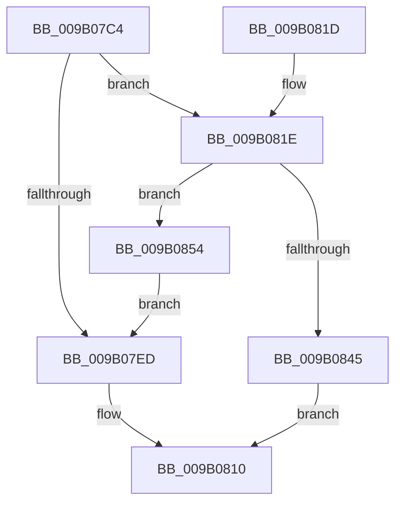

# CmpTransMgrSyncHive

- RVA: `0x009B07C4`–`0x009B0861` (길이 `157` bytes)
- VA: `0x00000001409B07C4`
- 실행 섹션: `PAGE`
- PDB 이름 있음: `예`; PDB Function 태그: `아니요`
- unwind 정보 RVA: `0x000795CC`
- 디코드: `46`개 명령, `157/157` bytes 표시
- 미해석 바이트: `0` (있으면 어셈블리에 `.byte`로 보존)

> 이 문서는 커널 이미지의 기계어와 PDB 기호를 분석해 생성했습니다. 4번과 5번은 함수 원형과 자료형을 바이너리 사용 방식에서 추정한 C 해석이며 원본 소스 복구 결과는 아닙니다.

## 1. Dependencies

- 직접 호출 지점: **10**; 고유 호출 대상: **8**
- 직접 호출자로 확인된 함수: **1**
- RIP 상대 이미지 참조: **0**

### Outgoing calls
- `0x009B07D1` → [CmpLockRegistry](../../pagecmrc/BC/CmpLockRegistry_function_00BC9B34.md) (function, `0x00BC9B34`)
- `0x009B07D9` → [HvLockHiveFlusherExclusive](../../pagecmrc/BC/HvLockHiveFlusherExclusive_function_00BC9C50.md) (function, `0x00BC9C50`)
- `0x009B07F0` → [HvUnlockHiveFlusherExclusive](../../pagecmrc/BC/HvUnlockHiveFlusherExclusive_function_00BC9C34.md) (function, `0x00BC9C34`)
- `0x009B07F5` → [CmpUnlockRegistry](../../pagecmrc/BC/CmpUnlockRegistry_function_00BC9A84.md) (function, `0x00BC9A84`)
- `0x009B07FF` → [CmpFlushHive](CmpFlushHive_function_009B3DC0.md) (function, `0x009B3DC0`)
- `0x009B0821` → [HvLockHiveWriter](../85/HvLockHiveWriter_function_00859894.md) (function, `0x00859894`)
- `0x009B0832` → [HvpMarkDirty](../85/HvpMarkDirty_function_008593C0.md) (function, `0x008593C0`)
- `0x009B083C` → [HvUnlockHiveWriter](../85/HvUnlockHiveWriter_function_008598E4.md) (function, `0x008598E4`)
- `0x009B0848` → [HvUnlockHiveFlusherExclusive](../../pagecmrc/BC/HvUnlockHiveFlusherExclusive_function_00BC9C34.md) (function, `0x00BC9C34`)
- `0x009B084D` → [CmpUnlockRegistry](../../pagecmrc/BC/CmpUnlockRegistry_function_00BC9A84.md) (function, `0x00BC9A84`)

### Direct callers
- [CmpTransMgrPrepare](CmpTransMgrPrepare_function_009B175C.md) at `0x009B185F`
- [CmpTransMgrPrepare](CmpTransMgrPrepare_function_009B175C.md) at `0x009B18E9`

### Static image references
- 디코드된 RIP-relative 메모리 참조가 없습니다.

## 2. Other-region calls and transfers

- 다른 실행 섹션으로 향하는 call: **6**
  - `0x009B07D1` → [CmpLockRegistry](../../pagecmrc/BC/CmpLockRegistry_function_00BC9B34.md) (`PAGE` → `PAGECMRC`)
  - `0x009B07D9` → [HvLockHiveFlusherExclusive](../../pagecmrc/BC/HvLockHiveFlusherExclusive_function_00BC9C50.md) (`PAGE` → `PAGECMRC`)
  - `0x009B07F0` → [HvUnlockHiveFlusherExclusive](../../pagecmrc/BC/HvUnlockHiveFlusherExclusive_function_00BC9C34.md) (`PAGE` → `PAGECMRC`)
  - `0x009B07F5` → [CmpUnlockRegistry](../../pagecmrc/BC/CmpUnlockRegistry_function_00BC9A84.md) (`PAGE` → `PAGECMRC`)
  - `0x009B0848` → [HvUnlockHiveFlusherExclusive](../../pagecmrc/BC/HvUnlockHiveFlusherExclusive_function_00BC9C34.md) (`PAGE` → `PAGECMRC`)
  - `0x009B084D` → [CmpUnlockRegistry](../../pagecmrc/BC/CmpUnlockRegistry_function_00BC9A84.md) (`PAGE` → `PAGECMRC`)
- 별도 외부 분기/꼬리 이동을 확인하지 못했습니다.

## 3. Assembly (complete function range)

```asm
009B07C4  48 89 5C 24 08                  mov qword ptr [rsp + 8], rbx
009B07C9  57                              push rdi
009B07CA  48 83 EC 20                     sub rsp, 0x20
009B07CE  48 8B D9                        mov rbx, rcx
009B07D1  E8 5E 93 21 00                  call 0x140bc9b34
009B07D6  48 8B CB                        mov rcx, rbx
009B07D9  E8 72 94 21 00                  call 0x140bc9c50
009B07DE  48 8B 43 40                     mov rax, qword ptr [rbx + 0x40]
009B07E2  8B 90 90 00 00 00               mov edx, dword ptr [rax + 0x90]
009B07E8  F6 C2 01                        test dl, 1
009B07EB  74 31                           je 0x1409b081e
009B07ED  48 8B CB                        mov rcx, rbx
009B07F0  E8 3F 94 21 00                  call 0x140bc9c34
009B07F5  E8 8A 92 21 00                  call 0x140bc9a84
009B07FA  33 D2                           xor edx, edx
009B07FC  48 8B CB                        mov rcx, rbx
009B07FF  E8 BC 35 00 00                  call 0x1409b3dc0
009B0804  33 FF                           xor edi, edi
009B0806  B9 9A 00 00 C0                  mov ecx, 0xc000009a
009B080B  85 C0                           test eax, eax
009B080D  0F 48 F9                        cmovs edi, ecx
009B0810  48 8B 5C 24 30                  mov rbx, qword ptr [rsp + 0x30]
009B0815  8B C7                           mov eax, edi
009B0817  48 83 C4 20                     add rsp, 0x20
009B081B  5F                              pop rdi
009B081C  C3                              ret
009B081D  CC                              int3
009B081E  48 8B CB                        mov rcx, rbx
009B0821  E8 6E 90 EA FF                  call 0x140859894
009B0826  45 33 C9                        xor r9d, r9d
009B0829  33 D2                           xor edx, edx
009B082B  48 8B CB                        mov rcx, rbx
009B082E  45 8D 41 20                     lea r8d, [r9 + 0x20]
009B0832  E8 89 8B EA FF                  call 0x1408593c0
009B0837  48 8B CB                        mov rcx, rbx
009B083A  8B F8                           mov edi, eax
009B083C  E8 A3 90 EA FF                  call 0x1408598e4
009B0841  85 FF                           test edi, edi
009B0843  79 0F                           jns 0x1409b0854
009B0845  48 8B CB                        mov rcx, rbx
009B0848  E8 E7 93 21 00                  call 0x140bc9c34
009B084D  E8 32 92 21 00                  call 0x140bc9a84
009B0852  EB BC                           jmp 0x1409b0810
009B0854  48 8B 43 40                     mov rax, qword ptr [rbx + 0x40]
009B0858  83 88 90 00 00 00 01            or dword ptr [rax + 0x90], 1
009B085F  EB 8C                           jmp 0x1409b07ed
```

## 4. C-style interpretation (structured pseudocode)

```c
__int64 __fastcall CmpTransMgrSyncHive(__int64 a1, __int64 a2, __int64 a3, int a4)
{
    __int64 result;
    __int64 v_rdi;
    __int64 v_rsp;
    unsigned __int64 v_stack_p8;

    v_stack_p8 = v_rbx;
    v_rsp = (v_rsp) - (32);
    result = CmpLockRegistry(a1, a2, a3, a4);
    result = HvLockHiveFlusherExclusive(a1, a2, a3, a4);
    if ((((unsigned __int8)((unsigned int)(*(unsigned int *)(*(unsigned __int64 *)(a1 + 64) + 144)))) & (1)) == 0) goto loc_009B081E;
loc_009B07ED:
    result = HvUnlockHiveFlusherExclusive(a1, (unsigned int)(*(unsigned int *)(*(unsigned __int64 *)(a1 + 64) + 144)), a3, a4);
    result = CmpUnlockRegistry(a1, (unsigned int)(*(unsigned int *)(*(unsigned __int64 *)(a1 + 64) + 144)), a3, a4);
    a2 = 0;
    result = CmpFlushHive(a1, a2, a3, a4);
    v_rdi = 0;
    if (sign_flag) { v_rdi = (unsigned int)((unsigned int)(0xC000009AULL)); }
loc_009B0810:
    v_rsp = (v_rsp) + (32);
    return (unsigned int)((unsigned int)(v_rdi));
loc_009B081E:
    result = HvLockHiveWriter(v_stack_p8, a2, a3, a4);
    a4 = 0;
    a2 = 0;
    result = HvpMarkDirty(v_stack_p8, a2, a4 + 32, a4);
    result = HvUnlockHiveWriter(v_stack_p8, a2, a4 + 32, a4);
    if (!sign_flag) goto loc_009B0854;
    result = HvUnlockHiveFlusherExclusive(v_stack_p8, a2, a4 + 32, a4);
    result = CmpUnlockRegistry(v_stack_p8, a2, a4 + 32, a4);
    goto loc_009B0810;
loc_009B0854:
    goto loc_009B07ED;
}
```

## 5. (Beta) C Style

```c
int64_t CmpTransMgrSyncHive(void *Arg1, int64_t Arg2, int64_t Arg3, int32_t Arg4)
{
    uint8_t *arg1 = (uint8_t *)Arg1;

    int64_t result;
    int64_t local_rdi;
    int64_t local_rsp;
    uint64_t v_stack_p8;

    v_stack_p8 = local_rbx;
    local_rsp = (local_rsp) - (32);
    result = CmpLockRegistry(Arg1, Arg2, Arg3, Arg4);
    result = HvLockHiveFlusherExclusive(Arg1, Arg2, Arg3, Arg4);
    if ((((uint8_t)((uint32_t)(*(uint32_t *)(*(uint64_t *)(arg1 + 0x40) + 0x90)))) & (1)) == 0) goto loc_009B081E;
loc_009B07ED:
    result = HvUnlockHiveFlusherExclusive(Arg1, (uint32_t)(*(uint32_t *)(*(uint64_t *)(arg1 + 0x40) + 0x90)), Arg3, Arg4);
    result = CmpUnlockRegistry(Arg1, (uint32_t)(*(uint32_t *)(*(uint64_t *)(arg1 + 0x40) + 0x90)), Arg3, Arg4);
    Arg2 = 0;
    result = CmpFlushHive(Arg1, Arg2, Arg3, Arg4);
    local_rdi = 0;
    if (sign_flag) { local_rdi = (uint32_t)((uint32_t)(0xC000009AULL)); }
loc_009B0810:
    local_rsp = (local_rsp) + (32);
    return (uint32_t)((uint32_t)(local_rdi));
loc_009B081E:
    result = HvLockHiveWriter(v_stack_p8, Arg2, Arg3, Arg4);
    Arg4 = 0;
    Arg2 = 0;
    result = HvpMarkDirty(v_stack_p8, Arg2, Arg4 + 32, Arg4);
    result = HvUnlockHiveWriter(v_stack_p8, Arg2, Arg4 + 32, Arg4);
    if (!sign_flag) goto loc_009B0854;
    result = HvUnlockHiveFlusherExclusive(v_stack_p8, Arg2, Arg4 + 32, Arg4);
    result = CmpUnlockRegistry(v_stack_p8, Arg2, Arg4 + 32, Arg4);
    goto loc_009B0810;
loc_009B0854:
    goto loc_009B07ED;
}
```

### 관측된 메모리 오프셋

구조체 형식이 확인되지 않은 접근은 인자 기준의 오프셋으로만 기록했습니다.

| 기준 인자 | 오프셋 표현 | 폭 (bit) | 접근 |
|---|---:|---:|---|
| `Arg1` | `+ 0x40` | `64` | `R` |

## 6. Execution-region graph

[열기: 2D/3D 그래프와 함수 탐색 컨트롤 패널](../../../control-panel.html?section=page&rva=0x009B07C4&view=graph)

- 2D 그래프는 위에서 아래로 흐르고, 3D 그래프는 빈 공간을 드래그해 회전합니다. Shift+드래그는 이동, 휠은 확대·축소, 함수 노드 선택은 대상 보고서 이동입니다.

### Static fallback


