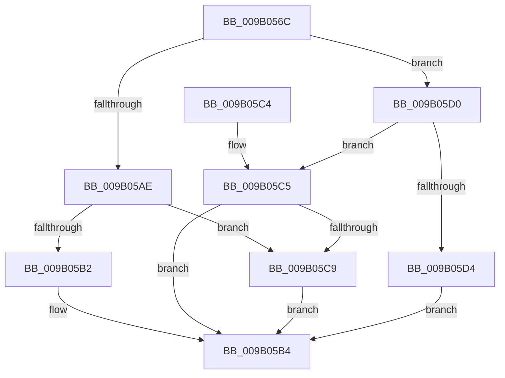

# CmpTryAcquireKcbIXLocks

- RVA: `0x009B056C`–`0x009B05D8` (길이 `108` bytes)
- VA: `0x00000001409B056C`
- 실행 섹션: `PAGE`
- PDB 이름 있음: `예`; PDB Function 태그: `아니요`
- unwind 정보 RVA: `0x0008CDBC`
- 디코드: `36`개 명령, `108/108` bytes 표시
- 미해석 바이트: `0` (있으면 어셈블리에 `.byte`로 보존)

> 이 문서는 커널 이미지의 기계어와 PDB 기호를 분석해 생성했습니다. 4번과 5번은 함수 원형과 자료형을 바이너리 사용 방식에서 추정한 C 해석이며 원본 소스 복구 결과는 아닙니다.

## 1. Dependencies

- 직접 호출 지점: **2**; 고유 호출 대상: **1**
- 직접 호출자로 확인된 함수: **7**
- RIP 상대 이미지 참조: **0**

### Outgoing calls
- `0x009B058B` → [CmpTryAcquireIXLockWithRollbackPacket](../9A/CmpTryAcquireIXLockWithRollbackPacket_function_009AEC14.md) (function, `0x009AEC14`)
- `0x009B059E` → [CmpTryAcquireIXLockWithRollbackPacket](../9A/CmpTryAcquireIXLockWithRollbackPacket_function_009AEC14.md) (function, `0x009AEC14`)

### Direct callers
- [CmpSaveBootControlSet](../7D/CmpSaveBootControlSet_function_007DC744.md) at `0x007DC9CD`
- [CmRestoreKey](../7D/CmRestoreKey_function_007DCF04.md) at `0x007DD38B`
- [CmRenameKey](../7E/CmRenameKey_function_007E8F48.md) at `0x007E921A`
- [CmRenameKey](../7E/CmRenameKey_function_007E8F48.md) at `0x007E9248`
- [CmRenameKey](../7E/CmRenameKey_function_007E8F48.md) at `0x007E9342`
- [CmpPrepareForSubtreeInvalidationWorker](../7E/CmpPrepareForSubtreeInvalidationWorker_function_007EB070.md) at `0x007EB094`
- [CmSetLastWriteTimeKey](../84/CmSetLastWriteTimeKey_function_00843368.md) at `0x008434AE`
- [CmSetKeyFlags](../9A/CmSetKeyFlags_function_009AEEA4.md) at `0x009AF02F`
- [CmpPerformUnloadKey](../9A/CmpPerformUnloadKey_function_009AFA28.md) at `0x009AFDAE`

### Static image references
- 디코드된 RIP-relative 메모리 참조가 없습니다.

## 2. Other-region calls and transfers

- 다른 실행 섹션으로 향하는 call: **0**
- 별도 외부 분기/꼬리 이동을 확인하지 못했습니다.

## 3. Assembly (complete function range)

```asm
009B056C  48 89 5C 24 08                  mov qword ptr [rsp + 8], rbx
009B0571  48 89 74 24 10                  mov qword ptr [rsp + 0x10], rsi
009B0576  57                              push rdi
009B0577  48 83 EC 20                     sub rsp, 0x20
009B057B  48 8B D9                        mov rbx, rcx
009B057E  4D 8B C1                        mov r8, r9
009B0581  48 81 C1 F8 00 00 00            add rcx, 0xf8
009B0588  49 8B F9                        mov rdi, r9
009B058B  E8 84 E6 FF FF                  call 0x1409aec14
009B0590  48 8D 8B 08 01 00 00            lea rcx, [rbx + 0x108]
009B0597  4C 8B C7                        mov r8, rdi
009B059A  B2 01                           mov dl, 1
009B059C  8B F0                           mov esi, eax
009B059E  E8 71 E6 FF FF                  call 0x1409aec14
009B05A3  8B C8                           mov ecx, eax
009B05A5  B8 2D 02 00 C0                  mov eax, 0xc000022d
009B05AA  85 F6                           test esi, esi
009B05AC  78 22                           js 0x1409b05d0
009B05AE  85 C9                           test ecx, ecx
009B05B0  78 17                           js 0x1409b05c9
009B05B2  33 C0                           xor eax, eax
009B05B4  48 8B 5C 24 30                  mov rbx, qword ptr [rsp + 0x30]
009B05B9  48 8B 74 24 38                  mov rsi, qword ptr [rsp + 0x38]
009B05BE  48 83 C4 20                     add rsp, 0x20
009B05C2  5F                              pop rdi
009B05C3  C3                              ret
009B05C4  CC                              int3
009B05C5  85 C9                           test ecx, ecx
009B05C7  79 EB                           jns 0x1409b05b4
009B05C9  3B C8                           cmp ecx, eax
009B05CB  0F 45 C1                        cmovne eax, ecx
009B05CE  EB E4                           jmp 0x1409b05b4
009B05D0  3B F0                           cmp esi, eax
009B05D2  74 F1                           je 0x1409b05c5
009B05D4  8B C6                           mov eax, esi
009B05D6  EB DC                           jmp 0x1409b05b4
```

## 4. C-style interpretation (structured pseudocode)

```c
__int64 __fastcall CmpTryAcquireKcbIXLocks(__int64 a1, __int64 a2, __int64 a3, __int64 a4)
{
    __int64 result;
    __int64 v_rsp;
    unsigned __int64 v_stack_p10;
    unsigned __int64 v_stack_p8;

    v_stack_p8 = v_rbx;
    v_stack_p10 = v_rsi;
    v_rsp = (v_rsp) - (32);
    a1 = (a1) + (248);
    result = CmpTryAcquireIXLockWithRollbackPacket(a1, a2, a4, a4);
    result = CmpTryAcquireIXLockWithRollbackPacket(a1 + 264, 1, a4, a4);
    if (sign_flag) goto loc_009B05D0;
    if (sign_flag) goto loc_009B05C9;
    result = 0;
loc_009B05B4:
    v_rsp = (v_rsp) + (32);
    return result;
loc_009B05C5:
    if (!sign_flag) goto loc_009B05B4;
loc_009B05C9:
    if (((unsigned int)((unsigned int)((unsigned int)(result)))) != 0) { result = (unsigned int)((unsigned int)((unsigned int)(result))); }
    goto loc_009B05B4;
loc_009B05D0:
    if (((unsigned int)(v_stack_p10)) == ((unsigned int)(result))) goto loc_009B05C5;
    goto loc_009B05B4;
}
```

## 5. (Beta) C Style

```c
int64_t CmpTryAcquireKcbIXLocks(void *Arg1, int64_t Arg2, int64_t Arg3, int64_t Arg4)
{
    uint8_t *arg1 = (uint8_t *)Arg1;

    int64_t result;
    int64_t local_rsp;
    uint64_t v_stack_p10;
    uint64_t v_stack_p8;

    v_stack_p8 = local_rbx;
    v_stack_p10 = local_rsi;
    local_rsp = (local_rsp) - (32);
    Arg1 = (Arg1) + (248);
    result = CmpTryAcquireIXLockWithRollbackPacket(Arg1, Arg2, Arg4, Arg4);
    result = CmpTryAcquireIXLockWithRollbackPacket(Arg1 + 264, 1, Arg4, Arg4);
    if (sign_flag) goto loc_009B05D0;
    if (sign_flag) goto loc_009B05C9;
    result = 0;
loc_009B05B4:
    local_rsp = (local_rsp) + (32);
    return result;
loc_009B05C5:
    if (!sign_flag) goto loc_009B05B4;
loc_009B05C9:
    if (((uint32_t)((uint32_t)((uint32_t)(result)))) != 0) { result = (uint32_t)((uint32_t)((uint32_t)(result))); }
    goto loc_009B05B4;
loc_009B05D0:
    if (((uint32_t)(v_stack_p10)) == ((uint32_t)(result))) goto loc_009B05C5;
    goto loc_009B05B4;
}
```

### 관측된 메모리 오프셋

구조체 형식이 확인되지 않은 접근은 인자 기준의 오프셋으로만 기록했습니다.

| 기준 인자 | 오프셋 표현 | 폭 (bit) | 접근 |
|---|---:|---:|---|
| `Arg1` | `+ 0x108` | `64` | `R` |

## 6. Execution-region graph

[열기: 2D/3D 그래프와 함수 탐색 컨트롤 패널](../../../control-panel.html?section=page&rva=0x009B056C&view=graph)

- 2D 그래프는 위에서 아래로 흐르고, 3D 그래프는 빈 공간을 드래그해 회전합니다. Shift+드래그는 이동, 휠은 확대·축소, 함수 노드 선택은 대상 보고서 이동입니다.

### Static fallback


