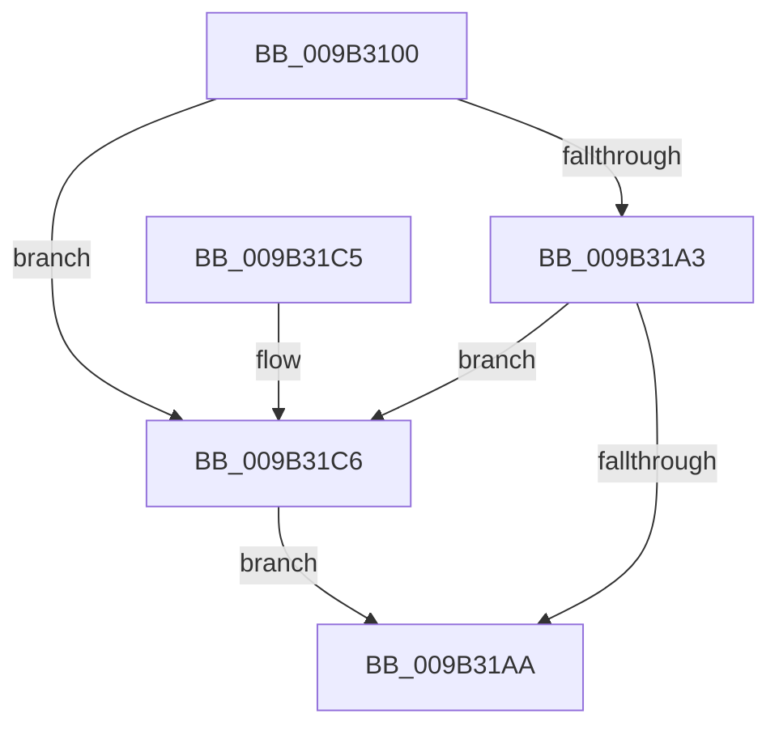

# CmpUnlockDeletedHashEntryByKcb

- RVA: `0x009B3100`–`0x009B31D0` (길이 `208` bytes)
- VA: `0x00000001409B3100`
- 실행 섹션: `PAGE`
- PDB 이름 있음: `예`; PDB Function 태그: `아니요`
- unwind 정보 RVA: `0x0006B95C`
- 디코드: `60`개 명령, `208/208` bytes 표시
- 미해석 바이트: `0` (있으면 어셈블리에 `.byte`로 보존)

> 이 문서는 커널 이미지의 기계어와 PDB 기호를 분석해 생성했습니다. 4번과 5번은 함수 원형과 자료형을 바이너리 사용 방식에서 추정한 C 해석이며 원본 소스 복구 결과는 아닙니다.

## 1. Dependencies

- 직접 호출 지점: **3**; 고유 호출 대상: **3**
- 직접 호출자로 확인된 함수: **4**
- RIP 상대 이미지 참조: **0**

### Outgoing calls
- `0x009B31AD` → [KeAbPostRelease](../../text/2E/KeAbPostRelease_function_002E1600.md) (function, `0x002E1600`)
- `0x009B31B5` → [CmpDereferenceHive](../86/CmpDereferenceHive_function_008632B0.md) (function, `0x008632B0`)
- `0x009B31C9` → [ExfReleasePushLock](../../text/26/ExfReleasePushLock_function_002638D0.md) (function, `0x002638D0`)

### Direct callers
- [sub_00851B91](../85/Unknown_function_00851B91.md) at `0x00851C8F`
- [sub_008622EA](../86/Unknown_function_008622EA.md) at `0x00862301`
- [sub_00863192](../86/Unknown_function_00863192.md) at `0x008631A9`
- [CmpDiscardKcb](CmpDiscardKcb_function_009B2F34.md) at `0x009B2FB7`

### Static image references
- 디코드된 RIP-relative 메모리 참조가 없습니다.

## 2. Other-region calls and transfers

- 다른 실행 섹션으로 향하는 call: **2**
  - `0x009B31AD` → [KeAbPostRelease](../../text/2E/KeAbPostRelease_function_002E1600.md) (`PAGE` → `.text`)
  - `0x009B31C9` → [ExfReleasePushLock](../../text/26/ExfReleasePushLock_function_002638D0.md) (`PAGE` → `.text`)
- 별도 외부 분기/꼬리 이동을 확인하지 못했습니다.

## 3. Assembly (complete function range)

```asm
009B3100  48 89 5C 24 08                  mov qword ptr [rsp + 8], rbx
009B3105  57                              push rdi
009B3106  48 83 EC 20                     sub rsp, 0x20
009B310A  8B 41 10                        mov eax, dword ptr [rcx + 0x10]
009B310D  4C 8B C9                        mov r9, rcx
009B3110  48 8B 79 20                     mov rdi, qword ptr [rcx + 0x20]
009B3114  8B D0                           mov edx, eax
009B3116  C1 EA 09                        shr edx, 9
009B3119  45 33 D2                        xor r10d, r10d
009B311C  33 D0                           xor edx, eax
009B311E  69 C2 A3 8A 01 00               imul eax, edx, 0x18aa3
009B3124  8B D0                           mov edx, eax
009B3126  44 8B C0                        mov r8d, eax
009B3129  8B 87 88 06 00 00               mov eax, dword ptr [rdi + 0x688]
009B312F  FF C8                           dec eax
009B3131  49 C1 E8 09                     shr r8, 9
009B3135  4C 33 C2                        xor r8, rdx
009B3138  4C 23 C0                        and r8, rax
009B313B  48 8B 87 80 06 00 00            mov rax, qword ptr [rdi + 0x680]
009B3142  4B 8D 0C 40                     lea rcx, [r8 + r8*2]
009B3146  4C 89 54 C8 08                  mov qword ptr [rax + rcx*8 + 8], r10
009B314B  41 8B 41 10                     mov eax, dword ptr [r9 + 0x10]
009B314F  8B C8                           mov ecx, eax
009B3151  4D 8B 41 20                     mov r8, qword ptr [r9 + 0x20]
009B3155  C1 E9 09                        shr ecx, 9
009B3158  33 C8                           xor ecx, eax
009B315A  69 C1 A3 8A 01 00               imul eax, ecx, 0x18aa3
009B3160  8B C8                           mov ecx, eax
009B3162  8B D0                           mov edx, eax
009B3164  49 8B 80 80 06 00 00            mov rax, qword ptr [r8 + 0x680]
009B316B  48 C1 EA 09                     shr rdx, 9
009B316F  48 33 D1                        xor rdx, rcx
009B3172  41 8B 88 88 06 00 00            mov ecx, dword ptr [r8 + 0x688]
009B3179  FF C9                           dec ecx
009B317B  48 23 D1                        and rdx, rcx
009B317E  48 8D 0C 52                     lea rcx, [rdx + rdx*2]
009B3182  48 8D 1C C8                     lea rbx, [rax + rcx*8]
009B3186  0F 0D 0B                        prefetchw byte ptr [rbx]
009B3189  48 8B 03                        mov rax, qword ptr [rbx]
009B318C  48 8B C8                        mov rcx, rax
009B318F  48 83 E1 F0                     and rcx, 0xfffffffffffffff0
009B3193  48 83 F9 10                     cmp rcx, 0x10
009B3197  48 8D 50 F0                     lea rdx, [rax - 0x10]
009B319B  49 0F 46 D2                     cmovbe rdx, r10
009B319F  A8 02                           test al, 2
009B31A1  75 23                           jne 0x1409b31c6
009B31A3  F0 48 0F B1 13                  lock cmpxchg qword ptr [rbx], rdx
009B31A8  75 1C                           jne 0x1409b31c6
009B31AA  48 8B CB                        mov rcx, rbx
009B31AD  E8 4E E4 92 FF                  call 0x1402e1600
009B31B2  48 8B CF                        mov rcx, rdi
009B31B5  E8 F6 00 EB FF                  call 0x1408632b0
009B31BA  48 8B 5C 24 30                  mov rbx, qword ptr [rsp + 0x30]
009B31BF  48 83 C4 20                     add rsp, 0x20
009B31C3  5F                              pop rdi
009B31C4  C3                              ret
009B31C5  CC                              int3
009B31C6  48 8B CB                        mov rcx, rbx
009B31C9  E8 02 07 8B FF                  call 0x1402638d0
009B31CE  EB DA                           jmp 0x1409b31aa
```

## 4. C-style interpretation (structured pseudocode)

```c
__int64 __fastcall CmpUnlockDeletedHashEntryByKcb(__int64 a1)
{
    __int64 result;
    __int64 v_r10;
    __int64 v_rsp;
    unsigned __int64 v_stack_p8;

    v_stack_p8 = v_rbx;
    v_rsp = (v_rsp) - (32);
    a2 = (unsigned int)(((unsigned int)((unsigned int)((unsigned int)(*(unsigned int *)(a1 + 16))))) >> (9));
    v_r10 = 0;
    a2 = (unsigned int)((a2) ^ ((unsigned int)((unsigned int)(*(unsigned int *)(a1 + 16)))));
    result = (unsigned int)(((unsigned int)(*(unsigned int *)(a1 + 16))) * ((unsigned int)(a2)));
    result = (unsigned int)(((unsigned int)(*(unsigned int *)(*(unsigned __int64 *)(a1 + 32) + 1672))) - 1);
    a3 = ((unsigned int)((unsigned int)(result))) >> (9);
    a3 = (a3) ^ ((unsigned int)((unsigned int)(result)));
    a3 = (a3) & (result);
    *(unsigned __int64 *)(*(unsigned __int64 *)(*(unsigned __int64 *)(a1 + 32) + 1664) + a3 + a3 * 2 * 8 + 8) = 0;
    a1 = (unsigned int)(((unsigned int)((unsigned int)((unsigned int)(*(unsigned int *)(a1 + 16))))) >> (9));
    a1 = (unsigned int)((a1) ^ ((unsigned int)((unsigned int)(*(unsigned int *)(a1 + 16)))));
    result = (unsigned int)(((unsigned int)(*(unsigned int *)(a1 + 16))) * ((unsigned int)(a1)));
    a2 = ((unsigned int)((unsigned int)(result))) >> (9);
    a2 = (a2) ^ ((unsigned int)((unsigned int)(result)));
    a1 = (unsigned int)(((unsigned int)(*(unsigned int *)(*(unsigned __int64 *)(a1 + 32) + 1672))) - 1);
    a2 = (a2) & (a1);
    a1 = (*(unsigned __int64 *)(*(unsigned __int64 *)(*(unsigned __int64 *)(a1 + 32) + 1664) + a2 + a2 * 2 * 8)) & (-16);
    a2 = *(unsigned __int64 *)(*(unsigned __int64 *)(*(unsigned __int64 *)(a1 + 32) + 1664) + a2 + a2 * 2 * 8) - 16;
    if (a1 <= 16) { a2 = 0; }
    if ((((unsigned __int8)(*(unsigned __int64 *)(*(unsigned __int64 *)(*(unsigned __int64 *)(a1 + 32) + 1664) + a2 + a2 * 2 * 8))) & (2)) != 0) goto loc_009B31C6;
    if ((((unsigned __int8)(*(unsigned __int64 *)(*(unsigned __int64 *)(*(unsigned __int64 *)(a1 + 32) + 1664) + a2 + a2 * 2 * 8))) & (2)) != 0) goto loc_009B31C6;
loc_009B31AA:
    result = KeAbPostRelease(*(unsigned __int64 *)(*(unsigned __int64 *)(a1 + 32) + 1664) + a2 + a2 * 2 * 8, a2, *(unsigned __int64 *)(a1 + 32), a1);
    result = CmpDereferenceHive(*(unsigned __int64 *)(a1 + 32), a2, *(unsigned __int64 *)(a1 + 32), a1);
    v_rsp = (v_rsp) + (32);
    return result;
loc_009B31C6:
    result = ExfReleasePushLock(v_stack_p8, a2, *(unsigned __int64 *)(a1 + 32), a1);
    goto loc_009B31AA;
}
```

## 5. (Beta) C Style

```c
int64_t CmpUnlockDeletedHashEntryByKcb(void *Arg1)
{
    uint8_t *arg1 = (uint8_t *)Arg1;

    int64_t result;
    int64_t local_r10;
    int64_t local_rsp;
    uint64_t v_stack_p8;

    v_stack_p8 = local_rbx;
    local_rsp = (local_rsp) - (32);
    a2 = (uint32_t)(((uint32_t)((uint32_t)((uint32_t)(*(uint32_t *)(arg1 + 0x10))))) >> (9));
    local_r10 = 0;
    a2 = (uint32_t)((a2) ^ ((uint32_t)((uint32_t)(*(uint32_t *)(arg1 + 0x10)))));
    result = (uint32_t)(((uint32_t)(*(uint32_t *)(arg1 + 0x10))) * ((uint32_t)(a2)));
    result = (uint32_t)(((uint32_t)(*(uint32_t *)(*(uint64_t *)(arg1 + 0x20) + 0x688))) - 1);
    a3 = ((uint32_t)((uint32_t)(result))) >> (9);
    a3 = (a3) ^ ((uint32_t)((uint32_t)(result)));
    a3 = (a3) & (result);
    *(uint64_t *)(*(uint64_t *)(*(uint64_t *)(arg1 + 0x20) + 0x680) + a3 + a3 * 2 * 8 + 0x8) = 0;
    Arg1 = (uint32_t)(((uint32_t)((uint32_t)((uint32_t)(*(uint32_t *)(arg1 + 0x10))))) >> (9));
    Arg1 = (uint32_t)((Arg1) ^ ((uint32_t)((uint32_t)(*(uint32_t *)(arg1 + 0x10)))));
    result = (uint32_t)(((uint32_t)(*(uint32_t *)(arg1 + 0x10))) * ((uint32_t)(Arg1)));
    a2 = ((uint32_t)((uint32_t)(result))) >> (9);
    a2 = (a2) ^ ((uint32_t)((uint32_t)(result)));
    Arg1 = (uint32_t)(((uint32_t)(*(uint32_t *)(*(uint64_t *)(arg1 + 0x20) + 0x688))) - 1);
    a2 = (a2) & (Arg1);
    Arg1 = (*(uint64_t *)(*(uint64_t *)(*(uint64_t *)(arg1 + 0x20) + 0x680) + a2 + a2 * 2 * 8)) & (-16);
    a2 = *(uint64_t *)(*(uint64_t *)(*(uint64_t *)(arg1 + 0x20) + 0x680) + a2 + a2 * 2 * 8) - 16;
    if (Arg1 <= 16) { a2 = 0; }
    if ((((uint8_t)(*(uint64_t *)(*(uint64_t *)(*(uint64_t *)(arg1 + 0x20) + 0x680) + a2 + a2 * 2 * 8))) & (2)) != 0) goto loc_009B31C6;
    if ((((uint8_t)(*(uint64_t *)(*(uint64_t *)(*(uint64_t *)(arg1 + 0x20) + 0x680) + a2 + a2 * 2 * 8))) & (2)) != 0) goto loc_009B31C6;
loc_009B31AA:
    result = KeAbPostRelease(*(uint64_t *)(*(uint64_t *)(arg1 + 0x20) + 0x680) + a2 + a2 * 2 * 8, a2, *(uint64_t *)(arg1 + 0x20), Arg1);
    result = CmpDereferenceHive(*(uint64_t *)(arg1 + 0x20), a2, *(uint64_t *)(arg1 + 0x20), Arg1);
    local_rsp = (local_rsp) + (32);
    return result;
loc_009B31C6:
    result = ExfReleasePushLock(v_stack_p8, a2, *(uint64_t *)(arg1 + 0x20), Arg1);
    goto loc_009B31AA;
}
```

### 관측된 메모리 오프셋

구조체 형식이 확인되지 않은 접근은 인자 기준의 오프셋으로만 기록했습니다.

| 기준 인자 | 오프셋 표현 | 폭 (bit) | 접근 |
|---|---:|---:|---|
| `Arg1` | `+ 0x10` | `32` | `R` |
| `Arg1` | `+ 0x20` | `64` | `R` |

## 6. Execution-region graph

[열기: 2D/3D 그래프와 함수 탐색 컨트롤 패널](../../../control-panel.html?section=page&rva=0x009B3100&view=graph)

- 2D 그래프는 위에서 아래로 흐르고, 3D 그래프는 빈 공간을 드래그해 회전합니다. Shift+드래그는 이동, 휠은 확대·축소, 함수 노드 선택은 대상 보고서 이동입니다.

### Static fallback


