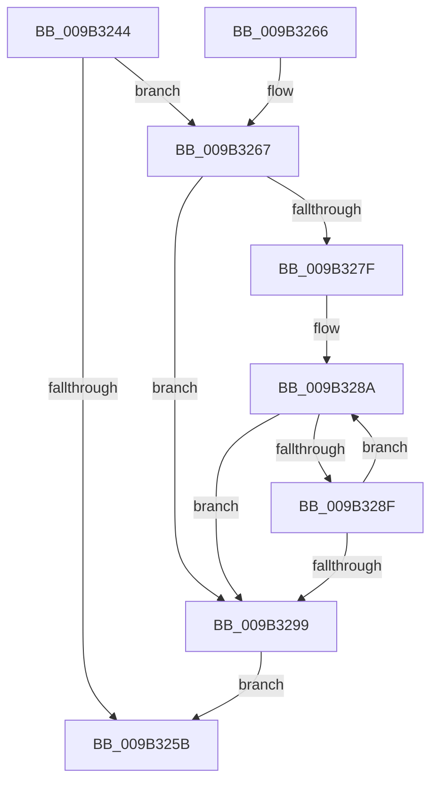

# CmpVERemoveHiveFromSIDMappingTable

- RVA: `0x009B3244`–`0x009B32F4` (길이 `176` bytes)
- VA: `0x00000001409B3244`
- 실행 섹션: `PAGE`
- PDB 이름 있음: `예`; PDB Function 태그: `아니요`
- unwind 정보 RVA: `0x00068BEC`
- 디코드: `47`개 명령, `176/176` bytes 표시
- 미해석 바이트: `0` (있으면 어셈블리에 `.byte`로 보존)

> 이 문서는 커널 이미지의 기계어와 PDB 기호를 분석해 생성했습니다. 4번과 5번은 함수 원형과 자료형을 바이너리 사용 방식에서 추정한 C 해석이며 원본 소스 복구 결과는 아닙니다.

## 1. Dependencies

- 직접 호출 지점: **4**; 고유 호출 대상: **4**
- 직접 호출자로 확인된 함수: **3**
- RIP 상대 이미지 참조: **4**

### Outgoing calls
- `0x009B326E` → [ExAcquireFastMutex](../../text/20/ExAcquireFastMutex_function_0020E5A0.md) (function, `0x0020E5A0`)
- `0x009B32AD` → [ExFreePoolWithTag](../../poolcode/B8/ExFreePoolWithTag_function_00B82870.md) (function, `0x00B82870`)
- `0x009B32DE` → [memcpy](../../text/6C/memcpy_function_006C6840.md) (function, `0x006C6840`)
- `0x009B32EA` → [ExReleaseFastMutex](../../text/25/ExReleaseFastMutex_function_002519C0.md) (function, `0x002519C0`)

### Direct callers
- [CmShutdownSystem2](../../text/66/CmShutdownSystem2_function_0066A7FC.md) at `0x0066A872`
- [CmpDestroyHive](CmpDestroyHive_function_009B1708.md) at `0x009B1721`
- [CmpCompleteUnloadKey](CmpCompleteUnloadKey_function_009B32FC.md) at `0x009B3463`

### Static image references
- `0x009B3267` → RVA `0x00EF5900` (`.data`; read)
- `0x009B3273` → RVA `0x00EEFC08` (`.data`; read)
- `0x009B327F` → RVA `0x00EEFC10` (`.data`; read)
- `0x009B32C1` → RVA `0x00EEFC08` (`.data`; write)

## 2. Other-region calls and transfers

- 다른 실행 섹션으로 향하는 call: **4**
  - `0x009B326E` → [ExAcquireFastMutex](../../text/20/ExAcquireFastMutex_function_0020E5A0.md) (`PAGE` → `.text`)
  - `0x009B32AD` → [ExFreePoolWithTag](../../poolcode/B8/ExFreePoolWithTag_function_00B82870.md) (`PAGE` → `POOLCODE`)
  - `0x009B32DE` → [memcpy](../../text/6C/memcpy_function_006C6840.md) (`PAGE` → `.text`)
  - `0x009B32EA` → [ExReleaseFastMutex](../../text/25/ExReleaseFastMutex_function_002519C0.md) (`PAGE` → `.text`)
- 별도 외부 분기/꼬리 이동을 확인하지 못했습니다.

## 3. Assembly (complete function range)

```asm
009B3244  48 89 5C 24 08                  mov qword ptr [rsp + 8], rbx
009B3249  57                              push rdi
009B324A  48 83 EC 20                     sub rsp, 0x20
009B324E  8B 81 10 10 00 00               mov eax, dword ptr [rcx + 0x1010]
009B3254  48 8B D9                        mov rbx, rcx
009B3257  A8 02                           test al, 2
009B3259  75 0C                           jne 0x1409b3267
009B325B  48 8B 5C 24 30                  mov rbx, qword ptr [rsp + 0x30]
009B3260  48 83 C4 20                     add rsp, 0x20
009B3264  5F                              pop rdi
009B3265  C3                              ret
009B3266  CC                              int3
009B3267  48 8D 0D 92 26 54 00            lea rcx, [rip + 0x542692]
009B326E  E8 2D B3 85 FF                  call 0x14020e5a0
009B3273  8B 0D 8F C9 53 00               mov ecx, dword ptr [rip + 0x53c98f]
009B3279  33 FF                           xor edi, edi
009B327B  85 C9                           test ecx, ecx
009B327D  74 1A                           je 0x1409b3299
009B327F  48 8B 05 8A C9 53 00            mov rax, qword ptr [rip + 0x53c98a]
009B3286  48 83 C0 18                     add rax, 0x18
009B328A  48 39 18                        cmp qword ptr [rax], rbx
009B328D  74 0A                           je 0x1409b3299
009B328F  FF C7                           inc edi
009B3291  48 83 C0 20                     add rax, 0x20
009B3295  3B F9                           cmp edi, ecx
009B3297  72 F1                           jb 0x1409b328a
009B3299  48 8B 0D 70 C9 53 00            mov rcx, qword ptr [rip + 0x53c970]
009B32A0  33 D2                           xor edx, edx
009B32A2  8B DF                           mov ebx, edi
009B32A4  48 C1 E3 05                     shl rbx, 5
009B32A8  48 8B 4C 0B 08                  mov rcx, qword ptr [rbx + rcx + 8]
009B32AD  E8 BE F5 1C 00                  call 0x140b82870
009B32B2  8B 05 50 C9 53 00               mov eax, dword ptr [rip + 0x53c950]
009B32B8  8D 57 01                        lea edx, [rdi + 1]
009B32BB  FF C8                           dec eax
009B32BD  48 C1 E2 05                     shl rdx, 5
009B32C1  89 05 41 C9 53 00               mov dword ptr [rip + 0x53c941], eax
009B32C7  2B C7                           sub eax, edi
009B32C9  44 8B C0                        mov r8d, eax
009B32CC  48 8B 05 3D C9 53 00            mov rax, qword ptr [rip + 0x53c93d]
009B32D3  49 C1 E0 05                     shl r8, 5
009B32D7  48 03 D0                        add rdx, rax
009B32DA  48 8D 0C 03                     lea rcx, [rbx + rax]
009B32DE  E8 5D 35 D1 FF                  call 0x1406c6840
009B32E3  48 8D 0D 16 26 54 00            lea rcx, [rip + 0x542616]
009B32EA  E8 D1 E6 89 FF                  call 0x1402519c0
009B32EF  E9 67 FF FF FF                  jmp 0x1409b325b
```

## 4. C-style interpretation (structured pseudocode)

```c
__int64 __fastcall CmpVERemoveHiveFromSIDMappingTable(__int64 a1, int a2)
{
    __int64 result;
    __int64 v_rbx;
    __int64 v_rdi;
    __int64 v_rsp;
    unsigned __int64 v_stack_p8;

    v_stack_p8 = v_rbx;
    v_rsp = (v_rsp) - (32);
    if ((((unsigned __int8)((unsigned int)(*(unsigned int *)(a1 + 4112)))) & (2)) != 0) goto loc_009B3267;
loc_009B325B:
    v_rsp = (v_rsp) + (32);
    return (unsigned int)(*(unsigned int *)(a1 + 4112));
loc_009B3267:
    result = ExAcquireFastMutex(v_rip + 5514898, a2, a3, a4);
    v_rdi = 0;
    if ((unsigned int)((unsigned int)(*(unsigned int *)(v_rip + 5491087))) == 0) goto loc_009B3299;
    result = (*(unsigned __int64 *)(v_rip + 5491082)) + (24);
loc_009B328A:
    if ((*(unsigned __int64 *)(result)) == v_stack_p8) goto loc_009B3299;
    v_rdi = (unsigned int)((v_rdi) + 1);
    result = (result) + (32);
    if (((unsigned int)(v_rdi)) < ((unsigned int)((unsigned int)(*(unsigned int *)(v_rip + 5491087))))) goto loc_009B328A;
loc_009B3299:
    a2 = 0;
    v_rbx = ((unsigned int)((unsigned int)(v_rdi))) << (5);
    result = ExFreePoolWithTag(*(unsigned __int64 *)(v_rbx + *(unsigned __int64 *)(v_rip + 5491056) * 1 + 8), a2, a3, a4);
    result = (unsigned int)(((unsigned int)(*(unsigned int *)(v_rip + 5491024))) - 1);
    a2 = (v_rdi + 1) << (5);
    *(unsigned int *)(v_rip + 5491009) = (unsigned int)(result);
    result = (unsigned int)((result) - ((unsigned int)(v_rdi)));
    a3 = ((unsigned int)((unsigned int)(result))) << (5);
    a2 = (a2) + (*(unsigned __int64 *)(v_rip + 5491005));
    result = memcpy(v_rbx + *(unsigned __int64 *)(v_rip + 5491005) * 1, a2, a3, a4);
    result = ExReleaseFastMutex(v_rip + 5514774, a2, a3, a4);
    goto loc_009B325B;
}
```

## 5. (Beta) C Style

```c
int64_t CmpVERemoveHiveFromSIDMappingTable(void *Arg1, int32_t Arg2)
{
    uint8_t *arg1 = (uint8_t *)Arg1;

    int64_t result;
    int64_t local_rbx;
    int64_t local_rdi;
    int64_t local_rsp;
    uint64_t v_stack_p8;

    v_stack_p8 = local_rbx;
    local_rsp = (local_rsp) - (32);
    if ((((uint8_t)((uint32_t)(*(uint32_t *)(arg1 + 0x1010)))) & (2)) != 0) goto loc_009B3267;
loc_009B325B:
    local_rsp = (local_rsp) + (32);
    return (uint32_t)(*(uint32_t *)(arg1 + 0x1010));
loc_009B3267:
    result = ExAcquireFastMutex(v_rip + 5514898, Arg2, a3, a4);
    local_rdi = 0;
    if ((uint32_t)((uint32_t)(*(uint32_t *)(v_rip + 0x53C98F))) == 0) goto loc_009B3299;
    result = (*(uint64_t *)(v_rip + 0x53C98A)) + (24);
loc_009B328A:
    if ((*(uint64_t *)(result)) == v_stack_p8) goto loc_009B3299;
    local_rdi = (uint32_t)((local_rdi) + 1);
    result = (result) + (32);
    if (((uint32_t)(local_rdi)) < ((uint32_t)((uint32_t)(*(uint32_t *)(v_rip + 0x53C98F))))) goto loc_009B328A;
loc_009B3299:
    Arg2 = 0;
    local_rbx = ((uint32_t)((uint32_t)(local_rdi))) << (5);
    result = ExFreePoolWithTag(*(uint64_t *)(local_rbx + *(uint64_t *)(v_rip + 0x53C970) * 1 + 0x8), Arg2, a3, a4);
    result = (uint32_t)(((uint32_t)(*(uint32_t *)(v_rip + 0x53C950))) - 1);
    Arg2 = (local_rdi + 1) << (5);
    *(uint32_t *)(v_rip + 0x53C941) = (uint32_t)(result);
    result = (uint32_t)((result) - ((uint32_t)(local_rdi)));
    a3 = ((uint32_t)((uint32_t)(result))) << (5);
    Arg2 = (Arg2) + (*(uint64_t *)(v_rip + 0x53C93D));
    result = memcpy(local_rbx + *(uint64_t *)(v_rip + 0x53C93D) * 1, Arg2, a3, a4);
    result = ExReleaseFastMutex(v_rip + 5514774, Arg2, a3, a4);
    goto loc_009B325B;
}
```

### 관측된 메모리 오프셋

구조체 형식이 확인되지 않은 접근은 인자 기준의 오프셋으로만 기록했습니다.

| 기준 인자 | 오프셋 표현 | 폭 (bit) | 접근 |
|---|---:|---:|---|
| `Arg1` | `+ 0x1010` | `32` | `R` |

## 6. Execution-region graph

[열기: 2D/3D 그래프와 함수 탐색 컨트롤 패널](../../../control-panel.html?section=page&rva=0x009B3244&view=graph)

- 2D 그래프는 위에서 아래로 흐르고, 3D 그래프는 빈 공간을 드래그해 회전합니다. Shift+드래그는 이동, 휠은 확대·축소, 함수 노드 선택은 대상 보고서 이동입니다.

### Static fallback


