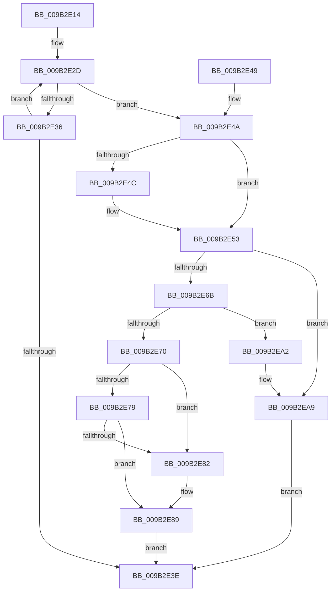

# CmpVolumeContextDecrementRefCount

- RVA: `0x009B2E14`–`0x009B2EB3` (길이 `159` bytes)
- VA: `0x00000001409B2E14`
- 실행 섹션: `PAGE`
- PDB 이름 있음: `예`; PDB Function 태그: `아니요`
- unwind 정보 RVA: `0x0009E430`
- 디코드: `48`개 명령, `159/159` bytes 표시
- 미해석 바이트: `0` (있으면 어셈블리에 `.byte`로 보존)

> 이 문서는 커널 이미지의 기계어와 PDB 기호를 분석해 생성했습니다. 4번과 5번은 함수 원형과 자료형을 바이너리 사용 방식에서 추정한 C 해석이며 원본 소스 복구 결과는 아닙니다.

## 1. Dependencies

- 직접 호출 지점: **4**; 고유 호출 대상: **3**
- 직접 호출자로 확인된 함수: **3**
- RIP 상대 이미지 참조: **0**

### Outgoing calls
- `0x009B2E56` → [CmSiRWLockAcquireExclusive](../A1/CmSiRWLockAcquireExclusive_function_00A1679C.md) (function, `0x00A1679C`)
- `0x009B2E93` → [CmSiRWLockReleaseExclusive](../A0/CmSiRWLockReleaseExclusive_function_00A0DAB0.md) (function, `0x00A0DAB0`)
- `0x009B2E9B` → [CmpVolumeContextFree](../AB/CmpVolumeContextFree_function_00AB1CF0.md) (function, `0x00AB1CF0`)
- `0x009B2EAC` → [CmSiRWLockReleaseExclusive](../A0/CmSiRWLockReleaseExclusive_function_00A0DAB0.md) (function, `0x00A0DAB0`)

### Direct callers
- [CmShutdownSystem2](../../text/66/CmShutdownSystem2_function_0066A7FC.md) at `0x0066A8EA`
- [CmShutdownSystem2](../../text/66/CmShutdownSystem2_function_0066A7FC.md) at `0x0066A94A`
- [CmpDestroyHive](CmpDestroyHive_function_009B1708.md) at `0x009B1742`
- [CmpCompleteUnloadKey](CmpCompleteUnloadKey_function_009B32FC.md) at `0x009B34B3`

### Static image references
- 디코드된 RIP-relative 메모리 참조가 없습니다.

## 2. Other-region calls and transfers

- 다른 실행 섹션으로 향하는 call: **0**
- 별도 외부 분기/꼬리 이동을 확인하지 못했습니다.

## 3. Assembly (complete function range)

```asm
009B2E14  48 89 5C 24 08                  mov qword ptr [rsp + 8], rbx
009B2E19  57                              push rdi
009B2E1A  48 83 EC 20                     sub rsp, 0x20
009B2E1E  48 8B 79 10                     mov rdi, qword ptr [rcx + 0x10]
009B2E22  48 8B D9                        mov rbx, rcx
009B2E25  0F 0D 49 18                     prefetchw byte ptr [rcx + 0x18]
009B2E29  48 8B 41 18                     mov rax, qword ptr [rcx + 0x18]
009B2E2D  48 8D 48 FF                     lea rcx, [rax - 1]
009B2E31  48 85 C9                        test rcx, rcx
009B2E34  7E 14                           jle 0x1409b2e4a
009B2E36  F0 48 0F B1 4B 18               lock cmpxchg qword ptr [rbx + 0x18], rcx
009B2E3C  75 EF                           jne 0x1409b2e2d
009B2E3E  48 8B 5C 24 30                  mov rbx, qword ptr [rsp + 0x30]
009B2E43  48 83 C4 20                     add rsp, 0x20
009B2E47  5F                              pop rdi
009B2E48  C3                              ret
009B2E49  CC                              int3
009B2E4A  74 07                           je 0x1409b2e53
009B2E4C  B9 0E 00 00 00                  mov ecx, 0xe
009B2E51  CD 29                           int 0x29
009B2E53  48 8B CF                        mov rcx, rdi
009B2E56  E8 41 39 06 00                  call 0x140a1679c
009B2E5B  48 83 C8 FF                     or rax, 0xffffffffffffffff
009B2E5F  F0 48 0F C1 43 18               lock xadd qword ptr [rbx + 0x18], rax
009B2E65  48 83 E8 01                     sub rax, 1
009B2E69  7F 3E                           jg 0x1409b2ea9
009B2E6B  48 85 C0                        test rax, rax
009B2E6E  75 32                           jne 0x1409b2ea2
009B2E70  48 8B 13                        mov rdx, qword ptr [rbx]
009B2E73  48 39 5A 08                     cmp qword ptr [rdx + 8], rbx
009B2E77  75 09                           jne 0x1409b2e82
009B2E79  48 8B 43 08                     mov rax, qword ptr [rbx + 8]
009B2E7D  48 39 18                        cmp qword ptr [rax], rbx
009B2E80  74 07                           je 0x1409b2e89
009B2E82  B9 03 00 00 00                  mov ecx, 3
009B2E87  CD 29                           int 0x29
009B2E89  48 89 10                        mov qword ptr [rax], rdx
009B2E8C  48 8B CF                        mov rcx, rdi
009B2E8F  48 89 42 08                     mov qword ptr [rdx + 8], rax
009B2E93  E8 18 AC 05 00                  call 0x140a0dab0
009B2E98  48 8B CB                        mov rcx, rbx
009B2E9B  E8 50 EE 0F 00                  call 0x140ab1cf0
009B2EA0  EB 9C                           jmp 0x1409b2e3e
009B2EA2  B9 0E 00 00 00                  mov ecx, 0xe
009B2EA7  CD 29                           int 0x29
009B2EA9  48 8B CF                        mov rcx, rdi
009B2EAC  E8 FF AB 05 00                  call 0x140a0dab0
009B2EB1  EB 8B                           jmp 0x1409b2e3e
```

## 4. C-style interpretation (structured pseudocode)

```c
__int64 __fastcall CmpVolumeContextDecrementRefCount(__int64 a1)
{
    __int64 result;
    __int64 v_rsp;
    unsigned __int64 v_stack_p8;

    v_stack_p8 = v_rbx;
    v_rsp = (v_rsp) - (32);
loc_009B2E2D:
    if (condition_is_less_or_equal) goto loc_009B2E4A;
    if (*(unsigned __int64 *)(a1 + 24) - 1 != 0) goto loc_009B2E2D;
loc_009B2E3E:
    v_rsp = (v_rsp) + (32);
    return *(unsigned __int64 *)(a1 + 24);
loc_009B2E4A:
    if (!(condition_is_equal)) {
        a1 = 14;
    }
    result = CmSiRWLockAcquireExclusive(*(unsigned __int64 *)(a1 + 16), a2, a3, a4);
    result = (result) | (-1);
    result = (result) - (1);
    if (condition_is_greater) goto loc_009B2EA9;
    if (result != 0) goto loc_009B2EA2;
    if ((*(unsigned __int64 *)(*(unsigned __int64 *)(v_stack_p8) + 8)) != v_stack_p8) goto loc_009B2E82;
    if ((*(unsigned __int64 *)(*(unsigned __int64 *)(v_stack_p8 + 8))) != v_stack_p8) {
        a1 = 3;
    }
    *(unsigned __int64 *)(*(unsigned __int64 *)(v_stack_p8 + 8)) = *(unsigned __int64 *)(v_stack_p8);
    *(unsigned __int64 *)(*(unsigned __int64 *)(v_stack_p8) + 8) = *(unsigned __int64 *)(v_stack_p8 + 8);
    result = CmSiRWLockReleaseExclusive(*(unsigned __int64 *)(a1 + 16), *(unsigned __int64 *)(v_stack_p8), a3, a4);
    result = CmpVolumeContextFree(v_stack_p8, *(unsigned __int64 *)(v_stack_p8), a3, a4);
    goto loc_009B2E3E;
loc_009B2EA2:
loc_009B2EA9:
    result = CmSiRWLockReleaseExclusive(*(unsigned __int64 *)(a1 + 16), *(unsigned __int64 *)(v_stack_p8), a3, a4);
    goto loc_009B2E3E;
}
```

## 5. (Beta) C Style

```c
int64_t CmpVolumeContextDecrementRefCount(void *Arg1)
{
    uint8_t *arg1 = (uint8_t *)Arg1;

    int64_t result;
    int64_t local_rsp;
    uint64_t v_stack_p8;

    v_stack_p8 = local_rbx;
    local_rsp = (local_rsp) - (32);
loc_009B2E2D:
    if (condition_is_less_or_equal) goto loc_009B2E4A;
    if (*(uint64_t *)(arg1 + 0x18) - 1 != 0) goto loc_009B2E2D;
loc_009B2E3E:
    local_rsp = (local_rsp) + (32);
    return *(uint64_t *)(arg1 + 0x18);
loc_009B2E4A:
    if (!(condition_is_equal)) {
        Arg1 = 14;
    }
    result = CmSiRWLockAcquireExclusive(*(uint64_t *)(arg1 + 0x10), a2, a3, a4);
    result = (result) | (-1);
    result = (result) - (1);
    if (condition_is_greater) goto loc_009B2EA9;
    if (result != 0) goto loc_009B2EA2;
    if ((*(uint64_t *)(*(uint64_t *)(v_stack_p8) + 0x8)) != v_stack_p8) goto loc_009B2E82;
    if ((*(uint64_t *)(*(uint64_t *)(v_stack_p8 + 0x8))) != v_stack_p8) {
        Arg1 = 3;
    }
    *(uint64_t *)(*(uint64_t *)(v_stack_p8 + 0x8)) = *(uint64_t *)(v_stack_p8);
    *(uint64_t *)(*(uint64_t *)(v_stack_p8) + 0x8) = *(uint64_t *)(v_stack_p8 + 0x8);
    result = CmSiRWLockReleaseExclusive(*(uint64_t *)(arg1 + 0x10), *(uint64_t *)(v_stack_p8), a3, a4);
    result = CmpVolumeContextFree(v_stack_p8, *(uint64_t *)(v_stack_p8), a3, a4);
    goto loc_009B2E3E;
loc_009B2EA2:
loc_009B2EA9:
    result = CmSiRWLockReleaseExclusive(*(uint64_t *)(arg1 + 0x10), *(uint64_t *)(v_stack_p8), a3, a4);
    goto loc_009B2E3E;
}
```

### 관측된 메모리 오프셋

구조체 형식이 확인되지 않은 접근은 인자 기준의 오프셋으로만 기록했습니다.

| 기준 인자 | 오프셋 표현 | 폭 (bit) | 접근 |
|---|---:|---:|---|
| `Arg1` | `+ 0x0` | `64` | `R` |
| `Arg1` | `+ 0x8` | `64` | `R` |
| `Arg1` | `+ 0x10` | `64` | `R` |
| `Arg1` | `+ 0x18` | `8` | `R` |
| `Arg1` | `+ 0x18` | `64` | `R` |
| `Arg1` | `+ 0x18` | `64` | `R/W` |

## 6. Execution-region graph

[열기: 2D/3D 그래프와 함수 탐색 컨트롤 패널](../../../control-panel.html?section=page&rva=0x009B2E14&view=graph)

- 2D 그래프는 위에서 아래로 흐르고, 3D 그래프는 빈 공간을 드래그해 회전합니다. Shift+드래그는 이동, 휠은 확대·축소, 함수 노드 선택은 대상 보고서 이동입니다.

### Static fallback


