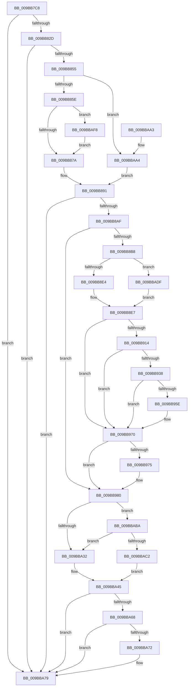

# EtwTiLogReadWriteVm

- RVA: `0x009BB7C8`–`0x009BBB07` (길이 `831` bytes)
- VA: `0x00000001409BB7C8`
- 실행 섹션: `PAGE`
- PDB 이름 있음: `예`; PDB Function 태그: `아니요`
- unwind 정보 RVA: `0x0009EF84`
- 디코드: `194`개 명령, `831/831` bytes 표시
- 미해석 바이트: `0` (있으면 어셈블리에 `.byte`로 보존)

> 이 문서는 커널 이미지의 기계어와 PDB 기호를 분석해 생성했습니다. 4번과 5번은 함수 원형과 자료형을 바이너리 사용 방식에서 추정한 C 해석이며 원본 소스 복구 결과는 아닙니다.

## 1. Dependencies

- 직접 호출 지점: **18**; 고유 호출 대상: **14**
- 직접 호출자로 확인된 함수: **1**
- RIP 상대 이미지 참조: **6**

### Outgoing calls
- `0x009BB810` → [memset](../../text/6C/memset_function_006C6C40.md) (function, `0x006C6C40`)
- `0x009BB848` → [EtwProviderEnabled](../../text/3B/EtwProviderEnabled_function_003BA250.md) (function, `0x003BA250`)
- `0x009BB87A` → [EtwProviderEnabled](../../text/3B/EtwProviderEnabled_function_003BA250.md) (function, `0x003BA250`)
- `0x009BB8A2` → [EtwEventEnabled](../../text/39/EtwEventEnabled_function_00392450.md) (function, `0x00392450`)
- `0x009BB907` → [ZwQueryVirtualMemory](../../text/6A/ZwQueryVirtualMemory_function_006AD530.md) (function, `0x006AD530`)
- `0x009BB929` → [ExAllocatePool2](../../poolcode/B8/ExAllocatePool2_function_00B820F0.md) (function, `0x00B820F0`)
- `0x009BB955` → [ZwQueryVirtualMemory](../../text/6A/ZwQueryVirtualMemory_function_006AD530.md) (function, `0x006AD530`)
- `0x009BB965` → [ExFreePoolWithTag](../../poolcode/B8/ExFreePoolWithTag_function_00B82870.md) (function, `0x00B82870`)
- `0x009BB97B` → [KiUnstackDetachProcess](../../text/21/KiUnstackDetachProcess_function_00217D30.md) (function, `0x00217D30`)
- `0x009BB9A2` → [EtwpTiFillProcessIdentity](../../text/3B/EtwpTiFillProcessIdentity_function_003B8F30.md) (function, `0x003B8F30`)
- `0x009BB9C2` → [EtwpTiFillThreadIdentity](../../text/47/EtwpTiFillThreadIdentity_function_00471C1C.md) (function, `0x00471C1C`)
- `0x009BB9E0` → [EtwpTiFillProcessIdentity](../../text/3B/EtwpTiFillProcessIdentity_function_003B8F30.md) (function, `0x003B8F30`)
- `0x009BBA40` → [EtwpTiFillZeroVad](../../text/46/EtwpTiFillZeroVad_function_00469548.md) (function, `0x00469548`)
- `0x009BBA5F` → [EtwWrite](../../text/41/EtwWrite_function_0041C720.md) (function, `0x0041C720`)
- `0x009BBA74` → [ExFreePoolWithTag](../../poolcode/B8/ExFreePoolWithTag_function_00B82870.md) (function, `0x00B82870`)
- `0x009BBA83` → [_security_check_cookie](../../text/6A/_security_check_cookie_function_006AC640.md) (function, `0x006AC640`)
- `0x009BBAD5` → [EtwpTiFillVad](../../text/46/EtwpTiFillVad_function_004695B0.md) (function, `0x004695B0`)
- `0x009BBAE8` → [KiStackAttachProcess](../../text/21/KiStackAttachProcess_function_00216820.md) (function, `0x00216820`)

### Direct callers
- [MiReadWriteVirtualMemory](MiReadWriteVirtualMemory_function_009BB4E0.md) at `0x009BB74B`

### Static image references
- `0x009BB7EB` → RVA `0x00E0A740` (`.data`; read)
- `0x009BB82D` → RVA `0x00EFFA30` (`.data`; read)
- `0x009BB883` → RVA `0x00013D28` (`.rdata`; read)
- `0x009BB88A` → RVA `0x00013D38` (`.rdata`; read)
- `0x009BBAA7` → RVA `0x00013D58` (`.rdata`; read)
- `0x009BBAAE` → RVA `0x00013D48` (`.rdata`; read)

## 2. Other-region calls and transfers

- 다른 실행 섹션으로 향하는 call: **18**
  - `0x009BB810` → [memset](../../text/6C/memset_function_006C6C40.md) (`PAGE` → `.text`)
  - `0x009BB848` → [EtwProviderEnabled](../../text/3B/EtwProviderEnabled_function_003BA250.md) (`PAGE` → `.text`)
  - `0x009BB87A` → [EtwProviderEnabled](../../text/3B/EtwProviderEnabled_function_003BA250.md) (`PAGE` → `.text`)
  - `0x009BB8A2` → [EtwEventEnabled](../../text/39/EtwEventEnabled_function_00392450.md) (`PAGE` → `.text`)
  - `0x009BB907` → [ZwQueryVirtualMemory](../../text/6A/ZwQueryVirtualMemory_function_006AD530.md) (`PAGE` → `.text`)
  - `0x009BB929` → [ExAllocatePool2](../../poolcode/B8/ExAllocatePool2_function_00B820F0.md) (`PAGE` → `POOLCODE`)
  - `0x009BB955` → [ZwQueryVirtualMemory](../../text/6A/ZwQueryVirtualMemory_function_006AD530.md) (`PAGE` → `.text`)
  - `0x009BB965` → [ExFreePoolWithTag](../../poolcode/B8/ExFreePoolWithTag_function_00B82870.md) (`PAGE` → `POOLCODE`)
  - `0x009BB97B` → [KiUnstackDetachProcess](../../text/21/KiUnstackDetachProcess_function_00217D30.md) (`PAGE` → `.text`)
  - `0x009BB9A2` → [EtwpTiFillProcessIdentity](../../text/3B/EtwpTiFillProcessIdentity_function_003B8F30.md) (`PAGE` → `.text`)
  - `0x009BB9C2` → [EtwpTiFillThreadIdentity](../../text/47/EtwpTiFillThreadIdentity_function_00471C1C.md) (`PAGE` → `.text`)
  - `0x009BB9E0` → [EtwpTiFillProcessIdentity](../../text/3B/EtwpTiFillProcessIdentity_function_003B8F30.md) (`PAGE` → `.text`)
  - `0x009BBA40` → [EtwpTiFillZeroVad](../../text/46/EtwpTiFillZeroVad_function_00469548.md) (`PAGE` → `.text`)
  - `0x009BBA5F` → [EtwWrite](../../text/41/EtwWrite_function_0041C720.md) (`PAGE` → `.text`)
  - `0x009BBA74` → [ExFreePoolWithTag](../../poolcode/B8/ExFreePoolWithTag_function_00B82870.md) (`PAGE` → `POOLCODE`)
  - `0x009BBA83` → [_security_check_cookie](../../text/6A/_security_check_cookie_function_006AC640.md) (`PAGE` → `.text`)
  - `0x009BBAD5` → [EtwpTiFillVad](../../text/46/EtwpTiFillVad_function_004695B0.md) (`PAGE` → `.text`)
  - `0x009BBAE8` → [KiStackAttachProcess](../../text/21/KiStackAttachProcess_function_00216820.md) (`PAGE` → `.text`)
- 별도 외부 분기/꼬리 이동을 확인하지 못했습니다.

## 3. Assembly (complete function range)

```asm
009BB7C8  48 89 5C 24 20                  mov qword ptr [rsp + 0x20], rbx
009BB7CD  89 4C 24 08                     mov dword ptr [rsp + 8], ecx
009BB7D1  55                              push rbp
009BB7D2  56                              push rsi
009BB7D3  57                              push rdi
009BB7D4  41 54                           push r12
009BB7D6  41 55                           push r13
009BB7D8  41 56                           push r14
009BB7DA  41 57                           push r15
009BB7DC  48 8D AC 24 C0 FE FF FF         lea rbp, [rsp - 0x140]
009BB7E4  48 81 EC 40 02 00 00            sub rsp, 0x240
009BB7EB  48 8B 05 4E EF 44 00            mov rax, qword ptr [rip + 0x44ef4e]
009BB7F2  48 33 C4                        xor rax, rsp
009BB7F5  48 89 85 30 01 00 00            mov qword ptr [rbp + 0x130], rax
009BB7FC  4C 8B EA                        mov r13, rdx
009BB7FF  48 8D 4C 24 40                  lea rcx, [rsp + 0x40]
009BB804  33 D2                           xor edx, edx
009BB806  4D 8B F0                        mov r14, r8
009BB809  41 8B D9                        mov ebx, r9d
009BB80C  44 8D 42 40                     lea r8d, [rdx + 0x40]
009BB810  E8 2B B4 D0 FF                  call 0x1406c6c40
009BB815  65 48 8B 04 25 88 01 00 00      mov rax, qword ptr gs:[0x188]
009BB81E  33 F6                           xor esi, esi
009BB820  80 B8 32 02 00 00 01            cmp byte ptr [rax + 0x232], 1
009BB827  0F 85 4C 02 00 00               jne 0x1409bba79
009BB82D  48 8B 0D FC 41 54 00            mov rcx, qword ptr [rip + 0x5441fc]
009BB834  B8 00 00 0C 00                  mov eax, 0xc0000
009BB839  83 FB 10                        cmp ebx, 0x10
009BB83C  41 B8 00 00 03 00               mov r8d, 0x30000
009BB842  44 0F 45 C0                     cmovne r8d, eax
009BB846  33 D2                           xor edx, edx
009BB848  E8 03 EA 9F FF                  call 0x1403ba250
009BB84D  84 C0                           test al, al
009BB84F  0F 84 24 02 00 00               je 0x1409bba79
009BB855  4D 3B EE                        cmp r13, r14
009BB858  0F 84 46 02 00 00               je 0x1409bbaa4
009BB85E  48 8B 0D CB 41 54 00            mov rcx, qword ptr [rip + 0x5441cb]
009BB865  33 D2                           xor edx, edx
009BB867  49 B8 00 00 00 00 01 00 00 00   movabs r8, 0x100000000
009BB871  83 FB 10                        cmp ebx, 0x10
009BB874  0F 85 7E 02 00 00               jne 0x1409bbaf8
009BB87A  E8 D1 E9 9F FF                  call 0x1403ba250
009BB87F  44 0F B6 E0                     movzx r12d, al
009BB883  48 8D 3D 9E 84 65 FF            lea rdi, [rip - 0x9a7b62]
009BB88A  48 8D 05 A7 84 65 FF            lea rax, [rip - 0x9a7b59]
009BB891  48 8B 0D 98 41 54 00            mov rcx, qword ptr [rip + 0x544198]
009BB898  83 FB 10                        cmp ebx, 0x10
009BB89B  48 0F 45 F8                     cmovne rdi, rax
009BB89F  48 8B D7                        mov rdx, rdi
009BB8A2  E8 A9 6B 9D FF                  call 0x140392450
009BB8A7  84 C0                           test al, al
009BB8A9  0F 84 CA 01 00 00               je 0x1409bba79
009BB8AF  45 85 E4                        test r12d, r12d
009BB8B2  0F 84 C8 00 00 00               je 0x1409bb980
009BB8B8  48 8B 9D A0 01 00 00            mov rbx, qword ptr [rbp + 0x1a0]
009BB8BF  0F 57 C0                        xorps xmm0, xmm0
009BB8C2  0F 11 45 80                     movups xmmword ptr [rbp - 0x80], xmm0
009BB8C6  0F 11 45 90                     movups xmmword ptr [rbp - 0x70], xmm0
009BB8CA  0F 11 45 A0                     movups xmmword ptr [rbp - 0x60], xmm0
009BB8CE  65 48 8B 04 25 88 01 00 00      mov rax, qword ptr gs:[0x188]
009BB8D7  4C 3B B0 B8 00 00 00            cmp r14, qword ptr [rax + 0xb8]
009BB8DE  0F 85 FB 01 00 00               jne 0x1409bbadf
009BB8E4  45 33 FF                        xor r15d, r15d
009BB8E7  48 21 74 24 28                  and qword ptr [rsp + 0x28], rsi
009BB8EC  4C 8D 4C 24 48                  lea r9, [rsp + 0x48]
009BB8F1  41 B8 03 00 00 00               mov r8d, 3
009BB8F7  48 C7 44 24 20 30 00 00 00      mov qword ptr [rsp + 0x20], 0x30
009BB900  48 8B D3                        mov rdx, rbx
009BB903  48 83 C9 FF                     or rcx, 0xffffffffffffffff
009BB907  E8 24 1C CF FF                  call 0x1406ad530
009BB90C  89 44 24 40                     mov dword ptr [rsp + 0x40], eax
009BB910  85 C0                           test eax, eax
009BB912  78 5C                           js 0x1409bb970
009BB914  BA 00 02 00 00                  mov edx, 0x200
009BB919  B9 00 01 00 00                  mov ecx, 0x100
009BB91E  41 B8 54 49 73 6E               mov r8d, 0x6e734954
009BB924  BE 01 00 00 00                  mov esi, 1
009BB929  E8 C2 67 1C 00                  call 0x140b820f0
009BB92E  48 89 44 24 78                  mov qword ptr [rsp + 0x78], rax
009BB933  48 85 C0                        test rax, rax
009BB936  74 38                           je 0x1409bb970
009BB938  48 83 64 24 28 00               and qword ptr [rsp + 0x28], 0
009BB93E  44 8D 46 01                     lea r8d, [rsi + 1]
009BB942  4C 8B C8                        mov r9, rax
009BB945  48 C7 44 24 20 00 02 00 00      mov qword ptr [rsp + 0x20], 0x200
009BB94E  48 8B D3                        mov rdx, rbx
009BB951  48 83 C9 FF                     or rcx, 0xffffffffffffffff
009BB955  E8 D6 1B CF FF                  call 0x1406ad530
009BB95A  85 C0                           test eax, eax
009BB95C  79 12                           jns 0x1409bb970
009BB95E  48 8B 4C 24 78                  mov rcx, qword ptr [rsp + 0x78]
009BB963  33 D2                           xor edx, edx
009BB965  E8 06 6F 1C 00                  call 0x140b82870
009BB96A  48 83 64 24 78 00               and qword ptr [rsp + 0x78], 0
009BB970  45 85 FF                        test r15d, r15d
009BB973  74 0B                           je 0x1409bb980
009BB975  33 D2                           xor edx, edx
009BB977  48 8D 4D 80                     lea rcx, [rbp - 0x80]
009BB97B  E8 B0 C3 85 FF                  call 0x140217d30
009BB980  83 65 BC 00                     and dword ptr [rbp - 0x44], 0
009BB984  48 8D 85 80 01 00 00            lea rax, [rbp + 0x180]
009BB98B  4C 8D 44 24 30                  lea r8, [rsp + 0x30]
009BB990  48 89 45 B0                     mov qword ptr [rbp - 0x50], rax
009BB994  49 8B D5                        mov rdx, r13
009BB997  C7 45 B8 04 00 00 00            mov dword ptr [rbp - 0x48], 4
009BB99E  48 8D 4D C0                     lea rcx, [rbp - 0x40]
009BB9A2  E8 89 D5 9F FF                  call 0x1403b8f30
009BB9A7  65 48 8B 14 25 88 01 00 00      mov rdx, qword ptr gs:[0x188]
009BB9B0  44 8D 58 01                     lea r11d, [rax + 1]
009BB9B4  48 8D 45 B0                     lea rax, [rbp - 0x50]
009BB9B8  41 8B CB                        mov ecx, r11d
009BB9BB  48 C1 E1 04                     shl rcx, 4
009BB9BF  48 03 C8                        add rcx, rax
009BB9C2  E8 55 62 AB FF                  call 0x140471c1c
009BB9C7  44 03 D8                        add r11d, eax
009BB9CA  4C 8D 44 24 38                  lea r8, [rsp + 0x38]
009BB9CF  48 8D 45 B0                     lea rax, [rbp - 0x50]
009BB9D3  41 8B CB                        mov ecx, r11d
009BB9D6  48 C1 E1 04                     shl rcx, 4
009BB9DA  49 8B D6                        mov rdx, r14
009BB9DD  48 03 C8                        add rcx, rax
009BB9E0  E8 4B D5 9F FF                  call 0x1403b8f30
009BB9E5  44 03 D8                        add r11d, eax
009BB9E8  48 8D 8D A0 01 00 00            lea rcx, [rbp + 0x1a0]
009BB9EF  41 8B C3                        mov eax, r11d
009BB9F2  BA 08 00 00 00                  mov edx, 8
009BB9F7  48 03 C0                        add rax, rax
009BB9FA  41 FF C3                        inc r11d
009BB9FD  83 64 C5 BC 00                  and dword ptr [rbp + rax*8 - 0x44], 0
009BBA02  48 89 4C C5 B0                  mov qword ptr [rbp + rax*8 - 0x50], rcx
009BBA07  48 8D 8D A8 01 00 00            lea rcx, [rbp + 0x1a8]
009BBA0E  89 54 C5 B8                     mov dword ptr [rbp + rax*8 - 0x48], edx
009BBA12  41 8B C3                        mov eax, r11d
009BBA15  41 FF C3                        inc r11d
009BBA18  48 03 C0                        add rax, rax
009BBA1B  83 64 C5 BC 00                  and dword ptr [rbp + rax*8 - 0x44], 0
009BBA20  48 89 4C C5 B0                  mov qword ptr [rbp + rax*8 - 0x50], rcx
009BBA25  89 54 C5 B8                     mov dword ptr [rbp + rax*8 - 0x48], edx
009BBA29  45 85 E4                        test r12d, r12d
009BBA2C  0F 85 88 00 00 00               jne 0x1409bbaba
009BBA32  41 8B C3                        mov eax, r11d
009BBA35  48 8D 4D B0                     lea rcx, [rbp - 0x50]
009BBA39  48 C1 E0 04                     shl rax, 4
009BBA3D  48 03 C8                        add rcx, rax
009BBA40  E8 03 DB AA FF                  call 0x140469548
009BBA45  48 8B 0D E4 3F 54 00            mov rcx, qword ptr [rip + 0x543fe4]
009BBA4C  46 8D 0C 18                     lea r9d, [rax + r11]
009BBA50  48 8D 45 B0                     lea rax, [rbp - 0x50]
009BBA54  45 33 C0                        xor r8d, r8d
009BBA57  48 8B D7                        mov rdx, rdi
009BBA5A  48 89 44 24 20                  mov qword ptr [rsp + 0x20], rax
009BBA5F  E8 BC 0C A6 FF                  call 0x14041c720
009BBA64  85 F6                           test esi, esi
009BBA66  74 11                           je 0x1409bba79
009BBA68  48 8B 4C 24 78                  mov rcx, qword ptr [rsp + 0x78]
009BBA6D  48 85 C9                        test rcx, rcx
009BBA70  74 07                           je 0x1409bba79
009BBA72  33 D2                           xor edx, edx
009BBA74  E8 F7 6D 1C 00                  call 0x140b82870
009BBA79  48 8B 8D 30 01 00 00            mov rcx, qword ptr [rbp + 0x130]
009BBA80  48 33 CC                        xor rcx, rsp
009BBA83  E8 B8 0B CF FF                  call 0x1406ac640
009BBA88  48 8B 9C 24 98 02 00 00         mov rbx, qword ptr [rsp + 0x298]
009BBA90  48 81 C4 40 02 00 00            add rsp, 0x240
009BBA97  41 5F                           pop r15
009BBA99  41 5E                           pop r14
009BBA9B  41 5D                           pop r13
009BBA9D  41 5C                           pop r12
009BBA9F  5F                              pop rdi
009BBAA0  5E                              pop rsi
009BBAA1  5D                              pop rbp
009BBAA2  C3                              ret
009BBAA3  CC                              int3
009BBAA4  45 33 E4                        xor r12d, r12d
009BBAA7  48 8D 3D AA 82 65 FF            lea rdi, [rip - 0x9a7d56]
009BBAAE  48 8D 05 93 82 65 FF            lea rax, [rip - 0x9a7d6d]
009BBAB5  E9 D7 FD FF FF                  jmp 0x1409bb891
009BBABA  85 F6                           test esi, esi
009BBABC  0F 84 70 FF FF FF               je 0x1409bba32
009BBAC2  41 8B C3                        mov eax, r11d
009BBAC5  48 8D 4D B0                     lea rcx, [rbp - 0x50]
009BBAC9  48 C1 E0 04                     shl rax, 4
009BBACD  48 8D 54 24 40                  lea rdx, [rsp + 0x40]
009BBAD2  48 03 C8                        add rcx, rax
009BBAD5  E8 D6 DA AA FF                  call 0x1404695b0
009BBADA  E9 66 FF FF FF                  jmp 0x1409bba45
009BBADF  4C 8D 45 80                     lea r8, [rbp - 0x80]
009BBAE3  33 D2                           xor edx, edx
009BBAE5  49 8B CE                        mov rcx, r14
009BBAE8  E8 33 AD 85 FF                  call 0x140216820
009BBAED  41 BF 01 00 00 00               mov r15d, 1
009BBAF3  E9 EF FD FF FF                  jmp 0x1409bb8e7
009BBAF8  49 B8 00 00 00 00 02 00 00 00   movabs r8, 0x200000000
009BBB02  E9 73 FD FF FF                  jmp 0x1409bb87a
```

## 4. C-style interpretation (structured pseudocode)

```c
__int64 __fastcall EtwTiLogReadWriteVm(int a1, __int64 a2, __int64 a3, int a4, __int64 a5, __int64 a6)
{
    __int64 result;
    __int64 v_r11;
    __int64 v_r12;
    __int64 v_r15;
    __int64 v_rdi;
    __int64 v_rsi;
    __int64 v_rsp;
    unsigned __int64 v_stack_m178;
    unsigned __int64 v_stack_m1B8;
    unsigned int v_stack_m1BC;
    unsigned int v_stack_m1C0;
    unsigned __int64 v_stack_m1C8;
    unsigned __int64 v_stack_m1D8;
    unsigned __int64 v_stack_m1E8;
    unsigned __int64 v_stack_m1F8;
    unsigned __int64 v_stack_m200;
    unsigned __int64 v_stack_m230;
    unsigned __int64 v_stack_m238;
    unsigned __int64 v_stack_m240;
    unsigned __int64 v_stack_m248;
    unsigned __int64 v_stack_m250;
    unsigned __int64 v_stack_m258;
    unsigned __int64 v_stack_m48;
    unsigned __int64 v_stack_p20;
    unsigned __int64 v_stack_p40;
    unsigned int v_stack_p8;

    v_stack_p20 = v_rbx;
    v_stack_p8 = a1;
    v_rsp = (v_rsp) - (576);
    result = (*(unsigned __int64 *)(v_rip + 4517710)) ^ (v_rsp);
    v_stack_m48 = result;
    a2 = 0;
    result = memset(v_stack_m238, a2, a2 + 64, a4);
    v_rsi = 0;
    if ((*(unsigned __int8 *)(*(unsigned __int64 *)(gs_base + (0 + 392)) + 562)) != 1) goto loc_009BBA79;
    a3 = (unsigned int)(0x30000ULL);
    if (((unsigned int)((unsigned int)(a4))) != 16) { a3 = (unsigned int)((unsigned int)(0xC0000ULL)); }
    a2 = 0;
    result = EtwProviderEnabled(*(unsigned __int64 *)(v_rip + 5521916), a2, a3, a4);
    if ((unsigned __int8)(result) == 0) goto loc_009BBA79;
    if (0 == a3) goto loc_009BBAA4;
    a2 = 0;
    if (((unsigned int)((unsigned int)(a4))) != 16) goto loc_009BBAF8;
loc_009BB87A:
    result = EtwProviderEnabled(*(unsigned __int64 *)(v_rip + 5521867), a2, a3, a4);
loc_009BB891:
    v_rdi = v_rip - 10124130;
    if (((unsigned int)((unsigned int)(a4))) != 16) { v_rdi = v_rip - 10124121; }
    result = EtwEventEnabled(*(unsigned __int64 *)(v_rip + 5521816), v_rdi, a3, a4);
    if ((unsigned __int8)(result) == 0) goto loc_009BBA79;
    if ((unsigned int)((unsigned __int8)(result)) == 0) goto loc_009BB980;
    v_stack_m1F8 = v_xmm0;
    v_stack_m1E8 = v_xmm0;
    v_stack_m1D8 = v_xmm0;
    if (a3 != (*(unsigned __int64 *)(*(unsigned __int64 *)(gs_base + (0 + 392)) + 184))) goto loc_009BBADF;
    v_r15 = 0;
loc_009BB8E7:
    v_stack_m258 = 48;
    a1 = (*(unsigned __int64 *)(v_rip + 5521816)) | (-1);
    result = ZwQueryVirtualMemory(a1, a5, 3, v_stack_m230);
    v_stack_m238 = (unsigned int)(result);
    if (sign_flag) goto loc_009BB970;
    result = ExAllocatePool2(256, 512, (unsigned int)(0x6E734954ULL), v_stack_m230);
    v_stack_m200 = result;
    if (result == 0) goto loc_009BB970;
    v_stack_m258 = 512;
    a1 = (256) | (-1);
    result = ZwQueryVirtualMemory(a1, a5, 1 + 1, result);
    if (sign_flag) {
        a1 = v_stack_m200;
        a2 = 0;
        result = ExFreePoolWithTag(a1, a2, 1 + 1, result);
    }
    if (0 != 0) {
        a2 = 0;
        a1 = v_stack_m1F8;
        result = KiUnstackDetachProcess(a1, a2, 1 + 1, result);
    }
    v_stack_m1C8 = v_stack_p8;
    v_stack_m1C0 = 4;
    result = EtwpTiFillProcessIdentity(v_stack_m1B8, 0, v_stack_m248, result);
    a1 = ((unsigned int)((unsigned int)(result + 1))) << (4);
    a1 = (a1) + (v_stack_m1C8);
    result = EtwpTiFillThreadIdentity(a1, *(unsigned __int64 *)(gs_base + (0 + 392)), v_stack_m248, result);
    v_r11 = (unsigned int)((result + 1) + ((unsigned int)(result)));
    a1 = ((unsigned int)((unsigned int)(v_r11))) << (4);
    a1 = (a1) + (v_stack_m1C8);
    result = EtwpTiFillProcessIdentity(a1, a3, v_stack_m240, result);
    v_r11 = (unsigned int)((v_r11) + ((unsigned int)(result)));
    result = ((unsigned int)((unsigned int)(v_r11))) + ((unsigned int)((unsigned int)(v_r11)));
    v_r11 = (unsigned int)((v_r11) + 1);
    *(unsigned __int64 *)(v_stack_m178 + result * 8 - 80) = a5;
    *(unsigned int *)(v_stack_m178 + result * 8 - 72) = 8;
    v_r11 = (unsigned int)((v_r11) + 1);
    result = ((unsigned int)((unsigned int)(v_r11))) + ((unsigned int)((unsigned int)(v_r11)));
    *(unsigned __int64 *)(v_stack_m178 + result * 8 - 80) = a6;
    *(unsigned int *)(v_stack_m178 + result * 8 - 72) = 8;
    if ((unsigned int)((unsigned __int8)(result)) != 0) goto loc_009BBABA;
loc_009BBA32:
    result = ((unsigned int)((unsigned int)(v_r11))) << (4);
    a1 = (v_stack_m1C8) + (result);
    result = EtwpTiFillZeroVad(a1, 8, v_stack_m240, result);
loc_009BBA45:
    a3 = 0;
    v_stack_m258 = v_stack_m1C8;
    result = EtwWrite(*(unsigned __int64 *)(v_rip + 5521380), v_rdi, a3, result + v_r11 * 1);
    if (1 == 0) goto loc_009BBA79;
    if (v_stack_m200 != 0) {
        a2 = 0;
        result = ExFreePoolWithTag(v_stack_m200, a2, a3, result + v_r11 * 1);
    }
    a1 = (v_stack_m48) ^ (v_rsp);
    result = _security_check_cookie(a1, a2, a3, result + v_r11 * 1);
    v_rsp = (v_rsp) + (576);
    return result;
loc_009BBAA4:
    v_r12 = 0;
    goto loc_009BB891;
loc_009BBABA:
    if (1 == 0) goto loc_009BBA32;
    result = ((unsigned int)((unsigned int)(v_r11))) << (4);
    a1 = (v_stack_m1C8) + (result);
    result = EtwpTiFillVad(a1, v_stack_p40, a3, result + v_r11 * 1);
    goto loc_009BBA45;
loc_009BBADF:
    a2 = 0;
    result = KiStackAttachProcess(0, a2, v_stack_m1F8, result + v_r11 * 1);
    goto loc_009BB8E7;
loc_009BBAF8:
    goto loc_009BB87A;
}
```

## 5. (Beta) C Style

```c
int64_t EtwTiLogReadWriteVm(int32_t Arg1, int64_t Arg2, int64_t Arg3, int32_t Arg4, int64_t Arg5, int64_t Arg6)
{
    int64_t result;
    int64_t local_r11;
    int64_t local_r12;
    int64_t local_r15;
    int64_t local_rdi;
    int64_t local_rsi;
    int64_t local_rsp;
    uint64_t v_stack_m178;
    uint64_t v_stack_m1B8;
    uint32_t v_stack_m1BC;
    uint32_t v_stack_m1C0;
    uint64_t v_stack_m1C8;
    uint64_t v_stack_m1D8;
    uint64_t v_stack_m1E8;
    uint64_t v_stack_m1F8;
    uint64_t v_stack_m200;
    uint64_t v_stack_m230;
    uint64_t v_stack_m238;
    uint64_t v_stack_m240;
    uint64_t v_stack_m248;
    uint64_t v_stack_m250;
    uint64_t v_stack_m258;
    uint64_t v_stack_m48;
    uint64_t v_stack_p20;
    uint64_t v_stack_p40;
    uint32_t v_stack_p8;

    v_stack_p20 = local_rbx;
    v_stack_p8 = Arg1;
    local_rsp = (local_rsp) - (576);
    result = (*(uint64_t *)(v_rip + 0x44EF4E)) ^ (local_rsp);
    v_stack_m48 = result;
    Arg2 = 0;
    result = memset(v_stack_m238, Arg2, Arg2 + 64, Arg4);
    local_rsi = 0;
    if ((*(uint8_t *)(*(uint64_t *)(gs_base + (0 + 0x188)) + 0x232)) != 1) goto loc_009BBA79;
    Arg3 = (uint32_t)(0x30000ULL);
    if (((uint32_t)((uint32_t)(Arg4))) != 16) { Arg3 = (uint32_t)((uint32_t)(0xC0000ULL)); }
    Arg2 = 0;
    result = EtwProviderEnabled(*(uint64_t *)(v_rip + 0x5441FC), Arg2, Arg3, Arg4);
    if ((uint8_t)(result) == 0) goto loc_009BBA79;
    if (0 == Arg3) goto loc_009BBAA4;
    Arg2 = 0;
    if (((uint32_t)((uint32_t)(Arg4))) != 16) goto loc_009BBAF8;
loc_009BB87A:
    result = EtwProviderEnabled(*(uint64_t *)(v_rip + 0x5441CB), Arg2, Arg3, Arg4);
loc_009BB891:
    local_rdi = v_rip - 10124130;
    if (((uint32_t)((uint32_t)(Arg4))) != 16) { local_rdi = v_rip - 10124121; }
    result = EtwEventEnabled(*(uint64_t *)(v_rip + 0x544198), local_rdi, Arg3, Arg4);
    if ((uint8_t)(result) == 0) goto loc_009BBA79;
    if ((uint32_t)((uint8_t)(result)) == 0) goto loc_009BB980;
    v_stack_m1F8 = v_xmm0;
    v_stack_m1E8 = v_xmm0;
    v_stack_m1D8 = v_xmm0;
    if (Arg3 != (*(uint64_t *)(*(uint64_t *)(gs_base + (0 + 0x188)) + 0xB8))) goto loc_009BBADF;
    local_r15 = 0;
loc_009BB8E7:
    v_stack_m258 = 48;
    Arg1 = (*(uint64_t *)(v_rip + 0x544198)) | (-1);
    result = ZwQueryVirtualMemory(Arg1, Arg5, 3, v_stack_m230);
    v_stack_m238 = (uint32_t)(result);
    if (sign_flag) goto loc_009BB970;
    result = ExAllocatePool2(256, 512, (uint32_t)(0x6E734954ULL), v_stack_m230);
    v_stack_m200 = result;
    if (result == 0) goto loc_009BB970;
    v_stack_m258 = 512;
    Arg1 = (256) | (-1);
    result = ZwQueryVirtualMemory(Arg1, Arg5, 1 + 1, result);
    if (sign_flag) {
        Arg1 = v_stack_m200;
        Arg2 = 0;
        result = ExFreePoolWithTag(Arg1, Arg2, 1 + 1, result);
    }
    if (0 != 0) {
        Arg2 = 0;
        Arg1 = v_stack_m1F8;
        result = KiUnstackDetachProcess(Arg1, Arg2, 1 + 1, result);
    }
    v_stack_m1C8 = v_stack_p8;
    v_stack_m1C0 = 4;
    result = EtwpTiFillProcessIdentity(v_stack_m1B8, 0, v_stack_m248, result);
    Arg1 = ((uint32_t)((uint32_t)(result + 1))) << (4);
    Arg1 = (Arg1) + (v_stack_m1C8);
    result = EtwpTiFillThreadIdentity(Arg1, *(uint64_t *)(gs_base + (0 + 0x188)), v_stack_m248, result);
    local_r11 = (uint32_t)((result + 1) + ((uint32_t)(result)));
    Arg1 = ((uint32_t)((uint32_t)(local_r11))) << (4);
    Arg1 = (Arg1) + (v_stack_m1C8);
    result = EtwpTiFillProcessIdentity(Arg1, Arg3, v_stack_m240, result);
    local_r11 = (uint32_t)((local_r11) + ((uint32_t)(result)));
    result = ((uint32_t)((uint32_t)(local_r11))) + ((uint32_t)((uint32_t)(local_r11)));
    local_r11 = (uint32_t)((local_r11) + 1);
    *(uint64_t *)(v_stack_m178 + result * 8 - 0x50) = Arg5;
    *(uint32_t *)(v_stack_m178 + result * 8 - 0x48) = 8;
    local_r11 = (uint32_t)((local_r11) + 1);
    result = ((uint32_t)((uint32_t)(local_r11))) + ((uint32_t)((uint32_t)(local_r11)));
    *(uint64_t *)(v_stack_m178 + result * 8 - 0x50) = Arg6;
    *(uint32_t *)(v_stack_m178 + result * 8 - 0x48) = 8;
    if ((uint32_t)((uint8_t)(result)) != 0) goto loc_009BBABA;
loc_009BBA32:
    result = ((uint32_t)((uint32_t)(local_r11))) << (4);
    Arg1 = (v_stack_m1C8) + (result);
    result = EtwpTiFillZeroVad(Arg1, 8, v_stack_m240, result);
loc_009BBA45:
    Arg3 = 0;
    v_stack_m258 = v_stack_m1C8;
    result = EtwWrite(*(uint64_t *)(v_rip + 0x543FE4), local_rdi, Arg3, result + local_r11 * 1);
    if (1 == 0) goto loc_009BBA79;
    if (v_stack_m200 != 0) {
        Arg2 = 0;
        result = ExFreePoolWithTag(v_stack_m200, Arg2, Arg3, result + local_r11 * 1);
    }
    Arg1 = (v_stack_m48) ^ (local_rsp);
    result = _security_check_cookie(Arg1, Arg2, Arg3, result + local_r11 * 1);
    local_rsp = (local_rsp) + (576);
    return result;
loc_009BBAA4:
    local_r12 = 0;
    goto loc_009BB891;
loc_009BBABA:
    if (1 == 0) goto loc_009BBA32;
    result = ((uint32_t)((uint32_t)(local_r11))) << (4);
    Arg1 = (v_stack_m1C8) + (result);
    result = EtwpTiFillVad(Arg1, v_stack_p40, Arg3, result + local_r11 * 1);
    goto loc_009BBA45;
loc_009BBADF:
    Arg2 = 0;
    result = KiStackAttachProcess(0, Arg2, v_stack_m1F8, result + local_r11 * 1);
    goto loc_009BB8E7;
loc_009BBAF8:
    goto loc_009BB87A;
}
```

## 6. Execution-region graph

[열기: 2D/3D 그래프와 함수 탐색 컨트롤 패널](../../../control-panel.html?section=page&rva=0x009BB7C8&view=graph)

- 2D 그래프는 위에서 아래로 흐르고, 3D 그래프는 빈 공간을 드래그해 회전합니다. Shift+드래그는 이동, 휠은 확대·축소, 함수 노드 선택은 대상 보고서 이동입니다.

### Static fallback


