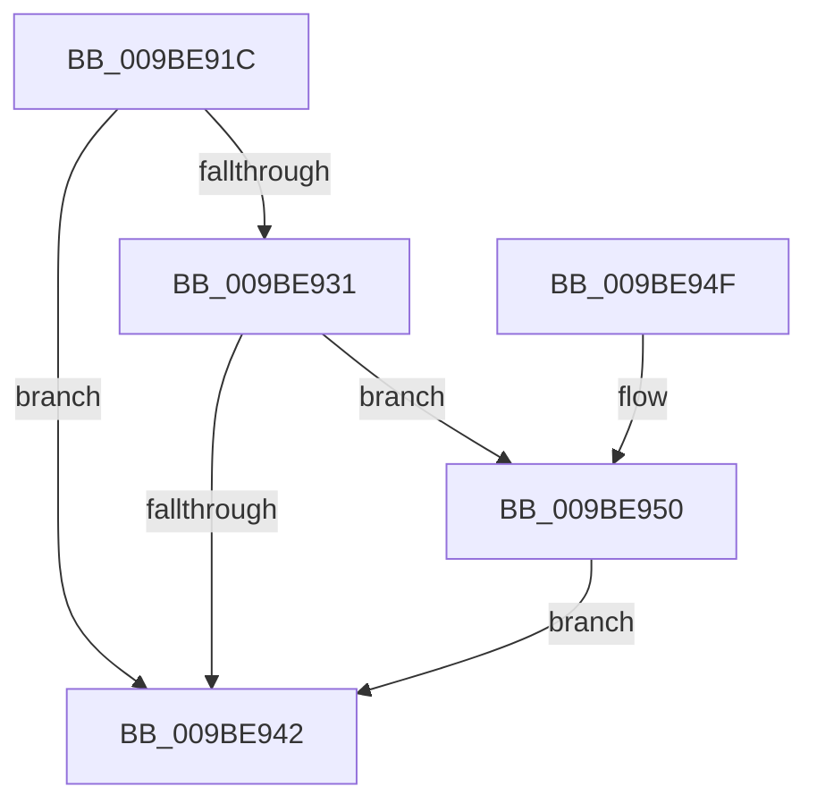

# EtwpAdjustFreeBuffers

- RVA: `0x009BE91C`–`0x009BE965` (길이 `73` bytes)
- VA: `0x00000001409BE91C`
- 실행 섹션: `PAGE`
- PDB 이름 있음: `예`; PDB Function 태그: `아니요`
- unwind 정보 RVA: `0x0009F34C`
- 디코드: `24`개 명령, `73/73` bytes 표시
- 미해석 바이트: `0` (있으면 어셈블리에 `.byte`로 보존)

> 이 문서는 커널 이미지의 기계어와 PDB 기호를 분석해 생성했습니다. 4번과 5번은 함수 원형과 자료형을 바이너리 사용 방식에서 추정한 C 해석이며 원본 소스 복구 결과는 아닙니다.

## 1. Dependencies

- 직접 호출 지점: **2**; 고유 호출 대상: **2**
- 직접 호출자로 확인된 함수: **2**
- RIP 상대 이미지 참조: **0**

### Outgoing calls
- `0x009BE937` → [EtwpQueryUsedProcessorCount](../../text/3E/EtwpQueryUsedProcessorCount_function_003EB940.md) (function, `0x003EB940`)
- `0x009BE954` → [EtwpAllocateFreeBuffers](../../text/3E/EtwpAllocateFreeBuffers_function_003EAEA4.md) (function, `0x003EAEA4`)

### Direct callers
- [EtwpFlushActiveBuffers](EtwpFlushActiveBuffers_function_009BDEF4.md) at `0x009BE05C`
- [EtwpLogger](EtwpLogger_function_009BE310.md) at `0x009BE472`

### Static image references
- 디코드된 RIP-relative 메모리 참조가 없습니다.

## 2. Other-region calls and transfers

- 다른 실행 섹션으로 향하는 call: **2**
  - `0x009BE937` → [EtwpQueryUsedProcessorCount](../../text/3E/EtwpQueryUsedProcessorCount_function_003EB940.md) (`PAGE` → `.text`)
  - `0x009BE954` → [EtwpAllocateFreeBuffers](../../text/3E/EtwpAllocateFreeBuffers_function_003EAEA4.md) (`PAGE` → `.text`)
- 별도 외부 분기/꼬리 이동을 확인하지 못했습니다.

## 3. Assembly (complete function range)

```asm
009BE91C  48 89 5C 24 08                  mov qword ptr [rsp + 8], rbx
009BE921  57                              push rdi
009BE922  48 83 EC 20                     sub rsp, 0x20
009BE926  33 DB                           xor ebx, ebx
009BE928  F7 41 0C 00 00 04 00            test dword ptr [rcx + 0xc], 0x40000
009BE92F  75 11                           jne 0x1409be942
009BE931  8B 91 E4 00 00 00               mov edx, dword ptr [rcx + 0xe4]
009BE937  E8 04 D0 A2 FF                  call 0x1403eb940
009BE93C  8B F8                           mov edi, eax
009BE93E  3B D0                           cmp edx, eax
009BE940  72 0E                           jb 0x1409be950
009BE942  8B C3                           mov eax, ebx
009BE944  48 8B 5C 24 30                  mov rbx, qword ptr [rsp + 0x30]
009BE949  48 83 C4 20                     add rsp, 0x20
009BE94D  5F                              pop rdi
009BE94E  C3                              ret
009BE94F  CC                              int3
009BE950  2B FA                           sub edi, edx
009BE952  8B D7                           mov edx, edi
009BE954  E8 4B C5 A2 FF                  call 0x1403eaea4
009BE959  3B F8                           cmp edi, eax
009BE95B  B9 17 00 00 C0                  mov ecx, 0xc0000017
009BE960  0F 45 D9                        cmovne ebx, ecx
009BE963  EB DD                           jmp 0x1409be942
```

## 4. C-style interpretation (structured pseudocode)

```c
__int64 __fastcall EtwpAdjustFreeBuffers(__int64 a1)
{
    __int64 result;
    __int64 v_rbx;
    __int64 v_rdi;
    __int64 v_rsp;
    unsigned __int64 v_stack_p8;

    v_stack_p8 = v_rbx;
    v_rsp = (v_rsp) - (32);
    v_rbx = 0;
    if (((*(unsigned int *)(a1 + 12)) & (0x40000ULL)) != 0) goto loc_009BE942;
    result = EtwpQueryUsedProcessorCount(a1, (unsigned int)(*(unsigned int *)(a1 + 228)), a3, a4);
    if (((unsigned int)((unsigned int)(*(unsigned int *)(a1 + 228)))) < ((unsigned int)(result))) goto loc_009BE950;
loc_009BE942:
    v_rsp = (v_rsp) + (32);
    return 0;
loc_009BE950:
    v_rdi = (unsigned int)(((unsigned int)((unsigned int)(result))) - ((unsigned int)((unsigned int)(*(unsigned int *)(a1 + 228)))));
    result = EtwpAllocateFreeBuffers(a1, (unsigned int)((unsigned int)(v_rdi)), a3, a4);
    v_rbx = v_stack_p8;
    if (((unsigned int)(v_rdi)) != ((unsigned int)(result))) { v_rbx = (unsigned int)((unsigned int)(0xC0000017ULL)); }
    goto loc_009BE942;
}
```

## 5. (Beta) C Style

```c
int64_t EtwpAdjustFreeBuffers(void *Arg1)
{
    uint8_t *arg1 = (uint8_t *)Arg1;

    int64_t result;
    int64_t local_rbx;
    int64_t local_rdi;
    int64_t local_rsp;
    uint64_t v_stack_p8;

    v_stack_p8 = local_rbx;
    local_rsp = (local_rsp) - (32);
    local_rbx = 0;
    if (((*(uint32_t *)(arg1 + 0xC)) & (0x40000ULL)) != 0) goto loc_009BE942;
    result = EtwpQueryUsedProcessorCount(Arg1, (uint32_t)(*(uint32_t *)(arg1 + 0xE4)), a3, a4);
    if (((uint32_t)((uint32_t)(*(uint32_t *)(arg1 + 0xE4)))) < ((uint32_t)(result))) goto loc_009BE950;
loc_009BE942:
    local_rsp = (local_rsp) + (32);
    return 0;
loc_009BE950:
    local_rdi = (uint32_t)(((uint32_t)((uint32_t)(result))) - ((uint32_t)((uint32_t)(*(uint32_t *)(arg1 + 0xE4)))));
    result = EtwpAllocateFreeBuffers(Arg1, (uint32_t)((uint32_t)(local_rdi)), a3, a4);
    local_rbx = v_stack_p8;
    if (((uint32_t)(local_rdi)) != ((uint32_t)(result))) { local_rbx = (uint32_t)((uint32_t)(0xC0000017ULL)); }
    goto loc_009BE942;
}
```

### 관측된 메모리 오프셋

구조체 형식이 확인되지 않은 접근은 인자 기준의 오프셋으로만 기록했습니다.

| 기준 인자 | 오프셋 표현 | 폭 (bit) | 접근 |
|---|---:|---:|---|
| `Arg1` | `+ 0xC` | `32` | `R` |
| `Arg1` | `+ 0xE4` | `32` | `R` |

## 6. Execution-region graph

[열기: 2D/3D 그래프와 함수 탐색 컨트롤 패널](../../../control-panel.html?section=page&rva=0x009BE91C&view=graph)

- 2D 그래프는 위에서 아래로 흐르고, 3D 그래프는 빈 공간을 드래그해 회전합니다. Shift+드래그는 이동, 휠은 확대·축소, 함수 노드 선택은 대상 보고서 이동입니다.

### Static fallback


