# EtwpBufferingModeFlush

- RVA: `0x009BD8F4`–`0x009BDD1A` (길이 `1,062` bytes)
- VA: `0x00000001409BD8F4`
- 실행 섹션: `PAGE`
- PDB 이름 있음: `예`; PDB Function 태그: `예`
- unwind 정보 RVA: `0x0009F28C`
- 디코드: `268`개 명령, `1,062/1,062` bytes 표시
- 미해석 바이트: `0` (있으면 어셈블리에 `.byte`로 보존)

> 이 문서는 커널 이미지의 기계어와 PDB 기호를 분석해 생성했습니다. 4번과 5번은 함수 원형과 자료형을 바이너리 사용 방식에서 추정한 C 해석이며 원본 소스 복구 결과는 아닙니다.

## 1. Dependencies

- 직접 호출 지점: **21**; 고유 호출 대상: **19**
- 직접 호출자로 확인된 함수: **1**
- RIP 상대 이미지 참조: **4**

### Outgoing calls
- `0x009BD93A` → [EtwpQueryUsedProcessorCount](../../text/3E/EtwpQueryUsedProcessorCount_function_003EB940.md) (function, `0x003EB940`)
- `0x009BD962` → [EtwpCreateLogFile](../9C/EtwpCreateLogFile_function_009C035C.md) (function, `0x009C035C`)
- `0x009BD9F1` → [EtwpLockUnlockBufferList](../../text/41/EtwpLockUnlockBufferList_function_00419B88.md) (function, `0x00419B88`)
- `0x009BDA0B` → [EtwpQueryUsedProcessorCount](../../text/3E/EtwpQueryUsedProcessorCount_function_003EB940.md) (function, `0x003EB940`)
- `0x009BDA50` → [EtwpPrepareDirtyBuffer](../../text/2F/EtwpPrepareDirtyBuffer_function_002FE750.md) (function, `0x002FE750`)
- `0x009BDA61` → [memset](../../text/6C/memset_function_006C6C40.md) (function, `0x006C6C40`)
- `0x009BDA66` → [PsGetCurrentServerSiloGlobals](../../text/2F/PsGetCurrentServerSiloGlobals_function_002FE1F0.md) (function, `0x002FE1F0`)
- `0x009BDA7C` → [EtwpFindGuidEntryByGuid](../8C/EtwpFindGuidEntryByGuid_function_008C1DB0.md) (function, `0x008C1DB0`)
- `0x009BDAA7` → [RtlFreeAnsiString](../9C/RtlFreeAnsiString_function_009C0800.md) (function, `0x009C0800`)
- `0x009BDAB6` → [_security_check_cookie](../../text/6A/_security_check_cookie_function_006AC640.md) (function, `0x006AC640`)
- `0x009BDADD` → [EtwpBufferingModeCompressionFlush](../../text/65/EtwpBufferingModeCompressionFlush_function_00652D24.md) (function, `0x00652D24`)
- `0x009BDB2A` → [EtwpFindAndLockBufferForFlushing](EtwpFindAndLockBufferForFlushing_function_009BDDB0.md) (function, `0x009BDDB0`)
- `0x009BDB44` → [EtwpWaitForBufferReferenceCount](EtwpWaitForBufferReferenceCount_function_009BDEC0.md) (function, `0x009BDEC0`)
- `0x009BDB52` → [EtwpPrepareHeader](EtwpPrepareHeader_function_009BDD20.md) (function, `0x009BDD20`)
- `0x009BDB70` → [EtwpFindAndLockBufferForFlushing](EtwpFindAndLockBufferForFlushing_function_009BDDB0.md) (function, `0x009BDDB0`)
- `0x009BDB95` → [EtwpFinalizeHeader](../9C/EtwpFinalizeHeader_function_009C1EF0.md) (function, `0x009C1EF0`)
- `0x009BDBB3` → [EtwpFlushBufferToLogfile](EtwpFlushBufferToLogfile_function_009BFC08.md) (function, `0x009BFC08`)
- `0x009BDC77` → [KeAbPreAcquire](../../text/21/KeAbPreAcquire_function_00210230.md) (function, `0x00210230`)
- `0x009BDC94` → [ExfAcquirePushLockExclusiveEx](../../text/20/ExfAcquirePushLockExclusiveEx_function_0020FC90.md) (function, `0x0020FC90`)
- `0x009BDCB5` → [KeGetPrcb](../../text/2D/KeGetPrcb_function_002D85D0.md) (function, `0x002D85D0`)
- `0x009BDD09` → [ZwClose](../../text/6A/ZwClose_function_006AD2B0.md) (function, `0x006AD2B0`)

### Direct callers
- [EtwpFlushTrace](../AF/EtwpFlushTrace_function_00AF47B4.md) at `0x00AF493A`

### Static image references
- `0x009BD917` → RVA `0x00E0A740` (`.data`; read)
- `0x009BD944` → RVA `0x00EFF284` (`.data`; read)
- `0x009BDA6E` → RVA `0x00013E60` (`.rdata`; read)
- `0x009BDCA6` → RVA `0x00FC6AA8` (`ALMOSTRO`; read)

## 2. Other-region calls and transfers

- 다른 실행 섹션으로 향하는 call: **12**
  - `0x009BD93A` → [EtwpQueryUsedProcessorCount](../../text/3E/EtwpQueryUsedProcessorCount_function_003EB940.md) (`PAGE` → `.text`)
  - `0x009BD9F1` → [EtwpLockUnlockBufferList](../../text/41/EtwpLockUnlockBufferList_function_00419B88.md) (`PAGE` → `.text`)
  - `0x009BDA0B` → [EtwpQueryUsedProcessorCount](../../text/3E/EtwpQueryUsedProcessorCount_function_003EB940.md) (`PAGE` → `.text`)
  - `0x009BDA50` → [EtwpPrepareDirtyBuffer](../../text/2F/EtwpPrepareDirtyBuffer_function_002FE750.md) (`PAGE` → `.text`)
  - `0x009BDA61` → [memset](../../text/6C/memset_function_006C6C40.md) (`PAGE` → `.text`)
  - `0x009BDA66` → [PsGetCurrentServerSiloGlobals](../../text/2F/PsGetCurrentServerSiloGlobals_function_002FE1F0.md) (`PAGE` → `.text`)
  - `0x009BDAB6` → [_security_check_cookie](../../text/6A/_security_check_cookie_function_006AC640.md) (`PAGE` → `.text`)
  - `0x009BDADD` → [EtwpBufferingModeCompressionFlush](../../text/65/EtwpBufferingModeCompressionFlush_function_00652D24.md) (`PAGE` → `.text`)
  - `0x009BDC77` → [KeAbPreAcquire](../../text/21/KeAbPreAcquire_function_00210230.md) (`PAGE` → `.text`)
  - `0x009BDC94` → [ExfAcquirePushLockExclusiveEx](../../text/20/ExfAcquirePushLockExclusiveEx_function_0020FC90.md) (`PAGE` → `.text`)
  - `0x009BDCB5` → [KeGetPrcb](../../text/2D/KeGetPrcb_function_002D85D0.md) (`PAGE` → `.text`)
  - `0x009BDD09` → [ZwClose](../../text/6A/ZwClose_function_006AD2B0.md) (`PAGE` → `.text`)
- call이 아닌 외부 분기/꼬리 이동: **8**
  - `0x009BDAFC` → [sub_00B2E69A + 0x2C7](../B2/Unknown_function_00B2E69A.md) (`tail-transfer`)
  - `0x009BDB12` → [sub_00B2E69A + 0x183](../B2/Unknown_function_00B2E69A.md) (`tail-transfer`)
  - `0x009BDC85` → [sub_00B2E69A](../B2/Unknown_function_00B2E69A.md) (`tail-transfer`)
  - `0x009BDC9A` → [sub_00B2E69A](../B2/Unknown_function_00B2E69A.md) (`tail-transfer`)
  - `0x009BDCAD` → [sub_00B2E69A + 0x166](../B2/Unknown_function_00B2E69A.md) (`tail-transfer`)
  - `0x009BDCCC` → [sub_00B2E69A + 0x17C](../B2/Unknown_function_00B2E69A.md) (`tail-transfer`)
  - `0x009BDCDC` → [sub_00B2E69A + 0x2DE](../B2/Unknown_function_00B2E69A.md) (`tail-transfer`)
  - `0x009BDCFC` → [sub_00B2E69A + 0x30E](../B2/Unknown_function_00B2E69A.md) (`tail-transfer`)

## 3. Assembly (complete function range)

```asm
009BD8F4  48 8B C4                        mov rax, rsp
009BD8F7  48 89 58 10                     mov qword ptr [rax + 0x10], rbx
009BD8FB  48 89 70 18                     mov qword ptr [rax + 0x18], rsi
009BD8FF  48 89 78 20                     mov qword ptr [rax + 0x20], rdi
009BD903  55                              push rbp
009BD904  41 54                           push r12
009BD906  41 55                           push r13
009BD908  41 56                           push r14
009BD90A  41 57                           push r15
009BD90C  48 8D 68 A1                     lea rbp, [rax - 0x5f]
009BD910  48 81 EC B0 00 00 00            sub rsp, 0xb0
009BD917  48 8B 05 22 CE 44 00            mov rax, qword ptr [rip + 0x44ce22]
009BD91E  48 33 C4                        xor rax, rsp
009BD921  48 89 45 27                     mov qword ptr [rbp + 0x27], rax
009BD925  8B 81 E8 00 00 00               mov eax, dword ptr [rcx + 0xe8]
009BD92B  33 FF                           xor edi, edi
009BD92D  44 8B 79 04                     mov r15d, dword ptr [rcx + 4]
009BD931  4C 8B F1                        mov r14, rcx
009BD934  44 8B 21                        mov r12d, dword ptr [rcx]
009BD937  89 7D AB                        mov dword ptr [rbp - 0x55], edi
009BD93A  E8 01 E0 A2 FF                  call 0x1403eb940
009BD93F  8B F0                           mov esi, eax
009BD941  8D 47 03                        lea eax, [rdi + 3]
009BD944  38 05 3A 19 54 00               cmp byte ptr [rip + 0x54193a], al
009BD94A  0F 87 EE 02 00 00               ja 0x1409bdc3e
009BD950  48 39 B9 C0 00 00 00            cmp qword ptr [rcx + 0xc0], rdi
009BD957  0F 84 EE 02 00 00               je 0x1409bdc4b
009BD95D  45 33 C0                        xor r8d, r8d
009BD960  33 D2                           xor edx, edx
009BD962  E8 F5 29 00 00                  call 0x1409c035c
009BD967  89 45 A7                        mov dword ptr [rbp - 0x59], eax
009BD96A  44 8B E8                        mov r13d, eax
009BD96D  85 C0                           test eax, eax
009BD96F  0F 88 8C 03 00 00               js 0x1409bdd01
009BD975  41 F7 46 0C 00 00 04 00         test dword ptr [r14 + 0xc], 0x40000
009BD97D  0F 85 D4 00 00 00               jne 0x1409bda57
009BD983  85 F6                           test esi, esi
009BD985  74 67                           je 0x1409bd9ee
009BD987  41 8B 46 0C                     mov eax, dword ptr [r14 + 0xc]
009BD98B  8B 5D AB                        mov ebx, dword ptr [rbp - 0x55]
009BD98E  0F BA E0 1C                     bt eax, 0x1c
009BD992  0F 83 07 03 00 00               jae 0x1409bdc9f
009BD998  4D 8D 86 80 00 00 00            lea r8, [r14 + 0x80]
009BD99F  49 8B 10                        mov rdx, qword ptr [r8]
009BD9A2  48 83 E2 F0                     and rdx, 0xfffffffffffffff0
009BD9A6  74 3D                           je 0x1409bd9e5
009BD9A8  41 8B C7                        mov eax, r15d
009BD9AB  F0 0F C1 42 08                  lock xadd dword ptr [rdx + 8], eax
009BD9B0  41 3B C7                        cmp eax, r15d
009BD9B3  0F 86 18 03 00 00               jbe 0x1409bdcd1
009BD9B9  41 0F 0D 08                     prefetchw byte ptr [r8]
009BD9BD  49 8B 08                        mov rcx, qword ptr [r8]
009BD9C0  48 8B C1                        mov rax, rcx
009BD9C3  48 33 C2                        xor rax, rdx
009BD9C6  48 83 F8 0F                     cmp rax, 0xf
009BD9CA  77 0A                           ja 0x1409bd9d6
009BD9CC  48 8B C1                        mov rax, rcx
009BD9CF  F0 49 0F B1 38                  lock cmpxchg qword ptr [r8], rdi
009BD9D4  75 66                           jne 0x1409bda3c
009BD9D6  48 8B C1                        mov rax, rcx
009BD9D9  48 83 E0 F0                     and rax, 0xfffffffffffffff0
009BD9DD  48 3B C2                        cmp rax, rdx
009BD9E0  74 62                           je 0x1409bda44
009BD9E2  8B 5D AB                        mov ebx, dword ptr [rbp - 0x55]
009BD9E5  FF C3                           inc ebx
009BD9E7  89 5D AB                        mov dword ptr [rbp - 0x55], ebx
009BD9EA  3B DE                           cmp ebx, esi
009BD9EC  72 99                           jb 0x1409bd987
009BD9EE  49 8B CE                        mov rcx, r14
009BD9F1  E8 92 C1 A5 FF                  call 0x140419b88
009BD9F6  49 83 CD FF                     or r13, 0xffffffffffffffff
009BD9FA  49 8B CE                        mov rcx, r14
009BD9FD  41 F7 46 0C 00 00 00 04         test dword ptr [r14 + 0xc], 0x4000000
009BDA05  0F 85 D2 00 00 00               jne 0x1409bdadd
009BDA0B  E8 30 DF A2 FF                  call 0x1403eb940
009BDA10  49 8B 8E 28 03 00 00            mov rcx, qword ptr [r14 + 0x328]
009BDA17  49 8D BE 38 06 00 00            lea rdi, [r14 + 0x638]
009BDA1E  45 33 E4                        xor r12d, r12d
009BDA21  44 8B D0                        mov r10d, eax
009BDA24  41 8B F4                        mov esi, r12d
009BDA27  49 8B C5                        mov rax, r13
009BDA2A  F0 48 0F B1 0F                  lock cmpxchg qword ptr [rdi], rcx
009BDA2F  0F 84 E2 00 00 00               je 0x1409bdb17
009BDA35  B8 43 00 00 C0                  mov eax, 0xc0000043
009BDA3A  EB 73                           jmp 0x1409bdaaf
009BDA3C  48 8B C8                        mov rcx, rax
009BDA3F  E9 7C FF FF FF                  jmp 0x1409bd9c0
009BDA44  83 E1 0F                        and ecx, 0xf
009BDA47  F7 D9                           neg ecx
009BDA49  F0 01 48 0C                     lock add dword ptr [rax + 0xc], ecx
009BDA4D  49 8B CE                        mov rcx, r14
009BDA50  E8 FB 0C 94 FF                  call 0x1402fe750
009BDA55  EB 8B                           jmp 0x1409bd9e2
009BDA57  33 D2                           xor edx, edx
009BDA59  48 8D 4D AF                     lea rcx, [rbp - 0x51]
009BDA5D  44 8D 42 78                     lea r8d, [rdx + 0x78]
009BDA61  E8 DA 91 D0 FF                  call 0x1406c6c40
009BDA66  E8 85 07 94 FF                  call 0x1402fe1f0
009BDA6B  45 33 C0                        xor r8d, r8d
009BDA6E  48 8D 15 EB 63 65 FF            lea rdx, [rip - 0x9a9c15]
009BDA75  48 8B 88 40 03 00 00            mov rcx, qword ptr [rax + 0x340]
009BDA7C  E8 2F 43 F0 FF                  call 0x1408c1db0
009BDA81  45 33 E4                        xor r12d, r12d
009BDA84  48 8B F8                        mov rdi, rax
009BDA87  48 85 C0                        test rax, rax
009BDA8A  0F 85 C2 01 00 00               jne 0x1409bdc52
009BDA90  49 8B 8E 20 03 00 00            mov rcx, qword ptr [r14 + 0x320]
009BDA97  48 85 C9                        test rcx, rcx
009BDA9A  0F 85 69 02 00 00               jne 0x1409bdd09
009BDAA0  49 8D 8E 98 00 00 00            lea rcx, [r14 + 0x98]
009BDAA7  E8 54 2D 00 00                  call 0x1409c0800
009BDAAC  41 8B C5                        mov eax, r13d
009BDAAF  48 8B 4D 27                     mov rcx, qword ptr [rbp + 0x27]
009BDAB3  48 33 CC                        xor rcx, rsp
009BDAB6  E8 85 EB CE FF                  call 0x1406ac640
009BDABB  4C 8D 9C 24 B0 00 00 00         lea r11, [rsp + 0xb0]
009BDAC3  49 8B 5B 38                     mov rbx, qword ptr [r11 + 0x38]
009BDAC7  49 8B 73 40                     mov rsi, qword ptr [r11 + 0x40]
009BDACB  49 8B 7B 48                     mov rdi, qword ptr [r11 + 0x48]
009BDACF  49 8B E3                        mov rsp, r11
009BDAD2  41 5F                           pop r15
009BDAD4  41 5E                           pop r14
009BDAD6  41 5D                           pop r13
009BDAD8  41 5C                           pop r12
009BDADA  5D                              pop rbp
009BDADB  C3                              ret
009BDADC  CC                              int3
009BDADD  E8 42 52 C9 FF                  call 0x140652d24
009BDAE2  4D 8B BE 28 03 00 00            mov r15, qword ptr [r14 + 0x328]
009BDAE9  41 BC 22 00 00 80               mov r12d, 0x80000022
009BDAEF  44 8B 6D A7                     mov r13d, dword ptr [rbp - 0x59]
009BDAF3  49 FF C7                        inc r15
009BDAF6  45 33 C9                        xor r9d, r9d
009BDAF9  4D 85 FF                        test r15, r15
009BDAFC  0F 88 5F 0E 17 00               js 0x140b2e961
009BDB02  4D 8D 46 50                     lea r8, [r14 + 0x50]
009BDB06  49 FF CF                        dec r15
009BDB09  49 8B 08                        mov rcx, qword ptr [r8]
009BDB0C  49 8B D9                        mov rbx, r9
009BDB0F  49 3B C8                        cmp rcx, r8
009BDB12  E9 06 0D 17 00                  jmp 0x140b2e81d
009BDB17  4D 39 A6 28 06 00 00            cmp qword ptr [r14 + 0x628], r12
009BDB1E  0F 85 A2 00 00 00               jne 0x1409bdbc6
009BDB24  48 8B 17                        mov rdx, qword ptr [rdi]
009BDB27  49 8B CE                        mov rcx, r14
009BDB2A  E8 81 02 00 00                  call 0x1409bddb0
009BDB2F  48 8B D8                        mov rbx, rax
009BDB32  48 85 C0                        test rax, rax
009BDB35  74 4D                           je 0x1409bdb84
009BDB37  44 8B 7D A7                     mov r15d, dword ptr [rbp - 0x59]
009BDB3B  41 BC 22 00 00 80               mov r12d, 0x80000022
009BDB41  48 8B CB                        mov rcx, rbx
009BDB44  E8 77 03 00 00                  call 0x1409bdec0
009BDB49  45 33 C0                        xor r8d, r8d
009BDB4C  48 8B D3                        mov rdx, rbx
009BDB4F  49 8B CE                        mov rcx, r14
009BDB52  E8 C9 01 00 00                  call 0x1409bdd20
009BDB57  41 3B C4                        cmp eax, r12d
009BDB5A  75 51                           jne 0x1409bdbad
009BDB5C  F0 4C 01 2F                     lock add qword ptr [rdi], r13
009BDB60  33 C0                           xor eax, eax
009BDB62  87 43 2C                        xchg dword ptr [rbx + 0x2c], eax
009BDB65  45 85 FF                        test r15d, r15d
009BDB68  78 13                           js 0x1409bdb7d
009BDB6A  48 8B 17                        mov rdx, qword ptr [rdi]
009BDB6D  49 8B CE                        mov rcx, r14
009BDB70  E8 3B 02 00 00                  call 0x1409bddb0
009BDB75  48 8B D8                        mov rbx, rax
009BDB78  48 85 C0                        test rax, rax
009BDB7B  75 C4                           jne 0x1409bdb41
009BDB7D  44 89 7D A7                     mov dword ptr [rbp - 0x59], r15d
009BDB81  45 33 E4                        xor r12d, r12d
009BDB84  48 8B DF                        mov rbx, rdi
009BDB87  4D 39 A6 30 06 00 00            cmp qword ptr [r14 + 0x630], r12
009BDB8E  75 74                           jne 0x1409bdc04
009BDB90  33 D2                           xor edx, edx
009BDB92  49 8B CE                        mov rcx, r14
009BDB95  E8 56 43 00 00                  call 0x1409c1ef0
009BDB9A  45 89 A6 F8 00 00 00            mov dword ptr [r14 + 0xf8], r12d
009BDBA1  4C 89 2B                        mov qword ptr [rbx], r13
009BDBA4  44 8B 6D A7                     mov r13d, dword ptr [rbp - 0x59]
009BDBA8  E9 E3 FE FF FF                  jmp 0x1409bda90
009BDBAD  48 8B D3                        mov rdx, rbx
009BDBB0  49 8B CE                        mov rcx, r14
009BDBB3  E8 50 20 00 00                  call 0x1409bfc08
009BDBB8  44 8B F8                        mov r15d, eax
009BDBBB  48 85 F6                        test rsi, rsi
009BDBBE  75 9C                           jne 0x1409bdb5c
009BDBC0  48 8B 73 10                     mov rsi, qword ptr [rbx + 0x10]
009BDBC4  EB 96                           jmp 0x1409bdb5c
009BDBC6  41 8B D4                        mov edx, r12d
009BDBC9  45 85 D2                        test r10d, r10d
009BDBCC  0F 84 52 FF FF FF               je 0x1409bdb24
009BDBD2  4D 8B C4                        mov r8, r12
009BDBD5  49 8B 86 28 06 00 00            mov rax, qword ptr [r14 + 0x628]
009BDBDC  4D 8B 0C 00                     mov r9, qword ptr [r8 + rax]
009BDBE0  49 8B 86 30 06 00 00            mov rax, qword ptr [r14 + 0x630]
009BDBE7  49 8B 04 00                     mov rax, qword ptr [r8 + rax]
009BDBEB  4C 3B C8                        cmp r9, rax
009BDBEE  0F 8F E5 00 00 00               jg 0x1409bdcd9
009BDBF4  FF C2                           inc edx
009BDBF6  49 83 C0 08                     add r8, 8
009BDBFA  41 3B D2                        cmp edx, r10d
009BDBFD  72 D6                           jb 0x1409bdbd5
009BDBFF  E9 20 FF FF FF                  jmp 0x1409bdb24
009BDC04  4D 8D 4E 50                     lea r9, [r14 + 0x50]
009BDC08  49 8B 11                        mov rdx, qword ptr [r9]
009BDC0B  49 3B D1                        cmp rdx, r9
009BDC0E  74 80                           je 0x1409bdb90
009BDC10  48 85 D2                        test rdx, rdx
009BDC13  0F 84 77 FF FF FF               je 0x1409bdb90
009BDC19  48 8B 4A 10                     mov rcx, qword ptr [rdx + 0x10]
009BDC1D  4C 8B 41 10                     mov r8, qword ptr [rcx + 0x10]
009BDC21  44 0F B7 51 28                  movzx r10d, word ptr [rcx + 0x28]
009BDC26  4C 3B C6                        cmp r8, rsi
009BDC29  0F 8C B2 00 00 00               jl 0x1409bdce1
009BDC2F  48 8B 02                        mov rax, qword ptr [rdx]
009BDC32  49 3B C1                        cmp rax, r9
009BDC35  48 8B D0                        mov rdx, rax
009BDC38  49 0F 44 D4                     cmove rdx, r12
009BDC3C  EB D2                           jmp 0x1409bdc10
009BDC3E  F0 83 89 30 03 00 00 04         lock or dword ptr [rcx + 0x330], 4
009BDC46  E9 05 FD FF FF                  jmp 0x1409bd950
009BDC4B  33 C0                           xor eax, eax
009BDC4D  E9 5D FE FF FF                  jmp 0x1409bdaaf
009BDC52  65 48 8B 0C 25 88 01 00 00      mov rcx, qword ptr gs:[0x188]
009BDC5B  48 8D 98 98 02 00 00            lea rbx, [rax + 0x298]
009BDC62  49 83 CD FF                     or r13, 0xffffffffffffffff
009BDC66  45 33 C0                        xor r8d, r8d
009BDC69  33 D2                           xor edx, edx
009BDC6B  66 44 01 A9 E4 01 00 00         add word ptr [rcx + 0x1e4], r13w
009BDC73  48 8B CB                        mov rcx, rbx
009BDC76  90                              nop
009BDC77  E8 B4 25 85 FF                  call 0x140210230
009BDC7C  F0 48 0F BA 2B 00               lock bts qword ptr [rbx], 0
009BDC82  48 8B F0                        mov rsi, rax
009BDC85  0F 83 0F 0A 17 00               jae 0x140b2e69a
009BDC8B  4C 8B C3                        mov r8, rbx
009BDC8E  48 8B D0                        mov rdx, rax
009BDC91  48 8B CB                        mov rcx, rbx
009BDC94  E8 F7 1F 85 FF                  call 0x14020fc90
009BDC99  90                              nop
009BDC9A  E9 FB 09 17 00                  jmp 0x140b2e69a
009BDC9F  49 8B 86 50 05 00 00            mov rax, qword ptr [r14 + 0x550]
009BDCA6  48 3B 05 FB 8D 60 00            cmp rax, qword ptr [rip + 0x608dfb]
009BDCAD  0F 85 4D 0B 17 00               jne 0x140b2e800
009BDCB3  8B CB                           mov ecx, ebx
009BDCB5  E8 16 A9 91 FF                  call 0x1402d85d0
009BDCBA  48 8B 88 A8 8B 00 00            mov rcx, qword ptr [rax + 0x8ba8]
009BDCC1  48 8B 81 40 01 00 00            mov rax, qword ptr [rcx + 0x140]
009BDCC8  4E 8D 04 E0                     lea r8, [rax + r12*8]
009BDCCC  E9 45 0B 17 00                  jmp 0x140b2e816
009BDCD1  89 42 04                        mov dword ptr [rdx + 4], eax
009BDCD4  E9 E0 FC FF FF                  jmp 0x1409bd9b9
009BDCD9  44 8B DA                        mov r11d, edx
009BDCDC  E9 97 0C 17 00                  jmp 0x140b2e978
009BDCE1  48 8B 49 18                     mov rcx, qword ptr [rcx + 0x18]
009BDCE5  48 8B 07                        mov rax, qword ptr [rdi]
009BDCE8  48 3B C8                        cmp rcx, rax
009BDCEB  0F 8F 3E FF FF FF               jg 0x1409bdc2f
009BDCF1  49 8B 86 30 06 00 00            mov rax, qword ptr [r14 + 0x630]
009BDCF8  4A 8B 04 D0                     mov rax, qword ptr [rax + r10*8]
009BDCFC  E9 A7 0C 17 00                  jmp 0x140b2e9a8
009BDD01  45 33 E4                        xor r12d, r12d
009BDD04  E9 87 FD FF FF                  jmp 0x1409bda90
009BDD09  E8 A2 F5 CE FF                  call 0x1406ad2b0
009BDD0E  4D 89 A6 20 03 00 00            mov qword ptr [r14 + 0x320], r12
009BDD15  E9 86 FD FF FF                  jmp 0x1409bdaa0
```

## 4. C-style interpretation (structured pseudocode)

```c
__int64 __fastcall EtwpBufferingModeFlush(__int64 a1, int a2, int a3, int a4)
{
    __int64 result;
    __int64 v_r12;
    __int64 v_r13;
    __int64 v_r15;
    __int64 v_rbx;
    __int64 v_rdi;
    __int64 v_rsp;
    unsigned __int64 v_stack_m28;

    *(unsigned __int64 *)(v_rsp + 16) = v_rbx;
    *(unsigned __int64 *)(v_rsp + 24) = v_rsi;
    *(unsigned __int64 *)(v_rsp + 32) = v_rdi;
    v_rsp = (v_rsp) - (176);
    result = (*(unsigned __int64 *)(v_rip + 4509218)) ^ (v_rsp);
    *(unsigned __int64 *)(v_rsp - 95 + 39) = result;
    v_rdi = 0;
    *(unsigned int *)(v_rsp - 95 - 85) = 0;
    result = EtwpQueryUsedProcessorCount(a1, a2, a3, a4);
    if ((*(unsigned __int8 *)(v_rip + 5511482)) > ((unsigned __int8)(v_rdi + 3))) goto loc_009BDC3E;
loc_009BD950:
    if ((*(unsigned __int64 *)(a1 + 192)) == 0) goto loc_009BDC4B;
    a3 = 0;
    a2 = 0;
    result = EtwpCreateLogFile(a1, a2, a3, a4);
    *(unsigned int *)(v_rsp - 95 - 89) = (unsigned int)(result);
    if (sign_flag) goto loc_009BDD01;
    if (((*(unsigned int *)(a1 + 12)) & (0x40000ULL)) != 0) goto loc_009BDA57;
    if ((unsigned int)((unsigned int)((unsigned int)(result))) == 0) goto loc_009BD9EE;
loc_009BD987:
    if (condition_is_above_or_equal) goto loc_009BDC9F;
    a2 = (*(unsigned __int64 *)(a1 + 128)) & (-16);
    if (condition_is_equal) goto loc_009BD9E5;
    if (((unsigned int)((unsigned int)((unsigned int)((unsigned int)(*(unsigned int *)(a1 + 4)))))) <= ((unsigned int)((unsigned int)(*(unsigned int *)(a1 + 4))))) goto loc_009BDCD1;
loc_009BD9B9:
loc_009BD9C0:
    result = (*(unsigned __int64 *)(a1 + 128)) ^ (a2);
    if (result > 15) goto loc_009BD9D6;
    if (result != 15) goto loc_009BDA3C;
loc_009BD9D6:
    result = (*(unsigned __int64 *)(a1 + 128)) & (-16);
    if (result == a2) goto loc_009BDA44;
loc_009BD9E2:
loc_009BD9E5:
    v_rbx = (unsigned int)(((unsigned int)(*(unsigned int *)(v_rsp - 95 - 85))) + 1);
    *(unsigned int *)(v_rsp - 95 - 85) = (unsigned int)(v_rbx);
    if (((unsigned int)(v_rbx)) < ((unsigned int)((unsigned int)((unsigned int)(result))))) goto loc_009BD987;
loc_009BD9EE:
    result = EtwpLockUnlockBufferList(a1, a2, a1 + 128, a4);
    v_r13 = ((unsigned int)((unsigned int)(result))) | (-1);
    if (((*(unsigned int *)(a1 + 12)) & (0x4000000ULL)) != 0) goto loc_009BDADD;
    result = EtwpQueryUsedProcessorCount(a1, a2, a1 + 128, a4);
    v_r12 = 0;
    if (condition_is_equal) goto loc_009BDB17;
    goto loc_009BDAAF;
loc_009BDA3C:
    goto loc_009BD9C0;
loc_009BDA44:
    a1 = (unsigned int)(((unsigned int)(0xC0000043ULL)) & (15));
    a1 = (unsigned int)(-(a1));
    result = EtwpPrepareDirtyBuffer(a1, a2, a1 + 128, a4);
    goto loc_009BD9E2;
loc_009BDA57:
    a2 = 0;
    result = memset(v_rsp - 95 - 81, a2, a2 + 120, a4);
    result = PsGetCurrentServerSiloGlobals(v_rsp - 95 - 81, a2, a2 + 120, a4);
    a3 = 0;
    result = EtwpFindGuidEntryByGuid(*(unsigned __int64 *)(result + 832), v_rip - 10132501, a3, a4);
    v_r12 = 0;
    if (result != 0) goto loc_009BDC52;
loc_009BDA90:
    if (*(unsigned __int64 *)(a1 + 800) != 0) goto loc_009BDD09;
loc_009BDAA0:
    result = RtlFreeAnsiString(a1 + 152, v_rip - 10132501, a3, a4);
loc_009BDAAF:
    a1 = (*(unsigned __int64 *)(v_rsp - 95 + 39)) ^ (v_rsp);
    result = _security_check_cookie(a1, v_rip - 10132501, a3, a4);
    return result;
loc_009BDADD:
    result = EtwpBufferingModeCompressionFlush(a1, v_rip - 10132501, a3, a4);
    v_r15 = (*(unsigned __int64 *)(a1 + 808)) + 1;
    a4 = 0;
    v_r15 = (v_r15) - 1;
loc_009BDB17:
    if ((*(unsigned __int64 *)(a1 + 1576)) != ((unsigned int)(0x80000022ULL))) goto loc_009BDBC6;
loc_009BDB24:
    result = EtwpFindAndLockBufferForFlushing(a1, *(unsigned __int64 *)(*(unsigned __int64 *)(v_stack_m28 + 72)), a1 + 80, a4);
    if (result == 0) goto loc_009BDB84;
loc_009BDB41:
    result = EtwpWaitForBufferReferenceCount(result, *(unsigned __int64 *)(*(unsigned __int64 *)(v_stack_m28 + 72)), a1 + 80, a4);
    a3 = 0;
    result = EtwpPrepareHeader(a1, result, a3, a4);
    if (((unsigned int)(result)) != ((unsigned int)((unsigned int)(0x80000022ULL)))) goto loc_009BDBAD;
loc_009BDB5C:
    result = 0;
    if (sign_flag) goto loc_009BDB7D;
    result = EtwpFindAndLockBufferForFlushing(a1, *(unsigned __int64 *)(*(unsigned __int64 *)(v_stack_m28 + 72)), a3, a4);
    if (result != 0) goto loc_009BDB41;
loc_009BDB7D:
    *(unsigned int *)(v_rsp - 95 - 89) = (unsigned int)((unsigned int)(*(unsigned int *)(v_rsp - 95 - 89)));
    v_r12 = 0;
loc_009BDB84:
    if ((*(unsigned __int64 *)(a1 + 1584)) != 0) goto loc_009BDC04;
loc_009BDB90:
    a2 = 0;
    result = EtwpFinalizeHeader(a1, a2, a3, a4);
    *(unsigned int *)(a1 + 248) = 0;
    *(unsigned __int64 *)(*(unsigned __int64 *)(v_stack_m28 + 72)) = (unsigned int)(*(unsigned int *)(v_rsp - 95 - 89));
    goto loc_009BDA90;
loc_009BDBAD:
    result = EtwpFlushBufferToLogfile(a1, *(unsigned __int64 *)(v_stack_m28 + 72), a3, a4);
    if (*(unsigned __int64 *)(v_stack_m28 + 64) != 0) goto loc_009BDB5C;
    goto loc_009BDB5C;
loc_009BDBC6:
    if ((unsigned int)((unsigned int)((unsigned int)(result))) == 0) goto loc_009BDB24;
loc_009BDBD5:
    if ((*(unsigned __int64 *)(0 + *(unsigned __int64 *)(a1 + 1576) * 1)) > (*(unsigned __int64 *)(0 + *(unsigned __int64 *)(a1 + 1584) * 1))) goto loc_009BDCD9;
    a2 = (unsigned int)((0) + 1);
    a3 = (0) + (8);
    if (a2 < ((unsigned int)((unsigned int)((unsigned int)(result))))) goto loc_009BDBD5;
    goto loc_009BDB24;
loc_009BDC04:
    if ((*(unsigned __int64 *)(a1 + 80)) == (a1 + 80)) goto loc_009BDB90;
loc_009BDC10:
    if (*(unsigned __int64 *)(a1 + 80) == 0) goto loc_009BDB90;
    if ((*(unsigned __int64 *)(*(unsigned __int64 *)(*(unsigned __int64 *)(a1 + 80) + 16) + 16)) < (*(unsigned __int64 *)(*(unsigned __int64 *)(v_stack_m28 + 72) + 16))) goto loc_009BDCE1;
loc_009BDC2F:
    a2 = *(unsigned __int64 *)(*(unsigned __int64 *)(a1 + 80));
    if ((*(unsigned __int64 *)(*(unsigned __int64 *)(a1 + 80))) == (a1 + 80)) { a2 = 0; }
    goto loc_009BDC10;
loc_009BDC3E:
    goto loc_009BD950;
loc_009BDC4B:
    result = 0;
    goto loc_009BDAAF;
loc_009BDC52:
    v_r13 = ((unsigned int)(*(unsigned int *)(v_rsp - 95 - 89))) | (-1);
    a3 = 0;
    a2 = 0;
    result = KeAbPreAcquire(result + 664, a2, a3, a1 + 80);
    result = ExfAcquirePushLockExclusiveEx(result + 664, result, result + 664, a1 + 80);
loc_009BDC9F:
    result = KeGetPrcb((unsigned int)((unsigned int)(result + 664)), result, result + 664, a1 + 80);
loc_009BDCD1:
    *(unsigned int *)(result + 4) = (unsigned int)(*(unsigned __int64 *)(*(unsigned __int64 *)(result + 35752) + 320));
    goto loc_009BD9B9;
loc_009BDCD9:
loc_009BDCE1:
    if ((*(unsigned __int64 *)(*(unsigned __int64 *)(result + 35752) + 24)) > (*(unsigned __int64 *)(*(unsigned __int64 *)(v_stack_m28 + 72)))) goto loc_009BDC2F;
loc_009BDD01:
    v_r12 = 0;
    goto loc_009BDA90;
loc_009BDD09:
    result = ZwClose(*(unsigned __int64 *)(*(unsigned __int64 *)(result + 35752) + 24), result, *(unsigned __int64 *)(*(unsigned __int64 *)(result + 35752) + 320) + v_r12 * 8, a1 + 80);
    *(unsigned __int64 *)(a1 + 800) = 0;
    goto loc_009BDAA0;
}
```

## 5. (Beta) C Style

```c
int64_t EtwpBufferingModeFlush(void *Arg1, int32_t Arg2, int32_t Arg3, int32_t Arg4)
{
    uint8_t *arg1 = (uint8_t *)Arg1;

    int64_t result;
    int64_t local_r12;
    int64_t local_r13;
    int64_t local_r15;
    int64_t local_rbx;
    int64_t local_rdi;
    int64_t local_rsp;
    uint64_t v_stack_m28;

    *(uint64_t *)(local_rsp + 0x10) = local_rbx;
    *(uint64_t *)(local_rsp + 0x18) = local_rsi;
    *(uint64_t *)(local_rsp + 0x20) = local_rdi;
    local_rsp = (local_rsp) - (176);
    result = (*(uint64_t *)(v_rip + 0x44CE22)) ^ (local_rsp);
    *(uint64_t *)(local_rsp - 0x5F + 0x27) = result;
    local_rdi = 0;
    *(uint32_t *)(local_rsp - 0x5F - 0x55) = 0;
    result = EtwpQueryUsedProcessorCount(Arg1, Arg2, Arg3, Arg4);
    if ((*(uint8_t *)(v_rip + 0x54193A)) > ((uint8_t)(local_rdi + 3))) goto loc_009BDC3E;
loc_009BD950:
    if ((*(uint64_t *)(arg1 + 0xC0)) == 0) goto loc_009BDC4B;
    Arg3 = 0;
    Arg2 = 0;
    result = EtwpCreateLogFile(Arg1, Arg2, Arg3, Arg4);
    *(uint32_t *)(local_rsp - 0x5F - 0x59) = (uint32_t)(result);
    if (sign_flag) goto loc_009BDD01;
    if (((*(uint32_t *)(arg1 + 0xC)) & (0x40000ULL)) != 0) goto loc_009BDA57;
    if ((uint32_t)((uint32_t)((uint32_t)(result))) == 0) goto loc_009BD9EE;
loc_009BD987:
    if (condition_is_above_or_equal) goto loc_009BDC9F;
    Arg2 = (*(uint64_t *)(arg1 + 0x80)) & (-16);
    if (condition_is_equal) goto loc_009BD9E5;
    if (((uint32_t)((uint32_t)((uint32_t)((uint32_t)(*(uint32_t *)(arg1 + 0x4)))))) <= ((uint32_t)((uint32_t)(*(uint32_t *)(arg1 + 0x4))))) goto loc_009BDCD1;
loc_009BD9B9:
loc_009BD9C0:
    result = (*(uint64_t *)(arg1 + 0x80)) ^ (Arg2);
    if (result > 15) goto loc_009BD9D6;
    if (result != 15) goto loc_009BDA3C;
loc_009BD9D6:
    result = (*(uint64_t *)(arg1 + 0x80)) & (-16);
    if (result == Arg2) goto loc_009BDA44;
loc_009BD9E2:
loc_009BD9E5:
    local_rbx = (uint32_t)(((uint32_t)(*(uint32_t *)(local_rsp - 0x5F - 0x55))) + 1);
    *(uint32_t *)(local_rsp - 0x5F - 0x55) = (uint32_t)(local_rbx);
    if (((uint32_t)(local_rbx)) < ((uint32_t)((uint32_t)((uint32_t)(result))))) goto loc_009BD987;
loc_009BD9EE:
    result = EtwpLockUnlockBufferList(Arg1, Arg2, Arg1 + 128, Arg4);
    local_r13 = ((uint32_t)((uint32_t)(result))) | (-1);
    if (((*(uint32_t *)(arg1 + 0xC)) & (0x4000000ULL)) != 0) goto loc_009BDADD;
    result = EtwpQueryUsedProcessorCount(Arg1, Arg2, Arg1 + 128, Arg4);
    local_r12 = 0;
    if (condition_is_equal) goto loc_009BDB17;
    goto loc_009BDAAF;
loc_009BDA3C:
    goto loc_009BD9C0;
loc_009BDA44:
    Arg1 = (uint32_t)(((uint32_t)(0xC0000043ULL)) & (15));
    Arg1 = (uint32_t)(-(Arg1));
    result = EtwpPrepareDirtyBuffer(Arg1, Arg2, Arg1 + 128, Arg4);
    goto loc_009BD9E2;
loc_009BDA57:
    Arg2 = 0;
    result = memset(local_rsp - 95 - 81, Arg2, Arg2 + 120, Arg4);
    result = PsGetCurrentServerSiloGlobals(local_rsp - 95 - 81, Arg2, Arg2 + 120, Arg4);
    Arg3 = 0;
    result = EtwpFindGuidEntryByGuid(*(uint64_t *)(result + 0x340), v_rip - 10132501, Arg3, Arg4);
    local_r12 = 0;
    if (result != 0) goto loc_009BDC52;
loc_009BDA90:
    if (*(uint64_t *)(arg1 + 0x320) != 0) goto loc_009BDD09;
loc_009BDAA0:
    result = RtlFreeAnsiString(Arg1 + 152, v_rip - 10132501, Arg3, Arg4);
loc_009BDAAF:
    Arg1 = (*(uint64_t *)(local_rsp - 0x5F + 0x27)) ^ (local_rsp);
    result = _security_check_cookie(Arg1, v_rip - 10132501, Arg3, Arg4);
    return result;
loc_009BDADD:
    result = EtwpBufferingModeCompressionFlush(Arg1, v_rip - 10132501, Arg3, Arg4);
    local_r15 = (*(uint64_t *)(arg1 + 0x328)) + 1;
    Arg4 = 0;
    local_r15 = (local_r15) - 1;
loc_009BDB17:
    if ((*(uint64_t *)(arg1 + 0x628)) != ((uint32_t)(0x80000022ULL))) goto loc_009BDBC6;
loc_009BDB24:
    result = EtwpFindAndLockBufferForFlushing(Arg1, *(uint64_t *)(*(uint64_t *)(v_stack_m28 + 0x48)), Arg1 + 80, Arg4);
    if (result == 0) goto loc_009BDB84;
loc_009BDB41:
    result = EtwpWaitForBufferReferenceCount(result, *(uint64_t *)(*(uint64_t *)(v_stack_m28 + 0x48)), Arg1 + 80, Arg4);
    Arg3 = 0;
    result = EtwpPrepareHeader(Arg1, result, Arg3, Arg4);
    if (((uint32_t)(result)) != ((uint32_t)((uint32_t)(0x80000022ULL)))) goto loc_009BDBAD;
loc_009BDB5C:
    result = 0;
    if (sign_flag) goto loc_009BDB7D;
    result = EtwpFindAndLockBufferForFlushing(Arg1, *(uint64_t *)(*(uint64_t *)(v_stack_m28 + 0x48)), Arg3, Arg4);
    if (result != 0) goto loc_009BDB41;
loc_009BDB7D:
    *(uint32_t *)(local_rsp - 0x5F - 0x59) = (uint32_t)((uint32_t)(*(uint32_t *)(local_rsp - 0x5F - 0x59)));
    local_r12 = 0;
loc_009BDB84:
    if ((*(uint64_t *)(arg1 + 0x630)) != 0) goto loc_009BDC04;
loc_009BDB90:
    Arg2 = 0;
    result = EtwpFinalizeHeader(Arg1, Arg2, Arg3, Arg4);
    *(uint32_t *)(arg1 + 0xF8) = 0;
    *(uint64_t *)(*(uint64_t *)(v_stack_m28 + 0x48)) = (uint32_t)(*(uint32_t *)(local_rsp - 0x5F - 0x59));
    goto loc_009BDA90;
loc_009BDBAD:
    result = EtwpFlushBufferToLogfile(Arg1, *(uint64_t *)(v_stack_m28 + 0x48), Arg3, Arg4);
    if (*(uint64_t *)(v_stack_m28 + 0x40) != 0) goto loc_009BDB5C;
    goto loc_009BDB5C;
loc_009BDBC6:
    if ((uint32_t)((uint32_t)((uint32_t)(result))) == 0) goto loc_009BDB24;
loc_009BDBD5:
    if ((*(uint64_t *)(0 + *(uint64_t *)(arg1 + 0x628) * 1)) > (*(uint64_t *)(0 + *(uint64_t *)(arg1 + 0x630) * 1))) goto loc_009BDCD9;
    Arg2 = (uint32_t)((0) + 1);
    Arg3 = (0) + (8);
    if (Arg2 < ((uint32_t)((uint32_t)((uint32_t)(result))))) goto loc_009BDBD5;
    goto loc_009BDB24;
loc_009BDC04:
    if ((*(uint64_t *)(arg1 + 0x50)) == (Arg1 + 80)) goto loc_009BDB90;
loc_009BDC10:
    if (*(uint64_t *)(arg1 + 0x50) == 0) goto loc_009BDB90;
    if ((*(uint64_t *)(*(uint64_t *)(*(uint64_t *)(arg1 + 0x50) + 0x10) + 0x10)) < (*(uint64_t *)(*(uint64_t *)(v_stack_m28 + 0x48) + 0x10))) goto loc_009BDCE1;
loc_009BDC2F:
    Arg2 = *(uint64_t *)(*(uint64_t *)(arg1 + 0x50));
    if ((*(uint64_t *)(*(uint64_t *)(arg1 + 0x50))) == (Arg1 + 80)) { Arg2 = 0; }
    goto loc_009BDC10;
loc_009BDC3E:
    goto loc_009BD950;
loc_009BDC4B:
    result = 0;
    goto loc_009BDAAF;
loc_009BDC52:
    local_r13 = ((uint32_t)(*(uint32_t *)(local_rsp - 0x5F - 0x59))) | (-1);
    Arg3 = 0;
    Arg2 = 0;
    result = KeAbPreAcquire(result + 664, Arg2, Arg3, Arg1 + 80);
    result = ExfAcquirePushLockExclusiveEx(result + 664, result, result + 664, Arg1 + 80);
loc_009BDC9F:
    result = KeGetPrcb((uint32_t)((uint32_t)(result + 664)), result, result + 664, Arg1 + 80);
loc_009BDCD1:
    *(uint32_t *)(result + 0x4) = (uint32_t)(*(uint64_t *)(*(uint64_t *)(result + 0x8BA8) + 0x140));
    goto loc_009BD9B9;
loc_009BDCD9:
loc_009BDCE1:
    if ((*(uint64_t *)(*(uint64_t *)(result + 0x8BA8) + 0x18)) > (*(uint64_t *)(*(uint64_t *)(v_stack_m28 + 0x48)))) goto loc_009BDC2F;
loc_009BDD01:
    local_r12 = 0;
    goto loc_009BDA90;
loc_009BDD09:
    result = ZwClose(*(uint64_t *)(*(uint64_t *)(result + 0x8BA8) + 0x18), result, *(uint64_t *)(*(uint64_t *)(result + 0x8BA8) + 0x140) + local_r12 * 8, Arg1 + 80);
    *(uint64_t *)(arg1 + 0x320) = 0;
    goto loc_009BDAA0;
}
```

### 관측된 메모리 오프셋

구조체 형식이 확인되지 않은 접근은 인자 기준의 오프셋으로만 기록했습니다.

| 기준 인자 | 오프셋 표현 | 폭 (bit) | 접근 |
|---|---:|---:|---|
| `Arg1` | `+ 0x0` | `8` | `R` |
| `Arg1` | `+ 0x0` | `32` | `R` |
| `Arg1` | `+ 0x0` | `64` | `R` |
| `Arg1` | `+ 0x0` | `64` | `R/W` |
| `Arg1` | `+ 0x0` | `64` | `W` |
| `Arg1` | `+ 0x4` | `32` | `R` |
| `Arg1` | `+ 0xC` | `32` | `R` |
| `Arg1` | `+ 0x50` | `64` | `R` |
| `Arg1` | `+ 0x80` | `64` | `R` |
| `Arg1` | `+ 0x98` | `64` | `R` |
| `Arg1` | `+ 0xE8` | `32` | `R` |
| `Arg1` | `+ 0xF8` | `32` | `W` |
| `Arg1` | `+ 0x320` | `64` | `R` |
| `Arg1` | `+ 0x320` | `64` | `W` |
| `Arg1` | `+ 0x328` | `64` | `R` |
| `Arg1` | `+ 0x550` | `64` | `R` |
| `Arg1` | `+ 0x628` | `64` | `R` |
| `Arg1` | `+ 0x630` | `64` | `R` |
| `Arg1` | `+ 0x638` | `64` | `R` |

## 6. Execution-region graph

[열기: 2D/3D 그래프와 함수 탐색 컨트롤 패널](../../../control-panel.html?section=page&rva=0x009BD8F4&view=graph)

- 2D 그래프는 위에서 아래로 흐르고, 3D 그래프는 빈 공간을 드래그해 회전합니다. Shift+드래그는 이동, 휠은 확대·축소, 함수 노드 선택은 대상 보고서 이동입니다.

### Static fallback

```mermaid
flowchart TD
  bb_009BD8F4[BB_009BD8F4]
  bb_009BD950[BB_009BD950]
  bb_009BD95D[BB_009BD95D]
  bb_009BD975[BB_009BD975]
  bb_009BD983[BB_009BD983]
  bb_009BD987[BB_009BD987]
  bb_009BD998[BB_009BD998]
  bb_009BD9A8[BB_009BD9A8]
  bb_009BD9B9[BB_009BD9B9]
  bb_009BD9C0[BB_009BD9C0]
  bb_009BD9CC[BB_009BD9CC]
  bb_009BD9D6[BB_009BD9D6]
  bb_009BD9E2[BB_009BD9E2]
  bb_009BD9E5[BB_009BD9E5]
  bb_009BD9EE[BB_009BD9EE]
  bb_009BDA0B[BB_009BDA0B]
  bb_009BDA35[BB_009BDA35]
  bb_009BDA3C[BB_009BDA3C]
  bb_009BDA44[BB_009BDA44]
  bb_009BDA57[BB_009BDA57]
  bb_009BDA90[BB_009BDA90]
  bb_009BDAA0[BB_009BDAA0]
  bb_009BDAAF[BB_009BDAAF]
  bb_009BDADC[BB_009BDADC]
  bb_009BDADD[BB_009BDADD]
  bb_009BDB02[BB_009BDB02]
  bb_009BDB17[BB_009BDB17]
  bb_009BDB24[BB_009BDB24]
  bb_009BDB37[BB_009BDB37]
  bb_009BDB41[BB_009BDB41]
  bb_009BDB5C[BB_009BDB5C]
  bb_009BDB6A[BB_009BDB6A]
  bb_009BDB7D[BB_009BDB7D]
  bb_009BDB84[BB_009BDB84]
  bb_009BDB90[BB_009BDB90]
  bb_009BDBAD[BB_009BDBAD]
  bb_009BDBC0[BB_009BDBC0]
  bb_009BDBC6[BB_009BDBC6]
  bb_009BDBD2[BB_009BDBD2]
  bb_009BDBD5[BB_009BDBD5]
  bb_009BDBF4[BB_009BDBF4]
  bb_009BDBFF[BB_009BDBFF]
  bb_009BDC04[BB_009BDC04]
  bb_009BDC10[BB_009BDC10]
  bb_009BDC19[BB_009BDC19]
  bb_009BDC2F[BB_009BDC2F]
  bb_009BDC3E[BB_009BDC3E]
  bb_009BDC4B[BB_009BDC4B]
  bb_009BDC52[BB_009BDC52]
  bb_009BDC8B[BB_009BDC8B]
  bb_009BDC9F[BB_009BDC9F]
  bb_009BDCB3[BB_009BDCB3]
  bb_009BDCD1[BB_009BDCD1]
  bb_009BDCD9[BB_009BDCD9]
  bb_009BDCE1[BB_009BDCE1]
  bb_009BDCF1[BB_009BDCF1]
  bb_009BDD01[BB_009BDD01]
  bb_009BDD09[BB_009BDD09]
  bb_009BD8F4 -->|branch| bb_009BDC3E
  bb_009BD8F4 -->|fallthrough| bb_009BD950
  bb_009BD950 -->|branch| bb_009BDC4B
  bb_009BD950 -->|fallthrough| bb_009BD95D
  bb_009BD95D -->|branch| bb_009BDD01
  bb_009BD95D -->|fallthrough| bb_009BD975
  bb_009BD975 -->|branch| bb_009BDA57
  bb_009BD975 -->|fallthrough| bb_009BD983
  bb_009BD983 -->|branch| bb_009BD9EE
  bb_009BD983 -->|fallthrough| bb_009BD987
  bb_009BD987 -->|branch| bb_009BDC9F
  bb_009BD987 -->|fallthrough| bb_009BD998
  bb_009BD998 -->|branch| bb_009BD9E5
  bb_009BD998 -->|fallthrough| bb_009BD9A8
  bb_009BD9A8 -->|branch| bb_009BDCD1
  bb_009BD9A8 -->|fallthrough| bb_009BD9B9
  bb_009BD9B9 -->|flow| bb_009BD9C0
  bb_009BD9C0 -->|branch| bb_009BD9D6
  bb_009BD9C0 -->|fallthrough| bb_009BD9CC
  bb_009BD9CC -->|branch| bb_009BDA3C
  bb_009BD9CC -->|fallthrough| bb_009BD9D6
  bb_009BD9D6 -->|branch| bb_009BDA44
  bb_009BD9D6 -->|fallthrough| bb_009BD9E2
  bb_009BD9E2 -->|flow| bb_009BD9E5
  bb_009BD9E5 -->|branch| bb_009BD987
  bb_009BD9E5 -->|fallthrough| bb_009BD9EE
  bb_009BD9EE -->|branch| bb_009BDADD
  bb_009BD9EE -->|fallthrough| bb_009BDA0B
  bb_009BDA0B -->|branch| bb_009BDB17
  bb_009BDA0B -->|fallthrough| bb_009BDA35
  bb_009BDA35 -->|branch| bb_009BDAAF
  bb_009BDA3C -->|branch| bb_009BD9C0
  bb_009BDA44 -->|branch| bb_009BD9E2
  bb_009BDA57 -->|branch| bb_009BDC52
  bb_009BDA57 -->|fallthrough| bb_009BDA90
  bb_009BDA90 -->|branch| bb_009BDD09
  bb_009BDA90 -->|fallthrough| bb_009BDAA0
  bb_009BDAA0 -->|flow| bb_009BDAAF
  bb_009BDADC -->|flow| bb_009BDADD
  bb_009BDADD -->|fallthrough| bb_009BDB02
  bb_009BDB17 -->|branch| bb_009BDBC6
  bb_009BDB17 -->|fallthrough| bb_009BDB24
  bb_009BDB24 -->|branch| bb_009BDB84
  bb_009BDB24 -->|fallthrough| bb_009BDB37
  bb_009BDB37 -->|flow| bb_009BDB41
  bb_009BDB41 -->|branch| bb_009BDBAD
  bb_009BDB41 -->|fallthrough| bb_009BDB5C
  bb_009BDB5C -->|branch| bb_009BDB7D
  bb_009BDB5C -->|fallthrough| bb_009BDB6A
  bb_009BDB6A -->|branch| bb_009BDB41
  bb_009BDB6A -->|fallthrough| bb_009BDB7D
  bb_009BDB7D -->|flow| bb_009BDB84
  bb_009BDB84 -->|branch| bb_009BDC04
  bb_009BDB84 -->|fallthrough| bb_009BDB90
  bb_009BDB90 -->|branch| bb_009BDA90
  bb_009BDBAD -->|branch| bb_009BDB5C
  bb_009BDBAD -->|fallthrough| bb_009BDBC0
  bb_009BDBC0 -->|branch| bb_009BDB5C
  bb_009BDBC6 -->|branch| bb_009BDB24
  bb_009BDBC6 -->|fallthrough| bb_009BDBD2
  bb_009BDBD2 -->|flow| bb_009BDBD5
  bb_009BDBD5 -->|branch| bb_009BDCD9
  bb_009BDBD5 -->|fallthrough| bb_009BDBF4
  bb_009BDBF4 -->|branch| bb_009BDBD5
  bb_009BDBF4 -->|fallthrough| bb_009BDBFF
  bb_009BDBFF -->|branch| bb_009BDB24
  bb_009BDC04 -->|branch| bb_009BDB90
  bb_009BDC04 -->|fallthrough| bb_009BDC10
  bb_009BDC10 -->|branch| bb_009BDB90
  bb_009BDC10 -->|fallthrough| bb_009BDC19
  bb_009BDC19 -->|branch| bb_009BDCE1
  bb_009BDC19 -->|fallthrough| bb_009BDC2F
  bb_009BDC2F -->|branch| bb_009BDC10
  bb_009BDC3E -->|branch| bb_009BD950
  bb_009BDC4B -->|branch| bb_009BDAAF
  bb_009BDC52 -->|fallthrough| bb_009BDC8B
  bb_009BDC9F -->|fallthrough| bb_009BDCB3
  bb_009BDCD1 -->|branch| bb_009BD9B9
  bb_009BDCE1 -->|branch| bb_009BDC2F
  bb_009BDCE1 -->|fallthrough| bb_009BDCF1
  bb_009BDD01 -->|branch| bb_009BDA90
  bb_009BDD09 -->|branch| bb_009BDAA0
```


