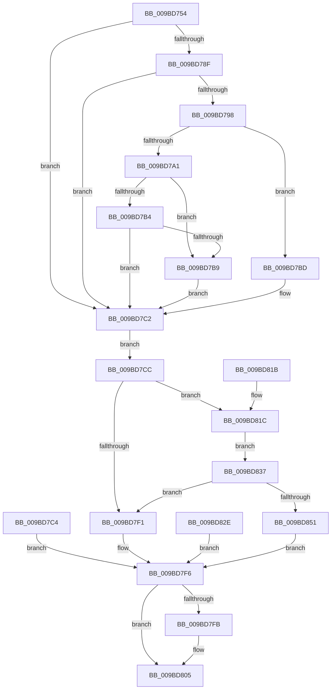

# EtwpCaptureString

- RVA: `0x009BD754`–`0x009BD853` (길이 `255` bytes)
- VA: `0x00000001409BD754`
- 실행 섹션: `PAGE`
- PDB 이름 있음: `예`; PDB Function 태그: `아니요`
- unwind 정보 RVA: `0x0009F20C`
- 디코드: `79`개 명령, `255/255` bytes 표시
- 미해석 바이트: `0` (있으면 어셈블리에 `.byte`로 보존)

> 이 문서는 커널 이미지의 기계어와 PDB 기호를 분석해 생성했습니다. 4번과 5번은 함수 원형과 자료형을 바이너리 사용 방식에서 추정한 C 해석이며 원본 소스 복구 결과는 아닙니다.

## 1. Dependencies

- 직접 호출 지점: **6**; 고유 호출 대상: **6**
- 직접 호출자로 확인된 함수: **5**
- RIP 상대 이미지 참조: **0**

### Outgoing calls
- `0x009BD785` → [RtlInitUnicodeString](../../text/42/RtlInitUnicodeString_function_0042A780.md) (function, `0x0042A780`)
- `0x009BD7BD` → [ExRaiseDatatypeMisalignment](../89/ExRaiseDatatypeMisalignment_function_00899FD0.md) (function, `0x00899FD0`)
- `0x009BD7DF` → [ExAllocatePool2](../../poolcode/B8/ExAllocatePool2_function_00B820F0.md) (function, `0x00B820F0`)
- `0x009BD800` → [ExFreePoolWithTag](../../poolcode/B8/ExFreePoolWithTag_function_00B82870.md) (function, `0x00B82870`)
- `0x009BD827` → [memcpy](../../text/6C/memcpy_function_006C6840.md) (function, `0x006C6840`)
- `0x009BD848` → [RtlCreateUnicodeString](RtlCreateUnicodeString_function_009BD860.md) (function, `0x009BD860`)

### Direct callers
- [EtwpAcquireLoggerContext](../93/EtwpAcquireLoggerContext_function_009326AC.md) at `0x00932774`
- [EtwpSetSoftRestartInformation](../A5/EtwpSetSoftRestartInformation_function_00A53DB8.md) at `0x00A53E3F`
- [EtwpStartLogger](../A9/EtwpStartLogger_function_00A99D80.md) at `0x00A99E61`
- [EtwpStartLogger](../A9/EtwpStartLogger_function_00A99D80.md) at `0x00A9A90C`
- [EtwpUpdateTrace](../AB/EtwpUpdateTrace_function_00ABCC7C.md) at `0x00ABCDDB`
- [EtwpFlushTrace](../AF/EtwpFlushTrace_function_00AF47B4.md) at `0x00AF48A6`

### Static image references
- 디코드된 RIP-relative 메모리 참조가 없습니다.

## 2. Other-region calls and transfers

- 다른 실행 섹션으로 향하는 call: **4**
  - `0x009BD785` → [RtlInitUnicodeString](../../text/42/RtlInitUnicodeString_function_0042A780.md) (`PAGE` → `.text`)
  - `0x009BD7DF` → [ExAllocatePool2](../../poolcode/B8/ExAllocatePool2_function_00B820F0.md) (`PAGE` → `POOLCODE`)
  - `0x009BD800` → [ExFreePoolWithTag](../../poolcode/B8/ExFreePoolWithTag_function_00B82870.md) (`PAGE` → `POOLCODE`)
  - `0x009BD827` → [memcpy](../../text/6C/memcpy_function_006C6840.md) (`PAGE` → `.text`)
- 별도 외부 분기/꼬리 이동을 확인하지 못했습니다.

## 3. Assembly (complete function range)

```asm
009BD754  48 89 5C 24 08                  mov qword ptr [rsp + 8], rbx
009BD759  48 89 74 24 10                  mov qword ptr [rsp + 0x10], rsi
009BD75E  57                              push rdi
009BD75F  41 56                           push r14
009BD761  41 57                           push r15
009BD763  48 83 EC 20                     sub rsp, 0x20
009BD767  4C 8B FA                        mov r15, rdx
009BD76A  4C 8B F1                        mov r14, rcx
009BD76D  33 FF                           xor edi, edi
009BD76F  8B F7                           mov esi, edi
009BD771  65 48 8B 04 25 88 01 00 00      mov rax, qword ptr gs:[0x188]
009BD77A  8A 98 32 02 00 00               mov bl, byte ptr [rax + 0x232]
009BD780  33 D2                           xor edx, edx
009BD782  49 8B CF                        mov rcx, r15
009BD785  E8 F6 CF A6 FF                  call 0x14042a780
009BD78A  90                              nop
009BD78B  84 DB                           test bl, bl
009BD78D  74 33                           je 0x1409bd7c2
009BD78F  41 0F B7 06                     movzx eax, word ptr [r14]
009BD793  66 85 C0                        test ax, ax
009BD796  74 2A                           je 0x1409bd7c2
009BD798  49 8B 4E 08                     mov rcx, qword ptr [r14 + 8]
009BD79C  F6 C1 01                        test cl, 1
009BD79F  75 1C                           jne 0x1409bd7bd
009BD7A1  48 8D 14 01                     lea rdx, [rcx + rax]
009BD7A5  48 B8 00 00 FF FF FF 7F 00 00   movabs rax, 0x7fffffff0000
009BD7AF  48 3B D0                        cmp rdx, rax
009BD7B2  77 05                           ja 0x1409bd7b9
009BD7B4  48 3B D1                        cmp rdx, rcx
009BD7B7  73 09                           jae 0x1409bd7c2
009BD7B9  8A 00                           mov al, byte ptr [rax]
009BD7BB  EB 05                           jmp 0x1409bd7c2
009BD7BD  E8 0E C8 ED FF                  call 0x140899fd0
009BD7C2  EB 08                           jmp 0x1409bd7cc
009BD7C4  8B F0                           mov esi, eax
009BD7C6  33 FF                           xor edi, edi
009BD7C8  8B DF                           mov ebx, edi
009BD7CA  EB 2A                           jmp 0x1409bd7f6
009BD7CC  41 0F B7 16                     movzx edx, word ptr [r14]
009BD7D0  48 83 C2 02                     add rdx, 2
009BD7D4  B9 00 01 00 00                  mov ecx, 0x100
009BD7D9  41 B8 45 74 77 50               mov r8d, 0x50777445
009BD7DF  E8 0C 49 1C 00                  call 0x140b820f0
009BD7E4  48 8B D8                        mov rbx, rax
009BD7E7  48 89 44 24 50                  mov qword ptr [rsp + 0x50], rax
009BD7EC  48 85 C0                        test rax, rax
009BD7EF  75 2B                           jne 0x1409bd81c
009BD7F1  BE 17 00 00 C0                  mov esi, 0xc0000017
009BD7F6  48 85 DB                        test rbx, rbx
009BD7F9  74 0A                           je 0x1409bd805
009BD7FB  33 D2                           xor edx, edx
009BD7FD  48 8B CB                        mov rcx, rbx
009BD800  E8 6B 50 1C 00                  call 0x140b82870
009BD805  8B C6                           mov eax, esi
009BD807  48 8B 5C 24 40                  mov rbx, qword ptr [rsp + 0x40]
009BD80C  48 8B 74 24 48                  mov rsi, qword ptr [rsp + 0x48]
009BD811  48 83 C4 20                     add rsp, 0x20
009BD815  41 5F                           pop r15
009BD817  41 5E                           pop r14
009BD819  5F                              pop rdi
009BD81A  C3                              ret
009BD81B  CC                              int3
009BD81C  45 0F B7 06                     movzx r8d, word ptr [r14]
009BD820  49 8B 56 08                     mov rdx, qword ptr [r14 + 8]
009BD824  48 8B CB                        mov rcx, rbx
009BD827  E8 14 90 D0 FF                  call 0x1406c6840
009BD82C  EB 09                           jmp 0x1409bd837
009BD82E  8B F0                           mov esi, eax
009BD830  48 8B 5C 24 50                  mov rbx, qword ptr [rsp + 0x50]
009BD835  EB BF                           jmp 0x1409bd7f6
009BD837  41 0F B7 06                     movzx eax, word ptr [r14]
009BD83B  48 D1 E8                        shr rax, 1
009BD83E  66 89 3C 43                     mov word ptr [rbx + rax*2], di
009BD842  48 8B D3                        mov rdx, rbx
009BD845  49 8B CF                        mov rcx, r15
009BD848  E8 13 00 00 00                  call 0x1409bd860
009BD84D  84 C0                           test al, al
009BD84F  74 A0                           je 0x1409bd7f1
009BD851  EB A3                           jmp 0x1409bd7f6
```

## 4. C-style interpretation (structured pseudocode)

```c
__int64 __fastcall EtwpCaptureString(__int64 a1, __int64 a2)
{
    __int64 result;
    __int64 v_rdi;
    __int64 v_rsp;
    unsigned __int64 v_stack_p10;
    unsigned __int64 v_stack_p18;
    unsigned __int64 v_stack_p50;
    unsigned __int64 v_stack_p8;

    v_stack_p8 = v_rbx;
    v_stack_p10 = v_rsi;
    v_rsp = (v_rsp) - (32);
    v_rdi = 0;
    a2 = 0;
    result = RtlInitUnicodeString(0, a2, a3, a4);
    if ((unsigned __int8)(*(unsigned __int8 *)(*(unsigned __int64 *)(gs_base + (0 + 392)) + 562)) == 0) goto loc_009BD7C2;
    if ((unsigned __int16)(*(unsigned __int16 *)(a1)) == 0) goto loc_009BD7C2;
    if ((((unsigned __int8)(*(unsigned __int64 *)(a1 + 8))) & (1)) != 0) goto loc_009BD7BD;
    if ((*(unsigned __int64 *)(a1 + 8) + *(unsigned __int16 *)(a1) * 1) > (*(unsigned __int16 *)(a1))) goto loc_009BD7B9;
    if ((*(unsigned __int64 *)(a1 + 8) + *(unsigned __int16 *)(a1) * 1) >= (*(unsigned __int64 *)(a1 + 8))) goto loc_009BD7C2;
loc_009BD7B9:
    goto loc_009BD7C2;
loc_009BD7BD:
    result = ExRaiseDatatypeMisalignment(*(unsigned __int64 *)(a1 + 8), *(unsigned __int64 *)(a1 + 8) + *(unsigned __int16 *)(a1) * 1, a3, a4);
loc_009BD7C2:
    goto loc_009BD7CC;
loc_009BD7CC:
    a2 = (*(unsigned __int16 *)(a1)) + (2);
    result = ExAllocatePool2(256, a2, (unsigned int)(0x50777445ULL), a4);
    v_stack_p18 = result;
    if (result != 0) goto loc_009BD81C;
loc_009BD7F1:
loc_009BD7F6:
    if (result != 0) {
        a2 = 0;
        a1 = result;
        result = ExFreePoolWithTag(a1, a2, (unsigned int)(0x50777445ULL), a4);
    }
    v_rsp = (v_rsp) + (32);
    return (unsigned int)((unsigned int)((unsigned int)(0xC0000017ULL)));
loc_009BD81C:
    result = memcpy(v_stack_p8, *(unsigned __int64 *)(a1 + 8), *(unsigned __int16 *)(a1), a4);
    goto loc_009BD837;
loc_009BD837:
    result = (*(unsigned __int16 *)(a1)) >> (1);
    *(unsigned __int16 *)(v_stack_p8 + result * 2) = 0;
    result = RtlCreateUnicodeString(0, v_stack_p8, *(unsigned __int16 *)(a1), a4);
    if ((unsigned __int8)(result) == 0) goto loc_009BD7F1;
    goto loc_009BD7F6;
}
```

## 5. (Beta) C Style

```c
int64_t EtwpCaptureString(void *Arg1, int64_t Arg2)
{
    uint8_t *arg1 = (uint8_t *)Arg1;

    int64_t result;
    int64_t local_rdi;
    int64_t local_rsp;
    uint64_t v_stack_p10;
    uint64_t v_stack_p18;
    uint64_t v_stack_p50;
    uint64_t v_stack_p8;

    v_stack_p8 = local_rbx;
    v_stack_p10 = local_rsi;
    local_rsp = (local_rsp) - (32);
    local_rdi = 0;
    Arg2 = 0;
    result = RtlInitUnicodeString(0, Arg2, a3, a4);
    if ((uint8_t)(*(uint8_t *)(*(uint64_t *)(gs_base + (0 + 0x188)) + 0x232)) == 0) goto loc_009BD7C2;
    if ((uint16_t)(*(uint16_t *)(arg1)) == 0) goto loc_009BD7C2;
    if ((((uint8_t)(*(uint64_t *)(arg1 + 0x8))) & (1)) != 0) goto loc_009BD7BD;
    if ((*(uint64_t *)(arg1 + 0x8) + *(uint16_t *)(arg1) * 1) > (*(uint16_t *)(arg1))) goto loc_009BD7B9;
    if ((*(uint64_t *)(arg1 + 0x8) + *(uint16_t *)(arg1) * 1) >= (*(uint64_t *)(arg1 + 0x8))) goto loc_009BD7C2;
loc_009BD7B9:
    goto loc_009BD7C2;
loc_009BD7BD:
    result = ExRaiseDatatypeMisalignment(*(uint64_t *)(arg1 + 0x8), *(uint64_t *)(arg1 + 0x8) + *(uint16_t *)(arg1) * 1, a3, a4);
loc_009BD7C2:
    goto loc_009BD7CC;
loc_009BD7CC:
    Arg2 = (*(uint16_t *)(arg1)) + (2);
    result = ExAllocatePool2(256, Arg2, (uint32_t)(0x50777445ULL), a4);
    v_stack_p18 = result;
    if (result != 0) goto loc_009BD81C;
loc_009BD7F1:
loc_009BD7F6:
    if (result != 0) {
        Arg2 = 0;
        Arg1 = result;
        result = ExFreePoolWithTag(Arg1, Arg2, (uint32_t)(0x50777445ULL), a4);
    }
    local_rsp = (local_rsp) + (32);
    return (uint32_t)((uint32_t)((uint32_t)(0xC0000017ULL)));
loc_009BD81C:
    result = memcpy(v_stack_p8, *(uint64_t *)(arg1 + 0x8), *(uint16_t *)(arg1), a4);
    goto loc_009BD837;
loc_009BD837:
    result = (*(uint16_t *)(arg1)) >> (1);
    *(uint16_t *)(v_stack_p8 + result * 2) = 0;
    result = RtlCreateUnicodeString(0, v_stack_p8, *(uint16_t *)(arg1), a4);
    if ((uint8_t)(result) == 0) goto loc_009BD7F1;
    goto loc_009BD7F6;
}
```

### 관측된 메모리 오프셋

구조체 형식이 확인되지 않은 접근은 인자 기준의 오프셋으로만 기록했습니다.

| 기준 인자 | 오프셋 표현 | 폭 (bit) | 접근 |
|---|---:|---:|---|
| `Arg1` | `+ 0x0` | `16` | `R` |
| `Arg1` | `+ 0x8` | `64` | `R` |

## 6. Execution-region graph

[열기: 2D/3D 그래프와 함수 탐색 컨트롤 패널](../../../control-panel.html?section=page&rva=0x009BD754&view=graph)

- 2D 그래프는 위에서 아래로 흐르고, 3D 그래프는 빈 공간을 드래그해 회전합니다. Shift+드래그는 이동, 휠은 확대·축소, 함수 노드 선택은 대상 보고서 이동입니다.

### Static fallback


