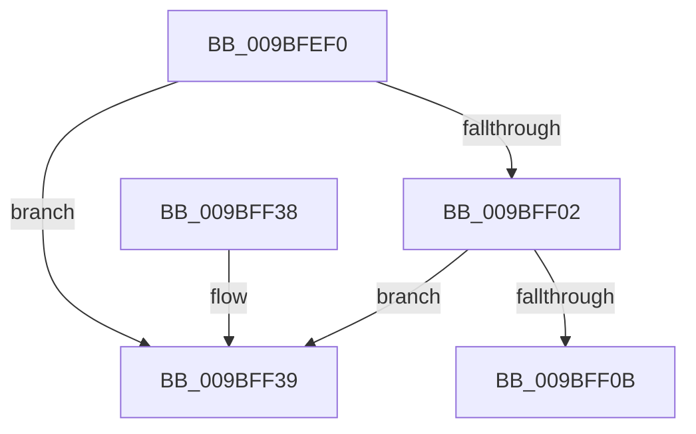

# EtwpDisassociateConsumer

- RVA: `0x009BFEF0`–`0x009BFF40` (길이 `80` bytes)
- VA: `0x00000001409BFEF0`
- 실행 섹션: `PAGE`
- PDB 이름 있음: `예`; PDB Function 태그: `아니요`
- unwind 정보 RVA: `0x0005DAC8`
- 디코드: `25`개 명령, `80/80` bytes 표시
- 미해석 바이트: `0` (있으면 어셈블리에 `.byte`로 보존)

> 이 문서는 커널 이미지의 기계어와 PDB 기호를 분석해 생성했습니다. 4번과 5번은 함수 원형과 자료형을 바이너리 사용 방식에서 추정한 C 해석이며 원본 소스 복구 결과는 아닙니다.

## 1. Dependencies

- 직접 호출 지점: **2**; 고유 호출 대상: **2**
- 직접 호출자로 확인된 함수: **1**
- RIP 상대 이미지 참조: **0**

### Outgoing calls
- `0x009BFF25` → [KeSetEvent](../../text/33/KeSetEvent_function_0033F310.md) (function, `0x0033F310`)
- `0x009BFF2D` → [ObfDereferenceObject](../../text/2F/ObfDereferenceObject_function_002F9350.md) (function, `0x002F9350`)

### Direct callers
- [EtwpRealtimeDeliverBuffer](EtwpRealtimeDeliverBuffer_function_009BF780.md) at `0x009BF8AB`

### Static image references
- 디코드된 RIP-relative 메모리 참조가 없습니다.

## 2. Other-region calls and transfers

- 다른 실행 섹션으로 향하는 call: **2**
  - `0x009BFF25` → [KeSetEvent](../../text/33/KeSetEvent_function_0033F310.md) (`PAGE` → `.text`)
  - `0x009BFF2D` → [ObfDereferenceObject](../../text/2F/ObfDereferenceObject_function_002F9350.md) (`PAGE` → `.text`)
- 별도 외부 분기/꼬리 이동을 확인하지 못했습니다.

## 3. Assembly (complete function range)

```asm
009BFEF0  40 53                           push rbx
009BFEF2  48 83 EC 20                     sub rsp, 0x20
009BFEF6  48 8B DA                        mov rbx, rdx
009BFEF9  48 8B 12                        mov rdx, qword ptr [rdx]
009BFEFC  48 39 5A 08                     cmp qword ptr [rdx + 8], rbx
009BFF00  75 37                           jne 0x1409bff39
009BFF02  48 8B 43 08                     mov rax, qword ptr [rbx + 8]
009BFF06  48 39 18                        cmp qword ptr [rax], rbx
009BFF09  75 2E                           jne 0x1409bff39
009BFF0B  48 89 10                        mov qword ptr [rax], rdx
009BFF0E  45 33 C0                        xor r8d, r8d
009BFF11  48 89 42 08                     mov qword ptr [rdx + 8], rax
009BFF15  33 D2                           xor edx, edx
009BFF17  FF 89 58 01 00 00               dec dword ptr [rcx + 0x158]
009BFF1D  48 8B 4B 30                     mov rcx, qword ptr [rbx + 0x30]
009BFF21  80 4B 5A 04                     or byte ptr [rbx + 0x5a], 4
009BFF25  E8 E6 F3 97 FF                  call 0x14033f310
009BFF2A  48 8B CB                        mov rcx, rbx
009BFF2D  E8 1E 94 93 FF                  call 0x1402f9350
009BFF32  48 83 C4 20                     add rsp, 0x20
009BFF36  5B                              pop rbx
009BFF37  C3                              ret
009BFF38  CC                              int3
009BFF39  B9 03 00 00 00                  mov ecx, 3
009BFF3E  CD 29                           int 0x29
```

## 4. C-style interpretation (structured pseudocode)

```c
__int64 __fastcall EtwpDisassociateConsumer(__int64 a1, __int64 a2, int a3)
{
    __int64 result;
    __int64 v_rsp;

    v_rsp = (v_rsp) - (32);
    if ((*(unsigned __int64 *)(*(unsigned __int64 *)(a2) + 8)) != a2) goto loc_009BFF39;
    if ((*(unsigned __int64 *)(*(unsigned __int64 *)(a2 + 8))) != a2) goto loc_009BFF39;
    *(unsigned __int64 *)(*(unsigned __int64 *)(a2 + 8)) = *(unsigned __int64 *)(a2);
    a3 = 0;
    *(unsigned __int64 *)(*(unsigned __int64 *)(a2) + 8) = *(unsigned __int64 *)(a2 + 8);
    a2 = 0;
    result = KeSetEvent(*(unsigned __int64 *)(a2 + 48), a2, a3, a4);
    result = ObfDereferenceObject(0, a2, a3, a4);
    v_rsp = (v_rsp) + (32);
    return result;
loc_009BFF39:
    return result;
}
```

## 5. (Beta) C Style

```c
int64_t EtwpDisassociateConsumer(void *Arg1, void *Arg2, int32_t Arg3)
{
    uint8_t *arg1 = (uint8_t *)Arg1;
    uint8_t *arg2 = (uint8_t *)Arg2;

    int64_t result;
    int64_t local_rsp;

    local_rsp = (local_rsp) - (32);
    if ((*(uint64_t *)(*(uint64_t *)(arg2) + 0x8)) != Arg2) goto loc_009BFF39;
    if ((*(uint64_t *)(*(uint64_t *)(arg2 + 0x8))) != Arg2) goto loc_009BFF39;
    *(uint64_t *)(*(uint64_t *)(arg2 + 0x8)) = *(uint64_t *)(arg2);
    Arg3 = 0;
    *(uint64_t *)(*(uint64_t *)(arg2) + 0x8) = *(uint64_t *)(arg2 + 0x8);
    Arg2 = 0;
    result = KeSetEvent(*(uint64_t *)(arg2 + 0x30), Arg2, Arg3, a4);
    result = ObfDereferenceObject(0, Arg2, Arg3, a4);
    local_rsp = (local_rsp) + (32);
    return result;
loc_009BFF39:
    return result;
}
```

### 관측된 메모리 오프셋

구조체 형식이 확인되지 않은 접근은 인자 기준의 오프셋으로만 기록했습니다.

| 기준 인자 | 오프셋 표현 | 폭 (bit) | 접근 |
|---|---:|---:|---|
| `Arg1` | `+ 0x158` | `32` | `R/W` |
| `Arg2` | `+ 0x0` | `64` | `R` |
| `Arg2` | `+ 0x8` | `64` | `R` |
| `Arg2` | `+ 0x30` | `64` | `R` |
| `Arg2` | `+ 0x5A` | `8` | `R/W` |

## 6. Execution-region graph

[열기: 2D/3D 그래프와 함수 탐색 컨트롤 패널](../../../control-panel.html?section=page&rva=0x009BFEF0&view=graph)

- 2D 그래프는 위에서 아래로 흐르고, 3D 그래프는 빈 공간을 드래그해 회전합니다. Shift+드래그는 이동, 휠은 확대·축소, 함수 노드 선택은 대상 보고서 이동입니다.

### Static fallback


