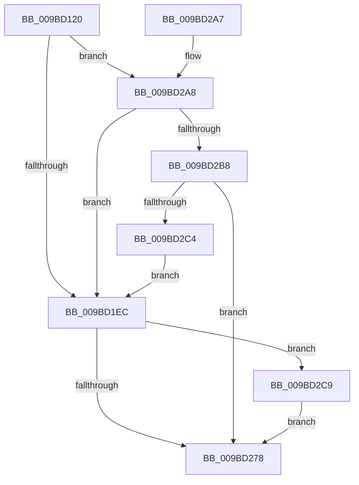

# EtwpEventWriteTemplateSession

- RVA: `0x009BD120`–`0x009BD322` (길이 `514` bytes)
- VA: `0x00000001409BD120`
- 실행 섹션: `PAGE`
- PDB 이름 있음: `예`; PDB Function 태그: `아니요`
- unwind 정보 RVA: `0x0009F1C4`
- 디코드: `96`개 명령, `514/514` bytes 표시
- 미해석 바이트: `0` (있으면 어셈블리에 `.byte`로 보존)

> 이 문서는 커널 이미지의 기계어와 PDB 기호를 분석해 생성했습니다. 4번과 5번은 함수 원형과 자료형을 바이너리 사용 방식에서 추정한 C 해석이며 원본 소스 복구 결과는 아닙니다.

## 1. Dependencies

- 직접 호출 지점: **2**; 고유 호출 대상: **2**
- 직접 호출자로 확인된 함수: **8**
- RIP 상대 이미지 참조: **6**

### Outgoing calls
- `0x009BD285` → [EtwWrite](../../text/41/EtwWrite_function_0041C720.md) (function, `0x0041C720`)
- `0x009BD291` → [_security_check_cookie](../../text/6A/_security_check_cookie_function_006AC640.md) (function, `0x006AC640`)

### Direct callers
- [EtwpTransitionToRealtime](../../text/65/EtwpTransitionToRealtime_function_006518D8.md) at `0x00651A22`
- [EtwpStopTrace](EtwpStopTrace_function_009BCE84.md) at `0x009BCFD3`
- [EtwpLogger](EtwpLogger_function_009BE310.md) at `0x009BE909`
- [EtwpStartLogger](../A9/EtwpStartLogger_function_00A99D80.md) at `0x00A9AD10`
- [EtwpUpdateLoggerSecurityDescriptor](../AA/EtwpUpdateLoggerSecurityDescriptor_function_00AA9F64.md) at `0x00AAA03B`
- [EtwpUpdateTrace](../AB/EtwpUpdateTrace_function_00ABCC7C.md) at `0x00ABD114`
- [EtwpTracingProvEnableCallback](../AC/EtwpTracingProvEnableCallback_function_00AC28B0.md) at `0x00AC2903`
- [EtwpFlushTrace](../AF/EtwpFlushTrace_function_00AF47B4.md) at `0x00AF4990`

### Static image references
- `0x009BD132` → RVA `0x00E0A740` (`.data`; read)
- `0x009BD140` → RVA `0x00EFF840` (`.data`; read)
- `0x009BD147` → RVA `0x000105E0` (`.rdata`; read)
- `0x009BD166` → RVA `0x00013D78` (`.rdata`; read)
- `0x009BD2A8` → RVA `0x00013D68` (`.rdata`; read)
- `0x009BD2B8` → RVA `0x00013E10` (`.rdata`; read)

## 2. Other-region calls and transfers

- 다른 실행 섹션으로 향하는 call: **2**
  - `0x009BD285` → [EtwWrite](../../text/41/EtwWrite_function_0041C720.md) (`PAGE` → `.text`)
  - `0x009BD291` → [_security_check_cookie](../../text/6A/_security_check_cookie_function_006AC640.md) (`PAGE` → `.text`)
- 별도 외부 분기/꼬리 이동을 확인하지 못했습니다.

## 3. Assembly (complete function range)

```asm
009BD120  48 89 5C 24 08                  mov qword ptr [rsp + 8], rbx
009BD125  55                              push rbp
009BD126  48 8D 6C 24 B0                  lea rbp, [rsp - 0x50]
009BD12B  48 81 EC 50 01 00 00            sub rsp, 0x150
009BD132  48 8B 05 07 D6 44 00            mov rax, qword ptr [rip + 0x44d607]
009BD139  48 33 C4                        xor rax, rsp
009BD13C  48 89 45 40                     mov qword ptr [rbp + 0x40], rax
009BD140  48 8B 0D F9 26 54 00            mov rcx, qword ptr [rip + 0x5426f9]
009BD147  4C 8D 15 92 34 65 FF            lea r10, [rip - 0x9acb6e]
009BD14E  45 33 DB                        xor r11d, r11d
009BD151  4C 89 54 24 70                  mov qword ptr [rsp + 0x70], r10
009BD156  49 8D 80 14 01 00 00            lea rax, [r8 + 0x114]
009BD15D  4C 89 55 90                     mov qword ptr [rbp - 0x70], r10
009BD161  48 89 44 24 40                  mov qword ptr [rsp + 0x40], rax
009BD166  4C 8D 15 0B 6C 65 FF            lea r10, [rip - 0x9a93f5]
009BD16D  44 89 5C 24 34                  mov dword ptr [rsp + 0x34], r11d
009BD172  49 8D 40 0C                     lea rax, [r8 + 0xc]
009BD176  48 89 44 24 50                  mov qword ptr [rsp + 0x50], rax
009BD17B  45 8D 4B 06                     lea r9d, [r11 + 6]
009BD17F  49 8B 80 90 00 00 00            mov rax, qword ptr [r8 + 0x90]
009BD186  48 89 44 24 60                  mov qword ptr [rsp + 0x60], rax
009BD18B  41 0F B7 80 88 00 00 00         movzx eax, word ptr [r8 + 0x88]
009BD193  89 44 24 68                     mov dword ptr [rsp + 0x68], eax
009BD197  49 8B 80 A0 00 00 00            mov rax, qword ptr [r8 + 0xa0]
009BD19E  48 89 45 80                     mov qword ptr [rbp - 0x80], rax
009BD1A2  41 0F B7 80 98 00 00 00         movzx eax, word ptr [r8 + 0x98]
009BD1AA  89 45 88                        mov dword ptr [rbp - 0x78], eax
009BD1AD  44 89 5C 24 38                  mov dword ptr [rsp + 0x38], r11d
009BD1B2  44 89 5C 24 30                  mov dword ptr [rsp + 0x30], r11d
009BD1B7  48 C7 44 24 48 10 00 00 00      mov qword ptr [rsp + 0x48], 0x10
009BD1C0  48 C7 44 24 58 04 00 00 00      mov qword ptr [rsp + 0x58], 4
009BD1C9  44 89 5C 24 6C                  mov dword ptr [rsp + 0x6c], r11d
009BD1CE  48 C7 44 24 78 02 00 00 00      mov qword ptr [rsp + 0x78], 2
009BD1D7  44 89 5D 8C                     mov dword ptr [rbp - 0x74], r11d
009BD1DB  48 C7 45 98 02 00 00 00         mov qword ptr [rbp - 0x68], 2
009BD1E3  49 3B D2                        cmp rdx, r10
009BD1E6  0F 85 BC 00 00 00               jne 0x1409bd2a8
009BD1EC  48 C7 45 A8 04 00 00 00         mov qword ptr [rbp - 0x58], 4
009BD1F4  49 8D 80 E0 00 00 00            lea rax, [r8 + 0xe0]
009BD1FB  48 89 45 A0                     mov qword ptr [rbp - 0x60], rax
009BD1FF  49 8D 80 EC 00 00 00            lea rax, [r8 + 0xec]
009BD206  48 89 45 B0                     mov qword ptr [rbp - 0x50], rax
009BD20A  49 8D 40 04                     lea rax, [r8 + 4]
009BD20E  48 89 45 C0                     mov qword ptr [rbp - 0x40], rax
009BD212  41 B9 0C 00 00 00               mov r9d, 0xc
009BD218  41 8B 80 F4 00 00 00            mov eax, dword ptr [r8 + 0xf4]
009BD21F  89 44 24 30                     mov dword ptr [rsp + 0x30], eax
009BD223  41 8B 80 E8 00 00 00            mov eax, dword ptr [r8 + 0xe8]
009BD22A  89 44 24 34                     mov dword ptr [rsp + 0x34], eax
009BD22E  48 8D 44 24 30                  lea rax, [rsp + 0x30]
009BD233  48 89 45 D0                     mov qword ptr [rbp - 0x30], rax
009BD237  48 8D 44 24 34                  lea rax, [rsp + 0x34]
009BD23C  48 89 45 E0                     mov qword ptr [rbp - 0x20], rax
009BD240  49 8D 80 D4 00 00 00            lea rax, [r8 + 0xd4]
009BD247  48 89 45 F0                     mov qword ptr [rbp - 0x10], rax
009BD24B  48 C7 45 B8 04 00 00 00         mov qword ptr [rbp - 0x48], 4
009BD253  48 C7 45 C8 04 00 00 00         mov qword ptr [rbp - 0x38], 4
009BD25B  48 C7 45 D8 04 00 00 00         mov qword ptr [rbp - 0x28], 4
009BD263  48 C7 45 E8 04 00 00 00         mov qword ptr [rbp - 0x18], 4
009BD26B  48 C7 45 F8 04 00 00 00         mov qword ptr [rbp - 8], 4
009BD273  49 3B D2                        cmp rdx, r10
009BD276  75 51                           jne 0x1409bd2c9
009BD278  48 8D 44 24 40                  lea rax, [rsp + 0x40]
009BD27D  45 33 C0                        xor r8d, r8d
009BD280  48 89 44 24 20                  mov qword ptr [rsp + 0x20], rax
009BD285  E8 96 F4 A5 FF                  call 0x14041c720
009BD28A  48 8B 4D 40                     mov rcx, qword ptr [rbp + 0x40]
009BD28E  48 33 CC                        xor rcx, rsp
009BD291  E8 AA F3 CE FF                  call 0x1406ac640
009BD296  48 8B 9C 24 60 01 00 00         mov rbx, qword ptr [rsp + 0x160]
009BD29E  48 81 C4 50 01 00 00            add rsp, 0x150
009BD2A5  5D                              pop rbp
009BD2A6  C3                              ret
009BD2A7  CC                              int3
009BD2A8  48 8D 05 B9 6A 65 FF            lea rax, [rip - 0x9a9547]
009BD2AF  48 3B D0                        cmp rdx, rax
009BD2B2  0F 84 34 FF FF FF               je 0x1409bd1ec
009BD2B8  48 8D 05 51 6B 65 FF            lea rax, [rip - 0x9a94af]
009BD2BF  48 3B D0                        cmp rdx, rax
009BD2C2  75 B4                           jne 0x1409bd278
009BD2C4  E9 23 FF FF FF                  jmp 0x1409bd1ec
009BD2C9  41 8B 80 F0 00 00 00            mov eax, dword ptr [r8 + 0xf0]
009BD2D0  41 B9 10 00 00 00               mov r9d, 0x10
009BD2D6  89 44 24 38                     mov dword ptr [rsp + 0x38], eax
009BD2DA  48 8D 44 24 38                  lea rax, [rsp + 0x38]
009BD2DF  48 89 45 00                     mov qword ptr [rbp], rax
009BD2E3  49 8D 80 FC 00 00 00            lea rax, [r8 + 0xfc]
009BD2EA  48 89 45 10                     mov qword ptr [rbp + 0x10], rax
009BD2EE  49 8D 80 04 01 00 00            lea rax, [r8 + 0x104]
009BD2F5  48 89 45 20                     mov qword ptr [rbp + 0x20], rax
009BD2F9  48 C7 45 08 04 00 00 00         mov qword ptr [rbp + 8], 4
009BD301  48 C7 45 18 04 00 00 00         mov qword ptr [rbp + 0x18], 4
009BD309  48 C7 45 28 04 00 00 00         mov qword ptr [rbp + 0x28], 4
009BD311  4C 89 45 30                     mov qword ptr [rbp + 0x30], r8
009BD315  48 C7 45 38 04 00 00 00         mov qword ptr [rbp + 0x38], 4
009BD31D  E9 56 FF FF FF                  jmp 0x1409bd278
```

## 4. C-style interpretation (structured pseudocode)

```c
__int64 __fastcall EtwpEventWriteTemplateSession(__int64 a1, __int64 a2, __int64 a3)
{
    __int64 result;
    __int64 v_r11;
    __int64 v_rsp;
    unsigned __int64 v_stack_m100;
    unsigned __int64 v_stack_m108;
    unsigned __int64 v_stack_m110;
    unsigned __int64 v_stack_m118;
    unsigned int v_stack_m120;
    unsigned int v_stack_m124;
    unsigned int v_stack_m128;
    unsigned __int64 v_stack_m138;
    unsigned __int64 v_stack_m18;
    unsigned __int64 v_stack_m20;
    unsigned __int64 v_stack_m28;
    unsigned __int64 v_stack_m30;
    unsigned __int64 v_stack_m38;
    unsigned __int64 v_stack_m40;
    unsigned __int64 v_stack_m48;
    unsigned __int64 v_stack_m50;
    unsigned __int64 v_stack_m58;
    unsigned __int64 v_stack_m60;
    unsigned __int64 v_stack_m68;
    unsigned __int64 v_stack_m70;
    unsigned __int64 v_stack_m78;
    unsigned __int64 v_stack_m80;
    unsigned __int64 v_stack_m88;
    unsigned __int64 v_stack_m90;
    unsigned __int64 v_stack_m98;
    unsigned __int64 v_stack_mA0;
    unsigned __int64 v_stack_mA8;
    unsigned __int64 v_stack_mB0;
    unsigned __int64 v_stack_mB8;
    unsigned __int64 v_stack_mC0;
    unsigned __int64 v_stack_mC8;
    unsigned int v_stack_mCC;
    unsigned int v_stack_mD0;
    unsigned __int64 v_stack_mD8;
    unsigned __int64 v_stack_mE0;
    unsigned __int64 v_stack_mE8;
    unsigned int v_stack_mEC;
    unsigned int v_stack_mF0;
    unsigned __int64 v_stack_mF8;
    unsigned int v_stack_p38;
    unsigned __int64 v_stack_p8;

    v_stack_p8 = v_rbx;
    v_rsp = (v_rsp) - (336);
    result = (*(unsigned __int64 *)(v_rip + 4511239)) ^ (v_rsp);
    v_stack_m18 = result;
    v_r11 = 0;
    v_stack_mE8 = v_rip - 10144622;
    v_stack_mC8 = v_rip - 10144622;
    v_stack_m118 = a3 + 276;
    v_stack_m124 = 0;
    v_stack_m108 = a3 + 12;
    v_stack_mF8 = *(unsigned __int64 *)(a3 + 144);
    v_stack_mF0 = (unsigned int)(*(unsigned __int16 *)(a3 + 136));
    v_stack_mD8 = *(unsigned __int64 *)(a3 + 160);
    v_stack_mD0 = (unsigned int)(*(unsigned __int16 *)(a3 + 152));
    v_stack_m120 = 0;
    v_stack_m128 = 0;
    v_stack_m110 = 16;
    v_stack_m100 = 4;
    v_stack_mEC = 0;
    v_stack_mE0 = 2;
    v_stack_mCC = 0;
    v_stack_mC0 = 2;
    if (a2 != (v_rip - 10130421)) goto loc_009BD2A8;
loc_009BD1EC:
    v_stack_mB0 = 4;
    v_stack_mB8 = a3 + 224;
    v_stack_mA8 = a3 + 236;
    v_stack_m98 = a3 + 4;
    v_stack_m128 = (unsigned int)((unsigned int)(*(unsigned int *)(a3 + 244)));
    v_stack_m124 = (unsigned int)((unsigned int)(*(unsigned int *)(a3 + 232)));
    v_stack_m88 = v_stack_m128;
    v_stack_m78 = v_stack_m124;
    v_stack_m68 = a3 + 212;
    v_stack_mA0 = 4;
    v_stack_m90 = 4;
    v_stack_m80 = 4;
    v_stack_m70 = 4;
    v_stack_m60 = 4;
    if (a2 != (v_rip - 10130421)) goto loc_009BD2C9;
loc_009BD278:
    a3 = 0;
    v_stack_m138 = v_stack_m118;
    result = EtwWrite(*(unsigned __int64 *)(v_rip + 5515001), a2, a3, 12);
    a1 = (v_stack_m18) ^ (v_rsp);
    result = _security_check_cookie(a1, a2, a3, 12);
    v_rsp = (v_rsp) + (336);
    return result;
loc_009BD2A8:
    if (a2 == (v_rip - 10130759)) goto loc_009BD1EC;
    if (a2 != (v_rip - 10130607)) goto loc_009BD278;
    goto loc_009BD1EC;
loc_009BD2C9:
    v_stack_p38 = (unsigned int)((unsigned int)(*(unsigned int *)(a3 + 240)));
    v_stack_m58 = v_stack_p38;
    v_stack_m48 = a3 + 252;
    v_stack_m38 = a3 + 260;
    v_stack_m50 = 4;
    v_stack_m40 = 4;
    v_stack_m30 = 4;
    v_stack_m28 = 0;
    v_stack_m20 = 4;
    goto loc_009BD278;
}
```

## 5. (Beta) C Style

```c
int64_t EtwpEventWriteTemplateSession(int64_t Arg1, int64_t Arg2, void *Arg3)
{
    uint8_t *arg3 = (uint8_t *)Arg3;

    int64_t result;
    int64_t local_r11;
    int64_t local_rsp;
    uint64_t v_stack_m100;
    uint64_t v_stack_m108;
    uint64_t v_stack_m110;
    uint64_t v_stack_m118;
    uint32_t v_stack_m120;
    uint32_t v_stack_m124;
    uint32_t v_stack_m128;
    uint64_t v_stack_m138;
    uint64_t v_stack_m18;
    uint64_t v_stack_m20;
    uint64_t v_stack_m28;
    uint64_t v_stack_m30;
    uint64_t v_stack_m38;
    uint64_t v_stack_m40;
    uint64_t v_stack_m48;
    uint64_t v_stack_m50;
    uint64_t v_stack_m58;
    uint64_t v_stack_m60;
    uint64_t v_stack_m68;
    uint64_t v_stack_m70;
    uint64_t v_stack_m78;
    uint64_t v_stack_m80;
    uint64_t v_stack_m88;
    uint64_t v_stack_m90;
    uint64_t v_stack_m98;
    uint64_t v_stack_mA0;
    uint64_t v_stack_mA8;
    uint64_t v_stack_mB0;
    uint64_t v_stack_mB8;
    uint64_t v_stack_mC0;
    uint64_t v_stack_mC8;
    uint32_t v_stack_mCC;
    uint32_t v_stack_mD0;
    uint64_t v_stack_mD8;
    uint64_t v_stack_mE0;
    uint64_t v_stack_mE8;
    uint32_t v_stack_mEC;
    uint32_t v_stack_mF0;
    uint64_t v_stack_mF8;
    uint32_t v_stack_p38;
    uint64_t v_stack_p8;

    v_stack_p8 = local_rbx;
    local_rsp = (local_rsp) - (336);
    result = (*(uint64_t *)(v_rip + 0x44D607)) ^ (local_rsp);
    v_stack_m18 = result;
    local_r11 = 0;
    v_stack_mE8 = v_rip - 10144622;
    v_stack_mC8 = v_rip - 10144622;
    v_stack_m118 = Arg3 + 276;
    v_stack_m124 = 0;
    v_stack_m108 = Arg3 + 12;
    v_stack_mF8 = *(uint64_t *)(arg3 + 0x90);
    v_stack_mF0 = (uint32_t)(*(uint16_t *)(arg3 + 0x88));
    v_stack_mD8 = *(uint64_t *)(arg3 + 0xA0);
    v_stack_mD0 = (uint32_t)(*(uint16_t *)(arg3 + 0x98));
    v_stack_m120 = 0;
    v_stack_m128 = 0;
    v_stack_m110 = 16;
    v_stack_m100 = 4;
    v_stack_mEC = 0;
    v_stack_mE0 = 2;
    v_stack_mCC = 0;
    v_stack_mC0 = 2;
    if (Arg2 != (v_rip - 10130421)) goto loc_009BD2A8;
loc_009BD1EC:
    v_stack_mB0 = 4;
    v_stack_mB8 = Arg3 + 224;
    v_stack_mA8 = Arg3 + 236;
    v_stack_m98 = Arg3 + 4;
    v_stack_m128 = (uint32_t)((uint32_t)(*(uint32_t *)(arg3 + 0xF4)));
    v_stack_m124 = (uint32_t)((uint32_t)(*(uint32_t *)(arg3 + 0xE8)));
    v_stack_m88 = v_stack_m128;
    v_stack_m78 = v_stack_m124;
    v_stack_m68 = Arg3 + 212;
    v_stack_mA0 = 4;
    v_stack_m90 = 4;
    v_stack_m80 = 4;
    v_stack_m70 = 4;
    v_stack_m60 = 4;
    if (Arg2 != (v_rip - 10130421)) goto loc_009BD2C9;
loc_009BD278:
    Arg3 = 0;
    v_stack_m138 = v_stack_m118;
    result = EtwWrite(*(uint64_t *)(v_rip + 0x5426F9), Arg2, Arg3, 12);
    Arg1 = (v_stack_m18) ^ (local_rsp);
    result = _security_check_cookie(Arg1, Arg2, Arg3, 12);
    local_rsp = (local_rsp) + (336);
    return result;
loc_009BD2A8:
    if (Arg2 == (v_rip - 10130759)) goto loc_009BD1EC;
    if (Arg2 != (v_rip - 10130607)) goto loc_009BD278;
    goto loc_009BD1EC;
loc_009BD2C9:
    v_stack_p38 = (uint32_t)((uint32_t)(*(uint32_t *)(arg3 + 0xF0)));
    v_stack_m58 = v_stack_p38;
    v_stack_m48 = Arg3 + 252;
    v_stack_m38 = Arg3 + 260;
    v_stack_m50 = 4;
    v_stack_m40 = 4;
    v_stack_m30 = 4;
    v_stack_m28 = 0;
    v_stack_m20 = 4;
    goto loc_009BD278;
}
```

### 관측된 메모리 오프셋

구조체 형식이 확인되지 않은 접근은 인자 기준의 오프셋으로만 기록했습니다.

| 기준 인자 | 오프셋 표현 | 폭 (bit) | 접근 |
|---|---:|---:|---|
| `Arg3` | `+ 0x4` | `64` | `R` |
| `Arg3` | `+ 0xC` | `64` | `R` |
| `Arg3` | `+ 0x88` | `16` | `R` |
| `Arg3` | `+ 0x90` | `64` | `R` |
| `Arg3` | `+ 0x98` | `16` | `R` |
| `Arg3` | `+ 0xA0` | `64` | `R` |
| `Arg3` | `+ 0xD4` | `64` | `R` |
| `Arg3` | `+ 0xE0` | `64` | `R` |
| `Arg3` | `+ 0xE8` | `32` | `R` |
| `Arg3` | `+ 0xEC` | `64` | `R` |
| `Arg3` | `+ 0xF0` | `32` | `R` |
| `Arg3` | `+ 0xF4` | `32` | `R` |
| `Arg3` | `+ 0xFC` | `64` | `R` |
| `Arg3` | `+ 0x104` | `64` | `R` |
| `Arg3` | `+ 0x114` | `64` | `R` |

## 6. Execution-region graph

[열기: 2D/3D 그래프와 함수 탐색 컨트롤 패널](../../../control-panel.html?section=page&rva=0x009BD120&view=graph)

- 2D 그래프는 위에서 아래로 흐르고, 3D 그래프는 빈 공간을 드래그해 회전합니다. Shift+드래그는 이동, 휠은 확대·축소, 함수 노드 선택은 대상 보고서 이동입니다.

### Static fallback


