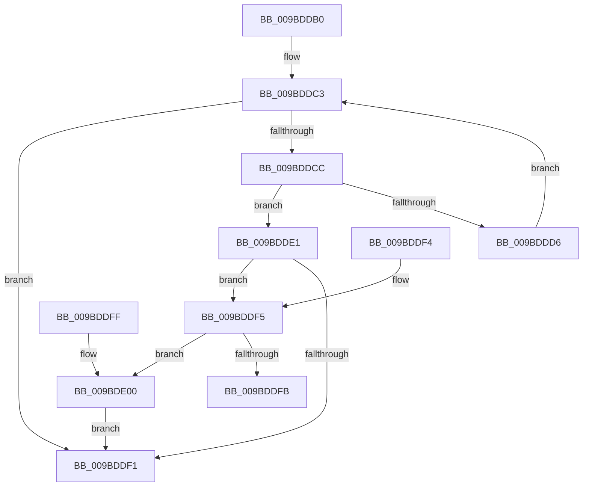

# EtwpFindAndLockBufferForFlushing

- RVA: `0x009BDDB0`–`0x009BDE06` (길이 `86` bytes)
- VA: `0x00000001409BDDB0`
- 실행 섹션: `PAGE`
- PDB 이름 있음: `예`; PDB Function 태그: `아니요`
- unwind 정보 RVA: `0x000DB714`
- 디코드: `29`개 명령, `86/86` bytes 표시
- 미해석 바이트: `0` (있으면 어셈블리에 `.byte`로 보존)

> 이 문서는 커널 이미지의 기계어와 PDB 기호를 분석해 생성했습니다. 4번과 5번은 함수 원형과 자료형을 바이너리 사용 방식에서 추정한 C 해석이며 원본 소스 복구 결과는 아닙니다.

## 1. Dependencies

- 직접 호출 지점: **0**; 고유 호출 대상: **0**
- 직접 호출자로 확인된 함수: **1**
- RIP 상대 이미지 참조: **0**

### Outgoing calls
- 직접 디코드된 call 명령이 없습니다.

### Direct callers
- [EtwpBufferingModeFlush](EtwpBufferingModeFlush_function_009BD8F4.md) at `0x009BDB2A`
- [EtwpBufferingModeFlush](EtwpBufferingModeFlush_function_009BD8F4.md) at `0x009BDB70`

### Static image references
- 디코드된 RIP-relative 메모리 참조가 없습니다.

## 2. Other-region calls and transfers

- 다른 실행 섹션으로 향하는 call: **0**
- 별도 외부 분기/꼬리 이동을 확인하지 못했습니다.

## 3. Assembly (complete function range)

```asm
009BDDB0  8B 81 E8 00 00 00               mov eax, dword ptr [rcx + 0xe8]
009BDDB6  4C 8D 41 50                     lea r8, [rcx + 0x50]
009BDDBA  49 8B 00                        mov rax, qword ptr [r8]
009BDDBD  45 33 C9                        xor r9d, r9d
009BDDC0  49 3B C0                        cmp rax, r8
009BDDC3  49 0F 44 C1                     cmove rax, r9
009BDDC7  48 85 C0                        test rax, rax
009BDDCA  74 25                           je 0x1409bddf1
009BDDCC  48 8B 48 10                     mov rcx, qword ptr [rax + 0x10]
009BDDD0  48 39 51 18                     cmp qword ptr [rcx + 0x18], rdx
009BDDD4  74 0B                           je 0x1409bdde1
009BDDD6  48 8B 08                        mov rcx, qword ptr [rax]
009BDDD9  48 8B C1                        mov rax, rcx
009BDDDC  49 3B C8                        cmp rcx, r8
009BDDDF  EB E2                           jmp 0x1409bddc3
009BDDE1  33 C0                           xor eax, eax
009BDDE3  41 B8 03 00 00 00               mov r8d, 3
009BDDE9  F0 44 0F B1 41 2C               lock cmpxchg dword ptr [rcx + 0x2c], r8d
009BDDEF  74 04                           je 0x1409bddf5
009BDDF1  33 C0                           xor eax, eax
009BDDF3  C3                              ret
009BDDF4  CC                              int3
009BDDF5  48 39 51 18                     cmp qword ptr [rcx + 0x18], rdx
009BDDF9  75 05                           jne 0x1409bde00
009BDDFB  48 8B C1                        mov rax, rcx
009BDDFE  C3                              ret
009BDDFF  CC                              int3
009BDE00  44 87 49 2C                     xchg dword ptr [rcx + 0x2c], r9d
009BDE04  EB EB                           jmp 0x1409bddf1
```

## 4. C-style interpretation (structured pseudocode)

```c
__int64 __fastcall EtwpFindAndLockBufferForFlushing(__int64 a1, __int64 a2, __int64 a3, int a4)
{
    __int64 result;

    a4 = 0;
loc_009BDDC3:
    result = *(unsigned __int64 *)(a1 + 80);
    if ((*(unsigned __int64 *)(a1 + 80)) == (a1 + 80)) { result = 0; }
    if (result == 0) goto loc_009BDDF1;
    if ((*(unsigned __int64 *)(*(unsigned __int64 *)(result + 16) + 24)) == a2) goto loc_009BDDE1;
    goto loc_009BDDC3;
loc_009BDDE1:
    result = 0;
    if (condition_is_equal) goto loc_009BDDF5;
loc_009BDDF1:
    result = 0;
    return result;
loc_009BDDF5:
    if ((*(unsigned __int64 *)(*(unsigned __int64 *)(result) + 24)) != a2) goto loc_009BDE00;
    return *(unsigned __int64 *)(result);
loc_009BDE00:
    goto loc_009BDDF1;
}
```

## 5. (Beta) C Style

```c
int64_t EtwpFindAndLockBufferForFlushing(void *Arg1, int64_t Arg2, int64_t Arg3, int32_t Arg4)
{
    uint8_t *arg1 = (uint8_t *)Arg1;

    int64_t result;

    Arg4 = 0;
loc_009BDDC3:
    result = *(uint64_t *)(arg1 + 0x50);
    if ((*(uint64_t *)(arg1 + 0x50)) == (Arg1 + 80)) { result = 0; }
    if (result == 0) goto loc_009BDDF1;
    if ((*(uint64_t *)(*(uint64_t *)(result + 0x10) + 0x18)) == Arg2) goto loc_009BDDE1;
    goto loc_009BDDC3;
loc_009BDDE1:
    result = 0;
    if (condition_is_equal) goto loc_009BDDF5;
loc_009BDDF1:
    result = 0;
    return result;
loc_009BDDF5:
    if ((*(uint64_t *)(*(uint64_t *)(result) + 0x18)) != Arg2) goto loc_009BDE00;
    return *(uint64_t *)(result);
loc_009BDE00:
    goto loc_009BDDF1;
}
```

### 관측된 메모리 오프셋

구조체 형식이 확인되지 않은 접근은 인자 기준의 오프셋으로만 기록했습니다.

| 기준 인자 | 오프셋 표현 | 폭 (bit) | 접근 |
|---|---:|---:|---|
| `Arg1` | `+ 0x0` | `64` | `R` |
| `Arg1` | `+ 0x50` | `64` | `R` |
| `Arg1` | `+ 0xE8` | `32` | `R` |

## 6. Execution-region graph

[열기: 2D/3D 그래프와 함수 탐색 컨트롤 패널](../../../control-panel.html?section=page&rva=0x009BDDB0&view=graph)

- 2D 그래프는 위에서 아래로 흐르고, 3D 그래프는 빈 공간을 드래그해 회전합니다. Shift+드래그는 이동, 휠은 확대·축소, 함수 노드 선택은 대상 보고서 이동입니다.

### Static fallback


