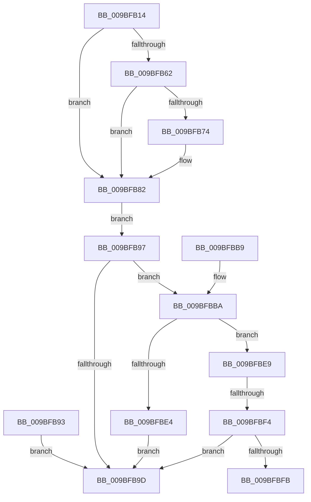

# EtwpFindUserBufferSpace

- RVA: `0x009BFB14`–`0x009BFC00` (길이 `236` bytes)
- VA: `0x00000001409BFB14`
- 실행 섹션: `PAGE`
- PDB 이름 있음: `예`; PDB Function 태그: `예`
- unwind 정보 RVA: `0x0009F49C`
- 디코드: `68`개 명령, `236/236` bytes 표시
- 미해석 바이트: `0` (있으면 어셈블리에 `.byte`로 보존)

> 이 문서는 커널 이미지의 기계어와 PDB 기호를 분석해 생성했습니다. 4번과 5번은 함수 원형과 자료형을 바이너리 사용 방식에서 추정한 C 해석이며 원본 소스 복구 결과는 아닙니다.

## 1. Dependencies

- 직접 호출 지점: **3**; 고유 호출 대상: **3**
- 직접 호출자로 확인된 함수: **1**
- RIP 상대 이미지 참조: **0**

### Outgoing calls
- `0x009BFB55` → [RtlFindNextAlignedForwardRunClear](../../text/43/RtlFindNextAlignedForwardRunClear_function_0043FB40.md) (function, `0x0043FB40`)
- `0x009BFB6B` → [RtlInterlockedSetClearRun](../../text/37/RtlInterlockedSetClearRun_function_00377F10.md) (function, `0x00377F10`)
- `0x009BFBD9` → [ZwAllocateVirtualMemory](../../text/6A/ZwAllocateVirtualMemory_function_006AD3D0.md) (function, `0x006AD3D0`)

### Direct callers
- [EtwpRealtimeInjectEtwBuffer](EtwpRealtimeInjectEtwBuffer_function_009BF910.md) at `0x009BF9F8`

### Static image references
- 디코드된 RIP-relative 메모리 참조가 없습니다.

## 2. Other-region calls and transfers

- 다른 실행 섹션으로 향하는 call: **3**
  - `0x009BFB55` → [RtlFindNextAlignedForwardRunClear](../../text/43/RtlFindNextAlignedForwardRunClear_function_0043FB40.md) (`PAGE` → `.text`)
  - `0x009BFB6B` → [RtlInterlockedSetClearRun](../../text/37/RtlInterlockedSetClearRun_function_00377F10.md) (`PAGE` → `.text`)
  - `0x009BFBD9` → [ZwAllocateVirtualMemory](../../text/6A/ZwAllocateVirtualMemory_function_006AD3D0.md) (`PAGE` → `.text`)
- call이 아닌 외부 분기/꼬리 이동: **2**
  - `0x009BFBEE` → [sub_00B2EB0E](../B2/Unknown_function_00B2EB0E.md) (`tail-transfer`)
  - `0x009BFBFB` → [sub_00B2EB0E](../B2/Unknown_function_00B2EB0E.md) (`tail-transfer`)

## 3. Assembly (complete function range)

```asm
009BFB14  4C 8B DC                        mov r11, rsp
009BFB17  49 89 5B 08                     mov qword ptr [r11 + 8], rbx
009BFB1B  49 89 73 10                     mov qword ptr [r11 + 0x10], rsi
009BFB1F  49 89 7B 20                     mov qword ptr [r11 + 0x20], rdi
009BFB23  41 54                           push r12
009BFB25  41 56                           push r14
009BFB27  41 57                           push r15
009BFB29  48 83 EC 30                     sub rsp, 0x30
009BFB2D  4D 8B F9                        mov r15, r9
009BFB30  48 8B FA                        mov rdi, rdx
009BFB33  33 DB                           xor ebx, ebx
009BFB35  49 21 19                        and qword ptr [r9], rbx
009BFB38  41 8D B0 FF 0F 00 00            lea esi, [r8 + 0xfff]
009BFB3F  B8 00 F0 FF FF                  mov eax, 0xfffff000
009BFB44  48 23 F0                        and rsi, rax
009BFB47  49 89 73 18                     mov qword ptr [r11 + 0x18], rsi
009BFB4B  C1 EE 0C                        shr esi, 0xc
009BFB4E  44 8B C6                        mov r8d, esi
009BFB51  48 8D 4A 60                     lea rcx, [rdx + 0x60]
009BFB55  E8 E6 FF A7 FF                  call 0x14043fb40
009BFB5A  44 8B F0                        mov r14d, eax
009BFB5D  83 F8 FF                        cmp eax, -1
009BFB60  74 20                           je 0x1409bfb82
009BFB62  44 8B C6                        mov r8d, esi
009BFB65  8B D0                           mov edx, eax
009BFB67  48 8D 4F 60                     lea rcx, [rdi + 0x60]
009BFB6B  E8 A0 83 9B FF                  call 0x140377f10
009BFB70  85 C0                           test eax, eax
009BFB72  74 0E                           je 0x1409bfb82
009BFB74  41 C1 E6 0C                     shl r14d, 0xc
009BFB78  41 8B C6                        mov eax, r14d
009BFB7B  48 03 47 70                     add rax, qword ptr [rdi + 0x70]
009BFB7F  49 89 07                        mov qword ptr [r15], rax
009BFB82  8B 8F 80 00 00 00               mov ecx, dword ptr [rdi + 0x80]
009BFB88  8D 0C 0E                        lea ecx, [rsi + rcx]
009BFB8B  89 8F 80 00 00 00               mov dword ptr [rdi + 0x80], ecx
009BFB91  EB 04                           jmp 0x1409bfb97
009BFB93  8B D8                           mov ebx, eax
009BFB95  EB 06                           jmp 0x1409bfb9d
009BFB97  49 83 3F 00                     cmp qword ptr [r15], 0
009BFB9B  74 1D                           je 0x1409bfbba
009BFB9D  8B C3                           mov eax, ebx
009BFB9F  48 8B 5C 24 50                  mov rbx, qword ptr [rsp + 0x50]
009BFBA4  48 8B 74 24 58                  mov rsi, qword ptr [rsp + 0x58]
009BFBA9  48 8B 7C 24 68                  mov rdi, qword ptr [rsp + 0x68]
009BFBAE  48 83 C4 30                     add rsp, 0x30
009BFBB2  41 5F                           pop r15
009BFBB4  41 5E                           pop r14
009BFBB6  41 5C                           pop r12
009BFBB8  C3                              ret
009BFBB9  CC                              int3
009BFBBA  C7 44 24 28 04 00 00 00         mov dword ptr [rsp + 0x28], 4
009BFBC2  C7 44 24 20 00 10 00 00         mov dword ptr [rsp + 0x20], 0x1000
009BFBCA  4C 8D 4C 24 60                  lea r9, [rsp + 0x60]
009BFBCF  45 33 C0                        xor r8d, r8d
009BFBD2  49 8B D7                        mov rdx, r15
009BFBD5  48 8B 4F 10                     mov rcx, qword ptr [rdi + 0x10]
009BFBD9  E8 F2 D7 CE FF                  call 0x1406ad3d0
009BFBDE  8B D8                           mov ebx, eax
009BFBE0  85 C0                           test eax, eax
009BFBE2  78 05                           js 0x1409bfbe9
009BFBE4  01 77 7C                        add dword ptr [rdi + 0x7c], esi
009BFBE7  EB B4                           jmp 0x1409bfb9d
009BFBE9  3D 9A 00 00 C0                  cmp eax, 0xc000009a
009BFBEE  0F 84 1A EF 16 00               je 0x140b2eb0e
009BFBF4  3D 2D 01 00 C0                  cmp eax, 0xc000012d
009BFBF9  75 A2                           jne 0x1409bfb9d
009BFBFB  E9 0E EF 16 00                  jmp 0x140b2eb0e
```

## 4. C-style interpretation (structured pseudocode)

```c
__int64 __fastcall EtwpFindUserBufferSpace(__int64 a1, __int64 a2, __int64 a3, __int64 a4)
{
    __int64 result;
    __int64 v_r14;
    __int64 v_rbx;
    __int64 v_rsi;
    __int64 v_rsp;
    unsigned __int64 v_stack_p10;
    unsigned __int64 v_stack_p20;
    unsigned int v_stack_p28;
    unsigned __int64 v_stack_p60;
    unsigned __int64 v_stack_p8;

    *(unsigned __int64 *)(v_rsp + 8) = v_rbx;
    *(unsigned __int64 *)(v_rsp + 16) = v_rsi;
    *(unsigned __int64 *)(v_rsp + 32) = v_rdi;
    v_rsp = (v_rsp) - (48);
    v_rbx = 0;
    v_rsi = (a3 + 4095) & ((unsigned int)(0xFFFFF000ULL));
    *(unsigned __int64 *)(v_rsp + 24) = v_rsi;
    v_rsi = (unsigned int)((v_rsi) >> (12));
    result = RtlFindNextAlignedForwardRunClear(a2 + 96, a2, (unsigned int)((unsigned int)(v_rsi)), a4);
    if (((unsigned int)(result)) == -1) goto loc_009BFB82;
    result = RtlInterlockedSetClearRun(a2 + 96, (unsigned int)((unsigned int)(result)), (unsigned int)((unsigned int)(v_rsi)), a4);
    v_r14 = (unsigned int)((unsigned int)(result));
    if ((unsigned int)(result) != 0) {
        v_r14 = (unsigned int)(((unsigned int)((unsigned int)(result))) << (12));
        result = (unsigned int)(v_r14);
        result = (result) + (*(unsigned __int64 *)(a2 + 112));
        *(unsigned __int64 *)(a4) = result;
    }
    *(unsigned int *)(a2 + 128) = (unsigned int)(v_rsi + (unsigned int)(*(unsigned int *)(a2 + 128)) * 1);
    goto loc_009BFB97;
loc_009BFB97:
    if ((*(unsigned __int64 *)(a4)) == 0) goto loc_009BFBBA;
loc_009BFB9D:
    v_rsp = (v_rsp) + (48);
    return 0;
loc_009BFBBA:
    v_stack_p28 = 4;
    v_stack_p20 = 0x1000ULL;
    a3 = 0;
    result = ZwAllocateVirtualMemory(*(unsigned __int64 *)(v_stack_p20 + 16), a4, a3, v_stack_p60);
    if (sign_flag) goto loc_009BFBE9;
    goto loc_009BFB9D;
loc_009BFBE9:
    if (((unsigned int)(result)) != 0xC000012DULL) goto loc_009BFB9D;
}
```

## 5. (Beta) C Style

```c
int64_t EtwpFindUserBufferSpace(int64_t Arg1, void *Arg2, void *Arg3, void *Arg4)
{
    uint8_t *arg2 = (uint8_t *)Arg2;
    uint8_t *arg3 = (uint8_t *)Arg3;
    uint8_t *arg4 = (uint8_t *)Arg4;

    int64_t result;
    int64_t local_r14;
    int64_t local_rbx;
    int64_t local_rsi;
    int64_t local_rsp;
    uint64_t v_stack_p10;
    uint64_t v_stack_p20;
    uint32_t v_stack_p28;
    uint64_t v_stack_p60;
    uint64_t v_stack_p8;

    *(uint64_t *)(local_rsp + 0x8) = local_rbx;
    *(uint64_t *)(local_rsp + 0x10) = local_rsi;
    *(uint64_t *)(local_rsp + 0x20) = local_rdi;
    local_rsp = (local_rsp) - (48);
    local_rbx = 0;
    local_rsi = (Arg3 + 4095) & ((uint32_t)(0xFFFFF000ULL));
    *(uint64_t *)(local_rsp + 0x18) = local_rsi;
    local_rsi = (uint32_t)((local_rsi) >> (12));
    result = RtlFindNextAlignedForwardRunClear(Arg2 + 96, Arg2, (uint32_t)((uint32_t)(local_rsi)), Arg4);
    if (((uint32_t)(result)) == -1) goto loc_009BFB82;
    result = RtlInterlockedSetClearRun(Arg2 + 96, (uint32_t)((uint32_t)(result)), (uint32_t)((uint32_t)(local_rsi)), Arg4);
    local_r14 = (uint32_t)((uint32_t)(result));
    if ((uint32_t)(result) != 0) {
        local_r14 = (uint32_t)(((uint32_t)((uint32_t)(result))) << (12));
        result = (uint32_t)(local_r14);
        result = (result) + (*(uint64_t *)(arg2 + 0x70));
        *(uint64_t *)(arg4) = result;
    }
    *(uint32_t *)(arg2 + 0x80) = (uint32_t)(local_rsi + (uint32_t)(*(uint32_t *)(arg2 + 0x80)) * 1);
    goto loc_009BFB97;
loc_009BFB97:
    if ((*(uint64_t *)(arg4)) == 0) goto loc_009BFBBA;
loc_009BFB9D:
    local_rsp = (local_rsp) + (48);
    return 0;
loc_009BFBBA:
    v_stack_p28 = 4;
    v_stack_p20 = 0x1000ULL;
    Arg3 = 0;
    result = ZwAllocateVirtualMemory(*(uint64_t *)(v_stack_p20 + 0x10), Arg4, Arg3, v_stack_p60);
    if (sign_flag) goto loc_009BFBE9;
    goto loc_009BFB9D;
loc_009BFBE9:
    if (((uint32_t)(result)) != 0xC000012DULL) goto loc_009BFB9D;
}
```

### 관측된 메모리 오프셋

구조체 형식이 확인되지 않은 접근은 인자 기준의 오프셋으로만 기록했습니다.

| 기준 인자 | 오프셋 표현 | 폭 (bit) | 접근 |
|---|---:|---:|---|
| `Arg2` | `+ 0x10` | `64` | `R` |
| `Arg2` | `+ 0x60` | `64` | `R` |
| `Arg2` | `+ 0x70` | `64` | `R` |
| `Arg2` | `+ 0x7C` | `32` | `R/W` |
| `Arg2` | `+ 0x80` | `32` | `R` |
| `Arg2` | `+ 0x80` | `32` | `W` |
| `Arg3` | `+ 0xFFF` | `32` | `R` |
| `Arg4` | `+ 0x0` | `64` | `R` |
| `Arg4` | `+ 0x0` | `64` | `R/W` |
| `Arg4` | `+ 0x0` | `64` | `W` |

## 6. Execution-region graph

[열기: 2D/3D 그래프와 함수 탐색 컨트롤 패널](../../../control-panel.html?section=page&rva=0x009BFB14&view=graph)

- 2D 그래프는 위에서 아래로 흐르고, 3D 그래프는 빈 공간을 드래그해 회전합니다. Shift+드래그는 이동, 휠은 확대·축소, 함수 노드 선택은 대상 보고서 이동입니다.

### Static fallback


