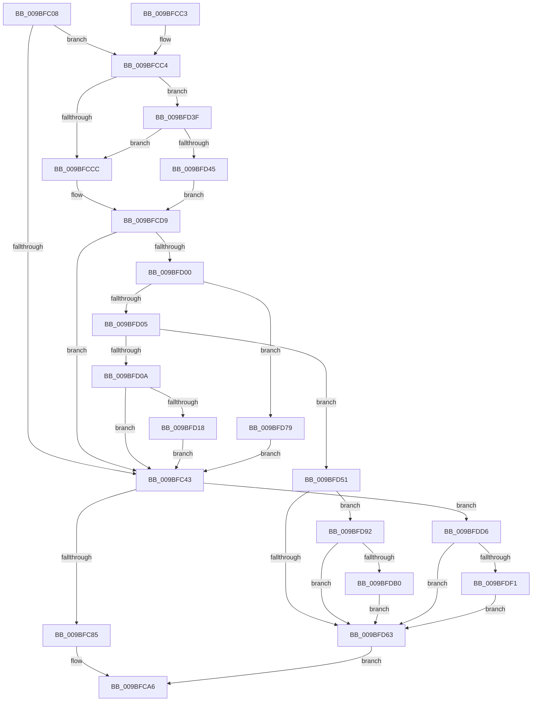

# EtwpFlushBufferToLogfile

- RVA: `0x009BFC08`–`0x009BFE20` (길이 `536` bytes)
- VA: `0x00000001409BFC08`
- 실행 섹션: `PAGE`
- PDB 이름 있음: `예`; PDB Function 태그: `아니요`
- unwind 정보 RVA: `0x0009F4E0`
- 디코드: `120`개 명령, `536/536` bytes 표시
- 미해석 바이트: `0` (있으면 어셈블리에 `.byte`로 보존)

> 이 문서는 커널 이미지의 기계어와 PDB 기호를 분석해 생성했습니다. 4번과 5번은 함수 원형과 자료형을 바이너리 사용 방식에서 추정한 C 해석이며 원본 소스 복구 결과는 아닙니다.

## 1. Dependencies

- 직접 호출 지점: **6**; 고유 호출 대상: **5**
- 직접 호출자로 확인된 함수: **3**
- RIP 상대 이미지 참조: **3**

### Outgoing calls
- `0x009BFC76` → [ZwWriteFile](../../text/6A/ZwWriteFile_function_006AD1D0.md) (function, `0x006AD1D0`)
- `0x009BFD2D` → [EtwpGenerateFileName](../A9/EtwpGenerateFileName_function_00A962C8.md) (function, `0x00A962C8`)
- `0x009BFDA7` → [EtwEventEnabled](../../text/39/EtwEventEnabled_function_00392450.md) (function, `0x00392450`)
- `0x009BFDCF` → [EtwpEventWriteTemplateMaxFileSize](../7B/EtwpEventWriteTemplateMaxFileSize_function_007B60F0.md) (function, `0x007B60F0`)
- `0x009BFDE4` → [EtwEventEnabled](../../text/39/EtwEventEnabled_function_00392450.md) (function, `0x00392450`)
- `0x009BFE16` → [EtwpEventWriteTemplateAdmin](../AA/EtwpEventWriteTemplateAdmin_function_00AA5880.md) (function, `0x00AA5880`)

### Direct callers
- [EtwpBufferingModeFlush](EtwpBufferingModeFlush_function_009BD8F4.md) at `0x009BDBB3`
- [EtwpFlushBuffer](EtwpFlushBuffer_function_009BF570.md) at `0x009BF694`
- [sub_00B2E69A](../B2/Unknown_function_00B2E69A.md) at `0x00B2E902`
- [sub_00B2E69A](../B2/Unknown_function_00B2E69A.md) at `0x00B2E943`

### Static image references
- `0x009BFD99` → RVA `0x00EFF840` (`.data`; read)
- `0x009BFDA0` → RVA `0x00022738` (`.rdata`; read)
- `0x009BFDDD` → RVA `0x00013D98` (`.rdata`; read)

## 2. Other-region calls and transfers

- 다른 실행 섹션으로 향하는 call: **3**
  - `0x009BFC76` → [ZwWriteFile](../../text/6A/ZwWriteFile_function_006AD1D0.md) (`PAGE` → `.text`)
  - `0x009BFDA7` → [EtwEventEnabled](../../text/39/EtwEventEnabled_function_00392450.md) (`PAGE` → `.text`)
  - `0x009BFDE4` → [EtwEventEnabled](../../text/39/EtwEventEnabled_function_00392450.md) (`PAGE` → `.text`)
- 별도 외부 분기/꼬리 이동을 확인하지 못했습니다.

## 3. Assembly (complete function range)

```asm
009BFC08  48 8B C4                        mov rax, rsp
009BFC0B  48 89 58 08                     mov qword ptr [rax + 8], rbx
009BFC0F  48 89 68 10                     mov qword ptr [rax + 0x10], rbp
009BFC13  48 89 70 18                     mov qword ptr [rax + 0x18], rsi
009BFC17  48 89 78 20                     mov qword ptr [rax + 0x20], rdi
009BFC1B  41 57                           push r15
009BFC1D  48 83 EC 60                     sub rsp, 0x60
009BFC21  44 8B 81 24 01 00 00            mov r8d, dword ptr [rcx + 0x124]
009BFC28  45 33 FF                        xor r15d, r15d
009BFC2B  8B 2A                           mov ebp, dword ptr [rdx]
009BFC2D  0F 57 C0                        xorps xmm0, xmm0
009BFC30  48 8B FA                        mov rdi, rdx
009BFC33  48 8B D9                        mov rbx, rcx
009BFC36  0F 11 40 E8                     movups xmmword ptr [rax - 0x18], xmm0
009BFC3A  45 85 C0                        test r8d, r8d
009BFC3D  0F 85 81 00 00 00               jne 0x1409bfcc4
009BFC43  48 8B 8B 20 03 00 00            mov rcx, qword ptr [rbx + 0x320]
009BFC4A  48 8D 44 24 50                  lea rax, [rsp + 0x50]
009BFC4F  4C 89 7C 24 40                  mov qword ptr [rsp + 0x40], r15
009BFC54  48 8D B3 D8 00 00 00            lea rsi, [rbx + 0xd8]
009BFC5B  48 89 74 24 38                  mov qword ptr [rsp + 0x38], rsi
009BFC60  45 33 C9                        xor r9d, r9d
009BFC63  89 6C 24 30                     mov dword ptr [rsp + 0x30], ebp
009BFC67  45 33 C0                        xor r8d, r8d
009BFC6A  48 89 7C 24 28                  mov qword ptr [rsp + 0x28], rdi
009BFC6F  33 D2                           xor edx, edx
009BFC71  48 89 44 24 20                  mov qword ptr [rsp + 0x20], rax
009BFC76  E8 55 D5 CE FF                  call 0x1406ad1d0
009BFC7B  8B F8                           mov edi, eax
009BFC7D  85 C0                           test eax, eax
009BFC7F  0F 88 51 01 00 00               js 0x1409bfdd6
009BFC85  48 8B 8B 50 05 00 00            mov rcx, qword ptr [rbx + 0x550]
009BFC8C  48 8B D5                        mov rdx, rbp
009BFC8F  48 01 16                        add qword ptr [rsi], rdx
009BFC92  F0 48 01 91 38 11 00 00         lock add qword ptr [rcx + 0x1138], rdx
009BFC9A  FF 83 F8 00 00 00               inc dword ptr [rbx + 0xf8]
009BFCA0  FF 83 CC 00 00 00               inc dword ptr [rbx + 0xcc]
009BFCA6  4C 8D 5C 24 60                  lea r11, [rsp + 0x60]
009BFCAB  8B C7                           mov eax, edi
009BFCAD  49 8B 5B 10                     mov rbx, qword ptr [r11 + 0x10]
009BFCB1  49 8B 6B 18                     mov rbp, qword ptr [r11 + 0x18]
009BFCB5  49 8B 73 20                     mov rsi, qword ptr [r11 + 0x20]
009BFCB9  49 8B 7B 28                     mov rdi, qword ptr [r11 + 0x28]
009BFCBD  49 8B E3                        mov rsp, r11
009BFCC0  41 5F                           pop r15
009BFCC2  C3                              ret
009BFCC3  CC                              int3
009BFCC4  8B 49 0C                        mov ecx, dword ptr [rcx + 0xc]
009BFCC7  F6 C1 01                        test cl, 1
009BFCCA  75 73                           jne 0x1409bfd3f
009BFCCC  8B 83 CC 00 00 00               mov eax, dword ptr [rbx + 0xcc]
009BFCD2  48 8B D5                        mov rdx, rbp
009BFCD5  48 0F AF D0                     imul rdx, rax
009BFCD9  8B C1                           mov eax, ecx
009BFCDB  25 00 20 00 00                  and eax, 0x2000
009BFCE0  F7 D8                           neg eax
009BFCE2  48 1B F6                        sbb rsi, rsi
009BFCE5  48 81 E6 00 04 F0 FF            and rsi, 0xfffffffffff00400
009BFCEC  48 81 C6 00 00 10 00            add rsi, 0x100000
009BFCF3  49 0F AF F0                     imul rsi, r8
009BFCF7  48 3B D6                        cmp rdx, rsi
009BFCFA  0F 82 43 FF FF FF               jb 0x1409bfc43
009BFD00  F6 C1 02                        test cl, 2
009BFD03  75 74                           jne 0x1409bfd79
009BFD05  F6 C1 08                        test cl, 8
009BFD08  74 47                           je 0x1409bfd51
009BFD0A  8B 83 38 03 00 00               mov eax, dword ptr [rbx + 0x338]
009BFD10  A8 01                           test al, 1
009BFD12  0F 85 2B FF FF FF               jne 0x1409bfc43
009BFD18  4C 8D 83 B8 00 00 00            lea r8, [rbx + 0xb8]
009BFD1F  48 8D 93 28 01 00 00            lea rdx, [rbx + 0x128]
009BFD26  48 8D 8B A8 00 00 00            lea rcx, [rbx + 0xa8]
009BFD2D  E8 96 65 0D 00                  call 0x140a962c8
009BFD32  F0 83 8B 38 03 00 00 01         lock or dword ptr [rbx + 0x338], 1
009BFD3A  E9 04 FF FF FF                  jmp 0x1409bfc43
009BFD3F  0F BA E1 1A                     bt ecx, 0x1a
009BFD43  73 87                           jae 0x1409bfccc
009BFD45  48 8B D5                        mov rdx, rbp
009BFD48  48 03 93 D8 00 00 00            add rdx, qword ptr [rbx + 0xd8]
009BFD4F  EB 88                           jmp 0x1409bfcd9
009BFD51  B9 00 01 00 00                  mov ecx, 0x100
009BFD56  BF 88 01 00 C0                  mov edi, 0xc0000188
009BFD5B  85 8B 30 03 00 00               test dword ptr [rbx + 0x330], ecx
009BFD61  74 2F                           je 0x1409bfd92
009BFD63  F0 FF 83 FC 00 00 00            lock inc dword ptr [rbx + 0xfc]
009BFD6A  81 FF 9A 00 00 C0               cmp edi, 0xc000009a
009BFD70  41 0F 44 FF                     cmove edi, r15d
009BFD74  E9 2D FF FF FF                  jmp 0x1409bfca6
009BFD79  8B 43 04                        mov eax, dword ptr [rbx + 4]
009BFD7C  48 89 83 D8 00 00 00            mov qword ptr [rbx + 0xd8], rax
009BFD83  C7 83 CC 00 00 00 01 00 00 00   mov dword ptr [rbx + 0xcc], 1
009BFD8D  E9 B1 FE FF FF                  jmp 0x1409bfc43
009BFD92  F0 09 8B 30 03 00 00            lock or dword ptr [rbx + 0x330], ecx
009BFD99  48 8B 0D A0 FA 53 00            mov rcx, qword ptr [rip + 0x53faa0]
009BFDA0  48 8D 15 91 29 66 FF            lea rdx, [rip - 0x99d66f]
009BFDA7  E8 A4 26 9D FF                  call 0x140392450
009BFDAC  84 C0                           test al, al
009BFDAE  74 B3                           je 0x1409bfd63
009BFDB0  8B 43 0C                        mov eax, dword ptr [rbx + 0xc]
009BFDB3  48 8D 8B 98 00 00 00            lea rcx, [rbx + 0x98]
009BFDBA  48 89 74 24 38                  mov qword ptr [rsp + 0x38], rsi
009BFDBF  4C 8D 8B 88 00 00 00            lea r9, [rbx + 0x88]
009BFDC6  89 44 24 30                     mov dword ptr [rsp + 0x30], eax
009BFDCA  48 89 4C 24 20                  mov qword ptr [rsp + 0x20], rcx
009BFDCF  E8 1C 63 DF FF                  call 0x1407b60f0
009BFDD4  EB 8D                           jmp 0x1409bfd63
009BFDD6  48 8B 0D 63 FA 53 00            mov rcx, qword ptr [rip + 0x53fa63]
009BFDDD  48 8D 15 B4 3F 65 FF            lea rdx, [rip - 0x9ac04c]
009BFDE4  E8 67 26 9D FF                  call 0x140392450
009BFDE9  84 C0                           test al, al
009BFDEB  0F 84 72 FF FF FF               je 0x1409bfd63
009BFDF1  8B 43 0C                        mov eax, dword ptr [rbx + 0xc]
009BFDF4  48 8D 8B 98 00 00 00            lea rcx, [rbx + 0x98]
009BFDFB  89 44 24 30                     mov dword ptr [rsp + 0x30], eax
009BFDFF  4C 8D 8B 88 00 00 00            lea r9, [rbx + 0x88]
009BFE06  89 7C 24 28                     mov dword ptr [rsp + 0x28], edi
009BFE0A  48 8D 15 87 3F 65 FF            lea rdx, [rip - 0x9ac079]
009BFE11  48 89 4C 24 20                  mov qword ptr [rsp + 0x20], rcx
009BFE16  E8 65 5A 0E 00                  call 0x140aa5880
009BFE1B  E9 43 FF FF FF                  jmp 0x1409bfd63
```

## 4. C-style interpretation (structured pseudocode)

```c
__int64 __fastcall EtwpFlushBufferToLogfile(__int64 a1, __int64 a2, __int64 a3, int a4)
{
    __int64 result;
    __int64 v_r15;
    __int64 v_rdi;
    __int64 v_rsi;
    __int64 v_rsp;
    unsigned __int64 v_stack_m18;
    unsigned __int64 v_stack_m28;
    unsigned __int64 v_stack_m30;
    unsigned int v_stack_m38;
    unsigned __int64 v_stack_m40;
    unsigned __int64 v_stack_m48;
    unsigned __int64 v_stack_m8;

    *(unsigned __int64 *)(v_rsp + 8) = v_rbx;
    *(unsigned __int64 *)(v_rsp + 16) = v_rbp;
    *(unsigned __int64 *)(v_rsp + 24) = v_rsi;
    *(unsigned __int64 *)(v_rsp + 32) = v_rdi;
    v_rsp = (v_rsp) - (96);
    v_r15 = 0;
    *(unsigned __int64 *)(v_rsp - 24) = v_xmm0;
    if ((unsigned int)((unsigned int)(*(unsigned int *)(a1 + 292))) != 0) goto loc_009BFCC4;
loc_009BFC43:
    v_stack_m28 = 0;
    v_stack_m30 = a1 + 216;
    a4 = 0;
    v_stack_m38 = (unsigned int)((unsigned int)(*(unsigned int *)(a2)));
    a3 = 0;
    v_stack_m40 = a2;
    a2 = 0;
    v_stack_m48 = v_stack_m18;
    result = ZwWriteFile(*(unsigned __int64 *)(a1 + 800), a2, a3, a4);
    if (sign_flag) goto loc_009BFDD6;
loc_009BFCA6:
    return (unsigned int)((unsigned int)((unsigned int)((unsigned int)(result))));
loc_009BFCC4:
    if ((((unsigned __int8)((unsigned int)(*(unsigned int *)(*(unsigned __int64 *)(a1 + 1360) + 12)))) & (1)) != 0) goto loc_009BFD3F;
loc_009BFCCC:
    a2 = (*(unsigned __int64 *)(v_stack_m8 + 24)) * ((unsigned int)(*(unsigned int *)(*(unsigned __int64 *)(v_stack_m8 + 16) + 204)));
loc_009BFCD9:
    result = (unsigned int)(((unsigned int)((unsigned int)((unsigned int)(*(unsigned int *)(*(unsigned __int64 *)(a1 + 1360) + 12))))) & (0x2000ULL));
    result = (unsigned int)(-(result));
    v_rsi = (*(unsigned __int64 *)(v_stack_m8 + 32)) & (0xFFFFFFFFFFF00400ULL);
    v_rsi = (v_rsi) + (0x100000ULL);
    v_rsi = (v_rsi) * (0);
    if (a2 < v_rsi) goto loc_009BFC43;
    if ((((unsigned __int8)((unsigned int)(*(unsigned int *)(*(unsigned __int64 *)(a1 + 1360) + 12)))) & (2)) != 0) goto loc_009BFD79;
    if ((((unsigned __int8)((unsigned int)(*(unsigned int *)(*(unsigned __int64 *)(a1 + 1360) + 12)))) & (8)) == 0) goto loc_009BFD51;
    if ((((unsigned __int8)((unsigned int)(*(unsigned int *)(*(unsigned __int64 *)(v_stack_m8 + 16) + 824)))) & (1)) != 0) goto loc_009BFC43;
    result = EtwpGenerateFileName(*(unsigned __int64 *)(v_stack_m8 + 16) + 168, *(unsigned __int64 *)(v_stack_m8 + 16) + 296, *(unsigned __int64 *)(v_stack_m8 + 16) + 184, a4);
    goto loc_009BFC43;
loc_009BFD3F:
    if (condition_is_above_or_equal) goto loc_009BFCCC;
    a2 = (*(unsigned __int64 *)(v_stack_m8 + 24)) + (*(unsigned __int64 *)(*(unsigned __int64 *)(v_stack_m8 + 16) + 216));
    goto loc_009BFCD9;
loc_009BFD51:
    if (((*(unsigned int *)(*(unsigned __int64 *)(v_stack_m8 + 16) + 816)) & (256)) == 0) goto loc_009BFD92;
loc_009BFD63:
    v_rdi = (unsigned int)(0xC0000188ULL);
    if (((unsigned int)((unsigned int)(0xC0000188ULL))) == 0xC000009AULL) { v_rdi = 0; }
    goto loc_009BFCA6;
loc_009BFD79:
    *(unsigned __int64 *)(*(unsigned __int64 *)(v_stack_m8 + 16) + 216) = (unsigned int)(*(unsigned int *)(*(unsigned __int64 *)(v_stack_m8 + 16) + 4));
    *(unsigned int *)(*(unsigned __int64 *)(v_stack_m8 + 16) + 204) = 1;
    goto loc_009BFC43;
loc_009BFD92:
    result = EtwEventEnabled(*(unsigned __int64 *)(v_rip + 5503648), v_rip - 10081903, *(unsigned __int64 *)(v_stack_m8 + 16) + 184, a4);
    if ((unsigned __int8)(result) == 0) goto loc_009BFD63;
    v_stack_m28 = v_rsi;
    v_stack_m30 = (unsigned int)((unsigned int)(*(unsigned int *)(*(unsigned __int64 *)(v_stack_m8 + 16) + 12)));
    v_stack_m40 = *(unsigned __int64 *)(v_stack_m8 + 16) + 152;
    result = EtwpEventWriteTemplateMaxFileSize(*(unsigned __int64 *)(v_stack_m8 + 16) + 152, v_rip - 10081903, *(unsigned __int64 *)(v_stack_m8 + 16) + 184, *(unsigned __int64 *)(v_stack_m8 + 16) + 136);
    goto loc_009BFD63;
loc_009BFDD6:
    result = EtwEventEnabled(*(unsigned __int64 *)(v_rip + 5503587), v_rip - 10141772, *(unsigned __int64 *)(v_stack_m8 + 16) + 184, *(unsigned __int64 *)(v_stack_m8 + 16) + 136);
    if ((unsigned __int8)(result) == 0) goto loc_009BFD63;
    v_stack_m30 = (unsigned int)((unsigned int)(*(unsigned int *)(*(unsigned __int64 *)(v_stack_m8 + 16) + 12)));
    v_stack_m38 = (unsigned int)(v_rdi);
    v_stack_m40 = *(unsigned __int64 *)(v_stack_m8 + 16) + 152;
    result = EtwpEventWriteTemplateAdmin(*(unsigned __int64 *)(v_stack_m8 + 16) + 152, v_rip - 10141817, *(unsigned __int64 *)(v_stack_m8 + 16) + 184, *(unsigned __int64 *)(v_stack_m8 + 16) + 136);
    goto loc_009BFD63;
}
```

## 5. (Beta) C Style

```c
int64_t EtwpFlushBufferToLogfile(void *Arg1, void *Arg2, int64_t Arg3, int32_t Arg4)
{
    uint8_t *arg1 = (uint8_t *)Arg1;
    uint8_t *arg2 = (uint8_t *)Arg2;

    int64_t result;
    int64_t local_r15;
    int64_t local_rdi;
    int64_t local_rsi;
    int64_t local_rsp;
    uint64_t v_stack_m18;
    uint64_t v_stack_m28;
    uint64_t v_stack_m30;
    uint32_t v_stack_m38;
    uint64_t v_stack_m40;
    uint64_t v_stack_m48;
    uint64_t v_stack_m8;

    *(uint64_t *)(local_rsp + 0x8) = local_rbx;
    *(uint64_t *)(local_rsp + 0x10) = local_rbp;
    *(uint64_t *)(local_rsp + 0x18) = local_rsi;
    *(uint64_t *)(local_rsp + 0x20) = local_rdi;
    local_rsp = (local_rsp) - (96);
    local_r15 = 0;
    *(uint64_t *)(local_rsp - 0x18) = v_xmm0;
    if ((uint32_t)((uint32_t)(*(uint32_t *)(arg1 + 0x124))) != 0) goto loc_009BFCC4;
loc_009BFC43:
    v_stack_m28 = 0;
    v_stack_m30 = Arg1 + 216;
    Arg4 = 0;
    v_stack_m38 = (uint32_t)((uint32_t)(*(uint32_t *)(arg2)));
    Arg3 = 0;
    v_stack_m40 = Arg2;
    Arg2 = 0;
    v_stack_m48 = v_stack_m18;
    result = ZwWriteFile(*(uint64_t *)(arg1 + 0x320), Arg2, Arg3, Arg4);
    if (sign_flag) goto loc_009BFDD6;
loc_009BFCA6:
    return (uint32_t)((uint32_t)((uint32_t)((uint32_t)(result))));
loc_009BFCC4:
    if ((((uint8_t)((uint32_t)(*(uint32_t *)(*(uint64_t *)(arg1 + 0x550) + 0xC)))) & (1)) != 0) goto loc_009BFD3F;
loc_009BFCCC:
    Arg2 = (*(uint64_t *)(v_stack_m8 + 0x18)) * ((uint32_t)(*(uint32_t *)(*(uint64_t *)(v_stack_m8 + 0x10) + 0xCC)));
loc_009BFCD9:
    result = (uint32_t)(((uint32_t)((uint32_t)((uint32_t)(*(uint32_t *)(*(uint64_t *)(arg1 + 0x550) + 0xC))))) & (0x2000ULL));
    result = (uint32_t)(-(result));
    local_rsi = (*(uint64_t *)(v_stack_m8 + 0x20)) & (0xFFFFFFFFFFF00400ULL);
    local_rsi = (local_rsi) + (0x100000ULL);
    local_rsi = (local_rsi) * (0);
    if (Arg2 < local_rsi) goto loc_009BFC43;
    if ((((uint8_t)((uint32_t)(*(uint32_t *)(*(uint64_t *)(arg1 + 0x550) + 0xC)))) & (2)) != 0) goto loc_009BFD79;
    if ((((uint8_t)((uint32_t)(*(uint32_t *)(*(uint64_t *)(arg1 + 0x550) + 0xC)))) & (8)) == 0) goto loc_009BFD51;
    if ((((uint8_t)((uint32_t)(*(uint32_t *)(*(uint64_t *)(v_stack_m8 + 0x10) + 0x338)))) & (1)) != 0) goto loc_009BFC43;
    result = EtwpGenerateFileName(*(uint64_t *)(v_stack_m8 + 0x10) + 168, *(uint64_t *)(v_stack_m8 + 0x10) + 296, *(uint64_t *)(v_stack_m8 + 0x10) + 184, Arg4);
    goto loc_009BFC43;
loc_009BFD3F:
    if (condition_is_above_or_equal) goto loc_009BFCCC;
    Arg2 = (*(uint64_t *)(v_stack_m8 + 0x18)) + (*(uint64_t *)(*(uint64_t *)(v_stack_m8 + 0x10) + 0xD8));
    goto loc_009BFCD9;
loc_009BFD51:
    if (((*(uint32_t *)(*(uint64_t *)(v_stack_m8 + 0x10) + 0x330)) & (256)) == 0) goto loc_009BFD92;
loc_009BFD63:
    local_rdi = (uint32_t)(0xC0000188ULL);
    if (((uint32_t)((uint32_t)(0xC0000188ULL))) == 0xC000009AULL) { local_rdi = 0; }
    goto loc_009BFCA6;
loc_009BFD79:
    *(uint64_t *)(*(uint64_t *)(v_stack_m8 + 0x10) + 0xD8) = (uint32_t)(*(uint32_t *)(*(uint64_t *)(v_stack_m8 + 0x10) + 0x4));
    *(uint32_t *)(*(uint64_t *)(v_stack_m8 + 0x10) + 0xCC) = 1;
    goto loc_009BFC43;
loc_009BFD92:
    result = EtwEventEnabled(*(uint64_t *)(v_rip + 0x53FAA0), v_rip - 10081903, *(uint64_t *)(v_stack_m8 + 0x10) + 184, Arg4);
    if ((uint8_t)(result) == 0) goto loc_009BFD63;
    v_stack_m28 = local_rsi;
    v_stack_m30 = (uint32_t)((uint32_t)(*(uint32_t *)(*(uint64_t *)(v_stack_m8 + 0x10) + 0xC)));
    v_stack_m40 = *(uint64_t *)(v_stack_m8 + 0x10) + 152;
    result = EtwpEventWriteTemplateMaxFileSize(*(uint64_t *)(v_stack_m8 + 0x10) + 152, v_rip - 10081903, *(uint64_t *)(v_stack_m8 + 0x10) + 184, *(uint64_t *)(v_stack_m8 + 0x10) + 136);
    goto loc_009BFD63;
loc_009BFDD6:
    result = EtwEventEnabled(*(uint64_t *)(v_rip + 0x53FA63), v_rip - 10141772, *(uint64_t *)(v_stack_m8 + 0x10) + 184, *(uint64_t *)(v_stack_m8 + 0x10) + 136);
    if ((uint8_t)(result) == 0) goto loc_009BFD63;
    v_stack_m30 = (uint32_t)((uint32_t)(*(uint32_t *)(*(uint64_t *)(v_stack_m8 + 0x10) + 0xC)));
    v_stack_m38 = (uint32_t)(local_rdi);
    v_stack_m40 = *(uint64_t *)(v_stack_m8 + 0x10) + 152;
    result = EtwpEventWriteTemplateAdmin(*(uint64_t *)(v_stack_m8 + 0x10) + 152, v_rip - 10141817, *(uint64_t *)(v_stack_m8 + 0x10) + 184, *(uint64_t *)(v_stack_m8 + 0x10) + 136);
    goto loc_009BFD63;
}
```

### 관측된 메모리 오프셋

구조체 형식이 확인되지 않은 접근은 인자 기준의 오프셋으로만 기록했습니다.

| 기준 인자 | 오프셋 표현 | 폭 (bit) | 접근 |
|---|---:|---:|---|
| `Arg1` | `+ 0x0` | `64` | `R/W` |
| `Arg1` | `+ 0x4` | `32` | `R` |
| `Arg1` | `+ 0xC` | `32` | `R` |
| `Arg1` | `+ 0x88` | `64` | `R` |
| `Arg1` | `+ 0x98` | `64` | `R` |
| `Arg1` | `+ 0xA8` | `64` | `R` |
| `Arg1` | `+ 0xB8` | `64` | `R` |
| `Arg1` | `+ 0xCC` | `32` | `R` |
| `Arg1` | `+ 0xCC` | `32` | `R/W` |
| `Arg1` | `+ 0xCC` | `32` | `W` |
| `Arg1` | `+ 0xD8` | `64` | `R` |
| `Arg1` | `+ 0xD8` | `64` | `W` |
| `Arg1` | `+ 0xF8` | `32` | `R/W` |
| `Arg1` | `+ 0xFC` | `32` | `R/W` |
| `Arg1` | `+ 0x124` | `32` | `R` |
| `Arg1` | `+ 0x128` | `64` | `R` |
| `Arg1` | `+ 0x320` | `64` | `R` |
| `Arg1` | `+ 0x330` | `32` | `R` |
| `Arg1` | `+ 0x330` | `32` | `R/W` |
| `Arg1` | `+ 0x338` | `32` | `R` |
| `Arg1` | `+ 0x338` | `32` | `R/W` |
| `Arg1` | `+ 0x550` | `64` | `R` |
| `Arg2` | `+ 0x0` | `32` | `R` |

## 6. Execution-region graph

[열기: 2D/3D 그래프와 함수 탐색 컨트롤 패널](../../../control-panel.html?section=page&rva=0x009BFC08&view=graph)

- 2D 그래프는 위에서 아래로 흐르고, 3D 그래프는 빈 공간을 드래그해 회전합니다. Shift+드래그는 이동, 휠은 확대·축소, 함수 노드 선택은 대상 보고서 이동입니다.

### Static fallback


