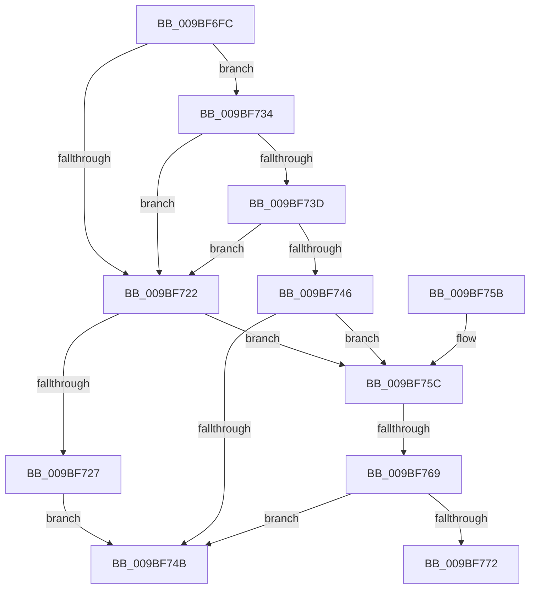

# EtwpFlushBufferToRealtime

- RVA: `0x009BF6FC`–`0x009BF777` (길이 `123` bytes)
- VA: `0x00000001409BF6FC`
- 실행 섹션: `PAGE`
- PDB 이름 있음: `예`; PDB Function 태그: `예`
- unwind 정보 RVA: `0x00063C10`
- 디코드: `34`개 명령, `123/123` bytes 표시
- 미해석 바이트: `0` (있으면 어셈블리에 `.byte`로 보존)

> 이 문서는 커널 이미지의 기계어와 PDB 기호를 분석해 생성했습니다. 4번과 5번은 함수 원형과 자료형을 바이너리 사용 방식에서 추정한 C 해석이며 원본 소스 복구 결과는 아닙니다.

## 1. Dependencies

- 직접 호출 지점: **2**; 고유 호출 대상: **2**
- 직접 호출자로 확인된 함수: **1**
- RIP 상대 이미지 참조: **0**

### Outgoing calls
- `0x009BF72D` → [EtwpRealtimeSaveBuffer](EtwpRealtimeSaveBuffer_function_009BFF48.md) (function, `0x009BFF48`)
- `0x009BF73D` → [EtwpRealtimeDeliverBuffer](EtwpRealtimeDeliverBuffer_function_009BF780.md) (function, `0x009BF780`)

### Direct callers
- [EtwpFlushBuffer](EtwpFlushBuffer_function_009BF570.md) at `0x009BF61D`

### Static image references
- 디코드된 RIP-relative 메모리 참조가 없습니다.

## 2. Other-region calls and transfers

- 다른 실행 섹션으로 향하는 call: **0**
- call이 아닌 외부 분기/꼬리 이동: **2**
  - `0x009BF763` → [sub_00B2EB06](../B2/Unknown_function_00B2EB06.md) (`tail-transfer`)
  - `0x009BF772` → [sub_00B2EB06](../B2/Unknown_function_00B2EB06.md) (`tail-transfer`)

## 3. Assembly (complete function range)

```asm
009BF6FC  48 89 5C 24 08                  mov qword ptr [rsp + 8], rbx
009BF701  48 89 74 24 10                  mov qword ptr [rsp + 0x10], rsi
009BF706  57                              push rdi
009BF707  48 83 EC 20                     sub rsp, 0x20
009BF70B  83 B9 58 01 00 00 00            cmp dword ptr [rcx + 0x158], 0
009BF712  41 8A F8                        mov dil, r8b
009BF715  48 8B F2                        mov rsi, rdx
009BF718  48 8B D9                        mov rbx, rcx
009BF71B  B8 01 00 00 C0                  mov eax, 0xc0000001
009BF720  77 12                           ja 0x1409bf734
009BF722  40 84 FF                        test dil, dil
009BF725  75 35                           jne 0x1409bf75c
009BF727  48 8B D6                        mov rdx, rsi
009BF72A  48 8B CB                        mov rcx, rbx
009BF72D  E8 16 08 00 00                  call 0x1409bff48
009BF732  EB 17                           jmp 0x1409bf74b
009BF734  83 B9 A8 01 00 00 00            cmp dword ptr [rcx + 0x1a8], 0
009BF73B  75 E5                           jne 0x1409bf722
009BF73D  E8 3E 00 00 00                  call 0x1409bf780
009BF742  85 C0                           test eax, eax
009BF744  78 DC                           js 0x1409bf722
009BF746  40 84 FF                        test dil, dil
009BF749  75 11                           jne 0x1409bf75c
009BF74B  48 8B 5C 24 30                  mov rbx, qword ptr [rsp + 0x30]
009BF750  48 8B 74 24 38                  mov rsi, qword ptr [rsp + 0x38]
009BF755  48 83 C4 20                     add rsp, 0x20
009BF759  5F                              pop rdi
009BF75A  C3                              ret
009BF75B  CC                              int3
009BF75C  83 BB 58 01 00 00 00            cmp dword ptr [rbx + 0x158], 0
009BF763  0F 84 9D F3 16 00               je 0x140b2eb06
009BF769  83 BB A8 01 00 00 00            cmp dword ptr [rbx + 0x1a8], 0
009BF770  74 D9                           je 0x1409bf74b
009BF772  E9 8F F3 16 00                  jmp 0x140b2eb06
```

## 4. C-style interpretation (structured pseudocode)

```c
__int64 __fastcall EtwpFlushBufferToRealtime(__int64 a1, __int64 a2, unsigned __int8 a3)
{
    __int64 result;
    __int64 v_rsp;
    unsigned __int64 v_stack_p10;
    unsigned __int64 v_stack_p8;

    v_stack_p8 = v_rbx;
    v_stack_p10 = v_rsi;
    v_rsp = (v_rsp) - (32);
    if ((*(unsigned int *)(a1 + 344)) > 0) goto loc_009BF734;
loc_009BF722:
    if (a3 != 0) goto loc_009BF75C;
    result = EtwpRealtimeSaveBuffer(a1, a2, a3, a4);
    goto loc_009BF74B;
loc_009BF734:
    if ((*(unsigned int *)(a1 + 424)) != 0) goto loc_009BF722;
    result = EtwpRealtimeDeliverBuffer(a1, a2, a3, a4);
    if (sign_flag) goto loc_009BF722;
    if (a3 != 0) goto loc_009BF75C;
loc_009BF74B:
    v_rsp = (v_rsp) + (32);
    return result;
loc_009BF75C:
    if ((*(unsigned int *)(v_stack_p8 + 424)) == 0) goto loc_009BF74B;
}
```

## 5. (Beta) C Style

```c
int64_t EtwpFlushBufferToRealtime(void *Arg1, int64_t Arg2, uint8_t Arg3)
{
    uint8_t *arg1 = (uint8_t *)Arg1;

    int64_t result;
    int64_t local_rsp;
    uint64_t v_stack_p10;
    uint64_t v_stack_p8;

    v_stack_p8 = local_rbx;
    v_stack_p10 = local_rsi;
    local_rsp = (local_rsp) - (32);
    if ((*(uint32_t *)(arg1 + 0x158)) > 0) goto loc_009BF734;
loc_009BF722:
    if (Arg3 != 0) goto loc_009BF75C;
    result = EtwpRealtimeSaveBuffer(Arg1, Arg2, Arg3, a4);
    goto loc_009BF74B;
loc_009BF734:
    if ((*(uint32_t *)(arg1 + 0x1A8)) != 0) goto loc_009BF722;
    result = EtwpRealtimeDeliverBuffer(Arg1, Arg2, Arg3, a4);
    if (sign_flag) goto loc_009BF722;
    if (Arg3 != 0) goto loc_009BF75C;
loc_009BF74B:
    local_rsp = (local_rsp) + (32);
    return result;
loc_009BF75C:
    if ((*(uint32_t *)(v_stack_p8 + 0x1A8)) == 0) goto loc_009BF74B;
}
```

### 관측된 메모리 오프셋

구조체 형식이 확인되지 않은 접근은 인자 기준의 오프셋으로만 기록했습니다.

| 기준 인자 | 오프셋 표현 | 폭 (bit) | 접근 |
|---|---:|---:|---|
| `Arg1` | `+ 0x158` | `32` | `R` |
| `Arg1` | `+ 0x1A8` | `32` | `R` |

## 6. Execution-region graph

[열기: 2D/3D 그래프와 함수 탐색 컨트롤 패널](../../../control-panel.html?section=page&rva=0x009BF6FC&view=graph)

- 2D 그래프는 위에서 아래로 흐르고, 3D 그래프는 빈 공간을 드래그해 회전합니다. Shift+드래그는 이동, 휠은 확대·축소, 함수 노드 선택은 대상 보고서 이동입니다.

### Static fallback


