# EtwpFlushBuffer

- RVA: `0x009BF570`–`0x009BF6F4` (길이 `388` bytes)
- VA: `0x00000001409BF570`
- 실행 섹션: `PAGE`
- PDB 이름 있음: `예`; PDB Function 태그: `아니요`
- unwind 정보 RVA: `0x0009F410`
- 디코드: `112`개 명령, `388/388` bytes 표시
- 미해석 바이트: `0` (있으면 어셈블리에 `.byte`로 보존)

> 이 문서는 커널 이미지의 기계어와 PDB 기호를 분석해 생성했습니다. 4번과 5번은 함수 원형과 자료형을 바이너리 사용 방식에서 추정한 C 해석이며 원본 소스 복구 결과는 아닙니다.

## 1. Dependencies

- 직접 호출 지점: **6**; 고유 호출 대상: **5**
- 직접 호출자로 확인된 함수: **2**
- RIP 상대 이미지 참조: **0**

### Outgoing calls
- `0x009BF5E7` → [memset](../../text/6C/memset_function_006C6C40.md) (function, `0x006C6C40`)
- `0x009BF61D` → [EtwpFlushBufferToRealtime](EtwpFlushBufferToRealtime_function_009BF6FC.md) (function, `0x009BF6FC`)
- `0x009BF694` → [EtwpFlushBufferToLogfile](EtwpFlushBufferToLogfile_function_009BFC08.md) (function, `0x009BFC08`)
- `0x009BF6AA` → [EtwpSendSessionNotification](EtwpSendSessionNotification_function_009BFE28.md) (function, `0x009BFE28`)
- `0x009BF6CD` → [EtwpFileModeCompress](../../text/42/EtwpFileModeCompress_function_004241B8.md) (function, `0x004241B8`)
- `0x009BF6EA` → [EtwpSendSessionNotification](EtwpSendSessionNotification_function_009BFE28.md) (function, `0x009BFE28`)

### Direct callers
- [EtwpFlushActiveBuffers](EtwpFlushActiveBuffers_function_009BDEF4.md) at `0x009BE08B`
- [sub_00B2E69A](../B2/Unknown_function_00B2E69A.md) at `0x00B2E7CB`

### Static image references
- 디코드된 RIP-relative 메모리 참조가 없습니다.

## 2. Other-region calls and transfers

- 다른 실행 섹션으로 향하는 call: **2**
  - `0x009BF5E7` → [memset](../../text/6C/memset_function_006C6C40.md) (`PAGE` → `.text`)
  - `0x009BF6CD` → [EtwpFileModeCompress](../../text/42/EtwpFileModeCompress_function_004241B8.md) (`PAGE` → `.text`)
- 별도 외부 분기/꼬리 이동을 확인하지 못했습니다.

## 3. Assembly (complete function range)

```asm
009BF570  48 8B C4                        mov rax, rsp
009BF573  48 89 58 08                     mov qword ptr [rax + 8], rbx
009BF577  48 89 68 10                     mov qword ptr [rax + 0x10], rbp
009BF57B  48 89 70 18                     mov qword ptr [rax + 0x18], rsi
009BF57F  48 89 78 20                     mov qword ptr [rax + 0x20], rdi
009BF583  41 56                           push r14
009BF585  48 83 EC 20                     sub rsp, 0x20
009BF589  48 8B D9                        mov rbx, rcx
009BF58C  BE 01 00 00 C0                  mov esi, 0xc0000001
009BF591  8B 4A 04                        mov ecx, dword ptr [rdx + 4]
009BF594  45 0F B7 F0                     movzx r14d, r8w
009BF598  48 8B FA                        mov rdi, rdx
009BF59B  8B EE                           mov ebp, esi
009BF59D  85 C9                           test ecx, ecx
009BF59F  0F 84 16 01 00 00               je 0x1409bf6bb
009BF5A5  89 4A 30                        mov dword ptr [rdx + 0x30], ecx
009BF5A8  66 41 83 FE 01                  cmp r14w, 1
009BF5AD  74 09                           je 0x1409bf5b8
009BF5AF  83 F9 48                        cmp ecx, 0x48
009BF5B2  0F 84 C1 00 00 00               je 0x1409bf679
009BF5B8  41 0F B7 C6                     movzx eax, r14w
009BF5BC  66 83 C8 20                     or ax, 0x20
009BF5C0  66 89 42 34                     mov word ptr [rdx + 0x34], ax
009BF5C4  48 83 BB 20 03 00 00 00         cmp qword ptr [rbx + 0x320], 0
009BF5CC  75 06                           jne 0x1409bf5d4
009BF5CE  41 F6 C6 40                     test r14b, 0x40
009BF5D2  75 18                           jne 0x1409bf5ec
009BF5D4  8B 02                           mov eax, dword ptr [rdx]
009BF5D6  2B C1                           sub eax, ecx
009BF5D8  85 C0                           test eax, eax
009BF5DA  7E 10                           jle 0x1409bf5ec
009BF5DC  4C 63 C0                        movsxd r8, eax
009BF5DF  48 03 CF                        add rcx, rdi
009BF5E2  BA FF 00 00 00                  mov edx, 0xff
009BF5E7  E8 54 76 D0 FF                  call 0x1406c6c40
009BF5EC  33 C9                           xor ecx, ecx
009BF5EE  B8 22 00 00 80                  mov eax, 0x80000022
009BF5F3  83 7F 30 48                     cmp dword ptr [rdi + 0x30], 0x48
009BF5F7  0F 44 C8                        cmove ecx, eax
009BF5FA  3B C8                           cmp ecx, eax
009BF5FC  41 0F 94 C0                     sete r8b
009BF600  66 41 83 E6 01                  and r14w, 1
009BF605  3B C8                           cmp ecx, eax
009BF607  0F 84 A4 00 00 00               je 0x1409bf6b1
009BF60D  8B 83 30 03 00 00               mov eax, dword ptr [rbx + 0x330]
009BF613  A8 08                           test al, 8
009BF615  74 15                           je 0x1409bf62c
009BF617  48 8B D7                        mov rdx, rdi
009BF61A  48 8B CB                        mov rcx, rbx
009BF61D  E8 DA 00 00 00                  call 0x1409bf6fc
009BF622  8B F0                           mov esi, eax
009BF624  85 C0                           test eax, eax
009BF626  0F 88 B3 00 00 00               js 0x1409bf6df
009BF62C  48 83 BB 20 03 00 00 00         cmp qword ptr [rbx + 0x320], 0
009BF634  75 4F                           jne 0x1409bf685
009BF636  B8 00 00 00 80                  mov eax, 0x80000000
009BF63B  8D 0C 06                        lea ecx, [rsi + rax]
009BF63E  85 C8                           test eax, ecx
009BF640  74 1E                           je 0x1409bf660
009BF642  33 C0                           xor eax, eax
009BF644  48 8B 5C 24 30                  mov rbx, qword ptr [rsp + 0x30]
009BF649  48 8B 6C 24 38                  mov rbp, qword ptr [rsp + 0x38]
009BF64E  48 8B 74 24 40                  mov rsi, qword ptr [rsp + 0x40]
009BF653  48 8B 7C 24 48                  mov rdi, qword ptr [rsp + 0x48]
009BF658  48 83 C4 20                     add rsp, 0x20
009BF65C  41 5E                           pop r14
009BF65E  C3                              ret
009BF65F  CC                              int3
009BF660  81 FE 88 01 00 C0               cmp esi, 0xc0000188
009BF666  74 DA                           je 0x1409bf642
009BF668  85 ED                           test ebp, ebp
009BF66A  79 D6                           jns 0x1409bf642
009BF66C  81 FD 01 00 00 C0               cmp ebp, 0xc0000001
009BF672  0F 45 F5                        cmovne esi, ebp
009BF675  8B C6                           mov eax, esi
009BF677  EB CB                           jmp 0x1409bf644
009BF679  B8 22 00 00 80                  mov eax, 0x80000022
009BF67E  8B C8                           mov ecx, eax
009BF680  E9 75 FF FF FF                  jmp 0x1409bf5fa
009BF685  8B 43 0C                        mov eax, dword ptr [rbx + 0xc]
009BF688  0F BA E0 1A                     bt eax, 0x1a
009BF68C  72 35                           jb 0x1409bf6c3
009BF68E  48 8B D7                        mov rdx, rdi
009BF691  48 8B CB                        mov rcx, rbx
009BF694  E8 6F 05 00 00                  call 0x1409bfc08
009BF699  8B E8                           mov ebp, eax
009BF69B  85 C0                           test eax, eax
009BF69D  79 97                           jns 0x1409bf636
009BF69F  44 8B C0                        mov r8d, eax
009BF6A2  BA 03 00 00 00                  mov edx, 3
009BF6A7  48 8B CB                        mov rcx, rbx
009BF6AA  E8 79 07 00 00                  call 0x1409bfe28
009BF6AF  EB 85                           jmp 0x1409bf636
009BF6B1  45 84 F6                        test r14b, r14b
009BF6B4  74 8C                           je 0x1409bf642
009BF6B6  E9 52 FF FF FF                  jmp 0x1409bf60d
009BF6BB  8B 4A 08                        mov ecx, dword ptr [rdx + 8]
009BF6BE  E9 E2 FE FF FF                  jmp 0x1409bf5a5
009BF6C3  A8 01                           test al, 1
009BF6C5  74 C7                           je 0x1409bf68e
009BF6C7  48 8B D7                        mov rdx, rdi
009BF6CA  48 8B CB                        mov rcx, rbx
009BF6CD  E8 E6 4A A6 FF                  call 0x1404241b8
009BF6D2  85 C0                           test eax, eax
009BF6D4  75 B8                           jne 0x1409bf68e
009BF6D6  48 8B BB 88 05 00 00            mov rdi, qword ptr [rbx + 0x588]
009BF6DD  EB AF                           jmp 0x1409bf68e
009BF6DF  44 8B C0                        mov r8d, eax
009BF6E2  BA 04 00 00 00                  mov edx, 4
009BF6E7  48 8B CB                        mov rcx, rbx
009BF6EA  E8 39 07 00 00                  call 0x1409bfe28
009BF6EF  E9 38 FF FF FF                  jmp 0x1409bf62c
```

## 4. C-style interpretation (structured pseudocode)

```c
__int64 __fastcall EtwpFlushBuffer(__int64 a1, __int64 a2, unsigned __int16 a3)
{
    __int64 result;
    __int64 v_r14;
    __int64 v_rsi;
    __int64 v_rsp;
    unsigned __int64 v_stack_p10;
    unsigned __int64 v_stack_p18;
    unsigned __int64 v_stack_p20;
    unsigned __int64 v_stack_p8;

    *(unsigned __int64 *)(v_rsp + 8) = v_rbx;
    *(unsigned __int64 *)(v_rsp + 16) = v_rbp;
    *(unsigned __int64 *)(v_rsp + 24) = v_rsi;
    *(unsigned __int64 *)(v_rsp + 32) = v_rdi;
    v_rsp = (v_rsp) - (32);
    if ((unsigned int)((unsigned int)(*(unsigned int *)(a2 + 4))) == 0) goto loc_009BF6BB;
loc_009BF5A5:
    *(unsigned int *)(a2 + 48) = (unsigned int)((unsigned int)(*(unsigned int *)(a2 + 4)));
    if (a3 == 1) goto loc_009BF5B8;
    if (((unsigned int)((unsigned int)(*(unsigned int *)(a2 + 4)))) == 72) goto loc_009BF679;
loc_009BF5B8:
    result = (unsigned __int16)((a3) | (32));
    *(unsigned __int16 *)(a2 + 52) = (unsigned __int16)(result);
    if ((*(unsigned __int64 *)(a1 + 800)) != 0) goto loc_009BF5D4;
    if ((((unsigned __int8)(a3)) & (64)) != 0) goto loc_009BF5EC;
loc_009BF5D4:
    result = (unsigned int)(((unsigned int)(*(unsigned int *)(a2))) - ((unsigned int)((unsigned int)(*(unsigned int *)(a2 + 4)))));
    if (!(condition_is_less_or_equal)) {
        a3 = (int)((unsigned int)(result));
        a1 = ((unsigned int)(*(unsigned int *)(a2 + 4))) + (a2);
        a2 = 255;
        result = memset(a1, a2, a3, a4);
    }
    a1 = 0;
    if ((*(unsigned int *)(a2 + 48)) == 72) { a1 = (unsigned int)((unsigned int)(0x80000022ULL)); }
loc_009BF5FA:
    a3 = (((unsigned int)(a1)) == ((unsigned int)((unsigned int)(0x80000022ULL)))) ? 1 : 0;
    v_r14 = (unsigned __int16)((a3) & (1));
    if (((unsigned int)(a1)) == ((unsigned int)((unsigned int)(0x80000022ULL)))) goto loc_009BF6B1;
loc_009BF60D:
    if ((((unsigned __int8)((unsigned int)(*(unsigned int *)(a1 + 816)))) & (8)) == 0) goto loc_009BF62C;
    result = EtwpFlushBufferToRealtime(a1, a2, a3, a4);
    if (sign_flag) goto loc_009BF6DF;
loc_009BF62C:
    if ((*(unsigned __int64 *)(a1 + 800)) != 0) goto loc_009BF685;
loc_009BF636:
    if ((((unsigned int)((unsigned int)(0x80000000ULL))) & ((unsigned int)((unsigned int)((unsigned int)(result)) + (unsigned int)(0x80000000ULL) * 1))) == 0) goto loc_009BF660;
loc_009BF642:
    result = 0;
loc_009BF644:
    v_rsp = (v_rsp) + (32);
    return result;
loc_009BF660:
    if (((unsigned int)(v_stack_p18)) == 0xC0000188ULL) goto loc_009BF642;
    if (!sign_flag) goto loc_009BF642;
    v_rsi = v_stack_p18;
    if (((unsigned int)(v_stack_p10)) != 0xC0000001ULL) { v_rsi = (unsigned int)(v_stack_p10); }
    goto loc_009BF644;
loc_009BF679:
    goto loc_009BF5FA;
loc_009BF685:
    if (((unsigned int)(v_stack_p10)) < 0xC0000001ULL) goto loc_009BF6C3;
loc_009BF68E:
    result = EtwpFlushBufferToLogfile(v_stack_p8, v_stack_p20, a3, a4);
    if (!sign_flag) goto loc_009BF636;
    result = EtwpSendSessionNotification(v_stack_p8, 3, (unsigned int)((unsigned int)(result)), a4);
    goto loc_009BF636;
loc_009BF6B1:
    if ((unsigned __int8)(v_r14) == 0) goto loc_009BF642;
    goto loc_009BF60D;
loc_009BF6BB:
    goto loc_009BF5A5;
loc_009BF6C3:
    if ((((unsigned __int8)(result)) & (1)) == 0) goto loc_009BF68E;
    result = EtwpFileModeCompress(v_stack_p8, v_stack_p20, (unsigned int)((unsigned int)(result)), a4);
    if ((unsigned int)(result) != 0) goto loc_009BF68E;
    goto loc_009BF68E;
loc_009BF6DF:
    result = EtwpSendSessionNotification(v_stack_p8, 4, (unsigned int)((unsigned int)(result)), a4);
    goto loc_009BF62C;
}
```

## 5. (Beta) C Style

```c
int64_t EtwpFlushBuffer(void *Arg1, void *Arg2, uint16_t Arg3)
{
    uint8_t *arg1 = (uint8_t *)Arg1;
    uint8_t *arg2 = (uint8_t *)Arg2;

    int64_t result;
    int64_t local_r14;
    int64_t local_rsi;
    int64_t local_rsp;
    uint64_t v_stack_p10;
    uint64_t v_stack_p18;
    uint64_t v_stack_p20;
    uint64_t v_stack_p8;

    *(uint64_t *)(local_rsp + 0x8) = local_rbx;
    *(uint64_t *)(local_rsp + 0x10) = local_rbp;
    *(uint64_t *)(local_rsp + 0x18) = local_rsi;
    *(uint64_t *)(local_rsp + 0x20) = local_rdi;
    local_rsp = (local_rsp) - (32);
    if ((uint32_t)((uint32_t)(*(uint32_t *)(arg2 + 0x4))) == 0) goto loc_009BF6BB;
loc_009BF5A5:
    *(uint32_t *)(arg2 + 0x30) = (uint32_t)((uint32_t)(*(uint32_t *)(arg2 + 0x4)));
    if (Arg3 == 1) goto loc_009BF5B8;
    if (((uint32_t)((uint32_t)(*(uint32_t *)(arg2 + 0x4)))) == 72) goto loc_009BF679;
loc_009BF5B8:
    result = (uint16_t)((Arg3) | (32));
    *(uint16_t *)(arg2 + 0x34) = (uint16_t)(result);
    if ((*(uint64_t *)(arg1 + 0x320)) != 0) goto loc_009BF5D4;
    if ((((uint8_t)(Arg3)) & (64)) != 0) goto loc_009BF5EC;
loc_009BF5D4:
    result = (uint32_t)(((uint32_t)(*(uint32_t *)(arg2))) - ((uint32_t)((uint32_t)(*(uint32_t *)(arg2 + 0x4)))));
    if (!(condition_is_less_or_equal)) {
        Arg3 = (int32_t)((uint32_t)(result));
        Arg1 = ((uint32_t)(*(uint32_t *)(arg2 + 0x4))) + (Arg2);
        Arg2 = 255;
        result = memset(Arg1, Arg2, Arg3, a4);
    }
    Arg1 = 0;
    if ((*(uint32_t *)(arg2 + 0x30)) == 72) { Arg1 = (uint32_t)((uint32_t)(0x80000022ULL)); }
loc_009BF5FA:
    Arg3 = (((uint32_t)(Arg1)) == ((uint32_t)((uint32_t)(0x80000022ULL)))) ? 1 : 0;
    local_r14 = (uint16_t)((Arg3) & (1));
    if (((uint32_t)(Arg1)) == ((uint32_t)((uint32_t)(0x80000022ULL)))) goto loc_009BF6B1;
loc_009BF60D:
    if ((((uint8_t)((uint32_t)(*(uint32_t *)(arg1 + 0x330)))) & (8)) == 0) goto loc_009BF62C;
    result = EtwpFlushBufferToRealtime(Arg1, Arg2, Arg3, a4);
    if (sign_flag) goto loc_009BF6DF;
loc_009BF62C:
    if ((*(uint64_t *)(arg1 + 0x320)) != 0) goto loc_009BF685;
loc_009BF636:
    if ((((uint32_t)((uint32_t)(0x80000000ULL))) & ((uint32_t)((uint32_t)((uint32_t)(result)) + (uint32_t)(0x80000000ULL) * 1))) == 0) goto loc_009BF660;
loc_009BF642:
    result = 0;
loc_009BF644:
    local_rsp = (local_rsp) + (32);
    return result;
loc_009BF660:
    if (((uint32_t)(v_stack_p18)) == 0xC0000188ULL) goto loc_009BF642;
    if (!sign_flag) goto loc_009BF642;
    local_rsi = v_stack_p18;
    if (((uint32_t)(v_stack_p10)) != 0xC0000001ULL) { local_rsi = (uint32_t)(v_stack_p10); }
    goto loc_009BF644;
loc_009BF679:
    goto loc_009BF5FA;
loc_009BF685:
    if (((uint32_t)(v_stack_p10)) < 0xC0000001ULL) goto loc_009BF6C3;
loc_009BF68E:
    result = EtwpFlushBufferToLogfile(v_stack_p8, v_stack_p20, Arg3, a4);
    if (!sign_flag) goto loc_009BF636;
    result = EtwpSendSessionNotification(v_stack_p8, 3, (uint32_t)((uint32_t)(result)), a4);
    goto loc_009BF636;
loc_009BF6B1:
    if ((uint8_t)(local_r14) == 0) goto loc_009BF642;
    goto loc_009BF60D;
loc_009BF6BB:
    goto loc_009BF5A5;
loc_009BF6C3:
    if ((((uint8_t)(result)) & (1)) == 0) goto loc_009BF68E;
    result = EtwpFileModeCompress(v_stack_p8, v_stack_p20, (uint32_t)((uint32_t)(result)), a4);
    if ((uint32_t)(result) != 0) goto loc_009BF68E;
    goto loc_009BF68E;
loc_009BF6DF:
    result = EtwpSendSessionNotification(v_stack_p8, 4, (uint32_t)((uint32_t)(result)), a4);
    goto loc_009BF62C;
}
```

### 관측된 메모리 오프셋

구조체 형식이 확인되지 않은 접근은 인자 기준의 오프셋으로만 기록했습니다.

| 기준 인자 | 오프셋 표현 | 폭 (bit) | 접근 |
|---|---:|---:|---|
| `Arg1` | `+ 0xC` | `32` | `R` |
| `Arg1` | `+ 0x320` | `64` | `R` |
| `Arg1` | `+ 0x330` | `32` | `R` |
| `Arg1` | `+ 0x588` | `64` | `R` |
| `Arg2` | `+ 0x0` | `32` | `R` |
| `Arg2` | `+ 0x4` | `32` | `R` |
| `Arg2` | `+ 0x8` | `32` | `R` |
| `Arg2` | `+ 0x30` | `32` | `R` |
| `Arg2` | `+ 0x30` | `32` | `W` |
| `Arg2` | `+ 0x34` | `16` | `W` |

## 6. Execution-region graph

[열기: 2D/3D 그래프와 함수 탐색 컨트롤 패널](../../../control-panel.html?section=page&rva=0x009BF570&view=graph)

- 2D 그래프는 위에서 아래로 흐르고, 3D 그래프는 빈 공간을 드래그해 회전합니다. Shift+드래그는 이동, 휠은 확대·축소, 함수 노드 선택은 대상 보고서 이동입니다.

### Static fallback

```mermaid
flowchart TD
  bb_009BF570[BB_009BF570]
  bb_009BF5A5[BB_009BF5A5]
  bb_009BF5AF[BB_009BF5AF]
  bb_009BF5B8[BB_009BF5B8]
  bb_009BF5CE[BB_009BF5CE]
  bb_009BF5D4[BB_009BF5D4]
  bb_009BF5DC[BB_009BF5DC]
  bb_009BF5EC[BB_009BF5EC]
  bb_009BF5FA[BB_009BF5FA]
  bb_009BF60D[BB_009BF60D]
  bb_009BF617[BB_009BF617]
  bb_009BF62C[BB_009BF62C]
  bb_009BF636[BB_009BF636]
  bb_009BF642[BB_009BF642]
  bb_009BF644[BB_009BF644]
  bb_009BF65F[BB_009BF65F]
  bb_009BF660[BB_009BF660]
  bb_009BF668[BB_009BF668]
  bb_009BF66C[BB_009BF66C]
  bb_009BF679[BB_009BF679]
  bb_009BF685[BB_009BF685]
  bb_009BF68E[BB_009BF68E]
  bb_009BF69F[BB_009BF69F]
  bb_009BF6B1[BB_009BF6B1]
  bb_009BF6B6[BB_009BF6B6]
  bb_009BF6BB[BB_009BF6BB]
  bb_009BF6C3[BB_009BF6C3]
  bb_009BF6C7[BB_009BF6C7]
  bb_009BF6D6[BB_009BF6D6]
  bb_009BF6DF[BB_009BF6DF]
  bb_009BF570 -->|branch| bb_009BF6BB
  bb_009BF570 -->|fallthrough| bb_009BF5A5
  bb_009BF5A5 -->|branch| bb_009BF5B8
  bb_009BF5A5 -->|fallthrough| bb_009BF5AF
  bb_009BF5AF -->|branch| bb_009BF679
  bb_009BF5AF -->|fallthrough| bb_009BF5B8
  bb_009BF5B8 -->|branch| bb_009BF5D4
  bb_009BF5B8 -->|fallthrough| bb_009BF5CE
  bb_009BF5CE -->|branch| bb_009BF5EC
  bb_009BF5CE -->|fallthrough| bb_009BF5D4
  bb_009BF5D4 -->|branch| bb_009BF5EC
  bb_009BF5D4 -->|fallthrough| bb_009BF5DC
  bb_009BF5DC -->|flow| bb_009BF5EC
  bb_009BF5EC -->|flow| bb_009BF5FA
  bb_009BF5FA -->|branch| bb_009BF6B1
  bb_009BF5FA -->|fallthrough| bb_009BF60D
  bb_009BF60D -->|branch| bb_009BF62C
  bb_009BF60D -->|fallthrough| bb_009BF617
  bb_009BF617 -->|branch| bb_009BF6DF
  bb_009BF617 -->|fallthrough| bb_009BF62C
  bb_009BF62C -->|branch| bb_009BF685
  bb_009BF62C -->|fallthrough| bb_009BF636
  bb_009BF636 -->|branch| bb_009BF660
  bb_009BF636 -->|fallthrough| bb_009BF642
  bb_009BF642 -->|flow| bb_009BF644
  bb_009BF65F -->|flow| bb_009BF660
  bb_009BF660 -->|branch| bb_009BF642
  bb_009BF660 -->|fallthrough| bb_009BF668
  bb_009BF668 -->|branch| bb_009BF642
  bb_009BF668 -->|fallthrough| bb_009BF66C
  bb_009BF66C -->|branch| bb_009BF644
  bb_009BF679 -->|branch| bb_009BF5FA
  bb_009BF685 -->|branch| bb_009BF6C3
  bb_009BF685 -->|fallthrough| bb_009BF68E
  bb_009BF68E -->|branch| bb_009BF636
  bb_009BF68E -->|fallthrough| bb_009BF69F
  bb_009BF69F -->|branch| bb_009BF636
  bb_009BF6B1 -->|branch| bb_009BF642
  bb_009BF6B1 -->|fallthrough| bb_009BF6B6
  bb_009BF6B6 -->|branch| bb_009BF60D
  bb_009BF6BB -->|branch| bb_009BF5A5
  bb_009BF6C3 -->|branch| bb_009BF68E
  bb_009BF6C3 -->|fallthrough| bb_009BF6C7
  bb_009BF6C7 -->|branch| bb_009BF68E
  bb_009BF6C7 -->|fallthrough| bb_009BF6D6
  bb_009BF6D6 -->|branch| bb_009BF68E
  bb_009BF6DF -->|branch| bb_009BF62C
```


