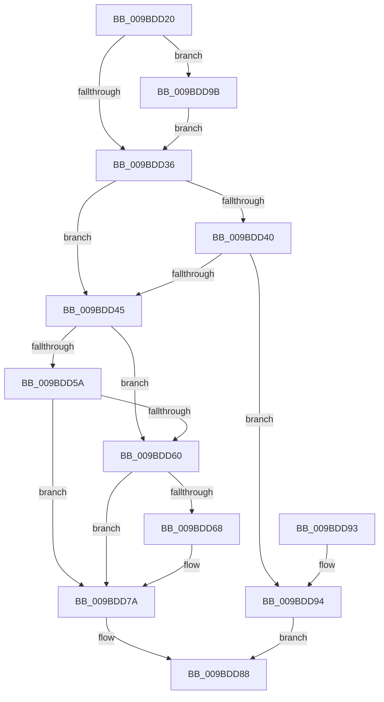

# EtwpPrepareHeader

- RVA: `0x009BDD20`–`0x009BDDA0` (길이 `128` bytes)
- VA: `0x00000001409BDD20`
- 실행 섹션: `PAGE`
- PDB 이름 있음: `예`; PDB Function 태그: `아니요`
- unwind 정보 RVA: `0x00068790`
- 디코드: `42`개 명령, `128/128` bytes 표시
- 미해석 바이트: `0` (있으면 어셈블리에 `.byte`로 보존)

> 이 문서는 커널 이미지의 기계어와 PDB 기호를 분석해 생성했습니다. 4번과 5번은 함수 원형과 자료형을 바이너리 사용 방식에서 추정한 C 해석이며 원본 소스 복구 결과는 아닙니다.

## 1. Dependencies

- 직접 호출 지점: **1**; 고유 호출 대상: **1**
- 직접 호출자로 확인된 함수: **4**
- RIP 상대 이미지 참조: **0**

### Outgoing calls
- `0x009BDD75` → [memset](../../text/6C/memset_function_006C6C40.md) (function, `0x006C6C40`)

### Direct callers
- [EtwpFileModeCompress](../../text/42/EtwpFileModeCompress_function_004241B8.md) at `0x00424339`
- [EtwpBufferingModeFlush](EtwpBufferingModeFlush_function_009BD8F4.md) at `0x009BDB52`
- [EtwpAddLogHeader](../9C/EtwpAddLogHeader_function_009C0BD0.md) at `0x009C1152`
- [sub_00B2E69A](../B2/Unknown_function_00B2E69A.md) at `0x00B2E8F2`
- [sub_00B2E69A](../B2/Unknown_function_00B2E69A.md) at `0x00B2E933`

### Static image references
- 디코드된 RIP-relative 메모리 참조가 없습니다.

## 2. Other-region calls and transfers

- 다른 실행 섹션으로 향하는 call: **1**
  - `0x009BDD75` → [memset](../../text/6C/memset_function_006C6C40.md) (`PAGE` → `.text`)
- 별도 외부 분기/꼬리 이동을 확인하지 못했습니다.

## 3. Assembly (complete function range)

```asm
009BDD20  48 89 5C 24 08                  mov qword ptr [rsp + 8], rbx
009BDD25  57                              push rdi
009BDD26  48 83 EC 20                     sub rsp, 0x20
009BDD2A  48 8B DA                        mov rbx, rdx
009BDD2D  33 FF                           xor edi, edi
009BDD2F  8B 52 04                        mov edx, dword ptr [rdx + 4]
009BDD32  85 D2                           test edx, edx
009BDD34  74 65                           je 0x1409bdd9b
009BDD36  89 53 30                        mov dword ptr [rbx + 0x30], edx
009BDD39  66 41 83 F8 01                  cmp r8w, 1
009BDD3E  74 05                           je 0x1409bdd45
009BDD40  83 FA 48                        cmp edx, 0x48
009BDD43  74 4F                           je 0x1409bdd94
009BDD45  41 0F B7 C0                     movzx eax, r8w
009BDD49  66 83 C8 20                     or ax, 0x20
009BDD4D  66 89 43 34                     mov word ptr [rbx + 0x34], ax
009BDD51  48 39 B9 20 03 00 00            cmp qword ptr [rcx + 0x320], rdi
009BDD58  75 06                           jne 0x1409bdd60
009BDD5A  41 F6 C0 40                     test r8b, 0x40
009BDD5E  75 1A                           jne 0x1409bdd7a
009BDD60  8B 03                           mov eax, dword ptr [rbx]
009BDD62  2B C2                           sub eax, edx
009BDD64  85 C0                           test eax, eax
009BDD66  7E 12                           jle 0x1409bdd7a
009BDD68  8B CA                           mov ecx, edx
009BDD6A  BA FF 00 00 00                  mov edx, 0xff
009BDD6F  48 03 CB                        add rcx, rbx
009BDD72  4C 63 C0                        movsxd r8, eax
009BDD75  E8 C6 8E D0 FF                  call 0x1406c6c40
009BDD7A  83 7B 30 48                     cmp dword ptr [rbx + 0x30], 0x48
009BDD7E  B8 22 00 00 80                  mov eax, 0x80000022
009BDD83  0F 44 F8                        cmove edi, eax
009BDD86  8B C7                           mov eax, edi
009BDD88  48 8B 5C 24 30                  mov rbx, qword ptr [rsp + 0x30]
009BDD8D  48 83 C4 20                     add rsp, 0x20
009BDD91  5F                              pop rdi
009BDD92  C3                              ret
009BDD93  CC                              int3
009BDD94  B8 22 00 00 80                  mov eax, 0x80000022
009BDD99  EB ED                           jmp 0x1409bdd88
009BDD9B  8B 53 08                        mov edx, dword ptr [rbx + 8]
009BDD9E  EB 96                           jmp 0x1409bdd36
```

## 4. C-style interpretation (structured pseudocode)

```c
__int64 __fastcall EtwpPrepareHeader(__int64 a1, __int64 a2, unsigned __int16 a3)
{
    __int64 result;
    __int64 v_rdi;
    __int64 v_rsp;
    unsigned __int64 v_stack_p8;

    v_stack_p8 = v_rbx;
    v_rsp = (v_rsp) - (32);
    v_rdi = 0;
    if ((unsigned int)((unsigned int)(*(unsigned int *)(a2 + 4))) == 0) goto loc_009BDD9B;
loc_009BDD36:
    *(unsigned int *)(a2 + 48) = (unsigned int)((unsigned int)(*(unsigned int *)(a2 + 4)));
    if (a3 == 1) goto loc_009BDD45;
    if (((unsigned int)((unsigned int)(*(unsigned int *)(a2 + 4)))) == 72) goto loc_009BDD94;
loc_009BDD45:
    result = (unsigned __int16)((a3) | (32));
    *(unsigned __int16 *)(a2 + 52) = (unsigned __int16)(result);
    if ((*(unsigned __int64 *)(a1 + 800)) != 0) goto loc_009BDD60;
    if ((((unsigned __int8)(a3)) & (64)) != 0) goto loc_009BDD7A;
loc_009BDD60:
    result = (unsigned int)(((unsigned int)(*(unsigned int *)(a2))) - ((unsigned int)((unsigned int)(*(unsigned int *)(a2 + 4)))));
    if (!(condition_is_less_or_equal)) {
        a1 = (unsigned int)((unsigned int)(*(unsigned int *)(a2 + 4)));
        a2 = 255;
        a1 = (a1) + (a2);
        a3 = (int)((unsigned int)(result));
        result = memset(a1, a2, a3, a4);
    }
    if ((*(unsigned int *)(a2 + 48)) == 72) { v_rdi = (unsigned int)((unsigned int)(0x80000022ULL)); }
loc_009BDD88:
    v_rsp = (v_rsp) + (32);
    return (unsigned int)((unsigned int)(v_rdi));
loc_009BDD94:
    goto loc_009BDD88;
loc_009BDD9B:
    goto loc_009BDD36;
}
```

## 5. (Beta) C Style

```c
int64_t EtwpPrepareHeader(void *Arg1, void *Arg2, uint16_t Arg3)
{
    uint8_t *arg1 = (uint8_t *)Arg1;
    uint8_t *arg2 = (uint8_t *)Arg2;

    int64_t result;
    int64_t local_rdi;
    int64_t local_rsp;
    uint64_t v_stack_p8;

    v_stack_p8 = local_rbx;
    local_rsp = (local_rsp) - (32);
    local_rdi = 0;
    if ((uint32_t)((uint32_t)(*(uint32_t *)(arg2 + 0x4))) == 0) goto loc_009BDD9B;
loc_009BDD36:
    *(uint32_t *)(arg2 + 0x30) = (uint32_t)((uint32_t)(*(uint32_t *)(arg2 + 0x4)));
    if (Arg3 == 1) goto loc_009BDD45;
    if (((uint32_t)((uint32_t)(*(uint32_t *)(arg2 + 0x4)))) == 72) goto loc_009BDD94;
loc_009BDD45:
    result = (uint16_t)((Arg3) | (32));
    *(uint16_t *)(arg2 + 0x34) = (uint16_t)(result);
    if ((*(uint64_t *)(arg1 + 0x320)) != 0) goto loc_009BDD60;
    if ((((uint8_t)(Arg3)) & (64)) != 0) goto loc_009BDD7A;
loc_009BDD60:
    result = (uint32_t)(((uint32_t)(*(uint32_t *)(arg2))) - ((uint32_t)((uint32_t)(*(uint32_t *)(arg2 + 0x4)))));
    if (!(condition_is_less_or_equal)) {
        Arg1 = (uint32_t)((uint32_t)(*(uint32_t *)(arg2 + 0x4)));
        Arg2 = 255;
        Arg1 = (Arg1) + (Arg2);
        Arg3 = (int32_t)((uint32_t)(result));
        result = memset(Arg1, Arg2, Arg3, a4);
    }
    if ((*(uint32_t *)(arg2 + 0x30)) == 72) { local_rdi = (uint32_t)((uint32_t)(0x80000022ULL)); }
loc_009BDD88:
    local_rsp = (local_rsp) + (32);
    return (uint32_t)((uint32_t)(local_rdi));
loc_009BDD94:
    goto loc_009BDD88;
loc_009BDD9B:
    goto loc_009BDD36;
}
```

### 관측된 메모리 오프셋

구조체 형식이 확인되지 않은 접근은 인자 기준의 오프셋으로만 기록했습니다.

| 기준 인자 | 오프셋 표현 | 폭 (bit) | 접근 |
|---|---:|---:|---|
| `Arg1` | `+ 0x320` | `64` | `R` |
| `Arg2` | `+ 0x0` | `32` | `R` |
| `Arg2` | `+ 0x4` | `32` | `R` |
| `Arg2` | `+ 0x8` | `32` | `R` |
| `Arg2` | `+ 0x30` | `32` | `R` |
| `Arg2` | `+ 0x30` | `32` | `W` |
| `Arg2` | `+ 0x34` | `16` | `W` |

## 6. Execution-region graph

[열기: 2D/3D 그래프와 함수 탐색 컨트롤 패널](../../../control-panel.html?section=page&rva=0x009BDD20&view=graph)

- 2D 그래프는 위에서 아래로 흐르고, 3D 그래프는 빈 공간을 드래그해 회전합니다. Shift+드래그는 이동, 휠은 확대·축소, 함수 노드 선택은 대상 보고서 이동입니다.

### Static fallback


