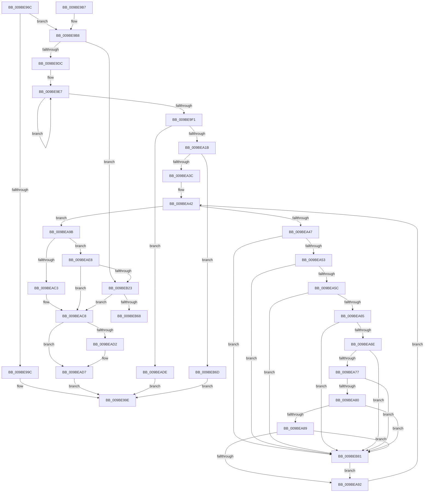

# EtwpRealtimeCreateLogfile

- RVA: `0x009BE96C`–`0x009BEB8B` (길이 `543` bytes)
- VA: `0x00000001409BE96C`
- 실행 섹션: `PAGE`
- PDB 이름 있음: `예`; PDB Function 태그: `예`
- unwind 정보 RVA: `0x0009F35C`
- 디코드: `135`개 명령, `543/543` bytes 표시
- 미해석 바이트: `0` (있으면 어셈블리에 `.byte`로 보존)

> 이 문서는 커널 이미지의 기계어와 PDB 기호를 분석해 생성했습니다. 4번과 5번은 함수 원형과 자료형을 바이너리 사용 방식에서 추정한 C 해석이며 원본 소스 복구 결과는 아닙니다.

## 1. Dependencies

- 직접 호출 지점: **9**; 고유 호출 대상: **8**
- 직접 호출자로 확인된 함수: **1**
- RIP 상대 이미지 참조: **3**

### Outgoing calls
- `0x009BE9BF` → [RtlInitUnicodeString](../../text/42/RtlInitUnicodeString_function_0042A780.md) (function, `0x0042A780`)
- `0x009BEA0A` → [ExAllocatePool2](../../poolcode/B8/ExAllocatePool2_function_00B820F0.md) (function, `0x00B820F0`)
- `0x009BEA2F` → [RtlStringCbPrintfW](../../text/40/RtlStringCbPrintfW_function_0040FB40.md) (function, `0x0040FB40`)
- `0x009BEABA` → [RtlCreateUnicodeString](RtlCreateUnicodeString_function_009BD860.md) (function, `0x009BD860`)
- `0x009BEAD2` → [ExFreePool](../../poolcode/B8/ExFreePool_function_00B82850.md) (function, `0x00B82850`)
- `0x009BEAF0` → [RtlInitUnicodeString](../../text/42/RtlInitUnicodeString_function_0042A780.md) (function, `0x0042A780`)
- `0x009BEB18` → [EtwpExpandFileName](../9C/EtwpExpandFileName_function_009C147C.md) (function, `0x009C147C`)
- `0x009BEB59` → [EtwpDelayCreate](../9C/EtwpDelayCreate_function_009C1188.md) (function, `0x009C1188`)
- `0x009BEB72` → [ExFreePoolWithTag](../../poolcode/B8/ExFreePoolWithTag_function_00B82870.md) (function, `0x00B82870`)

### Direct callers
- [EtwpLogger](EtwpLogger_function_009BE310.md) at `0x009BE578`

### Static image references
- `0x009BEA22` → RVA `0x00B07FC0` (` ?? ::NNGAKEGL::`string'`; read)
- `0x009BEAA2` → RVA `0x00B07F60` (` ?? ::NNGAKEGL::`string'`; read)
- `0x009BEAF5` → RVA `0x00FC6AA8` (`ALMOSTRO`; read)

## 2. Other-region calls and transfers

- 다른 실행 섹션으로 향하는 call: **6**
  - `0x009BE9BF` → [RtlInitUnicodeString](../../text/42/RtlInitUnicodeString_function_0042A780.md) (`PAGE` → `.text`)
  - `0x009BEA0A` → [ExAllocatePool2](../../poolcode/B8/ExAllocatePool2_function_00B820F0.md) (`PAGE` → `POOLCODE`)
  - `0x009BEA2F` → [RtlStringCbPrintfW](../../text/40/RtlStringCbPrintfW_function_0040FB40.md) (`PAGE` → `.text`)
  - `0x009BEAD2` → [ExFreePool](../../poolcode/B8/ExFreePool_function_00B82850.md) (`PAGE` → `POOLCODE`)
  - `0x009BEAF0` → [RtlInitUnicodeString](../../text/42/RtlInitUnicodeString_function_0042A780.md) (`PAGE` → `.text`)
  - `0x009BEB72` → [ExFreePoolWithTag](../../poolcode/B8/ExFreePoolWithTag_function_00B82870.md) (`PAGE` → `POOLCODE`)
- call이 아닌 외부 분기/꼬리 이동: **1**
  - `0x009BEB68` → [sub_00B2EA5E](../B2/Unknown_function_00B2EA5E.md) (`tail-transfer`)

## 3. Assembly (complete function range)

```asm
009BE96C  48 89 5C 24 10                  mov qword ptr [rsp + 0x10], rbx
009BE971  48 89 6C 24 18                  mov qword ptr [rsp + 0x18], rbp
009BE976  56                              push rsi
009BE977  57                              push rdi
009BE978  41 54                           push r12
009BE97A  41 56                           push r14
009BE97C  41 57                           push r15
009BE97E  48 83 EC 50                     sub rsp, 0x50
009BE982  4C 8D B1 68 01 00 00            lea r14, [rcx + 0x168]
009BE989  45 33 FF                        xor r15d, r15d
009BE98C  0F 57 C0                        xorps xmm0, xmm0
009BE98F  48 8B D9                        mov rbx, rcx
009BE992  0F 11 44 24 40                  movups xmmword ptr [rsp + 0x40], xmm0
009BE997  4D 39 3E                        cmp qword ptr [r14], r15
009BE99A  74 1C                           je 0x1409be9b8
009BE99C  33 C0                           xor eax, eax
009BE99E  4C 8D 5C 24 50                  lea r11, [rsp + 0x50]
009BE9A3  49 8B 5B 38                     mov rbx, qword ptr [r11 + 0x38]
009BE9A7  49 8B 6B 40                     mov rbp, qword ptr [r11 + 0x40]
009BE9AB  49 8B E3                        mov rsp, r11
009BE9AE  41 5F                           pop r15
009BE9B0  41 5E                           pop r14
009BE9B2  41 5C                           pop r12
009BE9B4  5F                              pop rdi
009BE9B5  5E                              pop rsi
009BE9B6  C3                              ret
009BE9B7  CC                              int3
009BE9B8  33 D2                           xor edx, edx
009BE9BA  48 8D 4C 24 40                  lea rcx, [rsp + 0x40]
009BE9BF  E8 BC BD A6 FF                  call 0x14042a780
009BE9C4  48 8D AB 70 01 00 00            lea rbp, [rbx + 0x170]
009BE9CB  41 BC 01 00 00 00               mov r12d, 1
009BE9D1  66 44 39 7D 00                  cmp word ptr [rbp], r15w
009BE9D6  0F 85 47 01 00 00               jne 0x1409beb23
009BE9DC  48 8B 8B 90 00 00 00            mov rcx, qword ptr [rbx + 0x90]
009BE9E3  48 83 C8 FF                     or rax, 0xffffffffffffffff
009BE9E7  48 FF C0                        inc rax
009BE9EA  66 44 39 3C 41                  cmp word ptr [rcx + rax*2], r15w
009BE9EF  75 F6                           jne 0x1409be9e7
009BE9F1  83 C0 09                        add eax, 9
009BE9F4  41 B8 45 74 77 50               mov r8d, 0x50777445
009BE9FA  B9 00 01 00 00                  mov ecx, 0x100
009BE9FF  48 8D 34 45 02 00 00 00         lea rsi, [rax*2 + 2]
009BEA07  48 8B D6                        mov rdx, rsi
009BEA0A  E8 E1 36 1C 00                  call 0x140b820f0
009BEA0F  48 8B F8                        mov rdi, rax
009BEA12  48 85 C0                        test rax, rax
009BEA15  0F 84 C3 00 00 00               je 0x1409beade
009BEA1B  4C 8B 8B 90 00 00 00            mov r9, qword ptr [rbx + 0x90]
009BEA22  4C 8D 05 97 95 14 00            lea r8, [rip + 0x149597]
009BEA29  48 8B D6                        mov rdx, rsi
009BEA2C  48 8B C8                        mov rcx, rax
009BEA2F  E8 0C 11 A5 FF                  call 0x14040fb40
009BEA34  85 C0                           test eax, eax
009BEA36  0F 85 31 01 00 00               jne 0x1409beb6d
009BEA3C  0F B7 07                        movzx eax, word ptr [rdi]
009BEA3F  48 8B D7                        mov rdx, rdi
009BEA42  66 85 C0                        test ax, ax
009BEA45  74 54                           je 0x1409bea9b
009BEA47  0F B7 C8                        movzx ecx, ax
009BEA4A  83 E9 22                        sub ecx, 0x22
009BEA4D  0F 84 2E 01 00 00               je 0x1409beb81
009BEA53  83 E9 0D                        sub ecx, 0xd
009BEA56  0F 84 25 01 00 00               je 0x1409beb81
009BEA5C  83 E9 0B                        sub ecx, 0xb
009BEA5F  0F 84 1C 01 00 00               je 0x1409beb81
009BEA65  83 E9 02                        sub ecx, 2
009BEA68  0F 84 13 01 00 00               je 0x1409beb81
009BEA6E  83 E9 02                        sub ecx, 2
009BEA71  0F 84 0A 01 00 00               je 0x1409beb81
009BEA77  41 2B CC                        sub ecx, r12d
009BEA7A  0F 84 01 01 00 00               je 0x1409beb81
009BEA80  83 E9 1D                        sub ecx, 0x1d
009BEA83  0F 84 F8 00 00 00               je 0x1409beb81
009BEA89  83 F9 20                        cmp ecx, 0x20
009BEA8C  0F 84 EF 00 00 00               je 0x1409beb81
009BEA92  48 83 C2 02                     add rdx, 2
009BEA96  0F B7 02                        movzx eax, word ptr [rdx]
009BEA99  EB A7                           jmp 0x1409bea42
009BEA9B  48 8B 83 50 05 00 00            mov rax, qword ptr [rbx + 0x550]
009BEAA2  48 8D 15 B7 94 14 00            lea rdx, [rip + 0x1494b7]
009BEAA9  48 8B 88 20 11 00 00            mov rcx, qword ptr [rax + 0x1120]
009BEAB0  48 85 C9                        test rcx, rcx
009BEAB3  48 0F 45 D1                     cmovne rdx, rcx
009BEAB7  48 8B CD                        mov rcx, rbp
009BEABA  E8 A1 ED FF FF                  call 0x1409bd860
009BEABF  84 C0                           test al, al
009BEAC1  75 25                           jne 0x1409beae8
009BEAC3  BF 17 00 00 C0                  mov edi, 0xc0000017
009BEAC8  48 8B 4C 24 48                  mov rcx, qword ptr [rsp + 0x48]
009BEACD  48 85 C9                        test rcx, rcx
009BEAD0  74 05                           je 0x1409bead7
009BEAD2  E8 79 3D 1C 00                  call 0x140b82850
009BEAD7  8B C7                           mov eax, edi
009BEAD9  E9 C0 FE FF FF                  jmp 0x1409be99e
009BEADE  B8 17 00 00 C0                  mov eax, 0xc0000017
009BEAE3  E9 B6 FE FF FF                  jmp 0x1409be99e
009BEAE8  48 8B D7                        mov rdx, rdi
009BEAEB  48 8D 4C 24 40                  lea rcx, [rsp + 0x40]
009BEAF0  E8 8B BC A6 FF                  call 0x14042a780
009BEAF5  48 8B 05 AC 7F 60 00            mov rax, qword ptr [rip + 0x607fac]
009BEAFC  4C 8D 4C 24 40                  lea r9, [rsp + 0x40]
009BEB01  48 39 83 50 05 00 00            cmp qword ptr [rbx + 0x550], rax
009BEB08  48 8B D5                        mov rdx, rbp
009BEB0B  41 8A CC                        mov cl, r12b
009BEB0E  0F 94 C0                        sete al
009BEB11  45 33 C0                        xor r8d, r8d
009BEB14  88 44 24 20                     mov byte ptr [rsp + 0x20], al
009BEB18  E8 5F 29 00 00                  call 0x1409c147c
009BEB1D  8B F8                           mov edi, eax
009BEB1F  85 C0                           test eax, eax
009BEB21  78 A5                           js 0x1409beac8
009BEB23  44 84 A3 30 03 00 00            test byte ptr [rbx + 0x330], r12b
009BEB2A  4C 8D 84 24 80 00 00 00         lea r8, [rsp + 0x80]
009BEB32  41 0F B6 C7                     movzx eax, r15b
009BEB36  48 8B D5                        mov rdx, rbp
009BEB39  41 0F 45 C4                     cmovne eax, r12d
009BEB3D  4C 89 7C 24 30                  mov qword ptr [rsp + 0x30], r15
009BEB42  45 33 C9                        xor r9d, r9d
009BEB45  44 88 64 24 28                  mov byte ptr [rsp + 0x28], r12b
009BEB4A  49 8B CE                        mov rcx, r14
009BEB4D  88 84 24 80 00 00 00            mov byte ptr [rsp + 0x80], al
009BEB54  44 88 64 24 20                  mov byte ptr [rsp + 0x20], r12b
009BEB59  E8 2A 26 00 00                  call 0x1409c1188
009BEB5E  8B F8                           mov edi, eax
009BEB60  85 C0                           test eax, eax
009BEB62  0F 88 60 FF FF FF               js 0x1409beac8
009BEB68  E9 F1 FE 16 00                  jmp 0x140b2ea5e
009BEB6D  33 D2                           xor edx, edx
009BEB6F  48 8B CF                        mov rcx, rdi
009BEB72  E8 F9 3C 1C 00                  call 0x140b82870
009BEB77  B8 0D 00 00 C0                  mov eax, 0xc000000d
009BEB7C  E9 1D FE FF FF                  jmp 0x1409be99e
009BEB81  66 C7 02 5F 00                  mov word ptr [rdx], 0x5f
009BEB86  E9 07 FF FF FF                  jmp 0x1409bea92
```

## 4. C-style interpretation (structured pseudocode)

```c
__int64 __fastcall EtwpRealtimeCreateLogfile(__int64 a1, int a2)
{
    __int64 result;
    __int64 v_r15;
    __int64 v_rsp;
    unsigned __int64 v_stack_m10;
    unsigned __int64 v_stack_m20;
    unsigned __int64 v_stack_m28;
    unsigned __int8 v_stack_m30;
    unsigned __int64 v_stack_m38;
    unsigned __int64 v_stack_m8;
    unsigned __int64 v_stack_p10;
    unsigned __int64 v_stack_p18;
    unsigned __int64 v_stack_p30;

    v_stack_p10 = v_rbx;
    v_stack_p18 = v_rbp;
    v_rsp = (v_rsp) - (80);
    v_r15 = 0;
    v_stack_m38 = v_xmm0;
    if ((*(unsigned __int64 *)(a1 + 360)) == 0) goto loc_009BE9B8;
    result = 0;
loc_009BE99E:
    return result;
loc_009BE9B8:
    a2 = 0;
    result = RtlInitUnicodeString(v_stack_m10, a2, a3, a4);
    if ((*(unsigned __int16 *)(*(unsigned __int64 *)(v_stack_m28 + 56) + 368)) != 0) goto loc_009BEB23;
    result = (result) | (-1);
loc_009BE9E7:
    result = (result) + 1;
    if ((*(unsigned __int16 *)(*(unsigned __int64 *)(*(unsigned __int64 *)(v_stack_m28 + 56) + 144) + result * 2)) != 0) goto loc_009BE9E7;
    result = (unsigned int)((result) + (9));
    result = ExAllocatePool2(256, result * 2 + 2, (unsigned int)(0x50777445ULL), a4);
    if (result == 0) goto loc_009BEADE;
    result = RtlStringCbPrintfW(result, result * 2 + 2, v_rip + 1349015, *(unsigned __int64 *)(*(unsigned __int64 *)(v_stack_m28 + 56) + 144));
    if ((unsigned int)(result) != 0) goto loc_009BEB6D;
loc_009BEA42:
    if ((unsigned __int16)(*(unsigned __int16 *)(result)) == 0) goto loc_009BEA9B;
    a1 = (unsigned int)(((unsigned __int16)(*(unsigned __int16 *)(result))) - (34));
    if (condition_is_equal) goto loc_009BEB81;
    a1 = (unsigned int)((a1) - (13));
    if (condition_is_equal) goto loc_009BEB81;
    a1 = (unsigned int)((a1) - (11));
    if (condition_is_equal) goto loc_009BEB81;
    a1 = (unsigned int)((a1) - (2));
    if (condition_is_equal) goto loc_009BEB81;
    a1 = (unsigned int)((a1) - (2));
    if (condition_is_equal) goto loc_009BEB81;
    a1 = (unsigned int)((a1) - (1));
    if (condition_is_equal) goto loc_009BEB81;
    a1 = (unsigned int)((a1) - (29));
    if (condition_is_equal) goto loc_009BEB81;
    if (((unsigned int)(a1)) == 32) goto loc_009BEB81;
loc_009BEA92:
    a2 = (result) + (2);
    goto loc_009BEA42;
loc_009BEA9B:
    a2 = v_rip + 1348791;
    if (*(unsigned __int64 *)(*(unsigned __int64 *)(*(unsigned __int64 *)(v_stack_m28 + 56) + 1360) + 4384) != 0) { a2 = *(unsigned __int64 *)(*(unsigned __int64 *)(*(unsigned __int64 *)(v_stack_m28 + 56) + 1360) + 4384); }
    result = RtlCreateUnicodeString(*(unsigned __int64 *)(v_stack_m28 + 56) + 368, a2, v_rip + 1349015, *(unsigned __int64 *)(*(unsigned __int64 *)(v_stack_m28 + 56) + 144));
    if ((unsigned __int8)(result) != 0) goto loc_009BEAE8;
loc_009BEAC8:
    if (v_stack_m8 != 0) {
        result = ExFreePool(v_stack_m8, a2, v_rip + 1349015, *(unsigned __int64 *)(*(unsigned __int64 *)(v_stack_m28 + 56) + 144));
    }
    goto loc_009BE99E;
loc_009BEADE:
    goto loc_009BE99E;
loc_009BEAE8:
    result = RtlInitUnicodeString(v_stack_m10, (unsigned int)(0xC0000017ULL), v_rip + 1349015, *(unsigned __int64 *)(*(unsigned __int64 *)(v_stack_m28 + 56) + 144));
    result = ((*(unsigned __int64 *)(*(unsigned __int64 *)(v_stack_m28 + 56) + 1360)) == (*(unsigned __int64 *)(v_rip + 6324140))) ? 1 : 0;
    a3 = 0;
    v_stack_m30 = (unsigned __int8)(result);
    result = EtwpExpandFileName(1, *(unsigned __int64 *)(v_stack_m28 + 56) + 368, a3, v_stack_m10);
    if (sign_flag) goto loc_009BEAC8;
loc_009BEB23:
    result = 0;
    if (((*(unsigned __int8 *)(*(unsigned __int64 *)(v_stack_m28 + 56) + 816)) & (1)) != 0) { result = 1; }
    v_stack_m20 = 0;
    a4 = 0;
    v_stack_m28 = 1;
    v_stack_p30 = (unsigned __int8)(result);
    v_stack_m30 = 1;
    result = EtwpDelayCreate(a1 + 360, *(unsigned __int64 *)(v_stack_m28 + 56) + 368, v_stack_p30, a4);
    if (sign_flag) goto loc_009BEAC8;
loc_009BEB6D:
    a2 = 0;
    result = ExFreePoolWithTag((unsigned int)((unsigned int)(result)), a2, v_stack_p30, a4);
    goto loc_009BE99E;
loc_009BEB81:
    *(unsigned __int16 *)(a2) = 95;
    goto loc_009BEA92;
}
```

## 5. (Beta) C Style

```c
int64_t EtwpRealtimeCreateLogfile(void *Arg1, int32_t Arg2)
{
    uint8_t *arg1 = (uint8_t *)Arg1;

    int64_t result;
    int64_t local_r15;
    int64_t local_rsp;
    uint64_t v_stack_m10;
    uint64_t v_stack_m20;
    uint64_t v_stack_m28;
    uint8_t v_stack_m30;
    uint64_t v_stack_m38;
    uint64_t v_stack_m8;
    uint64_t v_stack_p10;
    uint64_t v_stack_p18;
    uint64_t v_stack_p30;

    v_stack_p10 = local_rbx;
    v_stack_p18 = local_rbp;
    local_rsp = (local_rsp) - (80);
    local_r15 = 0;
    v_stack_m38 = v_xmm0;
    if ((*(uint64_t *)(arg1 + 0x168)) == 0) goto loc_009BE9B8;
    result = 0;
loc_009BE99E:
    return result;
loc_009BE9B8:
    Arg2 = 0;
    result = RtlInitUnicodeString(v_stack_m10, Arg2, a3, a4);
    if ((*(uint16_t *)(*(uint64_t *)(v_stack_m28 + 0x38) + 0x170)) != 0) goto loc_009BEB23;
    result = (result) | (-1);
loc_009BE9E7:
    result = (result) + 1;
    if ((*(uint16_t *)(*(uint64_t *)(*(uint64_t *)(v_stack_m28 + 0x38) + 0x90) + result * 2)) != 0) goto loc_009BE9E7;
    result = (uint32_t)((result) + (9));
    result = ExAllocatePool2(256, result * 2 + 2, (uint32_t)(0x50777445ULL), a4);
    if (result == 0) goto loc_009BEADE;
    result = RtlStringCbPrintfW(result, result * 2 + 2, v_rip + 1349015, *(uint64_t *)(*(uint64_t *)(v_stack_m28 + 0x38) + 0x90));
    if ((uint32_t)(result) != 0) goto loc_009BEB6D;
loc_009BEA42:
    if ((uint16_t)(*(uint16_t *)(result)) == 0) goto loc_009BEA9B;
    Arg1 = (uint32_t)(((uint16_t)(*(uint16_t *)(result))) - (34));
    if (condition_is_equal) goto loc_009BEB81;
    Arg1 = (uint32_t)((Arg1) - (13));
    if (condition_is_equal) goto loc_009BEB81;
    Arg1 = (uint32_t)((Arg1) - (11));
    if (condition_is_equal) goto loc_009BEB81;
    Arg1 = (uint32_t)((Arg1) - (2));
    if (condition_is_equal) goto loc_009BEB81;
    Arg1 = (uint32_t)((Arg1) - (2));
    if (condition_is_equal) goto loc_009BEB81;
    Arg1 = (uint32_t)((Arg1) - (1));
    if (condition_is_equal) goto loc_009BEB81;
    Arg1 = (uint32_t)((Arg1) - (29));
    if (condition_is_equal) goto loc_009BEB81;
    if (((uint32_t)(Arg1)) == 32) goto loc_009BEB81;
loc_009BEA92:
    Arg2 = (result) + (2);
    goto loc_009BEA42;
loc_009BEA9B:
    Arg2 = v_rip + 1348791;
    if (*(uint64_t *)(*(uint64_t *)(*(uint64_t *)(v_stack_m28 + 0x38) + 0x550) + 0x1120) != 0) { Arg2 = *(uint64_t *)(*(uint64_t *)(*(uint64_t *)(v_stack_m28 + 0x38) + 0x550) + 0x1120); }
    result = RtlCreateUnicodeString(*(uint64_t *)(v_stack_m28 + 0x38) + 368, Arg2, v_rip + 1349015, *(uint64_t *)(*(uint64_t *)(v_stack_m28 + 0x38) + 0x90));
    if ((uint8_t)(result) != 0) goto loc_009BEAE8;
loc_009BEAC8:
    if (v_stack_m8 != 0) {
        result = ExFreePool(v_stack_m8, Arg2, v_rip + 1349015, *(uint64_t *)(*(uint64_t *)(v_stack_m28 + 0x38) + 0x90));
    }
    goto loc_009BE99E;
loc_009BEADE:
    goto loc_009BE99E;
loc_009BEAE8:
    result = RtlInitUnicodeString(v_stack_m10, (uint32_t)(0xC0000017ULL), v_rip + 1349015, *(uint64_t *)(*(uint64_t *)(v_stack_m28 + 0x38) + 0x90));
    result = ((*(uint64_t *)(*(uint64_t *)(v_stack_m28 + 0x38) + 0x550)) == (*(uint64_t *)(v_rip + 0x607FAC))) ? 1 : 0;
    a3 = 0;
    v_stack_m30 = (uint8_t)(result);
    result = EtwpExpandFileName(1, *(uint64_t *)(v_stack_m28 + 0x38) + 368, a3, v_stack_m10);
    if (sign_flag) goto loc_009BEAC8;
loc_009BEB23:
    result = 0;
    if (((*(uint8_t *)(*(uint64_t *)(v_stack_m28 + 0x38) + 0x330)) & (1)) != 0) { result = 1; }
    v_stack_m20 = 0;
    a4 = 0;
    v_stack_m28 = 1;
    v_stack_p30 = (uint8_t)(result);
    v_stack_m30 = 1;
    result = EtwpDelayCreate(Arg1 + 360, *(uint64_t *)(v_stack_m28 + 0x38) + 368, v_stack_p30, a4);
    if (sign_flag) goto loc_009BEAC8;
loc_009BEB6D:
    Arg2 = 0;
    result = ExFreePoolWithTag((uint32_t)((uint32_t)(result)), Arg2, v_stack_p30, a4);
    goto loc_009BE99E;
loc_009BEB81:
    *(uint16_t *)(Arg2) = 95;
    goto loc_009BEA92;
}
```

### 관측된 메모리 오프셋

구조체 형식이 확인되지 않은 접근은 인자 기준의 오프셋으로만 기록했습니다.

| 기준 인자 | 오프셋 표현 | 폭 (bit) | 접근 |
|---|---:|---:|---|
| `Arg1` | `+ 0x0` | `16` | `R` |
| `Arg1` | `+ 0x0` | `64` | `R` |
| `Arg1` | `+ 0x90` | `64` | `R` |
| `Arg1` | `+ 0x168` | `64` | `R` |
| `Arg1` | `+ 0x170` | `64` | `R` |
| `Arg1` | `+ 0x330` | `8` | `R` |
| `Arg1` | `+ 0x550` | `64` | `R` |

## 6. Execution-region graph

[열기: 2D/3D 그래프와 함수 탐색 컨트롤 패널](../../../control-panel.html?section=page&rva=0x009BE96C&view=graph)

- 2D 그래프는 위에서 아래로 흐르고, 3D 그래프는 빈 공간을 드래그해 회전합니다. Shift+드래그는 이동, 휠은 확대·축소, 함수 노드 선택은 대상 보고서 이동입니다.

### Static fallback


