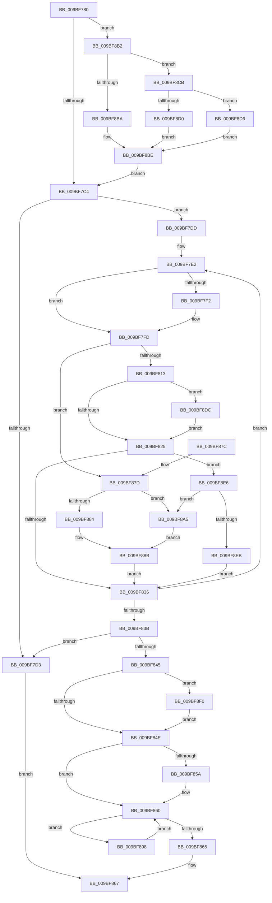

# EtwpRealtimeDeliverBuffer

- RVA: `0x009BF780`–`0x009BF8FC` (길이 `380` bytes)
- VA: `0x00000001409BF780`
- 실행 섹션: `PAGE`
- PDB 이름 있음: `예`; PDB Function 태그: `아니요`
- unwind 정보 RVA: `0x0009F43C`
- 디코드: `112`개 명령, `380/380` bytes 표시
- 미해석 바이트: `0` (있으면 어셈블리에 `.byte`로 보존)

> 이 문서는 커널 이미지의 기계어와 PDB 기호를 분석해 생성했습니다. 4번과 5번은 함수 원형과 자료형을 바이너리 사용 방식에서 추정한 C 해석이며 원본 소스 복구 결과는 아닙니다.

## 1. Dependencies

- 직접 호출 지점: **2**; 고유 호출 대상: **2**
- 직접 호출자로 확인된 함수: **4**
- RIP 상대 이미지 참조: **0**

### Outgoing calls
- `0x009BF806` → [EtwpRealtimeInjectEtwBuffer](EtwpRealtimeInjectEtwBuffer_function_009BF910.md) (function, `0x009BF910`)
- `0x009BF8AB` → [EtwpDisassociateConsumer](EtwpDisassociateConsumer_function_009BFEF0.md) (function, `0x009BFEF0`)

### Direct callers
- [EtwpRealtimeUpdateReferenceTime](../7C/EtwpRealtimeUpdateReferenceTime_function_007C0CC0.md) at `0x007C0D41`
- [EtwpRealtimeFlushSavedBuffers](EtwpRealtimeFlushSavedBuffers_function_009BF1B0.md) at `0x009BF252`
- [EtwpRealtimeSendEmptyMarker](EtwpRealtimeSendEmptyMarker_function_009BF4CC.md) at `0x009BF536`
- [EtwpFlushBufferToRealtime](EtwpFlushBufferToRealtime_function_009BF6FC.md) at `0x009BF73D`

### Static image references
- 디코드된 RIP-relative 메모리 참조가 없습니다.

## 2. Other-region calls and transfers

- 다른 실행 섹션으로 향하는 call: **0**
- 별도 외부 분기/꼬리 이동을 확인하지 못했습니다.

## 3. Assembly (complete function range)

```asm
009BF780  48 89 5C 24 20                  mov qword ptr [rsp + 0x20], rbx
009BF785  48 89 54 24 10                  mov qword ptr [rsp + 0x10], rdx
009BF78A  55                              push rbp
009BF78B  56                              push rsi
009BF78C  57                              push rdi
009BF78D  41 54                           push r12
009BF78F  41 55                           push r13
009BF791  41 56                           push r14
009BF793  41 57                           push r15
009BF795  48 83 EC 20                     sub rsp, 0x20
009BF799  33 DB                           xor ebx, ebx
009BF79B  48 8D 7A 34                     lea rdi, [rdx + 0x34]
009BF79F  45 32 C0                        xor r8b, r8b
009BF7A2  45 32 ED                        xor r13b, r13b
009BF7A5  48 8B F1                        mov rsi, rcx
009BF7A8  44 88 44 24 60                  mov byte ptr [rsp + 0x60], r8b
009BF7AD  8B 89 C0 01 00 00               mov ecx, dword ptr [rcx + 0x1c0]
009BF7B3  44 88 6C 24 70                  mov byte ptr [rsp + 0x70], r13b
009BF7B8  44 8D 4B 02                     lea r9d, [rbx + 2]
009BF7BC  85 C9                           test ecx, ecx
009BF7BE  0F 85 EE 00 00 00               jne 0x1409bf8b2
009BF7C4  4C 8D BE 48 01 00 00            lea r15, [rsi + 0x148]
009BF7CB  4D 8B 37                        mov r14, qword ptr [r15]
009BF7CE  4D 3B F7                        cmp r14, r15
009BF7D1  75 0A                           jne 0x1409bf7dd
009BF7D3  B8 01 00 00 C0                  mov eax, 0xc0000001
009BF7D8  E9 8A 00 00 00                  jmp 0x1409bf867
009BF7DD  4C 8B 6C 24 68                  mov r13, qword ptr [rsp + 0x68]
009BF7E2  44 0F B7 27                     movzx r12d, word ptr [rdi]
009BF7E6  49 8B EE                        mov rbp, r14
009BF7E9  4D 8B 36                        mov r14, qword ptr [r14]
009BF7EC  44 84 4D 5A                     test byte ptr [rbp + 0x5a], r9b
009BF7F0  74 0B                           je 0x1409bf7fd
009BF7F2  41 0F B7 C4                     movzx eax, r12w
009BF7F6  66 83 C8 04                     or ax, 4
009BF7FA  66 89 07                        mov word ptr [rdi], ax
009BF7FD  4D 8B C5                        mov r8, r13
009BF800  48 8B D5                        mov rdx, rbp
009BF803  48 8B CE                        mov rcx, rsi
009BF806  E8 05 01 00 00                  call 0x1409bf910
009BF80B  66 44 89 27                     mov word ptr [rdi], r12w
009BF80F  85 C0                           test eax, eax
009BF811  78 6A                           js 0x1409bf87d
009BF813  8A 45 5A                        mov al, byte ptr [rbp + 0x5a]
009BF816  41 B9 02 00 00 00               mov r9d, 2
009BF81C  41 84 C1                        test r9b, al
009BF81F  0F 85 B7 00 00 00               jne 0x1409bf8dc
009BF825  41 B0 01                        mov r8b, 1
009BF828  44 88 44 24 60                  mov byte ptr [rsp + 0x60], r8b
009BF82D  41 84 C0                        test r8b, al
009BF830  0F 85 B0 00 00 00               jne 0x1409bf8e6
009BF836  4D 3B F7                        cmp r14, r15
009BF839  75 A7                           jne 0x1409bf7e2
009BF83B  44 8A 6C 24 70                  mov r13b, byte ptr [rsp + 0x70]
009BF840  45 84 C0                        test r8b, r8b
009BF843  74 8E                           je 0x1409bf7d3
009BF845  45 84 ED                        test r13b, r13b
009BF848  0F 85 A2 00 00 00               jne 0x1409bf8f0
009BF84E  48 8B 54 24 68                  mov rdx, qword ptr [rsp + 0x68]
009BF853  66 83 7A 36 06                  cmp word ptr [rdx + 0x36], 6
009BF858  74 06                           je 0x1409bf860
009BF85A  FF 86 00 01 00 00               inc dword ptr [rsi + 0x100]
009BF860  48 85 DB                        test rbx, rbx
009BF863  75 33                           jne 0x1409bf898
009BF865  33 C0                           xor eax, eax
009BF867  48 8B 5C 24 78                  mov rbx, qword ptr [rsp + 0x78]
009BF86C  48 83 C4 20                     add rsp, 0x20
009BF870  41 5F                           pop r15
009BF872  41 5E                           pop r14
009BF874  41 5D                           pop r13
009BF876  41 5C                           pop r12
009BF878  5F                              pop rdi
009BF879  5E                              pop rsi
009BF87A  5D                              pop rbp
009BF87B  C3                              ret
009BF87C  CC                              int3
009BF87D  3D 3C 00 00 C0                  cmp eax, 0xc000003c
009BF882  75 21                           jne 0x1409bf8a5
009BF884  48 89 5D 20                     mov qword ptr [rbp + 0x20], rbx
009BF888  48 8B DD                        mov rbx, rbp
009BF88B  44 8A 44 24 60                  mov r8b, byte ptr [rsp + 0x60]
009BF890  41 B9 02 00 00 00               mov r9d, 2
009BF896  EB 9E                           jmp 0x1409bf836
009BF898  44 08 4B 5A                     or byte ptr [rbx + 0x5a], r9b
009BF89C  FF 43 50                        inc dword ptr [rbx + 0x50]
009BF89F  48 8B 5B 20                     mov rbx, qword ptr [rbx + 0x20]
009BF8A3  EB BB                           jmp 0x1409bf860
009BF8A5  48 8B D5                        mov rdx, rbp
009BF8A8  48 8B CE                        mov rcx, rsi
009BF8AB  E8 40 06 00 00                  call 0x1409bfef0
009BF8B0  EB D9                           jmp 0x1409bf88b
009BF8B2  0F B7 07                        movzx eax, word ptr [rdi]
009BF8B5  83 F9 03                        cmp ecx, 3
009BF8B8  75 11                           jne 0x1409bf8cb
009BF8BA  66 83 C8 08                     or ax, 8
009BF8BE  66 89 07                        mov word ptr [rdi], ax
009BF8C1  C6 44 24 70 01                  mov byte ptr [rsp + 0x70], 1
009BF8C6  E9 F9 FE FF FF                  jmp 0x1409bf7c4
009BF8CB  41 3B C9                        cmp ecx, r9d
009BF8CE  74 06                           je 0x1409bf8d6
009BF8D0  66 41 0B C1                     or ax, r9w
009BF8D4  EB E8                           jmp 0x1409bf8be
009BF8D6  66 83 C8 04                     or ax, 4
009BF8DA  EB E2                           jmp 0x1409bf8be
009BF8DC  24 FD                           and al, 0xfd
009BF8DE  88 45 5A                        mov byte ptr [rbp + 0x5a], al
009BF8E1  E9 3F FF FF FF                  jmp 0x1409bf825
009BF8E6  44 84 07                        test byte ptr [rdi], r8b
009BF8E9  75 BA                           jne 0x1409bf8a5
009BF8EB  E9 46 FF FF FF                  jmp 0x1409bf836
009BF8F0  83 A6 C0 01 00 00 00            and dword ptr [rsi + 0x1c0], 0
009BF8F7  E9 52 FF FF FF                  jmp 0x1409bf84e
```

## 4. C-style interpretation (structured pseudocode)

```c
__int64 __fastcall EtwpRealtimeDeliverBuffer(__int64 a1, __int64 a2, unsigned __int8 a3)
{
    __int64 result;
    __int64 v_r13;
    __int64 v_rbx;
    __int64 v_rsp;
    unsigned __int64 v_stack_p10;
    unsigned __int8 v_stack_p18;
    unsigned __int64 v_stack_p20;
    unsigned __int8 v_stack_p60;
    unsigned __int8 v_stack_p70;
    unsigned __int8 v_stack_p8;

    v_stack_p20 = v_rbx;
    v_stack_p10 = a2;
    v_rsp = (v_rsp) - (32);
    v_rbx = 0;
    a3 = 0;
    v_r13 = 0;
    v_stack_p8 = 0;
    v_stack_p18 = 0;
    if ((unsigned int)((unsigned int)(*(unsigned int *)(a1 + 448))) != 0) goto loc_009BF8B2;
loc_009BF7C4:
    if ((*(unsigned __int64 *)(a1 + 328)) != (a1 + 328)) goto loc_009BF7DD;
loc_009BF7D3:
    goto loc_009BF867;
loc_009BF7DD:
loc_009BF7E2:
    result = (unsigned int)(0xC0000001ULL);
    if (((*(unsigned __int8 *)(*(unsigned __int64 *)(a1 + 328) + 90)) & ((unsigned __int8)(v_rbx + 2))) != 0) {
        result = (unsigned __int16)(*(unsigned __int16 *)(a2 + 52));
        result = (unsigned __int16)((result) | (4));
        *(unsigned __int16 *)(a2 + 52) = (unsigned __int16)(result);
    }
    result = EtwpRealtimeInjectEtwBuffer(a1, *(unsigned __int64 *)(a1 + 328), v_stack_p10, v_rbx + 2);
    *(unsigned __int16 *)(a2 + 52) = (unsigned __int16)(*(unsigned __int16 *)(a2 + 52));
    if (sign_flag) goto loc_009BF87D;
    if (((2) & ((unsigned __int8)(*(unsigned __int8 *)(*(unsigned __int64 *)(a1 + 328) + 90)))) != 0) goto loc_009BF8DC;
loc_009BF825:
    v_stack_p8 = 1;
    if (((1) & ((unsigned __int8)(*(unsigned __int8 *)(*(unsigned __int64 *)(a1 + 328) + 90)))) != 0) goto loc_009BF8E6;
loc_009BF836:
    if ((*(unsigned __int64 *)(*(unsigned __int64 *)(a1 + 328))) != (a1 + 328)) goto loc_009BF7E2;
    if (1 == 0) goto loc_009BF7D3;
    if ((unsigned __int8)(v_stack_p18) != 0) goto loc_009BF8F0;
loc_009BF84E:
    if ((*(unsigned __int16 *)(v_stack_p10 + 54)) != 6) {
    }
    if (0 != 0) goto loc_009BF898;
    result = 0;
loc_009BF867:
    v_rsp = (v_rsp) + (32);
    return result;
loc_009BF87D:
    if (0 != 0xC000003CULL) goto loc_009BF8A5;
    *(unsigned __int64 *)(*(unsigned __int64 *)(a1 + 328) + 32) = v_stack_p20;
loc_009BF88B:
    goto loc_009BF836;
loc_009BF898:
    goto loc_009BF860;
loc_009BF8A5:
    result = EtwpDisassociateConsumer(a1, *(unsigned __int64 *)(a1 + 328), v_stack_p60, 2);
    goto loc_009BF88B;
loc_009BF8B2:
    if (((unsigned int)(a1)) != 3) goto loc_009BF8CB;
    result = (unsigned __int16)((*(unsigned __int16 *)(a2 + 52)) | (8));
loc_009BF8BE:
    *(unsigned __int16 *)(a2 + 52) = (unsigned __int16)(result);
    v_stack_p70 = 1;
    goto loc_009BF7C4;
loc_009BF8CB:
    if (((unsigned int)(a1)) == 2) goto loc_009BF8D6;
    result = (unsigned __int16)((result) | (2));
    goto loc_009BF8BE;
loc_009BF8D6:
    result = (unsigned __int16)((result) | (4));
    goto loc_009BF8BE;
loc_009BF8DC:
    result = (unsigned __int8)((result) & (253));
    *(unsigned __int8 *)(*(unsigned __int64 *)(a1 + 328) + 90) = (unsigned __int8)(result);
    goto loc_009BF825;
loc_009BF8E6:
    if (((*(unsigned __int8 *)(a2 + 52)) & ((unsigned __int8)(v_stack_p60))) != 0) goto loc_009BF8A5;
    goto loc_009BF836;
loc_009BF8F0:
    goto loc_009BF84E;
}
```

## 5. (Beta) C Style

```c
int64_t EtwpRealtimeDeliverBuffer(void *Arg1, void *Arg2, uint8_t Arg3)
{
    uint8_t *arg1 = (uint8_t *)Arg1;
    uint8_t *arg2 = (uint8_t *)Arg2;

    int64_t result;
    int64_t local_r13;
    int64_t local_rbx;
    int64_t local_rsp;
    uint64_t v_stack_p10;
    uint8_t v_stack_p18;
    uint64_t v_stack_p20;
    uint8_t v_stack_p60;
    uint8_t v_stack_p70;
    uint8_t v_stack_p8;

    v_stack_p20 = local_rbx;
    v_stack_p10 = Arg2;
    local_rsp = (local_rsp) - (32);
    local_rbx = 0;
    Arg3 = 0;
    local_r13 = 0;
    v_stack_p8 = 0;
    v_stack_p18 = 0;
    if ((uint32_t)((uint32_t)(*(uint32_t *)(arg1 + 0x1C0))) != 0) goto loc_009BF8B2;
loc_009BF7C4:
    if ((*(uint64_t *)(arg1 + 0x148)) != (Arg1 + 328)) goto loc_009BF7DD;
loc_009BF7D3:
    goto loc_009BF867;
loc_009BF7DD:
loc_009BF7E2:
    result = (uint32_t)(0xC0000001ULL);
    if (((*(uint8_t *)(*(uint64_t *)(arg1 + 0x148) + 0x5A)) & ((uint8_t)(local_rbx + 2))) != 0) {
        result = (uint16_t)(*(uint16_t *)(arg2 + 0x34));
        result = (uint16_t)((result) | (4));
        *(uint16_t *)(arg2 + 0x34) = (uint16_t)(result);
    }
    result = EtwpRealtimeInjectEtwBuffer(Arg1, *(uint64_t *)(arg1 + 0x148), v_stack_p10, local_rbx + 2);
    *(uint16_t *)(arg2 + 0x34) = (uint16_t)(*(uint16_t *)(arg2 + 0x34));
    if (sign_flag) goto loc_009BF87D;
    if (((2) & ((uint8_t)(*(uint8_t *)(*(uint64_t *)(arg1 + 0x148) + 0x5A)))) != 0) goto loc_009BF8DC;
loc_009BF825:
    v_stack_p8 = 1;
    if (((1) & ((uint8_t)(*(uint8_t *)(*(uint64_t *)(arg1 + 0x148) + 0x5A)))) != 0) goto loc_009BF8E6;
loc_009BF836:
    if ((*(uint64_t *)(*(uint64_t *)(arg1 + 0x148))) != (Arg1 + 328)) goto loc_009BF7E2;
    if (1 == 0) goto loc_009BF7D3;
    if ((uint8_t)(v_stack_p18) != 0) goto loc_009BF8F0;
loc_009BF84E:
    if ((*(uint16_t *)(v_stack_p10 + 0x36)) != 6) {
    }
    if (0 != 0) goto loc_009BF898;
    result = 0;
loc_009BF867:
    local_rsp = (local_rsp) + (32);
    return result;
loc_009BF87D:
    if (0 != 0xC000003CULL) goto loc_009BF8A5;
    *(uint64_t *)(*(uint64_t *)(arg1 + 0x148) + 0x20) = v_stack_p20;
loc_009BF88B:
    goto loc_009BF836;
loc_009BF898:
    goto loc_009BF860;
loc_009BF8A5:
    result = EtwpDisassociateConsumer(Arg1, *(uint64_t *)(arg1 + 0x148), v_stack_p60, 2);
    goto loc_009BF88B;
loc_009BF8B2:
    if (((uint32_t)(Arg1)) != 3) goto loc_009BF8CB;
    result = (uint16_t)((*(uint16_t *)(arg2 + 0x34)) | (8));
loc_009BF8BE:
    *(uint16_t *)(arg2 + 0x34) = (uint16_t)(result);
    v_stack_p70 = 1;
    goto loc_009BF7C4;
loc_009BF8CB:
    if (((uint32_t)(Arg1)) == 2) goto loc_009BF8D6;
    result = (uint16_t)((result) | (2));
    goto loc_009BF8BE;
loc_009BF8D6:
    result = (uint16_t)((result) | (4));
    goto loc_009BF8BE;
loc_009BF8DC:
    result = (uint8_t)((result) & (253));
    *(uint8_t *)(*(uint64_t *)(arg1 + 0x148) + 0x5A) = (uint8_t)(result);
    goto loc_009BF825;
loc_009BF8E6:
    if (((*(uint8_t *)(arg2 + 0x34)) & ((uint8_t)(v_stack_p60))) != 0) goto loc_009BF8A5;
    goto loc_009BF836;
loc_009BF8F0:
    goto loc_009BF84E;
}
```

### 관측된 메모리 오프셋

구조체 형식이 확인되지 않은 접근은 인자 기준의 오프셋으로만 기록했습니다.

| 기준 인자 | 오프셋 표현 | 폭 (bit) | 접근 |
|---|---:|---:|---|
| `Arg1` | `+ 0x0` | `64` | `R` |
| `Arg1` | `+ 0x100` | `32` | `R/W` |
| `Arg1` | `+ 0x148` | `64` | `R` |
| `Arg1` | `+ 0x1C0` | `32` | `R` |
| `Arg1` | `+ 0x1C0` | `32` | `R/W` |
| `Arg2` | `+ 0x0` | `8` | `R` |
| `Arg2` | `+ 0x0` | `16` | `R` |
| `Arg2` | `+ 0x0` | `16` | `W` |
| `Arg2` | `+ 0x34` | `64` | `R` |

## 6. Execution-region graph

[열기: 2D/3D 그래프와 함수 탐색 컨트롤 패널](../../../control-panel.html?section=page&rva=0x009BF780&view=graph)

- 2D 그래프는 위에서 아래로 흐르고, 3D 그래프는 빈 공간을 드래그해 회전합니다. Shift+드래그는 이동, 휠은 확대·축소, 함수 노드 선택은 대상 보고서 이동입니다.

### Static fallback


