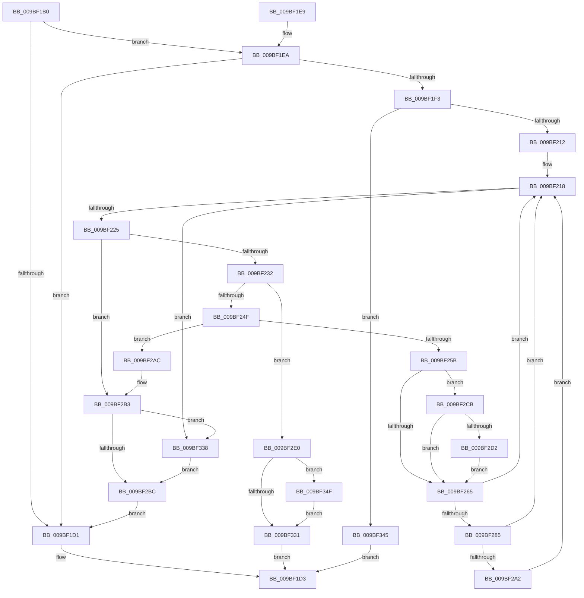

# EtwpRealtimeFlushSavedBuffers

- RVA: `0x009BF1B0`–`0x009BF359` (길이 `425` bytes)
- VA: `0x00000001409BF1B0`
- 실행 섹션: `PAGE`
- PDB 이름 있음: `예`; PDB Function 태그: `아니요`
- unwind 정보 RVA: `0x0009F3D0`
- 디코드: `99`개 명령, `425/425` bytes 표시
- 미해석 바이트: `0` (있으면 어셈블리에 `.byte`로 보존)

> 이 문서는 커널 이미지의 기계어와 PDB 기호를 분석해 생성했습니다. 4번과 5번은 함수 원형과 자료형을 바이너리 사용 방식에서 추정한 C 해석이며 원본 소스 복구 결과는 아닙니다.

## 1. Dependencies

- 직접 호출 지점: **9**; 고유 호출 대상: **7**
- 직접 호출자로 확인된 함수: **1**
- RIP 상대 이미지 참조: **0**

### Outgoing calls
- `0x009BF201` → [ExAllocatePool2](../../poolcode/B8/ExAllocatePool2_function_00B820F0.md) (function, `0x00B820F0`)
- `0x009BF23F` → [EtwpRealtimeRestoreBuffer](EtwpRealtimeRestoreBuffer_function_009BF360.md) (function, `0x009BF360`)
- `0x009BF252` → [EtwpRealtimeDeliverBuffer](EtwpRealtimeDeliverBuffer_function_009BF780.md) (function, `0x009BF780`)
- `0x009BF2C1` → [ExFreePoolWithTag](../../poolcode/B8/ExFreePoolWithTag_function_00B82870.md) (function, `0x00B82870`)
- `0x009BF30F` → [EtwpSendSessionNotification](EtwpSendSessionNotification_function_009BFE28.md) (function, `0x009BFE28`)
- `0x009BF317` → [EtwpRealtimeZeroTruncateLogfile](EtwpRealtimeZeroTruncateLogfile_function_009BDE0C.md) (function, `0x009BDE0C`)
- `0x009BF321` → [ExFreePoolWithTag](../../poolcode/B8/ExFreePoolWithTag_function_00B82870.md) (function, `0x00B82870`)
- `0x009BF33B` → [EtwpRealtimeZeroTruncateLogfile](EtwpRealtimeZeroTruncateLogfile_function_009BDE0C.md) (function, `0x009BDE0C`)
- `0x009BF352` → [EtwpRealtimeResetReferenceTime](../7C/EtwpRealtimeResetReferenceTime_function_007C0C8C.md) (function, `0x007C0C8C`)

### Direct callers
- [EtwpLogger](EtwpLogger_function_009BE310.md) at `0x009BE5C7`

### Static image references
- 디코드된 RIP-relative 메모리 참조가 없습니다.

## 2. Other-region calls and transfers

- 다른 실행 섹션으로 향하는 call: **3**
  - `0x009BF201` → [ExAllocatePool2](../../poolcode/B8/ExAllocatePool2_function_00B820F0.md) (`PAGE` → `POOLCODE`)
  - `0x009BF2C1` → [ExFreePoolWithTag](../../poolcode/B8/ExFreePoolWithTag_function_00B82870.md) (`PAGE` → `POOLCODE`)
  - `0x009BF321` → [ExFreePoolWithTag](../../poolcode/B8/ExFreePoolWithTag_function_00B82870.md) (`PAGE` → `POOLCODE`)
- 별도 외부 분기/꼬리 이동을 확인하지 못했습니다.

## 3. Assembly (complete function range)

```asm
009BF1B0  48 89 5C 24 08                  mov qword ptr [rsp + 8], rbx
009BF1B5  48 89 74 24 10                  mov qword ptr [rsp + 0x10], rsi
009BF1BA  48 89 7C 24 18                  mov qword ptr [rsp + 0x18], rdi
009BF1BF  41 56                           push r14
009BF1C1  48 83 EC 20                     sub rsp, 0x20
009BF1C5  83 B9 A8 01 00 00 00            cmp dword ptr [rcx + 0x1a8], 0
009BF1CC  48 8B F9                        mov rdi, rcx
009BF1CF  75 19                           jne 0x1409bf1ea
009BF1D1  33 C0                           xor eax, eax
009BF1D3  48 8B 5C 24 30                  mov rbx, qword ptr [rsp + 0x30]
009BF1D8  48 8B 74 24 38                  mov rsi, qword ptr [rsp + 0x38]
009BF1DD  48 8B 7C 24 40                  mov rdi, qword ptr [rsp + 0x40]
009BF1E2  48 83 C4 20                     add rsp, 0x20
009BF1E6  41 5E                           pop r14
009BF1E8  C3                              ret
009BF1E9  CC                              int3
009BF1EA  83 B9 58 01 00 00 00            cmp dword ptr [rcx + 0x158], 0
009BF1F1  74 DE                           je 0x1409bf1d1
009BF1F3  8B 51 04                        mov edx, dword ptr [rcx + 4]
009BF1F6  41 B8 45 74 77 50               mov r8d, 0x50777445
009BF1FC  B9 00 01 00 00                  mov ecx, 0x100
009BF201  E8 EA 2E 1C 00                  call 0x140b820f0
009BF206  48 8B F0                        mov rsi, rax
009BF209  48 85 C0                        test rax, rax
009BF20C  0F 84 33 01 00 00               je 0x1409bf345
009BF212  41 BE 03 00 00 00               mov r14d, 3
009BF218  83 BF A8 01 00 00 00            cmp dword ptr [rdi + 0x1a8], 0
009BF21F  0F 84 13 01 00 00               je 0x1409bf338
009BF225  83 BF 58 01 00 00 00            cmp dword ptr [rdi + 0x158], 0
009BF22C  0F 84 81 00 00 00               je 0x1409bf2b3
009BF232  48 8B 9F 88 01 00 00            mov rbx, qword ptr [rdi + 0x188]
009BF239  48 8B D6                        mov rdx, rsi
009BF23C  48 8B CF                        mov rcx, rdi
009BF23F  E8 1C 01 00 00                  call 0x1409bf360
009BF244  48 8B CF                        mov rcx, rdi
009BF247  85 C0                           test eax, eax
009BF249  0F 88 91 00 00 00               js 0x1409bf2e0
009BF24F  48 8B D6                        mov rdx, rsi
009BF252  E8 29 05 00 00                  call 0x1409bf780
009BF257  85 C0                           test eax, eax
009BF259  78 51                           js 0x1409bf2ac
009BF25B  8B 87 30 03 00 00               mov eax, dword ptr [rdi + 0x330]
009BF261  A8 01                           test al, 1
009BF263  75 66                           jne 0x1409bf2cb
009BF265  FF 8F A8 01 00 00               dec dword ptr [rdi + 0x1a8]
009BF26B  8B 46 30                        mov eax, dword ptr [rsi + 0x30]
009BF26E  48 8B 97 98 01 00 00            mov rdx, qword ptr [rdi + 0x198]
009BF275  48 2B D0                        sub rdx, rax
009BF278  83 7F 10 00                     cmp dword ptr [rdi + 0x10], 0
009BF27C  48 89 97 98 01 00 00            mov qword ptr [rdi + 0x198], rdx
009BF283  7D 93                           jge 0x1409bf218
009BF285  8B 8F EC 00 00 00               mov ecx, dword ptr [rdi + 0xec]
009BF28B  0F AF 4F 04                     imul ecx, dword ptr [rdi + 4]
009BF28F  48 8B 87 A0 01 00 00            mov rax, qword ptr [rdi + 0x1a0]
009BF296  48 2B C2                        sub rax, rdx
009BF299  48 3B C1                        cmp rax, rcx
009BF29C  0F 86 76 FF FF FF               jbe 0x1409bf218
009BF2A2  33 C0                           xor eax, eax
009BF2A4  87 47 10                        xchg dword ptr [rdi + 0x10], eax
009BF2A7  E9 6C FF FF FF                  jmp 0x1409bf218
009BF2AC  48 89 9F 88 01 00 00            mov qword ptr [rdi + 0x188], rbx
009BF2B3  83 BF A8 01 00 00 00            cmp dword ptr [rdi + 0x1a8], 0
009BF2BA  74 7C                           je 0x1409bf338
009BF2BC  33 D2                           xor edx, edx
009BF2BE  48 8B CE                        mov rcx, rsi
009BF2C1  E8 AA 35 1C 00                  call 0x140b82870
009BF2C6  E9 06 FF FF FF                  jmp 0x1409bf1d1
009BF2CB  66 44 39 76 36                  cmp word ptr [rsi + 0x36], r14w
009BF2D0  75 93                           jne 0x1409bf265
009BF2D2  0F 10 46 38                     movups xmm0, xmmword ptr [rsi + 0x38]
009BF2D6  F3 0F 7F 87 B0 01 00 00         movdqu xmmword ptr [rdi + 0x1b0], xmm0
009BF2DE  EB 85                           jmp 0x1409bf265
009BF2E0  8B 87 A8 01 00 00               mov eax, dword ptr [rdi + 0x1a8]
009BF2E6  BB 02 01 00 C0                  mov ebx, 0xc0000102
009BF2EB  01 87 04 01 00 00               add dword ptr [rdi + 0x104], eax
009BF2F1  44 8B C3                        mov r8d, ebx
009BF2F4  83 A7 A8 01 00 00 00            and dword ptr [rdi + 0x1a8], 0
009BF2FB  BA 04 00 00 00                  mov edx, 4
009BF300  48 83 A7 98 01 00 00 00         and qword ptr [rdi + 0x198], 0
009BF308  44 89 B7 C0 01 00 00            mov dword ptr [rdi + 0x1c0], r14d
009BF30F  E8 14 0B 00 00                  call 0x1409bfe28
009BF314  48 8B CF                        mov rcx, rdi
009BF317  E8 F0 EA FF FF                  call 0x1409bde0c
009BF31C  33 D2                           xor edx, edx
009BF31E  48 8B CE                        mov rcx, rsi
009BF321  E8 4A 35 1C 00                  call 0x140b82870
009BF326  8B 8F 30 03 00 00               mov ecx, dword ptr [rdi + 0x330]
009BF32C  F6 C1 01                        test cl, 1
009BF32F  75 1E                           jne 0x1409bf34f
009BF331  8B C3                           mov eax, ebx
009BF333  E9 9B FE FF FF                  jmp 0x1409bf1d3
009BF338  48 8B CF                        mov rcx, rdi
009BF33B  E8 CC EA FF FF                  call 0x1409bde0c
009BF340  E9 77 FF FF FF                  jmp 0x1409bf2bc
009BF345  B8 17 00 00 C0                  mov eax, 0xc0000017
009BF34A  E9 84 FE FF FF                  jmp 0x1409bf1d3
009BF34F  48 8B CF                        mov rcx, rdi
009BF352  E8 35 19 E0 FF                  call 0x1407c0c8c
009BF357  EB D8                           jmp 0x1409bf331
```

## 4. C-style interpretation (structured pseudocode)

```c
__int64 __fastcall EtwpRealtimeFlushSavedBuffers(__int64 a1)
{
    __int64 result;
    __int64 v_rsp;
    unsigned __int64 v_stack_p10;
    unsigned __int64 v_stack_p18;
    unsigned __int64 v_stack_p8;

    v_stack_p8 = v_rbx;
    v_stack_p10 = v_rsi;
    v_stack_p18 = v_rdi;
    v_rsp = (v_rsp) - (32);
    if ((*(unsigned int *)(a1 + 424)) != 0) goto loc_009BF1EA;
loc_009BF1D1:
    result = 0;
loc_009BF1D3:
    v_rsp = (v_rsp) + (32);
    return result;
loc_009BF1EA:
    if ((*(unsigned int *)(a1 + 344)) == 0) goto loc_009BF1D1;
    result = ExAllocatePool2(256, (unsigned int)(*(unsigned int *)(a1 + 4)), (unsigned int)(0x50777445ULL), a4);
    if (result == 0) goto loc_009BF345;
loc_009BF218:
    if ((*(unsigned int *)(v_stack_p18 + 424)) == 0) goto loc_009BF338;
    if ((*(unsigned int *)(v_stack_p18 + 344)) == 0) goto loc_009BF2B3;
    result = EtwpRealtimeRestoreBuffer(v_stack_p18, result, (unsigned int)(0x50777445ULL), a4);
    if (sign_flag) goto loc_009BF2E0;
    result = EtwpRealtimeDeliverBuffer(v_stack_p18, result, (unsigned int)(0x50777445ULL), a4);
    if (sign_flag) goto loc_009BF2AC;
    if ((((unsigned __int8)((unsigned int)(*(unsigned int *)(v_stack_p18 + 816)))) & (1)) != 0) goto loc_009BF2CB;
loc_009BF265:
    a2 = (*(unsigned __int64 *)(v_stack_p18 + 408)) - ((unsigned int)(*(unsigned int *)(result + 48)));
    *(unsigned __int64 *)(v_stack_p18 + 408) = a2;
    if ((*(unsigned int *)(v_stack_p18 + 16)) >= 0) goto loc_009BF218;
    a1 = (unsigned int)(((unsigned int)(*(unsigned int *)(v_stack_p18 + 236))) * (*(unsigned int *)(v_stack_p18 + 4)));
    result = (*(unsigned __int64 *)(v_stack_p18 + 416)) - (a2);
    if (result <= a1) goto loc_009BF218;
    result = 0;
    goto loc_009BF218;
loc_009BF2AC:
    *(unsigned __int64 *)(v_stack_p18 + 392) = *(unsigned __int64 *)(v_stack_p18 + 392);
loc_009BF2B3:
    if ((*(unsigned int *)(v_stack_p18 + 424)) == 0) goto loc_009BF338;
loc_009BF2BC:
    a2 = 0;
    result = ExFreePoolWithTag(0, a2, (unsigned int)(0x50777445ULL), a4);
    goto loc_009BF1D1;
loc_009BF2CB:
    if ((*(unsigned __int16 *)(result + 54)) != 3) goto loc_009BF265;
    *(unsigned __int64 *)(v_stack_p18 + 432) = v_xmm0;
    goto loc_009BF265;
loc_009BF2E0:
    *(unsigned int *)(v_stack_p18 + 448) = 3;
    result = EtwpSendSessionNotification(0, 4, (unsigned int)((unsigned int)((unsigned int)(0xC0000102ULL))), a4);
    result = EtwpRealtimeZeroTruncateLogfile(v_stack_p18, 4, (unsigned int)((unsigned int)((unsigned int)(0xC0000102ULL))), a4);
    a2 = 0;
    result = ExFreePoolWithTag(result, a2, (unsigned int)((unsigned int)((unsigned int)(0xC0000102ULL))), a4);
    if ((((unsigned __int8)((unsigned int)(*(unsigned int *)(v_stack_p18 + 816)))) & (1)) != 0) goto loc_009BF34F;
loc_009BF331:
    goto loc_009BF1D3;
loc_009BF338:
    result = EtwpRealtimeZeroTruncateLogfile(v_stack_p18, a2, (unsigned int)((unsigned int)((unsigned int)(0xC0000102ULL))), a4);
    goto loc_009BF2BC;
loc_009BF345:
    goto loc_009BF1D3;
loc_009BF34F:
    result = EtwpRealtimeResetReferenceTime(v_stack_p18, a2, (unsigned int)((unsigned int)((unsigned int)(0xC0000102ULL))), a4);
    goto loc_009BF331;
}
```

## 5. (Beta) C Style

```c
int64_t EtwpRealtimeFlushSavedBuffers(void *Arg1)
{
    uint8_t *arg1 = (uint8_t *)Arg1;

    int64_t result;
    int64_t local_rsp;
    uint64_t v_stack_p10;
    uint64_t v_stack_p18;
    uint64_t v_stack_p8;

    v_stack_p8 = local_rbx;
    v_stack_p10 = local_rsi;
    v_stack_p18 = local_rdi;
    local_rsp = (local_rsp) - (32);
    if ((*(uint32_t *)(arg1 + 0x1A8)) != 0) goto loc_009BF1EA;
loc_009BF1D1:
    result = 0;
loc_009BF1D3:
    local_rsp = (local_rsp) + (32);
    return result;
loc_009BF1EA:
    if ((*(uint32_t *)(arg1 + 0x158)) == 0) goto loc_009BF1D1;
    result = ExAllocatePool2(256, (uint32_t)(*(uint32_t *)(arg1 + 0x4)), (uint32_t)(0x50777445ULL), a4);
    if (result == 0) goto loc_009BF345;
loc_009BF218:
    if ((*(uint32_t *)(v_stack_p18 + 0x1A8)) == 0) goto loc_009BF338;
    if ((*(uint32_t *)(v_stack_p18 + 0x158)) == 0) goto loc_009BF2B3;
    result = EtwpRealtimeRestoreBuffer(v_stack_p18, result, (uint32_t)(0x50777445ULL), a4);
    if (sign_flag) goto loc_009BF2E0;
    result = EtwpRealtimeDeliverBuffer(v_stack_p18, result, (uint32_t)(0x50777445ULL), a4);
    if (sign_flag) goto loc_009BF2AC;
    if ((((uint8_t)((uint32_t)(*(uint32_t *)(v_stack_p18 + 0x330)))) & (1)) != 0) goto loc_009BF2CB;
loc_009BF265:
    a2 = (*(uint64_t *)(v_stack_p18 + 0x198)) - ((uint32_t)(*(uint32_t *)(result + 0x30)));
    *(uint64_t *)(v_stack_p18 + 0x198) = a2;
    if ((*(uint32_t *)(v_stack_p18 + 0x10)) >= 0) goto loc_009BF218;
    Arg1 = (uint32_t)(((uint32_t)(*(uint32_t *)(v_stack_p18 + 0xEC))) * (*(uint32_t *)(v_stack_p18 + 0x4)));
    result = (*(uint64_t *)(v_stack_p18 + 0x1A0)) - (a2);
    if (result <= Arg1) goto loc_009BF218;
    result = 0;
    goto loc_009BF218;
loc_009BF2AC:
    *(uint64_t *)(v_stack_p18 + 0x188) = *(uint64_t *)(v_stack_p18 + 0x188);
loc_009BF2B3:
    if ((*(uint32_t *)(v_stack_p18 + 0x1A8)) == 0) goto loc_009BF338;
loc_009BF2BC:
    a2 = 0;
    result = ExFreePoolWithTag(0, a2, (uint32_t)(0x50777445ULL), a4);
    goto loc_009BF1D1;
loc_009BF2CB:
    if ((*(uint16_t *)(result + 0x36)) != 3) goto loc_009BF265;
    *(uint64_t *)(v_stack_p18 + 0x1B0) = v_xmm0;
    goto loc_009BF265;
loc_009BF2E0:
    *(uint32_t *)(v_stack_p18 + 0x1C0) = 3;
    result = EtwpSendSessionNotification(0, 4, (uint32_t)((uint32_t)((uint32_t)(0xC0000102ULL))), a4);
    result = EtwpRealtimeZeroTruncateLogfile(v_stack_p18, 4, (uint32_t)((uint32_t)((uint32_t)(0xC0000102ULL))), a4);
    a2 = 0;
    result = ExFreePoolWithTag(result, a2, (uint32_t)((uint32_t)((uint32_t)(0xC0000102ULL))), a4);
    if ((((uint8_t)((uint32_t)(*(uint32_t *)(v_stack_p18 + 0x330)))) & (1)) != 0) goto loc_009BF34F;
loc_009BF331:
    goto loc_009BF1D3;
loc_009BF338:
    result = EtwpRealtimeZeroTruncateLogfile(v_stack_p18, a2, (uint32_t)((uint32_t)((uint32_t)(0xC0000102ULL))), a4);
    goto loc_009BF2BC;
loc_009BF345:
    goto loc_009BF1D3;
loc_009BF34F:
    result = EtwpRealtimeResetReferenceTime(v_stack_p18, a2, (uint32_t)((uint32_t)((uint32_t)(0xC0000102ULL))), a4);
    goto loc_009BF331;
}
```

### 관측된 메모리 오프셋

구조체 형식이 확인되지 않은 접근은 인자 기준의 오프셋으로만 기록했습니다.

| 기준 인자 | 오프셋 표현 | 폭 (bit) | 접근 |
|---|---:|---:|---|
| `Arg1` | `+ 0x4` | `32` | `R` |
| `Arg1` | `+ 0x10` | `32` | `R` |
| `Arg1` | `+ 0x10` | `32` | `R/W` |
| `Arg1` | `+ 0xEC` | `32` | `R` |
| `Arg1` | `+ 0x104` | `32` | `R/W` |
| `Arg1` | `+ 0x158` | `32` | `R` |
| `Arg1` | `+ 0x188` | `64` | `R` |
| `Arg1` | `+ 0x188` | `64` | `W` |
| `Arg1` | `+ 0x198` | `64` | `R` |
| `Arg1` | `+ 0x198` | `64` | `R/W` |
| `Arg1` | `+ 0x198` | `64` | `W` |
| `Arg1` | `+ 0x1A0` | `64` | `R` |
| `Arg1` | `+ 0x1A8` | `32` | `R` |
| `Arg1` | `+ 0x1A8` | `32` | `R/W` |
| `Arg1` | `+ 0x1B0` | `128` | `W` |
| `Arg1` | `+ 0x1C0` | `32` | `W` |
| `Arg1` | `+ 0x330` | `32` | `R` |

## 6. Execution-region graph

[열기: 2D/3D 그래프와 함수 탐색 컨트롤 패널](../../../control-panel.html?section=page&rva=0x009BF1B0&view=graph)

- 2D 그래프는 위에서 아래로 흐르고, 3D 그래프는 빈 공간을 드래그해 회전합니다. Shift+드래그는 이동, 휠은 확대·축소, 함수 노드 선택은 대상 보고서 이동입니다.

### Static fallback


