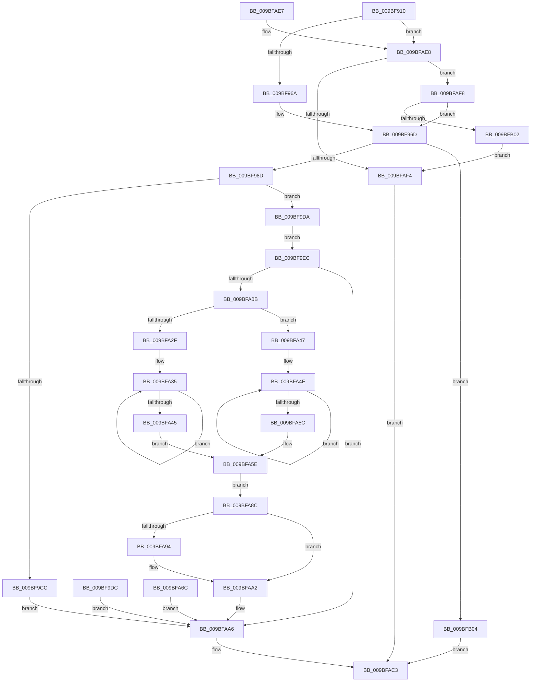

# EtwpRealtimeInjectEtwBuffer

- RVA: `0x009BF910`–`0x009BFB0B` (길이 `507` bytes)
- VA: `0x00000001409BF910`
- 실행 섹션: `PAGE`
- PDB 이름 있음: `예`; PDB Function 태그: `아니요`
- unwind 정보 RVA: `0x0009F458`
- 디코드: `133`개 명령, `507/507` bytes 표시
- 미해석 바이트: `0` (있으면 어셈블리에 `.byte`로 보존)

> 이 문서는 커널 이미지의 기계어와 PDB 기호를 분석해 생성했습니다. 4번과 5번은 함수 원형과 자료형을 바이너리 사용 방식에서 추정한 C 해석이며 원본 소스 복구 결과는 아닙니다.

## 1. Dependencies

- 직접 호출 지점: **9**; 고유 호출 대상: **9**
- 직접 호출자로 확인된 함수: **2**
- RIP 상대 이미지 참조: **1**

### Outgoing calls
- `0x009BF980` → [ExAcquireRundownProtection](../../text/21/ExAcquireRundownProtection_function_00216620.md) (function, `0x00216620`)
- `0x009BF997` → [KiStackAttachProcess](../../text/21/KiStackAttachProcess_function_00216820.md) (function, `0x00216820`)
- `0x009BF9F8` → [EtwpFindUserBufferSpace](EtwpFindUserBufferSpace_function_009BFB14.md) (function, `0x009BFB14`)
- `0x009BFA17` → [memcpy](../../text/6C/memcpy_function_006C6840.md) (function, `0x006C6840`)
- `0x009BFA80` → [EtwpFreeUserBufferSpace](../7C/EtwpFreeUserBufferSpace_function_007C0C08.md) (function, `0x007C0C08`)
- `0x009BFA9D` → [KeSetEvent](../../text/33/KeSetEvent_function_0033F310.md) (function, `0x0033F310`)
- `0x009BFAAD` → [KiUnstackDetachProcess](../../text/21/KiUnstackDetachProcess_function_00217D30.md) (function, `0x00217D30`)
- `0x009BFABC` → [ExReleaseRundownProtection](../../text/34/ExReleaseRundownProtection_function_00349E80.md) (function, `0x00349E80`)
- `0x009BFACE` → [_security_check_cookie](../../text/6A/_security_check_cookie_function_006AC640.md) (function, `0x006AC640`)

### Direct callers
- [EtwpRealtimeDeliverBuffer](EtwpRealtimeDeliverBuffer_function_009BF780.md) at `0x009BF806`
- [EtwpRealtimeNotifyConsumers](../9C/EtwpRealtimeNotifyConsumers_function_009C019C.md) at `0x009C030E`

### Static image references
- `0x009BF920` → RVA `0x00E0A740` (`.data`; read)

## 2. Other-region calls and transfers

- 다른 실행 섹션으로 향하는 call: **7**
  - `0x009BF980` → [ExAcquireRundownProtection](../../text/21/ExAcquireRundownProtection_function_00216620.md) (`PAGE` → `.text`)
  - `0x009BF997` → [KiStackAttachProcess](../../text/21/KiStackAttachProcess_function_00216820.md) (`PAGE` → `.text`)
  - `0x009BFA17` → [memcpy](../../text/6C/memcpy_function_006C6840.md) (`PAGE` → `.text`)
  - `0x009BFA9D` → [KeSetEvent](../../text/33/KeSetEvent_function_0033F310.md) (`PAGE` → `.text`)
  - `0x009BFAAD` → [KiUnstackDetachProcess](../../text/21/KiUnstackDetachProcess_function_00217D30.md) (`PAGE` → `.text`)
  - `0x009BFABC` → [ExReleaseRundownProtection](../../text/34/ExReleaseRundownProtection_function_00349E80.md) (`PAGE` → `.text`)
  - `0x009BFACE` → [_security_check_cookie](../../text/6A/_security_check_cookie_function_006AC640.md) (`PAGE` → `.text`)
- 별도 외부 분기/꼬리 이동을 확인하지 못했습니다.

## 3. Assembly (complete function range)

```asm
009BF910  48 89 5C 24 08                  mov qword ptr [rsp + 8], rbx
009BF915  56                              push rsi
009BF916  57                              push rdi
009BF917  41 56                           push r14
009BF919  48 81 EC 90 00 00 00            sub rsp, 0x90
009BF920  48 8B 05 19 AE 44 00            mov rax, qword ptr [rip + 0x44ae19]
009BF927  48 33 C4                        xor rax, rsp
009BF92A  48 89 84 24 88 00 00 00         mov qword ptr [rsp + 0x88], rax
009BF932  4D 8B F0                        mov r14, r8
009BF935  48 8B DA                        mov rbx, rdx
009BF938  48 8B F1                        mov rsi, rcx
009BF93B  48 89 54 24 48                  mov qword ptr [rsp + 0x48], rdx
009BF940  4C 89 44 24 40                  mov qword ptr [rsp + 0x40], r8
009BF945  0F 57 C0                        xorps xmm0, xmm0
009BF948  0F 11 44 24 58                  movups xmmword ptr [rsp + 0x58], xmm0
009BF94D  0F 11 44 24 68                  movups xmmword ptr [rsp + 0x68], xmm0
009BF952  0F 11 44 24 78                  movups xmmword ptr [rsp + 0x78], xmm0
009BF957  33 C0                           xor eax, eax
009BF959  48 89 44 24 28                  mov qword ptr [rsp + 0x28], rax
009BF95E  66 41 83 78 36 06               cmp word ptr [r8 + 0x36], 6
009BF964  0F 84 7E 01 00 00               je 0x1409bfae8
009BF96A  89 42 54                        mov dword ptr [rdx + 0x54], eax
009BF96D  48 8D 7A 18                     lea rdi, [rdx + 0x18]
009BF971  48 89 7C 24 38                  mov qword ptr [rsp + 0x38], rdi
009BF976  48 8B 0F                        mov rcx, qword ptr [rdi]
009BF979  48 81 C1 E8 01 00 00            add rcx, 0x1e8
009BF980  E8 9B 6C 85 FF                  call 0x140216620
009BF985  84 C0                           test al, al
009BF987  0F 84 77 01 00 00               je 0x1409bfb04
009BF98D  48 8B 0F                        mov rcx, qword ptr [rdi]
009BF990  4C 8D 44 24 58                  lea r8, [rsp + 0x58]
009BF995  33 D2                           xor edx, edx
009BF997  E8 84 6E 85 FF                  call 0x140216820
009BF99C  90                              nop
009BF99D  8B 8E F0 00 00 00               mov ecx, dword ptr [rsi + 0xf0]
009BF9A3  48 8B 83 88 00 00 00            mov rax, qword ptr [rbx + 0x88]
009BF9AA  89 08                           mov dword ptr [rax], ecx
009BF9AC  8B 8E 04 01 00 00               mov ecx, dword ptr [rsi + 0x104]
009BF9B2  48 8B 83 90 00 00 00            mov rax, qword ptr [rbx + 0x90]
009BF9B9  89 08                           mov dword ptr [rax], ecx
009BF9BB  8B 8E EC 00 00 00               mov ecx, dword ptr [rsi + 0xec]
009BF9C1  C1 E1 02                        shl ecx, 2
009BF9C4  48 8B 43 40                     mov rax, qword ptr [rbx + 0x40]
009BF9C8  39 08                           cmp dword ptr [rax], ecx
009BF9CA  72 0E                           jb 0x1409bf9da
009BF9CC  BE 3C 00 00 C0                  mov esi, 0xc000003c
009BF9D1  89 74 24 20                     mov dword ptr [rsp + 0x20], esi
009BF9D5  E9 CC 00 00 00                  jmp 0x1409bfaa6
009BF9DA  EB 10                           jmp 0x1409bf9ec
009BF9DC  8B F0                           mov esi, eax
009BF9DE  89 44 24 20                     mov dword ptr [rsp + 0x20], eax
009BF9E2  48 8B 7C 24 38                  mov rdi, qword ptr [rsp + 0x38]
009BF9E7  E9 BA 00 00 00                  jmp 0x1409bfaa6
009BF9EC  45 8B 46 30                     mov r8d, dword ptr [r14 + 0x30]
009BF9F0  4C 8D 4C 24 28                  lea r9, [rsp + 0x28]
009BF9F5  48 8B D3                        mov rdx, rbx
009BF9F8  E8 17 01 00 00                  call 0x1409bfb14
009BF9FD  8B F0                           mov esi, eax
009BF9FF  89 44 24 20                     mov dword ptr [rsp + 0x20], eax
009BFA03  85 C0                           test eax, eax
009BFA05  0F 88 9B 00 00 00               js 0x1409bfaa6
009BFA0B  45 8B 46 30                     mov r8d, dword ptr [r14 + 0x30]
009BFA0F  49 8B D6                        mov rdx, r14
009BFA12  48 8B 4C 24 28                  mov rcx, qword ptr [rsp + 0x28]
009BFA17  E8 24 6E D0 FF                  call 0x1406c6840
009BFA1C  48 8B 53 48                     mov rdx, qword ptr [rbx + 0x48]
009BFA20  4C 8B 44 24 28                  mov r8, qword ptr [rsp + 0x28]
009BFA25  49 83 C0 20                     add r8, 0x20
009BFA29  F6 43 5A 10                     test byte ptr [rbx + 0x5a], 0x10
009BFA2D  75 18                           jne 0x1409bfa47
009BFA2F  0F 0D 0A                        prefetchw byte ptr [rdx]
009BFA32  48 8B 02                        mov rax, qword ptr [rdx]
009BFA35  49 89 00                        mov qword ptr [r8], rax
009BFA38  48 8B C8                        mov rcx, rax
009BFA3B  F0 4C 0F B1 02                  lock cmpxchg qword ptr [rdx], r8
009BFA40  48 3B C1                        cmp rax, rcx
009BFA43  75 F0                           jne 0x1409bfa35
009BFA45  EB 17                           jmp 0x1409bfa5e
009BFA47  4C 89 44 24 50                  mov qword ptr [rsp + 0x50], r8
009BFA4C  8B 02                           mov eax, dword ptr [rdx]
009BFA4E  41 89 00                        mov dword ptr [r8], eax
009BFA51  8B C8                           mov ecx, eax
009BFA53  F0 44 0F B1 02                  lock cmpxchg dword ptr [rdx], r8d
009BFA58  3B C1                           cmp eax, ecx
009BFA5A  75 F2                           jne 0x1409bfa4e
009BFA5C  8B C0                           mov eax, eax
009BFA5E  48 89 44 24 30                  mov qword ptr [rsp + 0x30], rax
009BFA63  48 8B 43 40                     mov rax, qword ptr [rbx + 0x40]
009BFA67  F0 FF 00                        lock inc dword ptr [rax]
009BFA6A  EB 20                           jmp 0x1409bfa8c
009BFA6C  8B F0                           mov esi, eax
009BFA6E  48 8B 44 24 40                  mov rax, qword ptr [rsp + 0x40]
009BFA73  8B 50 30                        mov edx, dword ptr [rax + 0x30]
009BFA76  4C 8B 44 24 28                  mov r8, qword ptr [rsp + 0x28]
009BFA7B  48 8B 4C 24 48                  mov rcx, qword ptr [rsp + 0x48]
009BFA80  E8 83 11 E0 FF                  call 0x1407c0c08
009BFA85  48 8B 7C 24 38                  mov rdi, qword ptr [rsp + 0x38]
009BFA8A  EB 1A                           jmp 0x1409bfaa6
009BFA8C  48 83 7C 24 30 00               cmp qword ptr [rsp + 0x30], 0
009BFA92  75 0E                           jne 0x1409bfaa2
009BFA94  45 33 C0                        xor r8d, r8d
009BFA97  33 D2                           xor edx, edx
009BFA99  48 8B 4B 38                     mov rcx, qword ptr [rbx + 0x38]
009BFA9D  E8 6E F8 97 FF                  call 0x14033f310
009BFAA2  8B 74 24 20                     mov esi, dword ptr [rsp + 0x20]
009BFAA6  33 D2                           xor edx, edx
009BFAA8  48 8D 4C 24 58                  lea rcx, [rsp + 0x58]
009BFAAD  E8 7E 82 85 FF                  call 0x140217d30
009BFAB2  48 8B 0F                        mov rcx, qword ptr [rdi]
009BFAB5  48 81 C1 E8 01 00 00            add rcx, 0x1e8
009BFABC  E8 BF A3 98 FF                  call 0x140349e80
009BFAC1  8B C6                           mov eax, esi
009BFAC3  48 8B 8C 24 88 00 00 00         mov rcx, qword ptr [rsp + 0x88]
009BFACB  48 33 CC                        xor rcx, rsp
009BFACE  E8 6D CB CE FF                  call 0x1406ac640
009BFAD3  48 8B 9C 24 B0 00 00 00         mov rbx, qword ptr [rsp + 0xb0]
009BFADB  48 81 C4 90 00 00 00            add rsp, 0x90
009BFAE2  41 5E                           pop r14
009BFAE4  5F                              pop rdi
009BFAE5  5E                              pop rsi
009BFAE6  C3                              ret
009BFAE7  CC                              int3
009BFAE8  FF 42 54                        inc dword ptr [rdx + 0x54]
009BFAEB  8B 41 0C                        mov eax, dword ptr [rcx + 0xc]
009BFAEE  0F BA E0 1C                     bt eax, 0x1c
009BFAF2  73 04                           jae 0x1409bfaf8
009BFAF4  33 C0                           xor eax, eax
009BFAF6  EB CB                           jmp 0x1409bfac3
009BFAF8  83 7A 54 02                     cmp dword ptr [rdx + 0x54], 2
009BFAFC  0F 86 6B FE FF FF               jbe 0x1409bf96d
009BFB02  EB F0                           jmp 0x1409bfaf4
009BFB04  B8 0A 01 00 C0                  mov eax, 0xc000010a
009BFB09  EB B8                           jmp 0x1409bfac3
```

## 4. C-style interpretation (structured pseudocode)

```c
__int64 __fastcall EtwpRealtimeInjectEtwBuffer(__int64 a1, __int64 a2, __int64 a3)
{
    __int64 result;
    __int64 v_rsp;
    unsigned __int64 v_stack_m20;
    unsigned __int64 v_stack_m30;
    unsigned __int64 v_stack_m40;
    unsigned __int64 v_stack_m50;
    unsigned __int64 v_stack_m58;
    unsigned __int64 v_stack_m60;
    unsigned __int64 v_stack_m68;
    unsigned __int64 v_stack_m70;
    unsigned __int64 v_stack_m78;
    unsigned __int64 v_stack_m80;
    unsigned int v_stack_m88;
    unsigned __int64 v_stack_p8;

    v_stack_p8 = v_rbx;
    v_rsp = (v_rsp) - (144);
    result = (*(unsigned __int64 *)(v_rip + 4501017)) ^ (v_rsp);
    v_stack_m20 = result;
    v_stack_m60 = a2;
    v_stack_m68 = a3;
    v_stack_m50 = v_xmm0;
    v_stack_m40 = v_xmm0;
    v_stack_m30 = v_xmm0;
    result = 0;
    v_stack_m80 = 0;
    if ((*(unsigned __int16 *)(a3 + 54)) == 6) goto loc_009BFAE8;
    *(unsigned int *)(a2 + 84) = 0;
loc_009BF96D:
    v_stack_m70 = a2 + 24;
    a1 = (*(unsigned __int64 *)(a2 + 24)) + (488);
    result = ExAcquireRundownProtection(a1, a2, a3, a4);
    if ((unsigned __int8)(result) == 0) goto loc_009BFB04;
    a2 = 0;
    result = KiStackAttachProcess(*(unsigned __int64 *)(a2 + 24), a2, v_stack_m50, a4);
    *(unsigned int *)(*(unsigned __int64 *)(a2 + 136)) = (unsigned int)((unsigned int)(*(unsigned int *)(a1 + 240)));
    *(unsigned int *)(*(unsigned __int64 *)(a2 + 144)) = (unsigned int)((unsigned int)(*(unsigned int *)(a1 + 260)));
    a1 = (unsigned int)(((unsigned int)(*(unsigned int *)(a1 + 236))) << (2));
    if ((*(unsigned int *)(*(unsigned __int64 *)(a2 + 64))) < ((unsigned int)(a1))) goto loc_009BF9DA;
    v_stack_m88 = (unsigned int)((unsigned int)(0xC000003CULL));
    goto loc_009BFAA6;
loc_009BF9DA:
    goto loc_009BF9EC;
loc_009BF9EC:
    result = EtwpFindUserBufferSpace(a1, 0, (unsigned int)(*(unsigned int *)(a3 + 48)), v_stack_m80);
    v_stack_m88 = (unsigned int)(result);
    if (sign_flag) goto loc_009BFAA6;
    result = memcpy(v_stack_m80, a3, (unsigned int)(*(unsigned int *)(a3 + 48)), v_stack_m80);
    a3 = (v_stack_m80) + (32);
    if (((*(unsigned __int8 *)(a2 + 90)) & (16)) != 0) goto loc_009BFA47;
loc_009BFA35:
    *(unsigned __int64 *)(a3) = *(unsigned __int64 *)(*(unsigned __int64 *)(a2 + 72));
    if ((*(unsigned __int64 *)(*(unsigned __int64 *)(a2 + 72))) != (*(unsigned __int64 *)(*(unsigned __int64 *)(a2 + 72)))) goto loc_009BFA35;
    goto loc_009BFA5E;
loc_009BFA47:
    v_stack_m58 = a3;
loc_009BFA4E:
    *(unsigned int *)(a3) = (unsigned int)((unsigned int)(*(unsigned int *)(*(unsigned __int64 *)(a2 + 72))));
    if (((unsigned int)((unsigned int)(*(unsigned int *)(*(unsigned __int64 *)(a2 + 72))))) != ((unsigned int)((unsigned int)((unsigned int)((unsigned int)(*(unsigned int *)(*(unsigned __int64 *)(a2 + 72)))))))) goto loc_009BFA4E;
loc_009BFA5E:
    v_stack_m78 = (unsigned int)((unsigned int)((unsigned int)(*(unsigned int *)(*(unsigned __int64 *)(a2 + 72)))));
    goto loc_009BFA8C;
loc_009BFA8C:
    result = *(unsigned __int64 *)(a2 + 64);
    if (v_stack_m78 == 0) {
        a3 = 0;
        a2 = 0;
        a1 = *(unsigned __int64 *)(a2 + 56);
        result = KeSetEvent(a1, a2, a3, v_stack_m80);
    }
loc_009BFAA6:
    a2 = 0;
    result = KiUnstackDetachProcess(v_stack_m50, a2, a3, v_stack_m80);
    a1 = (*(unsigned __int64 *)(a2 + 24)) + (488);
    result = ExReleaseRundownProtection(a1, a2, a3, v_stack_m80);
loc_009BFAC3:
    a1 = (v_stack_m20) ^ (v_rsp);
    result = _security_check_cookie(a1, a2, a3, v_stack_m80);
    v_rsp = (v_rsp) + (144);
    return result;
loc_009BFAE8:
    if (condition_is_above_or_equal) goto loc_009BFAF8;
loc_009BFAF4:
    result = 0;
    goto loc_009BFAC3;
loc_009BFAF8:
    if ((*(unsigned int *)(a2 + 84)) <= 2) goto loc_009BF96D;
    goto loc_009BFAF4;
loc_009BFB04:
    goto loc_009BFAC3;
}
```

## 5. (Beta) C Style

```c
int64_t EtwpRealtimeInjectEtwBuffer(void *Arg1, void *Arg2, void *Arg3)
{
    uint8_t *arg1 = (uint8_t *)Arg1;
    uint8_t *arg2 = (uint8_t *)Arg2;
    uint8_t *arg3 = (uint8_t *)Arg3;

    int64_t result;
    int64_t local_rsp;
    uint64_t v_stack_m20;
    uint64_t v_stack_m30;
    uint64_t v_stack_m40;
    uint64_t v_stack_m50;
    uint64_t v_stack_m58;
    uint64_t v_stack_m60;
    uint64_t v_stack_m68;
    uint64_t v_stack_m70;
    uint64_t v_stack_m78;
    uint64_t v_stack_m80;
    uint32_t v_stack_m88;
    uint64_t v_stack_p8;

    v_stack_p8 = local_rbx;
    local_rsp = (local_rsp) - (144);
    result = (*(uint64_t *)(v_rip + 0x44AE19)) ^ (local_rsp);
    v_stack_m20 = result;
    v_stack_m60 = Arg2;
    v_stack_m68 = Arg3;
    v_stack_m50 = v_xmm0;
    v_stack_m40 = v_xmm0;
    v_stack_m30 = v_xmm0;
    result = 0;
    v_stack_m80 = 0;
    if ((*(uint16_t *)(arg3 + 0x36)) == 6) goto loc_009BFAE8;
    *(uint32_t *)(arg2 + 0x54) = 0;
loc_009BF96D:
    v_stack_m70 = Arg2 + 24;
    Arg1 = (*(uint64_t *)(arg2 + 0x18)) + (488);
    result = ExAcquireRundownProtection(Arg1, Arg2, Arg3, a4);
    if ((uint8_t)(result) == 0) goto loc_009BFB04;
    Arg2 = 0;
    result = KiStackAttachProcess(*(uint64_t *)(arg2 + 0x18), Arg2, v_stack_m50, a4);
    *(uint32_t *)(*(uint64_t *)(arg2 + 0x88)) = (uint32_t)((uint32_t)(*(uint32_t *)(arg1 + 0xF0)));
    *(uint32_t *)(*(uint64_t *)(arg2 + 0x90)) = (uint32_t)((uint32_t)(*(uint32_t *)(arg1 + 0x104)));
    Arg1 = (uint32_t)(((uint32_t)(*(uint32_t *)(arg1 + 0xEC))) << (2));
    if ((*(uint32_t *)(*(uint64_t *)(arg2 + 0x40))) < ((uint32_t)(Arg1))) goto loc_009BF9DA;
    v_stack_m88 = (uint32_t)((uint32_t)(0xC000003CULL));
    goto loc_009BFAA6;
loc_009BF9DA:
    goto loc_009BF9EC;
loc_009BF9EC:
    result = EtwpFindUserBufferSpace(Arg1, 0, (uint32_t)(*(uint32_t *)(arg3 + 0x30)), v_stack_m80);
    v_stack_m88 = (uint32_t)(result);
    if (sign_flag) goto loc_009BFAA6;
    result = memcpy(v_stack_m80, Arg3, (uint32_t)(*(uint32_t *)(arg3 + 0x30)), v_stack_m80);
    Arg3 = (v_stack_m80) + (32);
    if (((*(uint8_t *)(arg2 + 0x5A)) & (16)) != 0) goto loc_009BFA47;
loc_009BFA35:
    *(uint64_t *)(arg3) = *(uint64_t *)(*(uint64_t *)(arg2 + 0x48));
    if ((*(uint64_t *)(*(uint64_t *)(arg2 + 0x48))) != (*(uint64_t *)(*(uint64_t *)(arg2 + 0x48)))) goto loc_009BFA35;
    goto loc_009BFA5E;
loc_009BFA47:
    v_stack_m58 = Arg3;
loc_009BFA4E:
    *(uint32_t *)(arg3) = (uint32_t)((uint32_t)(*(uint32_t *)(*(uint64_t *)(arg2 + 0x48))));
    if (((uint32_t)((uint32_t)(*(uint32_t *)(*(uint64_t *)(arg2 + 0x48))))) != ((uint32_t)((uint32_t)((uint32_t)((uint32_t)(*(uint32_t *)(*(uint64_t *)(arg2 + 0x48)))))))) goto loc_009BFA4E;
loc_009BFA5E:
    v_stack_m78 = (uint32_t)((uint32_t)((uint32_t)(*(uint32_t *)(*(uint64_t *)(arg2 + 0x48)))));
    goto loc_009BFA8C;
loc_009BFA8C:
    result = *(uint64_t *)(arg2 + 0x40);
    if (v_stack_m78 == 0) {
        Arg3 = 0;
        Arg2 = 0;
        Arg1 = *(uint64_t *)(arg2 + 0x38);
        result = KeSetEvent(Arg1, Arg2, Arg3, v_stack_m80);
    }
loc_009BFAA6:
    Arg2 = 0;
    result = KiUnstackDetachProcess(v_stack_m50, Arg2, Arg3, v_stack_m80);
    Arg1 = (*(uint64_t *)(arg2 + 0x18)) + (488);
    result = ExReleaseRundownProtection(Arg1, Arg2, Arg3, v_stack_m80);
loc_009BFAC3:
    Arg1 = (v_stack_m20) ^ (local_rsp);
    result = _security_check_cookie(Arg1, Arg2, Arg3, v_stack_m80);
    local_rsp = (local_rsp) + (144);
    return result;
loc_009BFAE8:
    if (condition_is_above_or_equal) goto loc_009BFAF8;
loc_009BFAF4:
    result = 0;
    goto loc_009BFAC3;
loc_009BFAF8:
    if ((*(uint32_t *)(arg2 + 0x54)) <= 2) goto loc_009BF96D;
    goto loc_009BFAF4;
loc_009BFB04:
    goto loc_009BFAC3;
}
```

### 관측된 메모리 오프셋

구조체 형식이 확인되지 않은 접근은 인자 기준의 오프셋으로만 기록했습니다.

| 기준 인자 | 오프셋 표현 | 폭 (bit) | 접근 |
|---|---:|---:|---|
| `Arg1` | `+ 0xC` | `32` | `R` |
| `Arg1` | `+ 0xEC` | `32` | `R` |
| `Arg1` | `+ 0xF0` | `32` | `R` |
| `Arg1` | `+ 0x104` | `32` | `R` |
| `Arg2` | `+ 0x0` | `64` | `R` |
| `Arg2` | `+ 0x18` | `64` | `R` |
| `Arg2` | `+ 0x38` | `64` | `R` |
| `Arg2` | `+ 0x40` | `64` | `R` |
| `Arg2` | `+ 0x48` | `64` | `R` |
| `Arg2` | `+ 0x54` | `32` | `R` |
| `Arg2` | `+ 0x54` | `32` | `R/W` |
| `Arg2` | `+ 0x54` | `32` | `W` |
| `Arg2` | `+ 0x5A` | `8` | `R` |
| `Arg2` | `+ 0x88` | `64` | `R` |
| `Arg2` | `+ 0x90` | `64` | `R` |
| `Arg3` | `+ 0x30` | `32` | `R` |
| `Arg3` | `+ 0x36` | `16` | `R` |

## 6. Execution-region graph

[열기: 2D/3D 그래프와 함수 탐색 컨트롤 패널](../../../control-panel.html?section=page&rva=0x009BF910&view=graph)

- 2D 그래프는 위에서 아래로 흐르고, 3D 그래프는 빈 공간을 드래그해 회전합니다. Shift+드래그는 이동, 휠은 확대·축소, 함수 노드 선택은 대상 보고서 이동입니다.

### Static fallback


