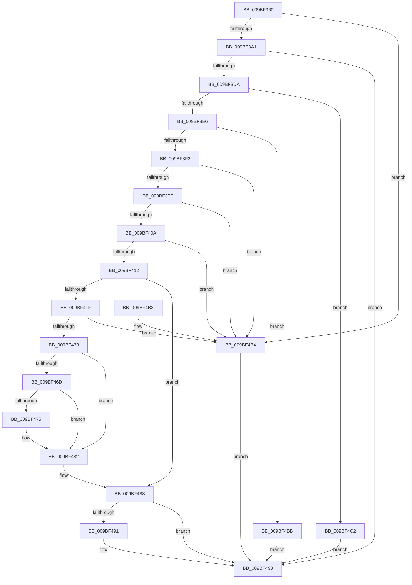

# EtwpRealtimeRestoreBuffer

- RVA: `0x009BF360`–`0x009BF4C6` (길이 `358` bytes)
- VA: `0x00000001409BF360`
- 실행 섹션: `PAGE`
- PDB 이름 있음: `예`; PDB Function 태그: `아니요`
- unwind 정보 RVA: `0x0009F3E8`
- 디코드: `90`개 명령, `358/358` bytes 표시
- 미해석 바이트: `0` (있으면 어셈블리에 `.byte`로 보존)

> 이 문서는 커널 이미지의 기계어와 PDB 기호를 분석해 생성했습니다. 4번과 5번은 함수 원형과 자료형을 바이너리 사용 방식에서 추정한 C 해석이며 원본 소스 복구 결과는 아닙니다.

## 1. Dependencies

- 직접 호출 지점: **2**; 고유 호출 대상: **1**
- 직접 호출자로 확인된 함수: **1**
- RIP 상대 이미지 참조: **0**

### Outgoing calls
- `0x009BF3CD` → [ZwReadFile](../../text/6A/ZwReadFile_function_006AD190.md) (function, `0x006AD190`)
- `0x009BF464` → [ZwReadFile](../../text/6A/ZwReadFile_function_006AD190.md) (function, `0x006AD190`)

### Direct callers
- [EtwpRealtimeFlushSavedBuffers](EtwpRealtimeFlushSavedBuffers_function_009BF1B0.md) at `0x009BF23F`

### Static image references
- 디코드된 RIP-relative 메모리 참조가 없습니다.

## 2. Other-region calls and transfers

- 다른 실행 섹션으로 향하는 call: **2**
  - `0x009BF3CD` → [ZwReadFile](../../text/6A/ZwReadFile_function_006AD190.md) (`PAGE` → `.text`)
  - `0x009BF464` → [ZwReadFile](../../text/6A/ZwReadFile_function_006AD190.md) (`PAGE` → `.text`)
- 별도 외부 분기/꼬리 이동을 확인하지 못했습니다.

## 3. Assembly (complete function range)

```asm
009BF360  48 8B C4                        mov rax, rsp
009BF363  48 89 58 08                     mov qword ptr [rax + 8], rbx
009BF367  48 89 68 10                     mov qword ptr [rax + 0x10], rbp
009BF36B  48 89 70 18                     mov qword ptr [rax + 0x18], rsi
009BF36F  48 89 78 20                     mov qword ptr [rax + 0x20], rdi
009BF373  41 56                           push r14
009BF375  48 83 EC 60                     sub rsp, 0x60
009BF379  48 8D 99 88 01 00 00            lea rbx, [rcx + 0x188]
009BF380  0F 57 C0                        xorps xmm0, xmm0
009BF383  48 8B 3B                        mov rdi, qword ptr [rbx]
009BF386  48 8B EA                        mov rbp, rdx
009BF389  48 83 C7 48                     add rdi, 0x48
009BF38D  48 8B F1                        mov rsi, rcx
009BF390  0F 11 40 E8                     movups xmmword ptr [rax - 0x18], xmm0
009BF394  48 3B B9 90 01 00 00            cmp rdi, qword ptr [rcx + 0x190]
009BF39B  0F 8F 13 01 00 00               jg 0x1409bf4b4
009BF3A1  48 83 60 D8 00                  and qword ptr [rax - 0x28], 0
009BF3A6  45 33 C9                        xor r9d, r9d
009BF3A9  48 8B 89 68 01 00 00            mov rcx, qword ptr [rcx + 0x168]
009BF3B0  45 33 C0                        xor r8d, r8d
009BF3B3  48 89 58 D0                     mov qword ptr [rax - 0x30], rbx
009BF3B7  C7 40 C8 48 00 00 00            mov dword ptr [rax - 0x38], 0x48
009BF3BE  48 89 50 C0                     mov qword ptr [rax - 0x40], rdx
009BF3C2  48 8D 40 E8                     lea rax, [rax - 0x18]
009BF3C6  33 D2                           xor edx, edx
009BF3C8  48 89 44 24 20                  mov qword ptr [rsp + 0x20], rax
009BF3CD  E8 BE DD CE FF                  call 0x1406ad190
009BF3D2  85 C0                           test eax, eax
009BF3D4  0F 88 BE 00 00 00               js 0x1409bf498
009BF3DA  8B 4C 24 50                     mov ecx, dword ptr [rsp + 0x50]
009BF3DE  85 C9                           test ecx, ecx
009BF3E0  0F 88 DC 00 00 00               js 0x1409bf4c2
009BF3E6  48 83 7C 24 58 48               cmp qword ptr [rsp + 0x58], 0x48
009BF3EC  0F 85 C9 00 00 00               jne 0x1409bf4bb
009BF3F2  8B 56 04                        mov edx, dword ptr [rsi + 4]
009BF3F5  39 55 00                        cmp dword ptr [rbp], edx
009BF3F8  0F 85 B6 00 00 00               jne 0x1409bf4b4
009BF3FE  8B 4D 30                        mov ecx, dword ptr [rbp + 0x30]
009BF401  83 F9 48                        cmp ecx, 0x48
009BF404  0F 82 AA 00 00 00               jb 0x1409bf4b4
009BF40A  3B CA                           cmp ecx, edx
009BF40C  0F 87 A2 00 00 00               ja 0x1409bf4b4
009BF412  66 83 4D 34 10                  or word ptr [rbp + 0x34], 0x10
009BF417  48 89 3B                        mov qword ptr [rbx], rdi
009BF41A  83 C1 B8                        add ecx, -0x48
009BF41D  74 69                           je 0x1409bf488
009BF41F  48 8D 04 39                     lea rax, [rcx + rdi]
009BF423  44 8B F1                        mov r14d, ecx
009BF426  48 3B 86 90 01 00 00            cmp rax, qword ptr [rsi + 0x190]
009BF42D  0F 8F 81 00 00 00               jg 0x1409bf4b4
009BF433  48 83 64 24 40 00               and qword ptr [rsp + 0x40], 0
009BF439  48 8D 45 48                     lea rax, [rbp + 0x48]
009BF43D  48 89 5C 24 38                  mov qword ptr [rsp + 0x38], rbx
009BF442  45 33 C9                        xor r9d, r9d
009BF445  89 4C 24 30                     mov dword ptr [rsp + 0x30], ecx
009BF449  45 33 C0                        xor r8d, r8d
009BF44C  48 8B 8E 68 01 00 00            mov rcx, qword ptr [rsi + 0x168]
009BF453  33 D2                           xor edx, edx
009BF455  48 89 44 24 28                  mov qword ptr [rsp + 0x28], rax
009BF45A  48 8D 44 24 50                  lea rax, [rsp + 0x50]
009BF45F  48 89 44 24 20                  mov qword ptr [rsp + 0x20], rax
009BF464  E8 27 DD CE FF                  call 0x1406ad190
009BF469  85 C0                           test eax, eax
009BF46B  78 15                           js 0x1409bf482
009BF46D  8B 44 24 50                     mov eax, dword ptr [rsp + 0x50]
009BF471  85 C0                           test eax, eax
009BF473  78 0D                           js 0x1409bf482
009BF475  4C 39 74 24 58                  cmp qword ptr [rsp + 0x58], r14
009BF47A  B9 11 00 00 C0                  mov ecx, 0xc0000011
009BF47F  0F 45 C1                        cmovne eax, ecx
009BF482  4C 01 33                        add qword ptr [rbx], r14
009BF485  48 8B 3B                        mov rdi, qword ptr [rbx]
009BF488  48 3B BE 90 01 00 00            cmp rdi, qword ptr [rsi + 0x190]
009BF48F  7C 07                           jl 0x1409bf498
009BF491  48 C7 03 48 00 00 00            mov qword ptr [rbx], 0x48
009BF498  4C 8D 5C 24 60                  lea r11, [rsp + 0x60]
009BF49D  49 8B 5B 10                     mov rbx, qword ptr [r11 + 0x10]
009BF4A1  49 8B 6B 18                     mov rbp, qword ptr [r11 + 0x18]
009BF4A5  49 8B 73 20                     mov rsi, qword ptr [r11 + 0x20]
009BF4A9  49 8B 7B 28                     mov rdi, qword ptr [r11 + 0x28]
009BF4AD  49 8B E3                        mov rsp, r11
009BF4B0  41 5E                           pop r14
009BF4B2  C3                              ret
009BF4B3  CC                              int3
009BF4B4  B8 02 01 00 C0                  mov eax, 0xc0000102
009BF4B9  EB DD                           jmp 0x1409bf498
009BF4BB  B8 11 00 00 C0                  mov eax, 0xc0000011
009BF4C0  EB D6                           jmp 0x1409bf498
009BF4C2  8B C1                           mov eax, ecx
009BF4C4  EB D2                           jmp 0x1409bf498
```

## 4. C-style interpretation (structured pseudocode)

```c
__int64 __fastcall EtwpRealtimeRestoreBuffer(__int64 a1, __int64 a2, int a3, int a4)
{
    __int64 result;
    __int64 v_rdi;
    __int64 v_rsp;
    unsigned __int64 v_stack_m10;
    unsigned int v_stack_m18;
    unsigned __int64 v_stack_m28;
    unsigned __int64 v_stack_m30;
    unsigned int v_stack_m38;
    unsigned __int64 v_stack_m40;
    unsigned __int64 v_stack_m48;
    unsigned __int64 v_stack_m8;

    *(unsigned __int64 *)(v_rsp + 8) = v_rbx;
    *(unsigned __int64 *)(v_rsp + 16) = v_rbp;
    *(unsigned __int64 *)(v_rsp + 24) = v_rsi;
    *(unsigned __int64 *)(v_rsp + 32) = v_rdi;
    v_rsp = (v_rsp) - (96);
    v_rdi = (*(unsigned __int64 *)(a1 + 392)) + (72);
    *(unsigned __int64 *)(v_rsp - 24) = v_xmm0;
    if (v_rdi > (*(unsigned __int64 *)(a1 + 400))) goto loc_009BF4B4;
    a4 = 0;
    a3 = 0;
    *(unsigned __int64 *)(v_rsp - 48) = a1 + 392;
    *(unsigned int *)(v_rsp - 56) = 72;
    *(unsigned __int64 *)(v_rsp - 64) = a2;
    a2 = 0;
    v_stack_m48 = v_rsp - 24;
    result = ZwReadFile(*(unsigned __int64 *)(a1 + 360), a2, a3, a4);
    if (sign_flag) goto loc_009BF498;
    if (sign_flag) goto loc_009BF4C2;
    if (v_stack_m10 != 72) goto loc_009BF4BB;
    if ((*(unsigned int *)(a2)) != ((unsigned int)((unsigned int)(*(unsigned int *)(a1 + 4))))) goto loc_009BF4B4;
    if (((unsigned int)((unsigned int)(*(unsigned int *)(a2 + 48)))) < 72) goto loc_009BF4B4;
    if (((unsigned int)((unsigned int)(*(unsigned int *)(a2 + 48)))) > ((unsigned int)((unsigned int)(*(unsigned int *)(a1 + 4))))) goto loc_009BF4B4;
    *(unsigned __int64 *)(a1 + 392) = v_rdi;
    a1 = (unsigned int)(((unsigned int)(*(unsigned int *)(a2 + 48))) + (-72));
    if (condition_is_equal) goto loc_009BF488;
    if ((a1 + v_rdi * 1) > (*(unsigned __int64 *)(a1 + 400))) goto loc_009BF4B4;
    v_stack_m30 = a1 + 392;
    a4 = 0;
    v_stack_m38 = (unsigned int)(a1);
    a3 = 0;
    a2 = 0;
    v_stack_m40 = a2 + 72;
    v_stack_m48 = v_stack_m18;
    result = ZwReadFile(*(unsigned __int64 *)(a1 + 360), a2, a3, a4);
    if (sign_flag) goto loc_009BF482;
    result = (unsigned int)(v_stack_m18);
    if (!(sign_flag)) {
        a1 = 0xC0000011ULL;
        result = (unsigned int)(v_stack_m18);
        if (v_stack_m10 != ((unsigned int)((unsigned int)(a1)))) { result = (unsigned int)(a1); }
    }
loc_009BF488:
    if ((*(unsigned __int64 *)(a1 + 392)) >= (*(unsigned __int64 *)(a1 + 400))) {
        *(unsigned __int64 *)(a1 + 392) = 72;
    }
    return result;
loc_009BF4B4:
    goto loc_009BF498;
loc_009BF4BB:
    goto loc_009BF498;
loc_009BF4C2:
    goto loc_009BF498;
}
```

## 5. (Beta) C Style

```c
int64_t EtwpRealtimeRestoreBuffer(void *Arg1, void *Arg2, int32_t Arg3, int32_t Arg4)
{
    uint8_t *arg1 = (uint8_t *)Arg1;
    uint8_t *arg2 = (uint8_t *)Arg2;

    int64_t result;
    int64_t local_rdi;
    int64_t local_rsp;
    uint64_t v_stack_m10;
    uint32_t v_stack_m18;
    uint64_t v_stack_m28;
    uint64_t v_stack_m30;
    uint32_t v_stack_m38;
    uint64_t v_stack_m40;
    uint64_t v_stack_m48;
    uint64_t v_stack_m8;

    *(uint64_t *)(local_rsp + 0x8) = local_rbx;
    *(uint64_t *)(local_rsp + 0x10) = local_rbp;
    *(uint64_t *)(local_rsp + 0x18) = local_rsi;
    *(uint64_t *)(local_rsp + 0x20) = local_rdi;
    local_rsp = (local_rsp) - (96);
    local_rdi = (*(uint64_t *)(arg1 + 0x188)) + (72);
    *(uint64_t *)(local_rsp - 0x18) = v_xmm0;
    if (local_rdi > (*(uint64_t *)(arg1 + 0x190))) goto loc_009BF4B4;
    Arg4 = 0;
    Arg3 = 0;
    *(void **)(local_rsp - 0x30) = Arg1 + 392;
    *(uint32_t *)(local_rsp - 0x38) = 72;
    *(void **)(local_rsp - 0x40) = Arg2;
    Arg2 = 0;
    v_stack_m48 = local_rsp - 24;
    result = ZwReadFile(*(uint64_t *)(arg1 + 0x168), Arg2, Arg3, Arg4);
    if (sign_flag) goto loc_009BF498;
    if (sign_flag) goto loc_009BF4C2;
    if (v_stack_m10 != 72) goto loc_009BF4BB;
    if ((*(uint32_t *)(arg2)) != ((uint32_t)((uint32_t)(*(uint32_t *)(arg1 + 0x4))))) goto loc_009BF4B4;
    if (((uint32_t)((uint32_t)(*(uint32_t *)(arg2 + 0x30)))) < 72) goto loc_009BF4B4;
    if (((uint32_t)((uint32_t)(*(uint32_t *)(arg2 + 0x30)))) > ((uint32_t)((uint32_t)(*(uint32_t *)(arg1 + 0x4))))) goto loc_009BF4B4;
    *(uint64_t *)(arg1 + 0x188) = local_rdi;
    Arg1 = (uint32_t)(((uint32_t)(*(uint32_t *)(arg2 + 0x30))) + (-72));
    if (condition_is_equal) goto loc_009BF488;
    if ((Arg1 + local_rdi * 1) > (*(uint64_t *)(arg1 + 0x190))) goto loc_009BF4B4;
    v_stack_m30 = Arg1 + 392;
    Arg4 = 0;
    v_stack_m38 = (uint32_t)(Arg1);
    Arg3 = 0;
    Arg2 = 0;
    v_stack_m40 = Arg2 + 72;
    v_stack_m48 = v_stack_m18;
    result = ZwReadFile(*(uint64_t *)(arg1 + 0x168), Arg2, Arg3, Arg4);
    if (sign_flag) goto loc_009BF482;
    result = (uint32_t)(v_stack_m18);
    if (!(sign_flag)) {
        Arg1 = 0xC0000011ULL;
        result = (uint32_t)(v_stack_m18);
        if (v_stack_m10 != ((uint32_t)((uint32_t)(Arg1)))) { result = (uint32_t)(Arg1); }
    }
loc_009BF488:
    if ((*(uint64_t *)(arg1 + 0x188)) >= (*(uint64_t *)(arg1 + 0x190))) {
        *(uint64_t *)(arg1 + 0x188) = 72;
    }
    return result;
loc_009BF4B4:
    goto loc_009BF498;
loc_009BF4BB:
    goto loc_009BF498;
loc_009BF4C2:
    goto loc_009BF498;
}
```

### 관측된 메모리 오프셋

구조체 형식이 확인되지 않은 접근은 인자 기준의 오프셋으로만 기록했습니다.

| 기준 인자 | 오프셋 표현 | 폭 (bit) | 접근 |
|---|---:|---:|---|
| `Arg1` | `+ 0x0` | `64` | `R` |
| `Arg1` | `+ 0x0` | `64` | `R/W` |
| `Arg1` | `+ 0x0` | `64` | `W` |
| `Arg1` | `+ 0x4` | `32` | `R` |
| `Arg1` | `+ 0x168` | `64` | `R` |
| `Arg1` | `+ 0x188` | `64` | `R` |
| `Arg1` | `+ 0x190` | `64` | `R` |
| `Arg2` | `+ 0x0` | `32` | `R` |
| `Arg2` | `+ 0x30` | `32` | `R` |
| `Arg2` | `+ 0x34` | `16` | `R/W` |
| `Arg2` | `+ 0x48` | `64` | `R` |

## 6. Execution-region graph

[열기: 2D/3D 그래프와 함수 탐색 컨트롤 패널](../../../control-panel.html?section=page&rva=0x009BF360&view=graph)

- 2D 그래프는 위에서 아래로 흐르고, 3D 그래프는 빈 공간을 드래그해 회전합니다. Shift+드래그는 이동, 휠은 확대·축소, 함수 노드 선택은 대상 보고서 이동입니다.

### Static fallback


