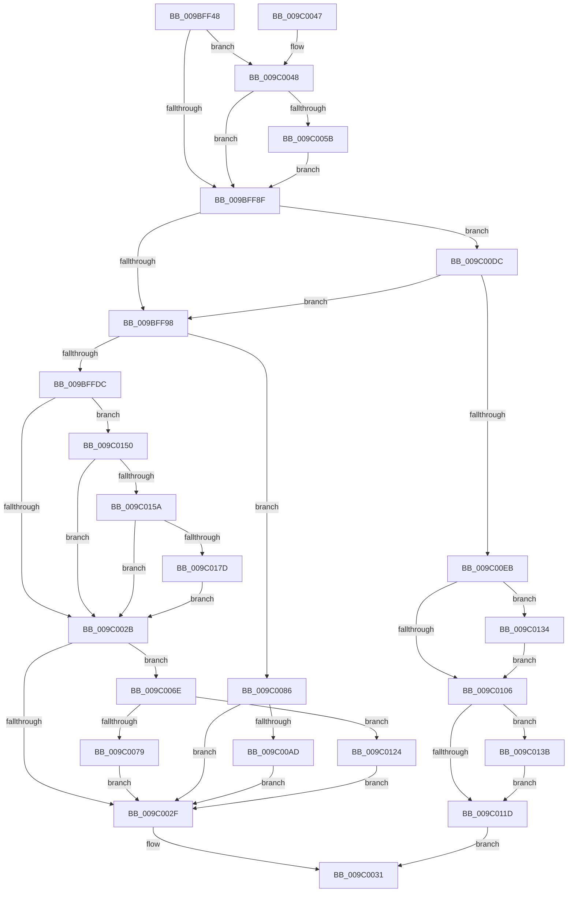

# EtwpRealtimeSaveBuffer

- RVA: `0x009BFF48`–`0x009C0195` (길이 `589` bytes)
- VA: `0x00000001409BFF48`
- 실행 섹션: `PAGE`
- PDB 이름 있음: `예`; PDB Function 태그: `아니요`
- unwind 정보 RVA: `0x0009F51C`
- 디코드: `129`개 명령, `589/589` bytes 표시
- 미해석 바이트: `0` (있으면 어셈블리에 `.byte`로 보존)

> 이 문서는 커널 이미지의 기계어와 PDB 기호를 분석해 생성했습니다. 4번과 5번은 함수 원형과 자료형을 바이너리 사용 방식에서 추정한 C 해석이며 원본 소스 복구 결과는 아닙니다.

## 1. Dependencies

- 직접 호출 지점: **7**; 고유 호출 대상: **4**
- 직접 호출자로 확인된 함수: **3**
- RIP 상대 이미지 참조: **3**

### Outgoing calls
- `0x009BFFCD` → [ZwWriteFile](../../text/6A/ZwWriteFile_function_006AD1D0.md) (function, `0x006AD1D0`)
- `0x009C00A4` → [EtwEventEnabled](../../text/39/EtwEventEnabled_function_00392450.md) (function, `0x00392450`)
- `0x009C00D2` → [EtwpEventWriteTemplateAdmin](../AA/EtwpEventWriteTemplateAdmin_function_00AA5880.md) (function, `0x00AA5880`)
- `0x009C0114` → [EtwEventEnabled](../../text/39/EtwEventEnabled_function_00392450.md) (function, `0x00392450`)
- `0x009C0149` → [EtwpEventWriteTemplateBackingFile](../7B/EtwpEventWriteTemplateBackingFile_function_007B5F64.md) (function, `0x007B5F64`)
- `0x009C0170` → [EtwEventEnabled](../../text/39/EtwEventEnabled_function_00392450.md) (function, `0x00392450`)
- `0x009C018B` → [EtwpEventWriteTemplateBackingFile](../7B/EtwpEventWriteTemplateBackingFile_function_007B5F64.md) (function, `0x007B5F64`)

### Direct callers
- [EtwpRealtimeUpdateReferenceTime](../7C/EtwpRealtimeUpdateReferenceTime_function_007C0CC0.md) at `0x007C0D3A`
- [EtwpRealtimeSendEmptyMarker](EtwpRealtimeSendEmptyMarker_function_009BF4CC.md) at `0x009BF563`
- [EtwpFlushBufferToRealtime](EtwpFlushBufferToRealtime_function_009BF6FC.md) at `0x009BF72D`

### Static image references
- `0x009C008C` → RVA `0x00013D98` (`.rdata`; read)
- `0x009C009D` → RVA `0x00EFF840` (`.data`; read)
- `0x009C010D` → RVA `0x00013DB8` (`.rdata`; read)

## 2. Other-region calls and transfers

- 다른 실행 섹션으로 향하는 call: **4**
  - `0x009BFFCD` → [ZwWriteFile](../../text/6A/ZwWriteFile_function_006AD1D0.md) (`PAGE` → `.text`)
  - `0x009C00A4` → [EtwEventEnabled](../../text/39/EtwEventEnabled_function_00392450.md) (`PAGE` → `.text`)
  - `0x009C0114` → [EtwEventEnabled](../../text/39/EtwEventEnabled_function_00392450.md) (`PAGE` → `.text`)
  - `0x009C0170` → [EtwEventEnabled](../../text/39/EtwEventEnabled_function_00392450.md) (`PAGE` → `.text`)
- 별도 외부 분기/꼬리 이동을 확인하지 못했습니다.

## 3. Assembly (complete function range)

```asm
009BFF48  48 8B C4                        mov rax, rsp
009BFF4B  48 89 58 10                     mov qword ptr [rax + 0x10], rbx
009BFF4F  48 89 68 18                     mov qword ptr [rax + 0x18], rbp
009BFF53  48 89 70 20                     mov qword ptr [rax + 0x20], rsi
009BFF57  57                              push rdi
009BFF58  48 83 EC 60                     sub rsp, 0x60
009BFF5C  4C 8B 81 80 01 00 00            mov r8, qword ptr [rcx + 0x180]
009BFF63  0F 57 C0                        xorps xmm0, xmm0
009BFF66  48 8B 99 90 01 00 00            mov rbx, qword ptr [rcx + 0x190]
009BFF6D  48 8B F2                        mov rsi, rdx
009BFF70  0F 11 40 E8                     movups xmmword ptr [rax - 0x18], xmm0
009BFF74  48 8B 81 88 01 00 00            mov rax, qword ptr [rcx + 0x188]
009BFF7B  48 8B F9                        mov rdi, rcx
009BFF7E  4C 89 44 24 70                  mov qword ptr [rsp + 0x70], r8
009BFF83  4D 8B C8                        mov r9, r8
009BFF86  4C 3B C0                        cmp r8, rax
009BFF89  0F 8D B9 00 00 00               jge 0x1409c0048
009BFF8F  4C 3B C8                        cmp r9, rax
009BFF92  0F 8C 44 01 00 00               jl 0x1409c00dc
009BFF98  48 83 64 24 40 00               and qword ptr [rsp + 0x40], 0
009BFF9E  48 8D 44 24 70                  lea rax, [rsp + 0x70]
009BFFA3  48 8B 8F 68 01 00 00            mov rcx, qword ptr [rdi + 0x168]
009BFFAA  45 33 C9                        xor r9d, r9d
009BFFAD  48 89 44 24 38                  mov qword ptr [rsp + 0x38], rax
009BFFB2  45 33 C0                        xor r8d, r8d
009BFFB5  8B 42 30                        mov eax, dword ptr [rdx + 0x30]
009BFFB8  33 D2                           xor edx, edx
009BFFBA  89 44 24 30                     mov dword ptr [rsp + 0x30], eax
009BFFBE  48 8D 44 24 50                  lea rax, [rsp + 0x50]
009BFFC3  48 89 74 24 28                  mov qword ptr [rsp + 0x28], rsi
009BFFC8  48 89 44 24 20                  mov qword ptr [rsp + 0x20], rax
009BFFCD  E8 FE D1 CE FF                  call 0x1406ad1d0
009BFFD2  8B E8                           mov ebp, eax
009BFFD4  85 C0                           test eax, eax
009BFFD6  0F 88 AA 00 00 00               js 0x1409c0086
009BFFDC  44 8B 46 30                     mov r8d, dword ptr [rsi + 0x30]
009BFFE0  4C 03 44 24 70                  add r8, qword ptr [rsp + 0x70]
009BFFE5  8B 8F EC 00 00 00               mov ecx, dword ptr [rdi + 0xec]
009BFFEB  49 3B D8                        cmp rbx, r8
009BFFEE  4C 89 87 80 01 00 00            mov qword ptr [rdi + 0x180], r8
009BFFF5  4C 0F 4F C3                     cmovg r8, rbx
009BFFF9  0F AF 4F 04                     imul ecx, dword ptr [rdi + 4]
009BFFFD  4C 89 87 90 01 00 00            mov qword ptr [rdi + 0x190], r8
009C0004  8B 46 30                        mov eax, dword ptr [rsi + 0x30]
009C0007  48 01 87 98 01 00 00            add qword ptr [rdi + 0x198], rax
009C000E  48 8B 87 A0 01 00 00            mov rax, qword ptr [rdi + 0x1a0]
009C0015  48 2B 87 98 01 00 00            sub rax, qword ptr [rdi + 0x198]
009C001C  FF 87 A8 01 00 00               inc dword ptr [rdi + 0x1a8]
009C0022  48 3B C1                        cmp rax, rcx
009C0025  0F 86 25 01 00 00               jbe 0x1409c0150
009C002B  85 ED                           test ebp, ebp
009C002D  74 3F                           je 0x1409c006e
009C002F  8B C5                           mov eax, ebp
009C0031  4C 8D 5C 24 60                  lea r11, [rsp + 0x60]
009C0036  49 8B 5B 18                     mov rbx, qword ptr [r11 + 0x18]
009C003A  49 8B 6B 20                     mov rbp, qword ptr [r11 + 0x20]
009C003E  49 8B 73 28                     mov rsi, qword ptr [r11 + 0x28]
009C0042  49 8B E3                        mov rsp, r11
009C0045  5F                              pop rdi
009C0046  C3                              ret
009C0047  CC                              int3
009C0048  8B 4A 30                        mov ecx, dword ptr [rdx + 0x30]
009C004B  49 03 C8                        add rcx, r8
009C004E  48 3B 8F A0 01 00 00            cmp rcx, qword ptr [rdi + 0x1a0]
009C0055  0F 8E 34 FF FF FF               jle 0x1409bff8f
009C005B  41 B9 48 00 00 00               mov r9d, 0x48
009C0061  49 8B D8                        mov rbx, r8
009C0064  4C 89 4C 24 70                  mov qword ptr [rsp + 0x70], r9
009C0069  E9 21 FF FF FF                  jmp 0x1409bff8f
009C006E  66 83 7E 36 06                  cmp word ptr [rsi + 0x36], 6
009C0073  0F 84 AB 00 00 00               je 0x1409c0124
009C0079  F0 81 A7 30 03 00 00 FF FF FF EF  lock and dword ptr [rdi + 0x330], 0xefffffff
009C0084  EB A9                           jmp 0x1409c002f
009C0086  FF 87 04 01 00 00               inc dword ptr [rdi + 0x104]
009C008C  48 8D 15 05 3D 65 FF            lea rdx, [rip - 0x9ac2fb]
009C0093  C7 87 C0 01 00 00 02 00 00 00   mov dword ptr [rdi + 0x1c0], 2
009C009D  48 8B 0D 9C F7 53 00            mov rcx, qword ptr [rip + 0x53f79c]
009C00A4  E8 A7 23 9D FF                  call 0x140392450
009C00A9  84 C0                           test al, al
009C00AB  74 82                           je 0x1409c002f
009C00AD  8B 47 0C                        mov eax, dword ptr [rdi + 0xc]
009C00B0  48 8D 8F 70 01 00 00            lea rcx, [rdi + 0x170]
009C00B7  89 44 24 30                     mov dword ptr [rsp + 0x30], eax
009C00BB  4C 8D 8F 88 00 00 00            lea r9, [rdi + 0x88]
009C00C2  89 6C 24 28                     mov dword ptr [rsp + 0x28], ebp
009C00C6  48 8D 15 CB 3C 65 FF            lea rdx, [rip - 0x9ac335]
009C00CD  48 89 4C 24 20                  mov qword ptr [rsp + 0x20], rcx
009C00D2  E8 A9 57 0E 00                  call 0x140aa5880
009C00D7  E9 53 FF FF FF                  jmp 0x1409c002f
009C00DC  8B 4A 30                        mov ecx, dword ptr [rdx + 0x30]
009C00DF  49 03 C9                        add rcx, r9
009C00E2  48 3B C8                        cmp rcx, rax
009C00E5  0F 8C AD FE FF FF               jl 0x1409bff98
009C00EB  FF 87 04 01 00 00               inc dword ptr [rdi + 0x104]
009C00F1  BB 88 01 00 C0                  mov ebx, 0xc0000188
009C00F6  83 7F 10 00                     cmp dword ptr [rdi + 0x10], 0
009C00FA  C7 87 C0 01 00 00 02 00 00 00   mov dword ptr [rdi + 0x1c0], 2
009C0104  7D 2E                           jge 0x1409c0134
009C0106  48 8B 0D 33 F7 53 00            mov rcx, qword ptr [rip + 0x53f733]
009C010D  48 8D 15 A4 3C 65 FF            lea rdx, [rip - 0x9ac35c]
009C0114  E8 37 23 9D FF                  call 0x140392450
009C0119  84 C0                           test al, al
009C011B  75 1E                           jne 0x1409c013b
009C011D  8B C3                           mov eax, ebx
009C011F  E9 0D FF FF FF                  jmp 0x1409c0031
009C0124  F0 81 8F 30 03 00 00 00 00 00 10  lock or dword ptr [rdi + 0x330], 0x10000000
009C012F  E9 FB FE FF FF                  jmp 0x1409c002f
009C0134  8B C3                           mov eax, ebx
009C0136  87 47 10                        xchg dword ptr [rdi + 0x10], eax
009C0139  EB CB                           jmp 0x1409c0106
009C013B  8B 47 0C                        mov eax, dword ptr [rdi + 0xc]
009C013E  4C 8D 8F 88 00 00 00            lea r9, [rdi + 0x88]
009C0145  89 44 24 28                     mov dword ptr [rsp + 0x28], eax
009C0149  E8 16 5E DF FF                  call 0x1407b5f64
009C014E  EB CD                           jmp 0x1409c011d
009C0150  83 7F 10 00                     cmp dword ptr [rdi + 0x10], 0
009C0154  0F 8C D1 FE FF FF               jl 0x1409c002b
009C015A  BB 88 01 00 C0                  mov ebx, 0xc0000188
009C015F  48 8D 15 52 3C 65 FF            lea rdx, [rip - 0x9ac3ae]
009C0166  87 5F 10                        xchg dword ptr [rdi + 0x10], ebx
009C0169  48 8B 0D D0 F6 53 00            mov rcx, qword ptr [rip + 0x53f6d0]
009C0170  E8 DB 22 9D FF                  call 0x140392450
009C0175  84 C0                           test al, al
009C0177  0F 84 AE FE FF FF               je 0x1409c002b
009C017D  8B 47 0C                        mov eax, dword ptr [rdi + 0xc]
009C0180  4C 8D 8F 88 00 00 00            lea r9, [rdi + 0x88]
009C0187  89 44 24 28                     mov dword ptr [rsp + 0x28], eax
009C018B  E8 D4 5D DF FF                  call 0x1407b5f64
009C0190  E9 96 FE FF FF                  jmp 0x1409c002b
```

## 4. C-style interpretation (structured pseudocode)

```c
__int64 __fastcall EtwpRealtimeSaveBuffer(__int64 a1, __int64 a2)
{
    __int64 result;
    __int64 v_rsp;
    unsigned __int64 v_stack_m18;
    unsigned __int64 v_stack_m28;
    unsigned __int64 v_stack_m30;
    unsigned int v_stack_m38;
    unsigned __int64 v_stack_m40;
    unsigned __int64 v_stack_m48;
    unsigned __int64 v_stack_m8;
    unsigned __int64 v_stack_p10;
    unsigned __int64 v_stack_p8;

    *(unsigned __int64 *)(v_rsp + 16) = v_rbx;
    *(unsigned __int64 *)(v_rsp + 24) = v_rbp;
    *(unsigned __int64 *)(v_rsp + 32) = v_rsi;
    v_rsp = (v_rsp) - (96);
    *(unsigned __int64 *)(v_rsp - 24) = v_xmm0;
    v_stack_p8 = *(unsigned __int64 *)(a1 + 384);
    if ((*(unsigned __int64 *)(a1 + 384)) >= (*(unsigned __int64 *)(a1 + 392))) goto loc_009C0048;
loc_009BFF8F:
    if ((*(unsigned __int64 *)(a1 + 384)) < (*(unsigned __int64 *)(a1 + 392))) goto loc_009C00DC;
loc_009BFF98:
    a4 = 0;
    v_stack_m30 = v_stack_p8;
    a3 = 0;
    a2 = 0;
    v_stack_m38 = (unsigned int)((unsigned int)(*(unsigned int *)(a2 + 48)));
    v_stack_m40 = 0;
    v_stack_m48 = v_stack_m18;
    result = ZwWriteFile(*(unsigned __int64 *)(a1 + 360), a2, a3, a4);
    if (sign_flag) goto loc_009C0086;
    a3 = ((unsigned int)(*(unsigned int *)(a2 + 48))) + (v_stack_p8);
    *(unsigned __int64 *)(a1 + 384) = a3;
    if ((*(unsigned __int64 *)(a1 + 400)) > a3) { a3 = *(unsigned __int64 *)(a1 + 400); }
    a1 = (unsigned int)(((unsigned int)(*(unsigned int *)(a1 + 236))) * (*(unsigned int *)(a1 + 4)));
    *(unsigned __int64 *)(a1 + 400) = a3;
    result = (*(unsigned __int64 *)(a1 + 416)) - (*(unsigned __int64 *)(a1 + 408));
    if (result <= a1) goto loc_009C0150;
loc_009C002B:
    if ((unsigned int)((unsigned int)((unsigned int)(result))) == 0) goto loc_009C006E;
loc_009C002F:
loc_009C0031:
    return (unsigned int)((unsigned int)((unsigned int)((unsigned int)(result))));
loc_009C0048:
    a1 = ((unsigned int)(*(unsigned int *)(a2 + 48))) + (a3);
    if (a1 <= (*(unsigned __int64 *)(a1 + 416))) goto loc_009BFF8F;
    v_stack_p10 = 72;
    goto loc_009BFF8F;
loc_009C006E:
    if ((*(unsigned __int16 *)(*(unsigned __int64 *)(v_stack_m8 + 40) + 54)) == 6) goto loc_009C0124;
    goto loc_009C002F;
loc_009C0086:
    *(unsigned int *)(a1 + 448) = 2;
    result = EtwEventEnabled(*(unsigned __int64 *)(v_rip + 5502876), v_rip - 10142459, a3, 72);
    if ((unsigned __int8)(result) == 0) goto loc_009C002F;
    v_stack_m30 = (unsigned int)((unsigned int)(*(unsigned int *)(a1 + 12)));
    v_stack_m38 = (unsigned int)(*(unsigned __int64 *)(v_stack_m8 + 32));
    v_stack_m40 = a1 + 368;
    result = EtwpEventWriteTemplateAdmin(a1 + 368, v_rip - 10142517, a3, a1 + 136);
    goto loc_009C002F;
loc_009C00DC:
    a1 = ((unsigned int)(*(unsigned int *)(v_rip - 10142517 + 48))) + (a1 + 136);
    if (a1 < result) goto loc_009BFF98;
    *(unsigned int *)(a1 + 448) = 2;
    if ((*(unsigned int *)(a1 + 16)) >= 0) goto loc_009C0134;
loc_009C0106:
    result = EtwEventEnabled(*(unsigned __int64 *)(v_rip + 5502771), v_rip - 10142556, a3, a1 + 136);
    if ((unsigned __int8)(result) != 0) goto loc_009C013B;
loc_009C011D:
    goto loc_009C0031;
loc_009C0124:
    goto loc_009C002F;
loc_009C0134:
    goto loc_009C0106;
loc_009C013B:
    v_stack_m38 = (unsigned int)((unsigned int)(*(unsigned int *)(a1 + 12)));
    result = EtwpEventWriteTemplateBackingFile(*(unsigned __int64 *)(v_rip + 5502771), v_rip - 10142556, a3, a1 + 136);
    goto loc_009C011D;
loc_009C0150:
    if ((*(unsigned int *)(a1 + 16)) < 0) goto loc_009C002B;
    result = EtwEventEnabled(*(unsigned __int64 *)(v_rip + 5502672), v_rip - 10142638, a3, a1 + 136);
    if ((unsigned __int8)(result) == 0) goto loc_009C002B;
    v_stack_m38 = (unsigned int)((unsigned int)(*(unsigned int *)(a1 + 12)));
    result = EtwpEventWriteTemplateBackingFile(*(unsigned __int64 *)(v_rip + 5502672), v_rip - 10142638, a3, a1 + 136);
    goto loc_009C002B;
}
```

## 5. (Beta) C Style

```c
int64_t EtwpRealtimeSaveBuffer(void *Arg1, void *Arg2)
{
    uint8_t *arg1 = (uint8_t *)Arg1;
    uint8_t *arg2 = (uint8_t *)Arg2;

    int64_t result;
    int64_t local_rsp;
    uint64_t v_stack_m18;
    uint64_t v_stack_m28;
    uint64_t v_stack_m30;
    uint32_t v_stack_m38;
    uint64_t v_stack_m40;
    uint64_t v_stack_m48;
    uint64_t v_stack_m8;
    uint64_t v_stack_p10;
    uint64_t v_stack_p8;

    *(uint64_t *)(local_rsp + 0x10) = local_rbx;
    *(uint64_t *)(local_rsp + 0x18) = local_rbp;
    *(uint64_t *)(local_rsp + 0x20) = local_rsi;
    local_rsp = (local_rsp) - (96);
    *(uint64_t *)(local_rsp - 0x18) = v_xmm0;
    v_stack_p8 = *(uint64_t *)(arg1 + 0x180);
    if ((*(uint64_t *)(arg1 + 0x180)) >= (*(uint64_t *)(arg1 + 0x188))) goto loc_009C0048;
loc_009BFF8F:
    if ((*(uint64_t *)(arg1 + 0x180)) < (*(uint64_t *)(arg1 + 0x188))) goto loc_009C00DC;
loc_009BFF98:
    a4 = 0;
    v_stack_m30 = v_stack_p8;
    a3 = 0;
    Arg2 = 0;
    v_stack_m38 = (uint32_t)((uint32_t)(*(uint32_t *)(arg2 + 0x30)));
    v_stack_m40 = 0;
    v_stack_m48 = v_stack_m18;
    result = ZwWriteFile(*(uint64_t *)(arg1 + 0x168), Arg2, a3, a4);
    if (sign_flag) goto loc_009C0086;
    a3 = ((uint32_t)(*(uint32_t *)(arg2 + 0x30))) + (v_stack_p8);
    *(uint64_t *)(arg1 + 0x180) = a3;
    if ((*(uint64_t *)(arg1 + 0x190)) > a3) { a3 = *(uint64_t *)(arg1 + 0x190); }
    Arg1 = (uint32_t)(((uint32_t)(*(uint32_t *)(arg1 + 0xEC))) * (*(uint32_t *)(arg1 + 0x4)));
    *(uint64_t *)(arg1 + 0x190) = a3;
    result = (*(uint64_t *)(arg1 + 0x1A0)) - (*(uint64_t *)(arg1 + 0x198));
    if (result <= Arg1) goto loc_009C0150;
loc_009C002B:
    if ((uint32_t)((uint32_t)((uint32_t)(result))) == 0) goto loc_009C006E;
loc_009C002F:
loc_009C0031:
    return (uint32_t)((uint32_t)((uint32_t)((uint32_t)(result))));
loc_009C0048:
    Arg1 = ((uint32_t)(*(uint32_t *)(arg2 + 0x30))) + (a3);
    if (Arg1 <= (*(uint64_t *)(arg1 + 0x1A0))) goto loc_009BFF8F;
    v_stack_p10 = 72;
    goto loc_009BFF8F;
loc_009C006E:
    if ((*(uint16_t *)(*(uint64_t *)(v_stack_m8 + 0x28) + 0x36)) == 6) goto loc_009C0124;
    goto loc_009C002F;
loc_009C0086:
    *(uint32_t *)(arg1 + 0x1C0) = 2;
    result = EtwEventEnabled(*(uint64_t *)(v_rip + 0x53F79C), v_rip - 10142459, a3, 72);
    if ((uint8_t)(result) == 0) goto loc_009C002F;
    v_stack_m30 = (uint32_t)((uint32_t)(*(uint32_t *)(arg1 + 0xC)));
    v_stack_m38 = (uint32_t)(*(uint64_t *)(v_stack_m8 + 0x20));
    v_stack_m40 = Arg1 + 368;
    result = EtwpEventWriteTemplateAdmin(Arg1 + 368, v_rip - 10142517, a3, Arg1 + 136);
    goto loc_009C002F;
loc_009C00DC:
    Arg1 = ((uint32_t)(*(uint32_t *)(v_rip - 0x9AC335 + 0x30))) + (Arg1 + 136);
    if (Arg1 < result) goto loc_009BFF98;
    *(uint32_t *)(arg1 + 0x1C0) = 2;
    if ((*(uint32_t *)(arg1 + 0x10)) >= 0) goto loc_009C0134;
loc_009C0106:
    result = EtwEventEnabled(*(uint64_t *)(v_rip + 0x53F733), v_rip - 10142556, a3, Arg1 + 136);
    if ((uint8_t)(result) != 0) goto loc_009C013B;
loc_009C011D:
    goto loc_009C0031;
loc_009C0124:
    goto loc_009C002F;
loc_009C0134:
    goto loc_009C0106;
loc_009C013B:
    v_stack_m38 = (uint32_t)((uint32_t)(*(uint32_t *)(arg1 + 0xC)));
    result = EtwpEventWriteTemplateBackingFile(*(uint64_t *)(v_rip + 0x53F733), v_rip - 10142556, a3, Arg1 + 136);
    goto loc_009C011D;
loc_009C0150:
    if ((*(uint32_t *)(arg1 + 0x10)) < 0) goto loc_009C002B;
    result = EtwEventEnabled(*(uint64_t *)(v_rip + 0x53F6D0), v_rip - 10142638, a3, Arg1 + 136);
    if ((uint8_t)(result) == 0) goto loc_009C002B;
    v_stack_m38 = (uint32_t)((uint32_t)(*(uint32_t *)(arg1 + 0xC)));
    result = EtwpEventWriteTemplateBackingFile(*(uint64_t *)(v_rip + 0x53F6D0), v_rip - 10142638, a3, Arg1 + 136);
    goto loc_009C002B;
}
```

### 관측된 메모리 오프셋

구조체 형식이 확인되지 않은 접근은 인자 기준의 오프셋으로만 기록했습니다.

| 기준 인자 | 오프셋 표현 | 폭 (bit) | 접근 |
|---|---:|---:|---|
| `Arg1` | `+ 0x4` | `32` | `R` |
| `Arg1` | `+ 0xC` | `32` | `R` |
| `Arg1` | `+ 0x10` | `32` | `R` |
| `Arg1` | `+ 0x10` | `32` | `R/W` |
| `Arg1` | `+ 0x88` | `64` | `R` |
| `Arg1` | `+ 0xEC` | `32` | `R` |
| `Arg1` | `+ 0x104` | `32` | `R/W` |
| `Arg1` | `+ 0x168` | `64` | `R` |
| `Arg1` | `+ 0x170` | `64` | `R` |
| `Arg1` | `+ 0x180` | `64` | `R` |
| `Arg1` | `+ 0x180` | `64` | `W` |
| `Arg1` | `+ 0x188` | `64` | `R` |
| `Arg1` | `+ 0x190` | `64` | `R` |
| `Arg1` | `+ 0x190` | `64` | `W` |
| `Arg1` | `+ 0x198` | `64` | `R` |
| `Arg1` | `+ 0x198` | `64` | `R/W` |
| `Arg1` | `+ 0x1A0` | `64` | `R` |
| `Arg1` | `+ 0x1A8` | `32` | `R/W` |
| `Arg1` | `+ 0x1C0` | `32` | `W` |
| `Arg1` | `+ 0x330` | `32` | `R/W` |
| `Arg2` | `+ 0x30` | `32` | `R` |
| `Arg2` | `+ 0x36` | `16` | `R` |

## 6. Execution-region graph

[열기: 2D/3D 그래프와 함수 탐색 컨트롤 패널](../../../control-panel.html?section=page&rva=0x009BFF48&view=graph)

- 2D 그래프는 위에서 아래로 흐르고, 3D 그래프는 빈 공간을 드래그해 회전합니다. Shift+드래그는 이동, 휠은 확대·축소, 함수 노드 선택은 대상 보고서 이동입니다.

### Static fallback


