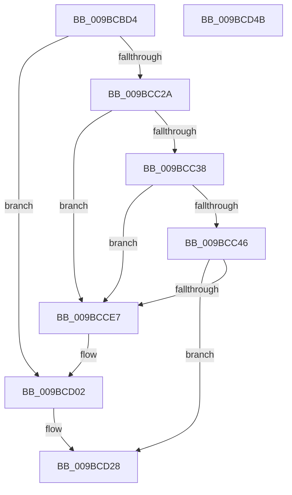

# EtwpRealtimeSaveState

- RVA: `0x009BCBD4`–`0x009BCD4C` (길이 `376` bytes)
- VA: `0x00000001409BCBD4`
- 실행 섹션: `PAGE`
- PDB 이름 있음: `예`; PDB Function 태그: `아니요`
- unwind 정보 RVA: `0x0009F188`
- 디코드: `82`개 명령, `376/376` bytes 표시
- 미해석 바이트: `0` (있으면 어셈블리에 `.byte`로 보존)

> 이 문서는 커널 이미지의 기계어와 PDB 기호를 분석해 생성했습니다. 4번과 5번은 함수 원형과 자료형을 바이너리 사용 방식에서 추정한 C 해석이며 원본 소스 복구 결과는 아닙니다.

## 1. Dependencies

- 직접 호출 지점: **5**; 고유 호출 대상: **5**
- 직접 호출자로 확인된 함수: **1**
- RIP 상대 이미지 참조: **1**

### Outgoing calls
- `0x009BCC12` → [memset](../../text/6C/memset_function_006C6C40.md) (function, `0x006C6C40`)
- `0x009BCC98` → [EtwpQueryUsedProcessorCount](../../text/3E/EtwpQueryUsedProcessorCount_function_003EB940.md) (function, `0x003EB940`)
- `0x009BCCDC` → [ZwWriteFile](../../text/6A/ZwWriteFile_function_006AD1D0.md) (function, `0x006AD1D0`)
- `0x009BCD23` → [ZwSetInformationFile](../../text/6A/ZwSetInformationFile_function_006AD5B0.md) (function, `0x006AD5B0`)
- `0x009BCD31` → [_security_check_cookie](../../text/6A/_security_check_cookie_function_006AC640.md) (function, `0x006AC640`)

### Direct callers
- [EtwpLogger](EtwpLogger_function_009BE310.md) at `0x009BE80A`

### Static image references
- `0x009BCBEB` → RVA `0x00E0A740` (`.data`; read)

## 2. Other-region calls and transfers

- 다른 실행 섹션으로 향하는 call: **5**
  - `0x009BCC12` → [memset](../../text/6C/memset_function_006C6C40.md) (`PAGE` → `.text`)
  - `0x009BCC98` → [EtwpQueryUsedProcessorCount](../../text/3E/EtwpQueryUsedProcessorCount_function_003EB940.md) (`PAGE` → `.text`)
  - `0x009BCCDC` → [ZwWriteFile](../../text/6A/ZwWriteFile_function_006AD1D0.md) (`PAGE` → `.text`)
  - `0x009BCD23` → [ZwSetInformationFile](../../text/6A/ZwSetInformationFile_function_006AD5B0.md) (`PAGE` → `.text`)
  - `0x009BCD31` → [_security_check_cookie](../../text/6A/_security_check_cookie_function_006AC640.md) (`PAGE` → `.text`)
- 별도 외부 분기/꼬리 이동을 확인하지 못했습니다.

## 3. Assembly (complete function range)

```asm
009BCBD4  48 89 5C 24 10                  mov qword ptr [rsp + 0x10], rbx
009BCBD9  48 89 7C 24 18                  mov qword ptr [rsp + 0x18], rdi
009BCBDE  55                              push rbp
009BCBDF  48 8D 6C 24 A9                  lea rbp, [rsp - 0x57]
009BCBE4  48 81 EC D0 00 00 00            sub rsp, 0xd0
009BCBEB  48 8B 05 4E DB 44 00            mov rax, qword ptr [rip + 0x44db4e]
009BCBF2  48 33 C4                        xor rax, rsp
009BCBF5  48 89 45 47                     mov qword ptr [rbp + 0x47], rax
009BCBF9  33 D2                           xor edx, edx
009BCBFB  48 8B D9                        mov rbx, rcx
009BCBFE  0F 57 C0                        xorps xmm0, xmm0
009BCC01  48 8D 4D F7                     lea rcx, [rbp - 9]
009BCC05  BF 01 00 00 C0                  mov edi, 0xc0000001
009BCC0A  0F 11 45 E7                     movups xmmword ptr [rbp - 0x19], xmm0
009BCC0E  44 8D 42 48                     lea r8d, [rdx + 0x48]
009BCC12  E8 29 A0 D0 FF                  call 0x1406c6c40
009BCC17  48 83 65 DF 00                  and qword ptr [rbp - 0x21], 0
009BCC1C  8B 83 30 03 00 00               mov eax, dword ptr [rbx + 0x330]
009BCC22  A8 01                           test al, 1
009BCC24  0F 84 D8 00 00 00               je 0x1409bcd02
009BCC2A  48 83 BB 68 01 00 00 00         cmp qword ptr [rbx + 0x168], 0
009BCC32  0F 84 AF 00 00 00               je 0x1409bcce7
009BCC38  8B 8B A8 01 00 00               mov ecx, dword ptr [rbx + 0x1a8]
009BCC3E  85 C9                           test ecx, ecx
009BCC40  0F 84 A1 00 00 00               je 0x1409bcce7
009BCC46  48 8B 83 88 01 00 00            mov rax, qword ptr [rbx + 0x188]
009BCC4D  0F 10 83 B0 01 00 00            movups xmm0, xmmword ptr [rbx + 0x1b0]
009BCC54  48 89 45 1F                     mov qword ptr [rbp + 0x1f], rax
009BCC58  48 8B 83 80 01 00 00            mov rax, qword ptr [rbx + 0x180]
009BCC5F  48 89 45 27                     mov qword ptr [rbp + 0x27], rax
009BCC63  8B 43 04                        mov eax, dword ptr [rbx + 4]
009BCC66  89 45 1B                        mov dword ptr [rbp + 0x1b], eax
009BCC69  48 8B 83 90 01 00 00            mov rax, qword ptr [rbx + 0x190]
009BCC70  48 89 45 2F                     mov qword ptr [rbp + 0x2f], rax
009BCC74  48 8B 83 98 01 00 00            mov rax, qword ptr [rbx + 0x198]
009BCC7B  89 4D 17                        mov dword ptr [rbp + 0x17], ecx
009BCC7E  48 8B CB                        mov rcx, rbx
009BCC81  48 89 45 37                     mov qword ptr [rbp + 0x37], rax
009BCC85  F3 0F 7F 45 07                  movdqu xmmword ptr [rbp + 7], xmm0
009BCC8A  C7 45 F7 52 6C 46 73            mov dword ptr [rbp - 9], 0x73466c52
009BCC91  C7 45 FF 01 00 00 00            mov dword ptr [rbp - 1], 1
009BCC98  E8 A3 EC A2 FF                  call 0x1403eb940
009BCC9D  48 83 64 24 40 00               and qword ptr [rsp + 0x40], 0
009BCCA3  45 33 C9                        xor r9d, r9d
009BCCA6  48 8B 8B 68 01 00 00            mov rcx, qword ptr [rbx + 0x168]
009BCCAD  45 33 C0                        xor r8d, r8d
009BCCB0  83 65 FB 00                     and dword ptr [rbp - 5], 0
009BCCB4  33 D2                           xor edx, edx
009BCCB6  89 45 03                        mov dword ptr [rbp + 3], eax
009BCCB9  48 8D 45 DF                     lea rax, [rbp - 0x21]
009BCCBD  48 89 44 24 38                  mov qword ptr [rsp + 0x38], rax
009BCCC2  48 8D 45 F7                     lea rax, [rbp - 9]
009BCCC6  C7 44 24 30 48 00 00 00         mov dword ptr [rsp + 0x30], 0x48
009BCCCE  48 89 44 24 28                  mov qword ptr [rsp + 0x28], rax
009BCCD3  48 8D 45 E7                     lea rax, [rbp - 0x19]
009BCCD7  48 89 44 24 20                  mov qword ptr [rsp + 0x20], rax
009BCCDC  E8 EF 04 CF FF                  call 0x1406ad1d0
009BCCE1  8B F8                           mov edi, eax
009BCCE3  85 C0                           test eax, eax
009BCCE5  79 41                           jns 0x1409bcd28
009BCCE7  8B 8B A8 01 00 00               mov ecx, dword ptr [rbx + 0x1a8]
009BCCED  01 8B 04 01 00 00               add dword ptr [rbx + 0x104], ecx
009BCCF3  83 A3 A8 01 00 00 00            and dword ptr [rbx + 0x1a8], 0
009BCCFA  48 83 A3 98 01 00 00 00         and qword ptr [rbx + 0x198], 0
009BCD02  48 8B 8B 68 01 00 00            mov rcx, qword ptr [rbx + 0x168]
009BCD09  4C 8D 45 D7                     lea r8, [rbp - 0x29]
009BCD0D  41 B9 01 00 00 00               mov r9d, 1
009BCD13  C6 45 D7 01                     mov byte ptr [rbp - 0x29], 1
009BCD17  48 8D 55 E7                     lea rdx, [rbp - 0x19]
009BCD1B  C7 44 24 20 0D 00 00 00         mov dword ptr [rsp + 0x20], 0xd
009BCD23  E8 88 08 CF FF                  call 0x1406ad5b0
009BCD28  8B C7                           mov eax, edi
009BCD2A  48 8B 4D 47                     mov rcx, qword ptr [rbp + 0x47]
009BCD2E  48 33 CC                        xor rcx, rsp
009BCD31  E8 0A F9 CE FF                  call 0x1406ac640
009BCD36  4C 8D 9C 24 D0 00 00 00         lea r11, [rsp + 0xd0]
009BCD3E  49 8B 5B 18                     mov rbx, qword ptr [r11 + 0x18]
009BCD42  49 8B 7B 20                     mov rdi, qword ptr [r11 + 0x20]
009BCD46  49 8B E3                        mov rsp, r11
009BCD49  5D                              pop rbp
009BCD4A  C3                              ret
009BCD4B  CC                              int3
```

## 4. C-style interpretation (structured pseudocode)

```c
__int64 __fastcall EtwpRealtimeSaveState(__int64 a1, int a2, __int64 a3, int a4)
{
    __int64 result;
    __int64 v_rsp;
    unsigned __int64 v_stack_m18;
    unsigned __int64 v_stack_m28;
    unsigned __int64 v_stack_m30;
    unsigned __int64 v_stack_m38;
    unsigned __int64 v_stack_m40;
    unsigned int v_stack_m44;
    unsigned int v_stack_m48;
    unsigned __int64 v_stack_m58;
    unsigned int v_stack_m5C;
    unsigned __int64 v_stack_m5F;
    unsigned int v_stack_m60;
    unsigned int v_stack_m64;
    unsigned __int64 v_stack_m68;
    unsigned __int64 v_stack_m78;
    unsigned __int64 v_stack_m8;
    unsigned __int64 v_stack_m80;
    unsigned __int64 v_stack_m88;
    unsigned __int64 v_stack_m98;
    unsigned __int64 v_stack_mA0;
    unsigned int v_stack_mA8;
    unsigned __int64 v_stack_mB0;
    unsigned __int64 v_stack_mB8;
    unsigned __int64 v_stack_p10;
    unsigned __int64 v_stack_p18;

    v_stack_p10 = v_rbx;
    v_stack_p18 = v_rdi;
    v_rsp = (v_rsp) - (208);
    result = (*(unsigned __int64 *)(v_rip + 4512590)) ^ (v_rsp);
    v_stack_m18 = result;
    a2 = 0;
    v_stack_m78 = v_xmm0;
    result = memset(v_stack_m68, a2, a2 + 72, a4);
    if ((((unsigned __int8)((unsigned int)(*(unsigned int *)(a1 + 816)))) & (1)) == 0) goto loc_009BCD02;
    if ((*(unsigned __int64 *)(a1 + 360)) == 0) goto loc_009BCCE7;
    if ((unsigned int)((unsigned int)(*(unsigned int *)(a1 + 424))) == 0) goto loc_009BCCE7;
    v_stack_m40 = *(unsigned __int64 *)(a1 + 392);
    v_stack_m38 = *(unsigned __int64 *)(a1 + 384);
    v_stack_m44 = (unsigned int)((unsigned int)(*(unsigned int *)(a1 + 4)));
    v_stack_m30 = *(unsigned __int64 *)(a1 + 400);
    v_stack_m48 = (unsigned int)((unsigned int)(*(unsigned int *)(a1 + 424)));
    v_stack_m28 = *(unsigned __int64 *)(a1 + 408);
    v_stack_m58 = v_xmm0;
    v_stack_m68 = 0x73466C52ULL;
    v_stack_m60 = 1;
    result = EtwpQueryUsedProcessorCount(a1, a2, a2 + 72, a4);
    a4 = 0;
    a3 = 0;
    a2 = 0;
    v_stack_m5C = (unsigned int)(result);
    v_stack_mA0 = v_stack_m80;
    v_stack_mA8 = 72;
    v_stack_mB0 = v_stack_m68;
    v_stack_mB8 = v_stack_m78;
    result = ZwWriteFile(*(unsigned __int64 *)(a1 + 360), a2, a3, a4);
    if (!sign_flag) goto loc_009BCD28;
loc_009BCCE7:
loc_009BCD02:
    v_stack_m88 = 1;
    v_stack_mB8 = 13;
    result = ZwSetInformationFile(*(unsigned __int64 *)(a1 + 360), v_stack_m78, v_stack_m88, 1);
loc_009BCD28:
    a1 = (v_stack_m18) ^ (v_rsp);
    result = _security_check_cookie(a1, v_stack_m78, v_stack_m88, 1);
    return result;
}
```

## 5. (Beta) C Style

```c
int64_t EtwpRealtimeSaveState(void *Arg1, int32_t Arg2, int64_t Arg3, int32_t Arg4)
{
    uint8_t *arg1 = (uint8_t *)Arg1;

    int64_t result;
    int64_t local_rsp;
    uint64_t v_stack_m18;
    uint64_t v_stack_m28;
    uint64_t v_stack_m30;
    uint64_t v_stack_m38;
    uint64_t v_stack_m40;
    uint32_t v_stack_m44;
    uint32_t v_stack_m48;
    uint64_t v_stack_m58;
    uint32_t v_stack_m5C;
    uint64_t v_stack_m5F;
    uint32_t v_stack_m60;
    uint32_t v_stack_m64;
    uint64_t v_stack_m68;
    uint64_t v_stack_m78;
    uint64_t v_stack_m8;
    uint64_t v_stack_m80;
    uint64_t v_stack_m88;
    uint64_t v_stack_m98;
    uint64_t v_stack_mA0;
    uint32_t v_stack_mA8;
    uint64_t v_stack_mB0;
    uint64_t v_stack_mB8;
    uint64_t v_stack_p10;
    uint64_t v_stack_p18;

    v_stack_p10 = local_rbx;
    v_stack_p18 = local_rdi;
    local_rsp = (local_rsp) - (208);
    result = (*(uint64_t *)(v_rip + 0x44DB4E)) ^ (local_rsp);
    v_stack_m18 = result;
    Arg2 = 0;
    v_stack_m78 = v_xmm0;
    result = memset(v_stack_m68, Arg2, Arg2 + 72, Arg4);
    if ((((uint8_t)((uint32_t)(*(uint32_t *)(arg1 + 0x330)))) & (1)) == 0) goto loc_009BCD02;
    if ((*(uint64_t *)(arg1 + 0x168)) == 0) goto loc_009BCCE7;
    if ((uint32_t)((uint32_t)(*(uint32_t *)(arg1 + 0x1A8))) == 0) goto loc_009BCCE7;
    v_stack_m40 = *(uint64_t *)(arg1 + 0x188);
    v_stack_m38 = *(uint64_t *)(arg1 + 0x180);
    v_stack_m44 = (uint32_t)((uint32_t)(*(uint32_t *)(arg1 + 0x4)));
    v_stack_m30 = *(uint64_t *)(arg1 + 0x190);
    v_stack_m48 = (uint32_t)((uint32_t)(*(uint32_t *)(arg1 + 0x1A8)));
    v_stack_m28 = *(uint64_t *)(arg1 + 0x198);
    v_stack_m58 = v_xmm0;
    v_stack_m68 = 0x73466C52ULL;
    v_stack_m60 = 1;
    result = EtwpQueryUsedProcessorCount(Arg1, Arg2, Arg2 + 72, Arg4);
    Arg4 = 0;
    Arg3 = 0;
    Arg2 = 0;
    v_stack_m5C = (uint32_t)(result);
    v_stack_mA0 = v_stack_m80;
    v_stack_mA8 = 72;
    v_stack_mB0 = v_stack_m68;
    v_stack_mB8 = v_stack_m78;
    result = ZwWriteFile(*(uint64_t *)(arg1 + 0x168), Arg2, Arg3, Arg4);
    if (!sign_flag) goto loc_009BCD28;
loc_009BCCE7:
loc_009BCD02:
    v_stack_m88 = 1;
    v_stack_mB8 = 13;
    result = ZwSetInformationFile(*(uint64_t *)(arg1 + 0x168), v_stack_m78, v_stack_m88, 1);
loc_009BCD28:
    Arg1 = (v_stack_m18) ^ (local_rsp);
    result = _security_check_cookie(Arg1, v_stack_m78, v_stack_m88, 1);
    return result;
}
```

### 관측된 메모리 오프셋

구조체 형식이 확인되지 않은 접근은 인자 기준의 오프셋으로만 기록했습니다.

| 기준 인자 | 오프셋 표현 | 폭 (bit) | 접근 |
|---|---:|---:|---|
| `Arg1` | `+ 0x4` | `32` | `R` |
| `Arg1` | `+ 0x104` | `32` | `R/W` |
| `Arg1` | `+ 0x168` | `64` | `R` |
| `Arg1` | `+ 0x180` | `64` | `R` |
| `Arg1` | `+ 0x188` | `64` | `R` |
| `Arg1` | `+ 0x190` | `64` | `R` |
| `Arg1` | `+ 0x198` | `64` | `R` |
| `Arg1` | `+ 0x198` | `64` | `R/W` |
| `Arg1` | `+ 0x1A8` | `32` | `R` |
| `Arg1` | `+ 0x1A8` | `32` | `R/W` |
| `Arg1` | `+ 0x1B0` | `128` | `R` |
| `Arg1` | `+ 0x330` | `32` | `R` |

## 6. Execution-region graph

[열기: 2D/3D 그래프와 함수 탐색 컨트롤 패널](../../../control-panel.html?section=page&rva=0x009BCBD4&view=graph)

- 2D 그래프는 위에서 아래로 흐르고, 3D 그래프는 빈 공간을 드래그해 회전합니다. Shift+드래그는 이동, 휠은 확대·축소, 함수 노드 선택은 대상 보고서 이동입니다.

### Static fallback


