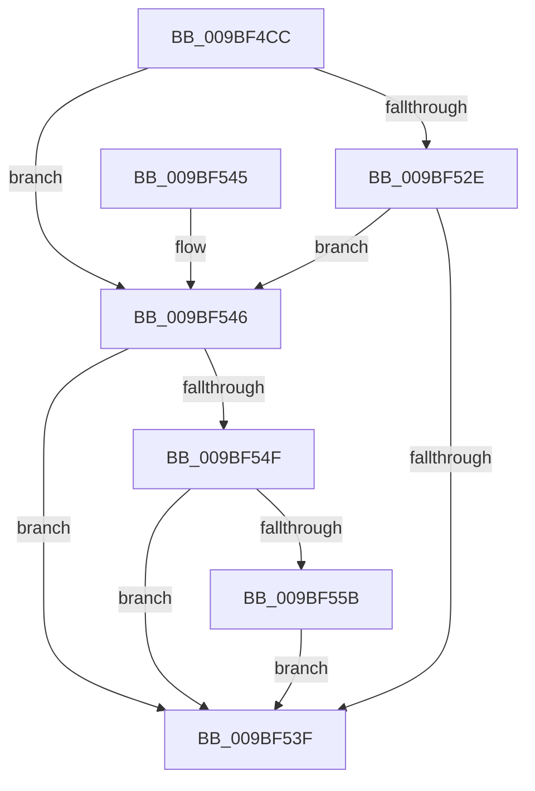

# EtwpRealtimeSendEmptyMarker

- RVA: `0x009BF4CC`–`0x009BF56A` (길이 `158` bytes)
- VA: `0x00000001409BF4CC`
- 실행 섹션: `PAGE`
- PDB 이름 있음: `예`; PDB Function 태그: `아니요`
- unwind 정보 RVA: `0x0009F404`
- 디코드: `40`개 명령, `158/158` bytes 표시
- 미해석 바이트: `0` (있으면 어셈블리에 `.byte`로 보존)

> 이 문서는 커널 이미지의 기계어와 PDB 기호를 분석해 생성했습니다. 4번과 5번은 함수 원형과 자료형을 바이너리 사용 방식에서 추정한 C 해석이며 원본 소스 복구 결과는 아닙니다.

## 1. Dependencies

- 직접 호출 지점: **5**; 고유 호출 대상: **5**
- 직접 호출자로 확인된 함수: **1**
- RIP 상대 이미지 참조: **0**

### Outgoing calls
- `0x009BF4E0` → [memset](../../text/6C/memset_function_006C6C40.md) (function, `0x006C6C40`)
- `0x009BF4ED` → [EtwpInitializeBufferHeader](../../text/3E/EtwpInitializeBufferHeader_function_003EB010.md) (function, `0x003EB010`)
- `0x009BF506` → [EtwpResetBufferHeader](../../text/3E/EtwpResetBufferHeader_function_003EB558.md) (function, `0x003EB558`)
- `0x009BF536` → [EtwpRealtimeDeliverBuffer](EtwpRealtimeDeliverBuffer_function_009BF780.md) (function, `0x009BF780`)
- `0x009BF563` → [EtwpRealtimeSaveBuffer](EtwpRealtimeSaveBuffer_function_009BFF48.md) (function, `0x009BFF48`)

### Direct callers
- [EtwpFlushActiveBuffers](EtwpFlushActiveBuffers_function_009BDEF4.md) at `0x009BE1E7`

### Static image references
- 디코드된 RIP-relative 메모리 참조가 없습니다.

## 2. Other-region calls and transfers

- 다른 실행 섹션으로 향하는 call: **3**
  - `0x009BF4E0` → [memset](../../text/6C/memset_function_006C6C40.md) (`PAGE` → `.text`)
  - `0x009BF4ED` → [EtwpInitializeBufferHeader](../../text/3E/EtwpInitializeBufferHeader_function_003EB010.md) (`PAGE` → `.text`)
  - `0x009BF506` → [EtwpResetBufferHeader](../../text/3E/EtwpResetBufferHeader_function_003EB558.md) (`PAGE` → `.text`)
- 별도 외부 분기/꼬리 이동을 확인하지 못했습니다.

## 3. Assembly (complete function range)

```asm
009BF4CC  40 53                           push rbx
009BF4CE  48 83 EC 70                     sub rsp, 0x70
009BF4D2  33 D2                           xor edx, edx
009BF4D4  48 8B D9                        mov rbx, rcx
009BF4D7  48 8D 4C 24 20                  lea rcx, [rsp + 0x20]
009BF4DC  44 8D 42 48                     lea r8d, [rdx + 0x48]
009BF4E0  E8 5B 77 D0 FF                  call 0x1406c6c40
009BF4E5  48 8D 54 24 20                  lea rdx, [rsp + 0x20]
009BF4EA  48 8B CB                        mov rcx, rbx
009BF4ED  E8 1E BB A2 FF                  call 0x1403eb010
009BF4F2  B8 FF FE 00 00                  mov eax, 0xfeff
009BF4F7  48 8D 4C 24 20                  lea rcx, [rsp + 0x20]
009BF4FC  66 21 44 24 54                  and word ptr [rsp + 0x54], ax
009BF501  BA 06 00 00 00                  mov edx, 6
009BF506  E8 4D C0 A2 FF                  call 0x1403eb558
009BF50B  83 BB 58 01 00 00 00            cmp dword ptr [rbx + 0x158], 0
009BF512  B8 01 00 00 00                  mov eax, 1
009BF517  66 89 44 24 54                  mov word ptr [rsp + 0x54], ax
009BF51C  C7 44 24 4C 03 00 00 00         mov dword ptr [rsp + 0x4c], 3
009BF524  C7 44 24 50 48 00 00 00         mov dword ptr [rsp + 0x50], 0x48
009BF52C  76 18                           jbe 0x1409bf546
009BF52E  48 8D 54 24 20                  lea rdx, [rsp + 0x20]
009BF533  48 8B CB                        mov rcx, rbx
009BF536  E8 45 02 00 00                  call 0x1409bf780
009BF53B  85 C0                           test eax, eax
009BF53D  78 07                           js 0x1409bf546
009BF53F  48 83 C4 70                     add rsp, 0x70
009BF543  5B                              pop rbx
009BF544  C3                              ret
009BF545  CC                              int3
009BF546  8B 43 0C                        mov eax, dword ptr [rbx + 0xc]
009BF549  0F BA E0 1C                     bt eax, 0x1c
009BF54D  72 F0                           jb 0x1409bf53f
009BF54F  8B 83 30 03 00 00               mov eax, dword ptr [rbx + 0x330]
009BF555  0F BA E0 1C                     bt eax, 0x1c
009BF559  72 E4                           jb 0x1409bf53f
009BF55B  48 8D 54 24 20                  lea rdx, [rsp + 0x20]
009BF560  48 8B CB                        mov rcx, rbx
009BF563  E8 E0 09 00 00                  call 0x1409bff48
009BF568  EB D5                           jmp 0x1409bf53f
```

## 4. C-style interpretation (structured pseudocode)

```c
__int64 __fastcall EtwpRealtimeSendEmptyMarker(__int64 a1, int a2)
{
    __int64 result;
    __int64 v_rsp;
    unsigned __int16 v_stack_m24;
    unsigned int v_stack_m28;
    unsigned int v_stack_m2C;
    unsigned __int64 v_stack_m58;
    unsigned __int64 v_stack_p20;

    v_rsp = (v_rsp) - (112);
    a2 = 0;
    result = memset(v_stack_m58, a2, a2 + 72, a4);
    result = EtwpInitializeBufferHeader(a1, v_stack_m58, a2 + 72, a4);
    result = EtwpResetBufferHeader(v_stack_m58, 6, a2 + 72, a4);
    v_stack_m24 = 1;
    v_stack_m2C = 3;
    v_stack_m28 = 72;
    if ((*(unsigned int *)(a1 + 344)) <= 0) goto loc_009BF546;
    result = EtwpRealtimeDeliverBuffer(a1, v_stack_m58, a2 + 72, a4);
    if (sign_flag) goto loc_009BF546;
loc_009BF53F:
    v_rsp = (v_rsp) + (112);
    return result;
loc_009BF546:
    if (condition_is_below) goto loc_009BF53F;
    if (condition_is_below) goto loc_009BF53F;
    result = EtwpRealtimeSaveBuffer(a1, v_stack_p20, a2 + 72, a4);
    goto loc_009BF53F;
}
```

## 5. (Beta) C Style

```c
int64_t EtwpRealtimeSendEmptyMarker(void *Arg1, int32_t Arg2)
{
    uint8_t *arg1 = (uint8_t *)Arg1;

    int64_t result;
    int64_t local_rsp;
    uint16_t v_stack_m24;
    uint32_t v_stack_m28;
    uint32_t v_stack_m2C;
    uint64_t v_stack_m58;
    uint64_t v_stack_p20;

    local_rsp = (local_rsp) - (112);
    Arg2 = 0;
    result = memset(v_stack_m58, Arg2, Arg2 + 72, a4);
    result = EtwpInitializeBufferHeader(Arg1, v_stack_m58, Arg2 + 72, a4);
    result = EtwpResetBufferHeader(v_stack_m58, 6, Arg2 + 72, a4);
    v_stack_m24 = 1;
    v_stack_m2C = 3;
    v_stack_m28 = 72;
    if ((*(uint32_t *)(arg1 + 0x158)) <= 0) goto loc_009BF546;
    result = EtwpRealtimeDeliverBuffer(Arg1, v_stack_m58, Arg2 + 72, a4);
    if (sign_flag) goto loc_009BF546;
loc_009BF53F:
    local_rsp = (local_rsp) + (112);
    return result;
loc_009BF546:
    if (condition_is_below) goto loc_009BF53F;
    if (condition_is_below) goto loc_009BF53F;
    result = EtwpRealtimeSaveBuffer(Arg1, v_stack_p20, Arg2 + 72, a4);
    goto loc_009BF53F;
}
```

### 관측된 메모리 오프셋

구조체 형식이 확인되지 않은 접근은 인자 기준의 오프셋으로만 기록했습니다.

| 기준 인자 | 오프셋 표현 | 폭 (bit) | 접근 |
|---|---:|---:|---|
| `Arg1` | `+ 0xC` | `32` | `R` |
| `Arg1` | `+ 0x158` | `32` | `R` |
| `Arg1` | `+ 0x330` | `32` | `R` |

## 6. Execution-region graph

[열기: 2D/3D 그래프와 함수 탐색 컨트롤 패널](../../../control-panel.html?section=page&rva=0x009BF4CC&view=graph)

- 2D 그래프는 위에서 아래로 흐르고, 3D 그래프는 빈 공간을 드래그해 회전합니다. Shift+드래그는 이동, 휠은 확대·축소, 함수 노드 선택은 대상 보고서 이동입니다.

### Static fallback


